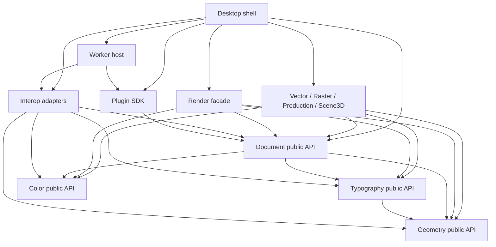

# Kiến trúc PikDraw

Trạng thái: **đề xuất**, chưa có engine thực thi. [ADR 0001](../decisions/0001-foundation.md) tách các quyết định nền tảng đã chọn cho scaffold khỏi stack ứng dụng đang chờ benchmark.

## Nguyên tắc

PikDraw là ứng dụng desktop có một mô hình tài liệu và nhiều workspace theo công việc. “Super app” ở đây nghĩa là các công cụ vector, in, thi công và 3D liên kết dữ liệu, undo và tài nguyên; mỗi workspace không sở hữu một bản sao tài liệu riêng.

Các ranh giới lõi:

| Thành phần | Trách nhiệm | Không được làm |
| --- | --- | --- |
| Foundation/contracts | ID, đơn vị, math cơ bản, lỗi, version, schema, message | Phụ thuộc UI hoặc module nghiệp vụ |
| Geometry | Bézier, topology, Boolean, offset, spatial index | Gọi UI, sửa document trực tiếp |
| Document | Nodes, pages, layers, assets, transactions, history, snapshots | Biết widget, GPU hay reader CDR/AI |
| Text/color services | Shaping, font resolution, color transform qua interface | Sở hữu selection hoặc sửa tài liệu ngầm |
| Render | Render immutable snapshot, cache, viewport, backend GPU/CPU | Sửa document hoặc phụ thuộc UI widget |
| Modules | Công cụ vector/raster/CAD/production/3D, commands và contributions | Truy cập private internals của module khác |
| Interop/workers | Parse, convert, preflight và tác vụ nặng | Ghi vào document đang mở hoặc thực thi lệnh UI |
| Desktop shell | Dock, workspace, selection, command routing, progress | Chứa thuật toán geometry hoặc logic format |
| Plugin host/SDK | Extension registry, RPC, capability, lifecycle | Cho plugin ngoài truy cập con trỏ document |

Tên thư mục và dependency có hiệu lực ở [module registry](../../registry/modules.json); bảng trên mô tả vai trò kiến trúc, không tạo thêm module trùng chức năng. Foundation/contracts hiện là vai trò schema dùng chung ở `contracts/`, chưa phải một library `core/foundation` đã triển khai.

## Hướng phụ thuộc

Mũi tên nghĩa là **A được dùng public API của B**; B không import A. IPC nối runtime khác nhau, không phải dependency C++ trực tiếp. Sơ đồ nhóm các feature để dễ đọc; bảng ngay dưới là quan hệ chi tiết có hiệu lực.

| Module | Dependency được khai báo |
| --- | --- |
| geometry, color, contracts | Không có dependency module |
| typography | geometry |
| document | geometry, color, typography |
| rendering | document, geometry, color, typography |
| vector | document, geometry, typography |
| raster | document, color |
| production | document, geometry |
| scene3d | document, geometry, color |
| interop | document, geometry, color, typography |
| plugin-sdk | document |
| workers | interop, plugin-sdk |
| desktop | document, rendering, vector, raster, production, scene3d, interop, plugin-sdk, workers |
| harness | Không phụ thuộc module ứng dụng |

Document dùng kiểu/public API của geometry, color và typography để giữ dữ liệu nhất quán; không gọi mọi phép xử lý nặng khi sửa node. Module thực hiện phép tính từ snapshot rồi gửi transaction đã kiểm tra. Các implementation text/color được inject tại composition root. Renderer nhận display-list contributions qua registry; không link trực tiếp từng module chuyên môn.

`platform/workers` là phần host/lifecycle. Executable chuyển đổi hoặc plugin ngoài process nhận schema/RPC contracts; không đồng nghĩa phải link dependency đầy đủ của host hay nhận document pointer. `packages/plugin-sdk` dùng public document DTO khi xây adapter, còn giao diện công khai với plugin ngoài vẫn là schema/RPC. Mọi thay đổi theo sơ đồ phải cập nhật registry cùng ADR nếu vượt phạm vi task.

Không tạo vòng phụ thuộc qua header tiện ích, re-export hoặc manifest thiếu khai báo. Nếu hai module cần dùng chung dữ liệu, đưa contract nhỏ xuống tầng chung hoặc dùng command/event có schema. Chuyển logic chung xuống core phải có ADR; tránh biến core thành nơi gom mọi tính năng.

## Mô hình tài liệu

Mỗi node có ID ổn định, type và schema version, transform, style, metadata nguồn và liên kết tài nguyên. Trang, layer, nhóm và instance là các cấu trúc rõ ràng. Nội dung mở rộng dùng typed payload đã đăng ký schema; core không tự suy đoán cấu trúc riêng của plugin.

- Chỉ command/transaction public mới thay đổi tài liệu. Một thao tác thành công tạo một đơn vị undo hợp lý; thao tác hủy không để lại thay đổi dở dang.
- Snapshots bất biến phục vụ render, export và worker. Kết quả bất đồng bộ ghi kèm document revision; nếu nguồn thay đổi, ứng dụng phải rebase theo quy tắc đã định hoặc yêu cầu chạy lại.
- Đường thiết kế giữ biểu diễn chính xác; tessellation và mesh preview là dữ liệu dẫn xuất. Độ phân giải preview không được làm thay đổi đường cắt gốc.
- 2D và 3D dùng quy ước trục/đơn vị có phiên bản. mm và số thực 64-bit là ứng viên nội bộ, cần benchmark và ADR trước khi đóng schema. Tỷ lệ hiển thị không được thay đổi kích thước thực.
- Kích thước thi công, hình đùn và output liên kết bằng ID/revision. Xóa nguồn tạo trạng thái cần sửa có thể thấy được, không âm thầm gắn sang node khác.
- Node/plugin chưa nhận dạng phải được bảo toàn như dữ liệu opaque và đánh dấu read-only. Không bỏ payload khi lưu tài liệu chỉ vì plugin vắng mặt.

Định dạng native đề xuất là container có manifest, document graph, assets và bảng schema versions. Cần migration có kiểm thử, lưu nguyên tử, checksum và giới hạn kích thước/nesting. Chưa chốt hậu tố hoặc định dạng binary/text trước ADR về storage.

## Plugin và worker

**Plugin bên ngoài mặc định chạy ngoài process.** Contract có version negotiation, capability declarations, cancellation, progress, timeout và resource budget. Plugin nhận snapshot/asset handle được cấp, trả command proposal hoặc artifact; host kiểm tra schema, revision, tọa độ hữu hạn và kích thước trước khi commit.

Các extension points ban đầu: command, workspace panel qua host-managed declarative UI, importer/exporter, thao tác xử lý tài liệu và preflight rule. Render/native tool contributions cần design review riêng vì tác động độ trễ và rủi ro ABI.

Không công bố ABI C++ không ổn định như API plugin. SDK công khai trước hết là schema/RPC trung lập ngôn ngữ. Nếu cần extension native, chọn C ABI có version và handle opaque qua ADR; coi code native trong process là trusted component. Không tự động cấp quyền đó cho plugin cộng đồng.

Plugin manifest khai báo ID, version, SDK range, entry point, capabilities, tài nguyên và license. Cài plugin không tự cấp mạng hoặc quyền đọc mọi file. Quyền chỉ cấp theo tác vụ/phạm vi cần thiết; offline là trạng thái vận hành bình thường.

Process isolation giúp giới hạn sự cố, **không tự tạo security sandbox**. Trước khi gọi plugin không tin cậy, cần OS containment, giới hạn filesystem/network và cơ chế broker đã được kiểm chứng; nếu chưa có thì chạy ở chế độ trusted-only và công bố giới hạn. Crash của worker phải trả lỗi tác vụ, giữ tài liệu nguồn và cho phép restart. Lỗi của UI/core vẫn cần autosave và phục hồi.

## Render và tác vụ nặng

Render facade cho phép thay backend; chọn GPU/CPU sau benchmark. Thiết kế cache theo document revision, viewport, color profile và DPI; invalidation rõ ràng. Đối tượng ngoài viewport được cull; hit-test dùng spatial index. Hình học vẫn tính theo độ chính xác tài liệu, rendering có thể lấy tọa độ tương đối camera để giảm sai số.

Nhập file, encode ảnh, Boolean lớn, preflight và export chạy nền. UI không chờ worker trong event loop. Preview khi kéo có thể giảm chất lượng có chủ ý; khi kết thúc phải đánh giá lại kết quả chính xác. Task scheduler cần quota để export/import không làm viewport mất phản hồi.

Undo có budget và chiến lược giảm tải có thể kiểm chứng; không xóa lịch sử âm thầm. Autosave có journal/snapshot phục hồi, revision và checkpoint; ghi file đích qua file tạm và replace nguyên tử khi nền tảng hỗ trợ. Không coi autosave là backup vĩnh viễn.

## Phát triển bởi nhiều agent

Provider AI là nhãn định tuyến/adapter của tooling phát triển, không phải dependency của engine PikDraw. Harness hiện là CLI và bảng task cục bộ, chưa tự gọi model hoặc truyền message qua mạng. Mỗi nhiệm vụ có owner, allowed paths, contract revision, worktree và tiêu chí kiểm tra. Agent bàn giao task/handoff có cấu trúc; hợp đồng agent-message có schema để triển khai transport sau này. Không dùng lịch sử chat dài làm nguồn chân lý.

Session mới bắt đầu tại `AGENTS.md`, đọc chỉ mục/module liên quan rồi lấy context pack của tác vụ. Context pack chỉ chứa đường dẫn, version và tóm tắt cần thiết; không chứa credentials hoặc toàn bộ kho mã. Đọc source/ADR thật trước khi sửa. Harness có validation tùy chỉnh bằng Python cho task/handoff, ownership và registry/dependency checks. Agent-message JSON Schema hiện là đặc tả; chưa có JSON Schema validator hay transport mạng. Review kỹ thuật vẫn kiểm tra chất lượng mà parser không thể chứng minh.

Một owner integration hợp nhất các worktree sau kiểm tra và review. Sửa contract chung phải công bố impact rồi cập nhật consumers liên quan trong cùng chuỗi thay đổi. Chi tiết worktree/gateway nằm ở [worktree workflow](../agents/WORKTREES.md), [giao thức agent](../agents/PROTOCOL.md) và tooling của kho mã, tránh mô tả hai quy trình khác nhau tại đây.
