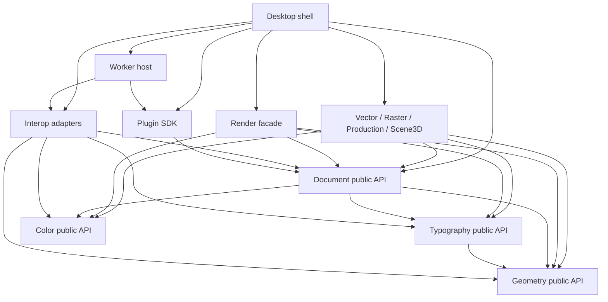

# Kiến trúc PikDraw

Trạng thái: **đặc tả, chưa có engine thực thi**. [ADR 0001](../decisions/0001-foundation.md) và [ADR 0002](../decisions/0002-runtime-and-hardware.md) chấp nhận ranh giới/ownership/resilience; stack/backend/budgets vẫn Proposed. C++20/Qt/Skia là baseline cho [ba spike](../roadmap/foundation-spikes.md), không phải năng lực đã triển khai. Runtime và precision có đặc tả chi tiết ở [document/runtime](document-runtime.md).

## Nguyên tắc

PikDraw là ứng dụng desktop có một mô hình tài liệu và nhiều workspace theo công việc. “Super app” ở đây nghĩa là các công cụ vector, in, thi công và 3D liên kết dữ liệu, undo và tài nguyên; mỗi workspace không sở hữu một bản sao tài liệu riêng.

Các ranh giới lõi:

| Thành phần | Trách nhiệm | Không được làm |
| --- | --- | --- |
| Foundation/contracts | ID, đơn vị, math cơ bản, lỗi, version, schema, message | Phụ thuộc UI hoặc module nghiệp vụ |
| Geometry | Bézier, topology, Boolean, offset, spatial index | Gọi UI, sửa document trực tiếp |
| Document | Nodes, pages, layers, assets, transactions, history, snapshots | Biết widget, GPU hay reader CDR/AI |
| Text/color services | Shaping, font resolution, color transform qua interface | Sở hữu selection hoặc sửa tài liệu ngầm |
| Render | Render immutable snapshot, cache, viewport, backend GPU/CPU | Sửa document hoặc phụ thuộc UI widget |
| Modules | Công cụ vector/raster/CAD/production/3D, commands và contributions | Truy cập private internals của module khác |
| Interop/workers | Parse, convert, preflight và tác vụ nặng | Ghi vào document đang mở hoặc thực thi lệnh UI |
| Desktop shell | Dock, workspace, selection, command routing, progress | Chứa thuật toán geometry hoặc logic format |
| Plugin host/SDK | Extension registry, RPC, capability, lifecycle | Cho plugin ngoài truy cập con trỏ document |

Tên thư mục và dependency có hiệu lực ở [module registry](../../registry/modules.json); bảng trên mô tả vai trò kiến trúc, không tạo thêm module trùng chức năng. Foundation/contracts hiện là vai trò schema dùng chung ở `contracts/`, chưa phải một library `core/foundation` đã triển khai.

## Hướng phụ thuộc

Mũi tên nghĩa là **A được dùng public API của B**; B không import A. IPC nối runtime khác nhau, không phải dependency C++ trực tiếp. Sơ đồ nhóm các feature để dễ đọc; bảng ngay dưới là quan hệ chi tiết có hiệu lực.

| Module | Dependency được khai báo |
| --- | --- |
| geometry, color, contracts | Không có dependency module |
| typography | geometry |
| document | geometry, color, typography |
| rendering | document, geometry, color, typography |
| vector | document, geometry, typography |
| raster | document, color |
| production | document, geometry |
| scene3d | document, geometry, color |
| interop | document, geometry, color, typography |
| plugin-sdk | document |
| workers | interop, plugin-sdk |
| desktop | document, rendering, vector, raster, production, scene3d, interop, plugin-sdk, workers |
| harness | Không phụ thuộc module ứng dụng |

Document dùng kiểu/public API của geometry, color và typography để giữ dữ liệu nhất quán; không gọi mọi phép xử lý nặng khi sửa node. Module thực hiện phép tính từ snapshot rồi gửi transaction đã kiểm tra. Các implementation text/color được inject tại composition root. Renderer nhận display-list contributions qua registry; không link trực tiếp từng module chuyên môn.

`platform/workers` là phần host/lifecycle. Executable chuyển đổi hoặc plugin ngoài process nhận schema/RPC contracts; không đồng nghĩa phải link dependency đầy đủ của host hay nhận document pointer. `packages/plugin-sdk` dùng public document DTO khi xây adapter, còn giao diện công khai với plugin ngoài vẫn là schema/RPC. Mọi thay đổi theo sơ đồ phải cập nhật registry cùng ADR nếu vượt phạm vi task.

Không tạo vòng phụ thuộc qua header tiện ích, re-export hoặc manifest thiếu khai báo. Nếu hai module cần dùng chung dữ liệu, đưa contract nhỏ xuống tầng chung hoặc dùng command/event có schema. Chuyển logic chung xuống core phải có ADR; tránh biến core thành nơi gom mọi tính năng.

## Mô hình tài liệu

Mỗi node có ID ổn định, type và schema version, transform, style, metadata nguồn và liên kết tài nguyên. Trang, layer, nhóm và instance là các cấu trúc rõ ràng. Nội dung mở rộng dùng typed payload đã đăng ký schema; core không tự suy đoán cấu trúc riêng của plugin.

- Chỉ command/transaction public mới thay đổi tài liệu. Một thao tác thành công tạo một đơn vị undo hợp lý; thao tác hủy không để lại thay đổi dở dang.
- Một writer logic tuần tự công bố snapshot/root/index nhất quán. Render/export/worker chỉ đọc snapshot; job/proposal có document ID/epoch, base revision, object versions và job generation. MVP dùng strict base revision: edit/undo/cancel/close hoặc job replacement làm kết quả cũ vô hiệu; không tự rebase Boolean. Revision tăng đơn điệu cả undo/redo.
- Đường thiết kế giữ biểu diễn chính xác; tessellation và mesh preview là dữ liệu dẫn xuất. Độ phân giải preview không được làm thay đổi đường cắt gốc.
- 2D/3D dùng trục/đơn vị có phiên bản. Nguồn và transform đề xuất mm/binary64; renderer trừ camera/tile origin bằng double trước cast float. Sản xuất có error budget/topology checks riêng; integer quantization không bảo đảm sai số cả pipeline. Schema/API chờ spike và consumer review; tỷ lệ preview không đổi kích thước thực.
- Kích thước thi công, hình đùn và output liên kết bằng ID/revision. Xóa nguồn tạo trạng thái cần sửa có thể thấy được, không âm thầm gắn sang node khác.
- Node/plugin chưa nhận dạng phải được bảo toàn như dữ liệu opaque và đánh dấu read-only. Không bỏ payload khi lưu tài liệu chỉ vì plugin vắng mặt.
- Text giữ Unicode/font identity/layout và liên kết outline; màu giữ RGB/CMYK/spot/ICC/overprint. Texture RGBA hoặc PDF nhìn đúng không chứng minh print separations hoặc khả năng sửa chữ.
- COW/persistent structures theo chunk và shared immutable assets là ứng viên; không clone graph mỗi frame. Camera/selection/drag preview thuộc interaction state. Đo prepare/validate/commit/invalidation và cleanup/history retention, không chỉ pointer publication.

Định dạng native đề xuất là container có manifest, document graph, assets và bảng schema versions. Cần migration có kiểm thử, lưu nguyên tử, checksum và giới hạn kích thước/nesting. Chưa chốt hậu tố hoặc định dạng binary/text trước ADR về storage.

## Plugin và worker

**Plugin bên ngoài mặc định chạy ngoài process.** Contract có version negotiation, capability declarations, cancellation, progress, timeout và resource budget. Plugin nhận snapshot/asset handle được cấp, trả command proposal hoặc artifact; host kiểm tra schema, revision, tọa độ hữu hạn và kích thước trước khi commit.

Các extension points ban đầu: command, workspace panel qua host-managed declarative UI, importer/exporter, thao tác xử lý tài liệu và preflight rule. Render/native tool contributions cần design review riêng vì tác động độ trễ và rủi ro ABI.

Không công bố ABI C++ không ổn định như API plugin. SDK công khai trước hết là schema/RPC trung lập ngôn ngữ. Nếu cần extension native, chọn C ABI có version và handle opaque qua ADR; coi code native trong process là trusted component. Không tự động cấp quyền đó cho plugin cộng đồng.

Plugin manifest khai báo ID, version, SDK range, entry point, capabilities, tài nguyên và license. Cài plugin không tự cấp mạng hoặc quyền đọc mọi file. Quyền chỉ cấp theo tác vụ/phạm vi cần thiết; offline là trạng thái vận hành bình thường.

Process isolation giúp giới hạn sự cố, **không tự tạo security sandbox**. Trước khi gọi plugin không tin cậy, cần OS containment, giới hạn filesystem/network và cơ chế broker đã được kiểm chứng; nếu chưa có thì chạy ở chế độ trusted-only và công bố giới hạn. Crash của worker phải trả lỗi tác vụ, giữ tài liệu nguồn và cho phép restart. Lỗi của UI/core vẫn cần autosave và phục hồi.

## Render và tác vụ nặng

Render facade chọn GPU/software theo capability probe, feature limits và driver/build đã kiểm chứng, không theo nhãn GPU rời/onboard. Chọn rõ implementation Ganesh/Graphite hoặc candidate khác, giữ GPU owner/lifetime theo API và Qt present prototype. CPU fallback có budget/chất lượng riêng. Recoverable device-loss có rebuild policy từ snapshot/assets; native driver crash/hang cùng process cần recovery hoặc GPU-process spike, chưa có bảo đảm switch CPU.

Spatial index cùng revision có bounds stroke/effects. Object culling không giải quyết zoom-to-fit hoặc một path nhiều segment; khảo sát chunking/LOD và tile cache. Cache key có dependency revision, viewport/scale/DPI/profile, clip/effect và backend generation; compositing order và halo filter phải đúng. Atlas resources/layer caches có memory cap, không là nguồn xuất sản xuất.

Main/UI, logical writer, render owner, compute/I/O executors và worker processes là vai trò, không số thread cố định. Nhập/encode/geometry/preflight/export chạy nền; UI không chờ trong event loop. Scheduler có count/byte/CPU quotas, ưu tiên input/render, coalesce frame/preview lỗi thời nhưng không drop commands. Tính toán cuối kiểm tra lại source revision và error budget. Qt GUI ở main thread; render/present placement chờ spike.

Undo/snapshot/assets/caches/workers có budget và lifecycle; cleanup lớn không chặn input/frame. Save/export chốt một revision và giữ assets nhất quán. Save r hoàn tất không làm sạch edits r+1. Journal/checkpoint/replace có durability policy và fault injection; atomic rename không tự chứng minh chịu mất điện. Autosave không phải backup vĩnh viễn.

Interop chốt version/feature matrix và tách visual/editable/export reports. PDF-compatible AI đọc phần PDF không bảo đảm authoring semantics; CDR import nghiên cứu với libcdr. CDR export/AI native round-trip ngoài MVP; PDF/SVG/tập DXF là output candidates có fixture. EPS/AI non-PDF/SKP cần khảo sát riêng. Plugin/worker output coi là untrusted, validate quyền/limits/revision trước atomic commit.

## Phát triển bởi nhiều agent

- **Phân công động (Dynamic Claim Model):** Provider AI (Claude, Gemini, Codex...) là nhãn nhận dạng phiên làm việc (Session Metadata), không gán cứng cố định cho từng module. Bất kỳ subagent nào cũng có thể nhận bất kỳ tác vụ nào dựa trên yêu cầu thực tế từ người điều phối (Coordinator).
- **Worktree và phạm vi:** Mỗi implementation task có checkout riêng và owned paths. Harness từ chối lease chồng lấn và committed diff ngoài scope khi handoff; chưa có OS write sandbox chặn mọi ghi file. Không lấy merge sạch làm evidence semantics đúng.
- **Contract semantics:** Shared schemas/API có task riêng và consumer review. Khóa units/axes, transform composition, fill/winding/tolerance, IDs/revisions/cancel/atomic errors và text/color bằng vectors có oracle; producer/consumer chạy cùng vectors. Shape hợp schema không đủ.
- **Tiêu chuẩn kiểm thử bằng chứng (Evidence-Based):** Mọi bàn giao task/handoff phải đi kèm bằng chứng kiểm thử thực tế (Unit tests, doctor checks), không dùng báo cáo suông. Chi tiết xem tại [ADR 0002](../decisions/0002-runtime-and-hardware.md), [worktree workflow](../agents/WORKTREES.md) và [giao thức agent](../agents/PROTOCOL.md).
- **Gate tích hợp:** Kiểm tra actual diff/dependencies/consumers trên merged revision; bảo vệ gate/oracle chung khỏi task feature. Code scanner, semantic runner và hardware performance CI là gates cần triển khai, không là tính năng harness hiện có.

Một owner integration hợp nhất các worktree sau kiểm tra và review. Sửa contract chung phải công bố impact rồi cập nhật consumers liên quan trong cùng chuỗi thay đổi. Chi tiết worktree/gateway nằm ở [worktree workflow](../agents/WORKTREES.md), [giao thức agent](../agents/PROTOCOL.md) và tooling của kho mã, tránh mô tả hai quy trình khác nhau tại đây.
