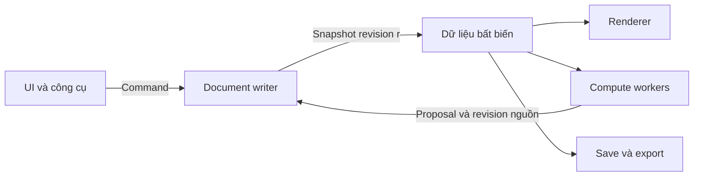

# Document, độ chính xác và runtime PikDraw

Trạng thái: **Khóa theo bộ hợp đồng Contracts C1–C7 tại M0 Foundation**. Tuân theo [ADR 0001](../decisions/0001-foundation.md), [ADR 0002](../decisions/0002-runtime-and-hardware.md), [ADR 0003](../decisions/0003-storage-durability.md), [ADR 0004](../decisions/0004-ui-development-loop.md) và các hợp đồng trong `contracts/`.

## Ba biểu diễn cùng nguồn

| Biểu diễn | Dữ liệu đề nghị | Điều kiện |
| --- | --- | --- |
| Nguồn chỉnh sửa | mm, binary64 coordinates/transforms, Bézier/arc parameters, Unicode/font, RGB/CMYK/spot/ICC | Stable IDs; không round theo UI; kiểm tra số hữu hạn/miền hỗ trợ |
| Sản xuất dẫn xuất | Curve/polygon tool data gắn source IDs/revisions, algorithm version, tolerance/parameters | Sai số vật lý, closure/winding/holes; không phụ thuộc camera |
| Preview | Float gần camera/tile, tessellation, mesh, RGBA caches | LOD/DPI/profile/backend generation; không ghi đè source hoặc dùng làm đường CNC |

Tại 20.000 mm, float32 có ULP khoảng 0,001953125 mm; khổ 20 m không tự chứng minh sai ở mức 1 mm. Nguy cơ nằm ở cancellation, đường gần suy biến, transform lặp và tọa độ xa gốc. Double cũng không bảo đảm topology; cần robust algorithms và oracle.

Renderer tính `transform_double(p) - camera_or_tile_origin_double` trước khi cast float. Path rất lớn cần chunk/clip bằng precision model trước bước cast. Không cast toàn cục rồi trừ origin. Hit-test/snap chính xác dùng model/index, không dùng pixel cache làm oracle.

Clipper2 là ứng viên polygon clipping/offset, dùng integer nội bộ. Lưới 1 µm khảo sát cần scale/overflow/range checks; không phải dung sai toàn pipeline. Budget gồm curve approximation, quantization, topology/offset và export. Mức 0,01 mm là ngưỡng khảo sát theo fixture/máy, chưa là cam kết sản phẩm. Preview/production có tolerance riêng; không tự xóa sliver/lỗ nhỏ hoặc simplify source để pass.

Importer boundary ghi precision/units đã đọc; core double không khôi phục dữ liệu parser làm tròn. Giữ đường nguồn/metadata khi chuyển dạng. Topology lỗi trả diagnostic gắn object/source, không output giả hợp lệ.

## Một writer, nhiều reader

Writer logic tuần tự là nơi duy nhất công bố root mới. Render/compute/export/save đọc snapshot; không giữ document-wide mutex trong draw loop. Writer có thể trên main nếu spike chứng minh budget prepare/validate/commit; không chốt số thread trước đo.

Snapshot có document ID, lifecycle epoch, revision, object versions, immutable root/index và asset handles. Publish có synchronization phù hợp ngôn ngữ; reader giữ lifetime root/assets. Không chia sẻ container mutable rồi chỉ khóa pointer ngoài.

Persistent tree/COW theo chunk là ứng viên: edit copy phần thay đổi, geometry/assets lớn được chia sẻ bất biến. Không clone document mỗi frame hoặc allocation riêng mọi point. Index/bounds cùng revision; prepare incremental delta hoặc replacement root ngoài critical path khi nặng.

Camera/hover/selection và drag preview thuộc interaction state. Pan/zoom không tăng document revision. Drag coalesce preview và commit với undo unit hợp lý, không full snapshot mỗi mouse event. Preview không mang nhãn kết quả sản xuất cuối.

## Kết quả bất đồng bộ và transaction

Yêu cầu job tối thiểu: document ID/epoch, base revision, read object IDs/versions, job ID/generation, parameters/units/tolerance và algorithm version. Response trả proposal/diagnostics/metadata, không mutable document pointer. Đây là yêu cầu semantic, chưa là DTO chạy được.

1. Writer chốt snapshot; worker tính riêng.
2. Validate schema/size/finite numbers/topology và prepare nặng ngoài UI critical section.
3. Writer kiểm tra document epoch còn mở, job chưa cancel/thay thế và revision hợp lệ.
4. Commit toàn bộ hoặc từ chối toàn bộ; publish root/index nhất quán và một undo record.

MVP dùng **strict base revision**: current khác base thì bỏ proposal và báo chạy lại, kể cả edit không liên quan. Read-set/object-version validation chỉ thêm khi có protocol/test consumer riêng. Không rebase Boolean bằng đoán ý người dùng.

Revision tăng đơn điệu cả undo/redo; epoch thay khi đóng/mở. IDs trùng sau undo không đủ để nhận job cũ. Cancel/source delete/job replacement vô hiệu proposal muộn. Recheck preconditions lúc commit sau prevalidation; không để check-then-apply race.

Prepare root lớn từ base snapshot có thể chạy nền; final publication ngắn khi strict revision còn khớp. Đo riêng prepare/validation/commit/render invalidation; không giấu O(n) copy/index rebuild trên main trong một command.

## Bộ nhớ và scheduler

- Snapshot leases có lifecycle/diagnostics; history/render/compute/I/O không giữ revisions vô hạn.
- Job queue giới hạn count/bytes, ưu tiên input/render; giảm compute khi software renderer cần CPU. Coalesce frame/preview, không drop document commands.
- Budget undo/checkpoint/assets/caches/workers và báo policy khi hết budget; không âm thầm mất history.
- Cleanup cây/blob lớn có thể chuyển executor; GPU handles hủy trên owner phù hợp. Tránh destructor/refcount storm trong frame.
- Cache keys gồm dependency revision/tolerance/scale/DPI/profile/backend generation; bounds gồm stroke/effect và giữ grouped compositing.
- Device-loss hủy GPU caches, giữ nguồn để rebuild software; không giả mọi image có bản CPU hợp lệ.

## Lưu và phục hồi

Save/export giữ một snapshot cố định; không serialize chunks từ nhiều revisions. Asset refs tồn tại/nhất quán suốt job. Save r hoàn tất chỉ làm sạch document nếu revision/epoch hiện tại còn tương ứng; không xóa dirty state của edits r+1.

Native container cần schema versions/manifest/checksum/limits/migration và atomic replacement trước khi khóa format. Journal/checkpoint công bố durability: thời điểm flush/commit, cửa sổ edits có thể mất và checkpoint hoàn tất. Atomic rename không tự chứng minh durability khi mất điện mọi filesystem.

Inject lỗi ở serialize/write/flush/replace/checkpoint. Mở lại nhận bản trước hoặc bản mới hợp lệ theo policy; file dở dang không mang nhãn success. Recovery mở bản riêng có provenance, không ghi đè nguồn âm thầm.

## Semantics contracts phải khóa

| Chủ đề | Nội dung và fixture |
| --- | --- |
| Units/coordinates | Đơn vị model, import/export scale, trục/handedness 2D/3D, miền hỗ trợ |
| Transform | Composition order, local/world, matrix layout, reflection/nonuniform scale |
| Paths | Fill rule, winding, open/closed, holes, degenerate/self-intersection và tolerance |
| Commands/jobs | IDs/revision/epoch/generation, cancellation, atomic error, undo |
| Text/color | Unicode/font substitution, text/outline, profile/spot/overprint và blend |
| IPC/resources | Versions, max bytes/count/depth, handles/permissions, quota/diagnostics |

Producer/consumer chạy cùng vectors: offset 1 mm không thành 1 inch; reflection không làm sai fill; undo rồi nhận job cũ phải từ chối. Oracle/negative tests được review, không chỉ validate schema.

## Ranh giới sản phẩm

Scene3D giữ extrusion/mesh dẫn xuất gắn IDs/revisions; source vẫn sửa được. Preview hộp đèn không chứng minh mô phỏng quang học. Production phân biệt closed cut/open engraving, tool/material parameters và output revision. Offset không tự chứng minh CAM/toolpath hoặc constraint solver đầy đủ.

Print output đọc màu/chữ nguồn, không dùng texture preview. Pixel diff bổ sung units/topology, Unicode/font, spot/overprint và editability checks; không thay chúng.
