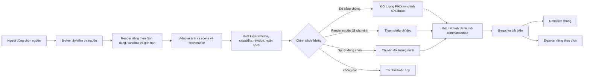

# Hướng dẫn tương thích và tái sử dụng tài nguyên vector

Trạng thái: nguyên tắc kiến trúc để lập kế hoạch và review; không bật hoặc xác nhận capability runtime.
Phạm vi: chức năng đọc/nhập, chỉnh sửa, render, chuyển đổi, export, hoặc sử dụng tài nguyên vector có nguồn cục bộ hay trên mạng.
Định dạng cần xem xét khi phù hợp: PDF, Illustrator AI, CorelDRAW CDR, EPS, SVG và DXF.

## Mục tiêu

PikDraw nên đọc nhiều định dạng nhưng dùng một mô hình tài liệu và các semantics edit/render chung. Nhờ vậy, một đối tượng đã được ánh xạ chính xác có thể chỉnh sửa và hiển thị nhất quán dù đầu vào là PDF, AI, CDR, EPS, SVG hay DXF. Định dạng nguồn vẫn cần adapter riêng vì chúng khác nhau về cấu trúc và ý nghĩa; dùng một parser/converter chung không đảm bảo tương thích.

“Đồng bộ tương thích” là đồng bộ những phần đã được chuẩn hóa: hình học, units, transforms, hierarchy, màu, opacity, clipping, thứ tự vẽ và effect graph. Adapter giữ metadata/provenance nguồn và báo phần không ánh xạ được. Không được đổi ngầm effect hoặc dữ liệu nguồn để ép mọi file về cùng một biểu diễn.

Tài liệu này bổ sung cho [C8 Import fidelity](../../contracts/c8-import-fidelity.md), [C9 Appearance/effects](../../contracts/c9-appearance-effects.md), [ADR 0006](../decisions/0006-format-import-resilience.md) và [roadmap nhập file](../roadmap/import-resilience-20261016.md). Các tài liệu/harness là đặc tả và kế hoạch; trước mỗi task cần đọc source snapshot và capability matrix hiện tại.

## Luồng dùng chung

1. **Nhận nguồn:** thao tác lấy tài nguyên từ mạng do người dùng khởi phát qua broker của host. Broker giữ URL/metadata cần thiết, xác minh kiểu nội dung theo signature, kiểm redirect, dung lượng tải/giải nén, thời gian và quyền lưu/trích dẫn. Parser, renderer và plugin không tự gọi mạng hoặc tự tải linked asset.
2. **Đọc:** chọn reader theo format/version đã được duyệt. Reader ngoài process nhận đúng handle/bytes chỉ đọc, không nhận quyền đọc toàn thư mục hoặc chạy script/macro từ file. Áp giới hạn count, depth, decompression, pixels, segments, fonts, effect scratch và thời gian.
3. **Chuẩn hóa:** adapter chuyển dữ liệu vào scene/proposal trung lập có units, transform, hierarchy, order, color/profile, object IDs tạm, assets/provenance và report. Không để type/parser dependency của PDFium, libcdr, Ghostscript hoặc thư viện SVG lọt vào `core/document`.
4. **Đánh giá fidelity:** host đối chiếu phiên bản, feature, coverage, appearance, editability, production và export độc lập theo C8. Chỉ phần có semantics và oracle đã đạt mới được tạo thành đối tượng editable. Reference-only chỉ dùng khi render nguồn đã qua kiểm chứng. Phần cần flatten/outline/rasterize phải có lựa chọn và báo loss trước commit.
5. **Áp dụng và sửa:** document writer xác thực proposal với source hash, stable IDs, epoch/revision/job generation, rồi commit thành một transaction/Undo unit. Các edit tiếp theo tác động lên cùng mô hình tài liệu, không sửa riêng bản cache của importer.
6. **Render/export:** renderer chung đọc snapshot PikDraw cho đối tượng native/editable. Reference renderer riêng chỉ dùng cho vùng reference-only và phải được đánh dấu, không tham gia đường sản xuất. Exporter mỗi format ánh xạ canonical model về khả năng thực tế của định dạng đích; import thành công không tự mở quyền export.

## Trách nhiệm theo định dạng

| Định dạng | Đặc điểm cần tính trong plan | Nguyên tắc adapter và giới hạn |
| --- | --- | --- |
| PDF | Trang, vector và raster cùng tồn tại; fonts, transparency, clipping, color spaces, separations/overprint và tài nguyên liên kết có thể ảnh hưởng hiển thị/in. | Xét theo page/object/feature. PDF render đúng chưa chứng minh có thể sửa thành vector. Ghi riêng độ chính xác geometry, layer/object structure và print/color coverage. |
| AI | Có thể có dữ liệu Illustrator authoring và/hoặc biểu diễn PDF-compatible. | Tách rõ nhánh AI authoring với nhánh đọc phần PDF-compatible; không suy ra artboards, live effects, layer semantics hay editability đầy đủ từ PDF view. |
| CDR | Cấu trúc và effect phụ thuộc phiên bản CorelDRAW; có fills/transparencies, merge modes, lenses, mesh, PowerClip và nội dung liên kết. | Pin reader/build và ma trận theo version family + feature. Parser không báo lỗi không chứng minh một effect đã được giữ hoặc round-trip. |
| EPS | PostScript có thể tạo hình/vector và raster qua chương trình mô tả trang; một số luồng cần chuyển đổi qua interpreter. | Tách “converted representation” khỏi native editable. Worker cách ly không chạy lệnh/tài nguyên tùy ý; kiểm giấy phép, độ chính xác, flattening và color trước khi bật. |
| SVG | XML tree, CSS/style inheritance, defs/use, transforms, units, clipping/masks/filters, fonts và external references. | Dùng parser XML giới hạn an toàn; catalog CSS/filter subset rõ. Tắt script/animation/external fetch; phát hiện cycle, recursion và tài nguyên vượt quota. |
| DXF | Tập trung vào CAD geometry: units, model/paper space, layers, blocks/inserts, arcs/splines, dimensions và độ chính xác. | Không đồng nhất DXF entities với appearance effects. Giữ unit/transform/layer/entity identity; polygonize hoặc đổi spline phải có tolerance và diagnostic riêng. |

Từ “blend” cần phân biệt compositing blend mode với đối tượng/thuật toán Blend tạo bước chuyển hình học. Mỗi format có thể dùng tên giống nhau nhưng meaning khác; tham khảo stable IDs trong C9 và không map theo tên hiển thị.

## Yêu cầu trong mỗi feature plan có liên quan

Plan cần thêm phần tương đương bảng dưới đây; ghi `Not applicable` kèm lý do thay vì bỏ qua định dạng mà chưa đánh giá.

| Nội dung plan | Câu hỏi phải trả lời |
| --- | --- |
| User workflow và nguồn | Người dùng mở file hay lấy asset trực tuyến? Tài liệu local hay remote? Có linked assets không? |
| Scope format | PDF, AI authoring, AI PDF-compatible, CDR version family, EPS conversion, SVG profile, DXF entity set nào trong scope? |
| Current state | Source path/capability registry nào đã xác minh trong task snapshot? Cái nào chỉ là plan, prototype hoặc reference? |
| Canonical semantics | Object types, hierarchy, units, transforms, color, text/fonts, fills/strokes, opacity/effects và painter order được biểu diễn ra sao? |
| Shared algorithm boundary | Phần normalization, document commands, renderer và validation nào dùng chung? Phần nào bắt buộc giữ adapter riêng? |
| Fidelity matrix | Per-format/version/representation/feature, kết quả appearance, editability, provenance, production và export riêng biệt là gì? |
| Loss policy | Unknown/missing feature được giữ reference, chuyển đổi tường minh hay từ chối? Diagnostic và user choice xuất hiện trước commit ở đâu? |
| Source integrity | Hash, source locator, version, adapter build, attribution/license và linked asset status nào được giữ? Có quyền lưu/đóng gói lại nguồn không? |
| Network/security | Broker, URL/redirect policy, response-size/time/decompression limits, network denial cho parser và quyền truy cập được kiểm như thế nào? |
| Acceptance evidence | Fixture ID/source app build, render oracle, structural/editability check, save/reopen và nguồn đích nào cần kiểm? |

Plan phải liệt kê các gate còn thiếu, không dùng “đã đọc được” làm tương đương “render đúng”, “sửa được”, “giữ nguyên nguồn”, “đạt sản xuất” hoặc “export ngược đúng”. Nếu feature chỉ dùng một subset, ghi rõ subset và danh sách từ chối.

## Nguyên tắc để giữ thuật toán đồng bộ

- **Một document model:** input adapters tạo proposal vào cùng document schema. Không duy trì mô hình sửa riêng cho từng format; khác biệt chưa map được giữ thành provenance/opaque data theo policy hoặc báo unsupported.
- **Một semantic implementation:** commands, undo/redo, transform, units, compositing và render của dữ liệu editable dùng implementation chung của PikDraw. Adapter chỉ giải mã và map semantics; không tự vẽ một phiên bản khác của cùng đối tượng editable.
- **Không ép qua format trung gian:** không convert mọi nguồn qua SVG/PDF nếu pipeline ấy loại bỏ semantics trước khi host có thể đánh giá. Chỉ dùng intermediate khi source feature coverage của đường đó đã được đo.
- **Chuyển đổi có nhãn:** nếu buộc rasterize/outline/approximate, report source feature, resolution/profile/tolerance và hậu quả chỉnh sửa. Bản chuyển đổi không được hiển thị như dữ liệu vector gốc.
- **Tách renderer nguồn:** dùng source application/format renderer làm oracle hoặc reference-only khi đủ điều kiện; không để reference renderer trở thành authority cho canonical editable geometry hoặc output CNC.
- **Capability theo hàng:** thêm hỗ trợ từng adapter/version/feature qua fixtures và consumer review. Không mở rộng một pass SVG, một CDR sample hoặc một AI có PDF sang định dạng/version khác.
- **Không export overclaim:** import, native save/reopen, export và mở lại trong ứng dụng đích có gates riêng. Công bố đúng các hàng đã qua kiểm thử.

## Nguồn, quyền và dữ liệu tải từ mạng

Với tài nguyên lấy từ internet, plan phải xác định ai khởi tạo request, nguồn/URL được phép, quyền lưu và dùng lại, attribution/license, source hash và thời hạn lưu. Không lưu token hoặc URL có thông tin xác thực vào document, task log hay report. Không fetch linked assets/URLs do file tự khai báo. Nguồn không rõ license có thể được xem theo quyết định người dùng nhưng không được đóng gói, phân phối hoặc dùng làm fixture công khai nếu chưa qua quyền sử dụng.

File tải về và metadata trong file là input không tin cậy. Broker/worker xử lý parse, font, image, archive và conversion với policy/network/quotas C6/C8. Source gốc giữ read-only; mọi normalized proposal được validate trước khi document writer nhận. File/URL, tên khách hàng, bytes hoặc nội dung riêng tư không được chép vào docs/Git làm bằng chứng.

## Kiểm chứng và cập nhật

Khi lập từng plan, đọc lại `modules/interop/README.md`, capability matrix trong `modules/interop/src/format_capability_matrix.cpp`, C8, C9 và task snapshot đang tích hợp. Không chép trạng thái capability cũ từ tài liệu chiến lược thành claim hiện tại.

Acceptance nên kiểm ba lớp song song: (1) pixel/color/alpha so với reference nguồn, (2) cấu trúc/editability/source provenance, và (3) lifecycle/production/export phù hợp workflow. Dùng cùng semantic vectors cho document command, renderer và adapter khi cùng feature; adapter-specific vectors bổ sung khác biệt format/version. Thêm regression cho unknown features, malformed files, stale/cancel, resource limit và no-silent-loss. Chỉ thay đổi trạng thái capability sau khi fixture, consumer review và evidence của đúng snapshot đạt.
