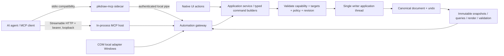

# Kế hoạch cổng AI agent qua MCP và COM

Ngày: 20/10/2026. Ưu tiên: **P0 cho khả năng tự động hóa và kiểm thử editor**.
Trạng thái: **Verified in-app HTTP, AC01 content/layout, AC02 atomic/undo, AC05 path denial, AC07 1.000-object paging, Settings revoke & Release package (20/10/2026)**.
A01–A08 có source implementation; packaged-canonical client và các resilience gates AC03–AC09 còn lại vẫn mở. Desktop host MCP Streamable HTTP trực tiếp trong tiến trình và route
semantic calls qua UI-owner queue tới document writer. Stdio sidecar vẫn là compatibility cho
client chỉ hỗ trợ stdio; COM local server dùng cùng tool definitions/schema qua named pipe.
Catalog source có 20 tools, gồm mở file native vào tab mới. NativeWindow HTTP E2E
(`test_pikdraw_in_process_mcp_e2e`) pass 1/1: discovery, scope enforcement, thiết kế 600×300 mm
đạt brief AC01 (font query/đo chữ Unicode, lề 10 mm, ba icon đều nhau, source color, stable IDs,
save/reopen, semantic edit/undo), và biển hiệu vector 5×2 m gồm 36 đối tượng xác minh qua document
data. Client tạo và sửa thiết kế trực tiếp qua MCP, không dùng screenshot, chuột hay bàn phím.
Host là NativeWindow thật trong test process; acceptance với executable desktop đóng gói vẫn mở.
Settings keyboard focus/revoke và stale-endpoint denial cũng pass. Copy URL/key UI assertions
chỉ chạy khi clipboard hiện có thể được khôi phục an toàn; test đã báo skip khi clipboard chứa định dạng
phi văn bản. Release package `build/win-dev/packages/PikDraw-0.1.0-win64.zip` có 25 entries và cả 3 executable khớp output canonical (SHA-256:
`E8D8A30DA88D684CCEA256BA9213F5B7A74859A9D6EF12A8EFE61209044A67F8`).
Không tạo branch/worktree, không commit.

### Bằng chứng triển khai hiện tại

- A01: typed inspect/query/capability và service command độc lập UI.
- A02–A04: desktop opt-in bằng Settings hoặc `--enable-mcp`/`--enable-mcp-edit`; app host
  bind bearer-protected Streamable HTTP trên `127.0.0.1` và dispatch thẳng qua UI-owner queue.
  Source xử lý modern stateless MCP `2026-07-28` (`Mcp-Method`/`Mcp-Name`) và compatibility
  handshake `2025-11-25`. `test_pikdraw_embedded_mcp_http` built and passed with stateless
  discovery/catalog/connect/create, legacy initialize/notification/session delete, invalid
  bearer, Host/Origin rejection, method/name metadata checks, token rotation, UI-owner dispatch
  and queued revoke cancellation. Sidecar stdio and COM continue to use the same-user named pipe.
  NativeWindow HTTP E2E (`test_pikdraw_in_process_mcp_e2e`) passes on the live Win32 shell,
  including create/edit/validate/save/reopen, the AC01 600×300 mm layout assertions, a 36-object
  5×2 m design verified semantically, keyboard Settings revoke and stale-endpoint denial. Copy URL/key checks remain conditional on
  safe clipboard restoration.
- Current focused command `tooling/native/build.ps1 -Test -TestTarget
  test_pikdraw_in_process_mcp_e2e,test_pikdraw_embedded_mcp_http,test_pikdraw_mcp_server,
  test_pikdraw_mcp_pipe_integration,test_pikdraw_com_dispatch -TestRegex
  '^test_pikdraw_(in_process_mcp_e2e|embedded_mcp_http|mcp_server|mcp_pipe_integration|com_dispatch)$'`
  built changed targets and passed CTest 5/5, including AC01 content/layout and edit-after-reopen.
  Follow-up `tooling/native/build.ps1 -Test -TestTarget
  test_pikdraw_automation_service,test_pikdraw_automation_rpc,test_pikdraw_com_runtime_e2e
  -TestRegex '^test_pikdraw_(automation_service|automation_rpc|com_runtime_e2e)$'` passed 3/3,
  including the live NativeWindow COM-dispatch runtime fixture. AC02 check
  `tooling/native/build.ps1 -Test -TestTarget test_pikdraw_automation_rpc -TestRegex
  '^test_pikdraw_automation_rpc$'` passed 1/1 after asserting failed-batch snapshot/dirty/history
  preservation and valid-batch undo/redo with stable IDs and monotonic revisions. The subsequent
  `./tooling/native/build.ps1 -Test -TestTarget pikdraw -BuildOnly` linked the canonical app
  successfully. A prior full configured CTest snapshot ran 86/87; its contour assertion is
  recorded below as historical evidence and must be rerun against the final source snapshot.
- AC03 stale-write subcase: `tooling/native/build.ps1 -Test -TestTarget
  test_pikdraw_in_process_mcp_e2e -TestRegex '^test_pikdraw_in_process_mcp_e2e$'` passed 1/1;
  a NativeWindow workflow edit advances the document after the agent read revision R, the stale
  MCP batch receives `REVISION_CONFLICT`, and assertions preserve the local object with no partial
  agent object. The same current-source E2E also starts an inline text draft and proves MCP batch
  and document creation return `BUSY_INTERACTION` without closing the draft or changing committed
  objects/revision. It also waits for an HTTP write to enter the UI-owner queue, closes its target
  tab, opens a replacement, then verifies `SESSION_EXPIRED` and an empty replacement document.
  Pen/effect draft coverage remains open. The queue-depth synchronizer is private to the E2E
  friend accessor and does not add a network-visible diagnostic tool.
- AC05 path-boundary subcase: the same current-source NativeWindow HTTP E2E passed 1/1 with an
  edit/file grant. Native save and open requests containing `../` traversal return `PATH_DENIED`,
  and the connected document keeps its revision and object count; broader ACL, junction, queued
  revoke and cross-user cases remain open.
- AC07 read-scale subcase: `tooling/native/build.ps1 -Test -TestTarget test_pikdraw_automation_rpc
  -TestRegex '^test_pikdraw_automation_rpc$'` passed 1/1 after creating 1,000 objects in four
  bounded batches. Ten pages return every stable ID once under one epoch/revision; a continuation
  after a committed edit returns `REVISION_CONFLICT`. Latency budgets, concurrent UI edits and
  import-job cancel/revoke/late-commit behavior remain open.
- AC09 document-safety subcases pass in the same NativeWindow E2E: MCP saves revision R, a native
  workflow edit commits R+1 and leaves the tab dirty, while `file.verify_reopen` confirms the file
  still contains only R and preserves its stable ID. `document.create`/`file.open` leave that dirty
  original tab intact; unavailable-font measurement reports fallback and warning. A true save/edit
  race during one I/O operation remains open.
- A03/A05: batch rectangle/ellipse/text có dry-run, một transaction/undo,
  revision/epoch guard và receipt/idempotency; `document.create` mở tab riêng có ID duy nhất;
  có font query/text metrics, document validation, native save và verify-reopen trong file
  grant tại `%LOCALAPPDATA%\PikDraw\automation\files`.
- A07 editing: tạo line/polyline editable, transform/duplicate/delete theo stable IDs;
  `objects.get` đọc object lồng trong group; style, group/ungroup, align và distribute chạy
  qua batch transaction; undo/redo kiểm revision và có idempotent receipt. `pikdraw.file.open`
  chỉ đọc native `.pikdraw` trong fixed grant, kiểm file handle/final path và mở thành tab
  sạch với document ID mới; tài liệu hiện tại không bị thay, agent phải reconnect trước khi sửa.
  Focused MCP catalog, pipe, COM dispatch và COM-to-pipe E2E tests pass.
- A08 UI: `Settings > AI Connections…` quản lý nháp read/edit, Apply/Cancel, status thực,
  revoke và keyboard focus; `Help > AI Automation…` mở cùng trang hướng dẫn. Hai nút Copy URL
  và Copy key có action IDs `action.settings.ai_connections.copy_endpoint` và
  `action.settings.ai_connections.copy_access_key`. EN/VI GDI shell captures và focused shell
  tests xác nhận trạng thái/action; direct NativeWindow E2E đã xác nhận keyboard focus/revoke.
  Copy URL/key assertions giữ clipboard snapshot an toàn và có thể bị skip nếu clipboard hiện có
  định dạng phi văn bản.
- A06 COM: `apps/com-server/` cung cấp ProgID `PikDraw.Automation`, per-user
  `/RegServer`/`/UnregServer`, same-user DACL, MTA local server và late-bound `IDispatch`.
-  `GetInstances`, `GetTools`, `CallTool` dùng nguyên MCP tool/schema/session; registered
  out-of-process smoke trên source mới trả 20 tools. PowerShell và client STA/MTA gọi
  `GetTools`/`CallTool` thành công; `test_pikdraw_com_runtime_e2e` hiện chạy lại 3/3 cùng
  automation service/RPC, còn COM-to-app smoke xác nhận scope create và reconnect;
  `/UnregServer` đã gỡ ProgID/CLSID keys.
- Current registration check built `pikdraw-com-server,test_pikdraw_com_client`, registered
  under HKCU, activated the independent C++ client in STA and MTA, and passed `GetTools` plus
  `CallTool`; `/UnregServer` ran in `finally` and the three ProgID/CLSID roots were confirmed absent.
- Historical live MCP smoke qua stdio sidecar và desktop binary pass protocol `2025-11-25`, catalog 20 tools,
  từ chối create/open trong session read-only, tạo batch 6 object trên trang 600×300 mm,
  validate, save/verify-reopen, mở tab mới, transform theo stable ID và verify save lần hai.
  Phát hiện ban đầu cho phép read-only session gọi `document.create`; source hiện yêu cầu
  `session_handle` mang scope `document.create`. Focused MCP/pipe/COM CTest pass 4/4, gồm
  regression ở MCP schema, desktop runtime và COM E2E.
- Historical package snapshot `build/win-dev/packages/PikDraw-0.1.0-win64.zip` đã build/verify;
- Package snapshot `build/win-dev/packages/PikDraw-0.1.0-win64.zip` đã được verify 23/23 entries
  bằng `tooling/native/package.ps1` (SHA-256: `15E2F1463EDCF5FB668C5A3BBEBC1B12BF8FBE1B2B7047019D724D51085FD5C1`).
  Cả 3 binary `pikdraw.exe`, `apps/mcp-server/pikdraw-mcp-server.exe`, `apps/com-server/pikdraw-com-server.exe`
  đều khớp 100% mã canonical build.
- `test_pikdraw_in_process_mcp_e2e` dùng NativeWindow thật và Streamable HTTP trực tiếp đã pass 1/1:
  discovery, scope enforcement, thiết kế AC01 600×300 mm với font/glyph, margin 10 mm, ba icon cân
  nhau, source color, stable IDs và edit/undo sau khi mở lại; cùng biển hiệu 5×2 m gồm 36 vector
  object. Xác minh bằng document data, không screenshot/chuột/bàn phím trong luồng thiết kế. Settings
  revoke và stale-endpoint denial pass. Clipboard copy test conditional, không khẳng định khi bị skip.
- Còn mở: chạy independent client với executable desktop đóng gói; resilience gates AC03–AC09;
  package hiện là ZIP giải nén được, chưa phải MSI hay installer cập nhật.

Kiểm tra cập nhật 17/10/2026: `./tooling/native/build.ps1 -Test -TestTarget
pikdraw,pikdraw-mcp-server,test_pikdraw_automation_service,test_pikdraw_automation_rpc,
test_pikdraw_mcp_server,test_pikdraw_mcp_pipe_integration -BuildOnly` biên dịch source,
nhưng link `pikdraw.exe` thất bại do file canonical đang được PID 42744 mở; các target còn
lại build xong. Sau đó `./tooling/native/build.ps1 -Test -TestTarget
test_pikdraw_mcp_pipe_integration -BuildOnly` hoàn tất; lệnh
`./tooling/native/build.ps1 -TestsOnly -TestRegex
'^(test_pikdraw_automation_service|test_pikdraw_automation_rpc|test_pikdraw_mcp_server|test_pikdraw_mcp_pipe_integration)$'`
đạt 4/4. `./tooling/pikdraw.ps1 doctor` đạt `ok=true`, 17 modules ở lượt MCP ban đầu;
`git diff --check` trên owned paths không báo lỗi whitespace. MCP stdio discovery/tools
schema và luồng client → sidecar → app → writer → save/reopen đã smoke-test trong lượt
trước. Sau patch ID duy nhất, pipe integration cùng 3 test automation chạy lại 4/4;
`./tooling/native/build.ps1 -Test -TestTarget test_pikdraw_desktop_shell -BuildOnly` và
`./tooling/native/build.ps1 -TestsOnly -TestRegex '^test_pikdraw_desktop_shell$'` hoàn tất,
shell CTest 1/1. EN/VI GDI Settings captures được xem rồi xóa khỏi Temp. Doctor ở lượt đó
`ok=true`, 17 modules. Direct app E2E và OS interaction cần chạy lại sau khi canonical
executable không còn bị khóa.

A06 verification: `./tooling/native/build.ps1 -Test -TestTarget
pikdraw-com-server,test_pikdraw_com_dispatch,test_pikdraw_com_client -BuildOnly` passed;
`./tooling/native/build.ps1 -TestsOnly -TestRegex
'^(test_pikdraw_com_dispatch|test_pikdraw_mcp_server|test_pikdraw_mcp_pipe_integration|test_pikdraw_automation_service|test_pikdraw_automation_rpc|test_pikdraw_desktop_shell)$'`
passed 6/6. Per-user activation smoke registered then removed `PikDraw.Automation` in
HKCU; independent C++ client passed both STA and MTA `CoCreateInstance`, `GetTools` and
`CallTool`; PowerShell `New-Object -ComObject` historically discovered 16 tools. On the
current build, a fresh per-user registration returned 19 tools including object lookup and
guarded history operations; the independent `test_pikdraw_com_client` passed in STA and MTA,
and a PowerShell client confirmed 19 tools. Each smoke removed ProgID/CLSID keys; the server exited after the client
released its object. `./tooling/pikdraw.ps1 doctor` reports 18 modules, no issues. Full COM
revoke/registered-server parity, installer/package and canonical desktop app interaction
remain open. New `test_pikdraw_com_runtime_e2e` passes through in-process late-bound IDispatch,
MCP tool routing, real per-user named pipe and native UI-owner writer for 600×300 mm document
creation, rectangle/ellipse/Unicode text batch validation/apply, idempotent retry and receipt,
object query, document validation and native save/verify-reopen. `./tooling/native/build.ps1
-TestsOnly -TestRegex '^(test_pikdraw_com_runtime_e2e|test_pikdraw_com_dispatch|test_pikdraw_mcp_server|test_pikdraw_mcp_pipe_integration|test_pikdraw_automation_service|test_pikdraw_automation_rpc|test_pikdraw_desktop_shell)$'`
passed 7/7; `tests/architecture/verify_contracts.py` passed 7/7 contracts and all fixtures/oracles.
This fixture does not activate the registered out-of-process COM server or launch the canonical
PikDraw executable.

`file.open` follow-up, 17/10/2026: MCP/COM dispatch source now advertises 20 tools. The
focused source build for `pikdraw`, `pikdraw-mcp-server` and MCP/pipe/COM tests completed with
warnings-as-errors on (`ninja: no work to do`); after fixing the test's read-only scope, the
exact CTest filter `^(test_pikdraw_mcp_server|test_pikdraw_mcp_pipe_integration|test_pikdraw_com_dispatch|test_pikdraw_com_runtime_e2e)$`
passed 4/4. The COM-to-desktop fixture verified denial without `file.read`, then opened the
saved 600×300 mm design into a third clean tab, returned a new document identity, reconnected,
queried all three objects and retained the original document session. Rebuilding
`pikdraw-com-server` and its standalone client was attempted on that earlier source snapshot,
but stopped at an unrelated missing vector header; that historical attempt does not establish
current COM status. The later A06 verification below passed registered out-of-process 20-tool
activation and STA/MTA calls. Canonical desktop app interaction remains a separate gate.

## 1. Kết quả cần đạt

Agent kết nối trực tiếp đúng phiên PikDraw, khám phá chức năng thật, đọc cây tài liệu,
tạo/sửa thiết kế theo mm và ID, kiểm kết quả rồi lưu bản chỉnh sửa được. Luồng chính
không cần screenshot, tọa độ màn hình, chuột hoặc phím giả lập. Người dùng nhìn thấy
cùng tài liệu khi writer commit; agent không sửa một model phụ tách khỏi editor.

“Thiết kế hoàn chỉnh” được nghiệm thu theo brief cụ thể: kích thước/trang, đối tượng,
text/font, màu, bố cục, constraints, kiểm tra lỗi và file giao có thể mở lại/chỉnh sửa.
Không đồng nghĩa thiết kế đẹp tự động, mọi công cụ đã hỗ trợ hay file CNC đạt sản xuất.
Agent chịu trách nhiệm suy luận brief; PikDraw cung cấp operations xác định và bằng chứng.

## 2. Nền hiện tại đã khảo sát

Snapshot là working source dirty tại HEAD `11512046d23fac08059ecd37382179283b4530a0`;
HEAD một mình không đại diện local edits. Task handoff sẽ giữ hash của tài liệu mới.

| Thành phần | Bằng chứng source | Hệ quả |
| --- | --- | --- |
| Desktop C++20/Win32/GDI | `docs/project-state.json`, `apps/desktop` | Xây trên runtime này; Qt/Skia là blueprint |
| Automation service A01/A03/A05 | `modules/automation/`, `apps/desktop/src/automation/` | Service đã compose vào desktop UI-owner thread; inspect/query, scopes, revision guards, receipts, rectangle/ellipse/text batch và validation có handler/tests |
| Command writer/snapshots | `core/document/include/pikdraw/document/commands/transaction_writer.hpp`, C2 | MCP/COM calls marshal qua desktop pipe tới UI owner và dùng cùng command writer; chưa có full external undo/redo API |
| Rectangle/ellipse/text/transform/group/align/style/native IO/render | `apps/desktop/include/pikdraw/desktop/workflows/document_workflow.hpp`, implementation và tests tương ứng | Tái dùng semantics sau audit; declaration không đủ để quảng bá tool |
| Stable action IDs | `apps/desktop/include/pikdraw/desktop/actions/action_id.hpp` | Catalog menu có mục chưa có capability; không expose toàn bộ tự động |
| Import/export matrix | `modules/interop/src/format_capability_matrix.cpp` | SVG static subset, DXF import subset; xem mục 8 |
| Worker IPC/lifecycle | `platform/workers/src/process_launcher.cpp` và C6 | Có pipe parser; automation phải có endpoint/policy riêng |
| MCP/COM automation | `apps/mcp-server/`, `apps/com-server/`, `apps/desktop/src/automation/` | In-process Streamable HTTP and dual-era source plus focused transport tests are implemented; canonical app linked on a prior transport snapshot, latest direct create/save/reopen E2E remains unverified. Stdio sidecar and per-user COM compatibility smoke passed on earlier source snapshots |

Registry có nhiều module vẫn mang nhãn planned; không lấy nhãn đó làm chứng cứ runtime.
Các workflow `*_selected` cần refactor có target IDs và command builder trước khi public.
Page/layer quản lý đầy đủ, generic Boolean, node editing, advanced text/raster/production
phải có gate riêng; tên hàm hoặc menu không mở toàn bộ semantics.

## 3. Kiến trúc đề xuất

MCP và COM là hai adapter dùng cùng API; **COM không là điều kiện bắt buộc cho MCP**.
“Cổng” ở đây là endpoint phần mềm. Cổng COM serial/RS-232 không áp dụng.
Chi tiết normative đề xuất ở [C10](../../contracts/c10-agent-automation.md);
lý do gateway ban đầu ở [ADR 0010](../decisions/0010-agent-automation-gateway.md) và quyết định
host MCP HTTP trực tiếp ở [ADR 0011](../decisions/0011-in-process-mcp-http.md).

Lớp service tái dùng core/module theo `registry/modules.json`; core không phụ thuộc desktop.
Vị trí dự kiến: DTO tại `packages/automation-api/`, service `modules/automation/`,
pipe/COM `platform/automation/`, sidecar `apps/mcp-server/`, composition trong desktop.
Đây là paths dự kiến cần chốt graph/registry ở A01; chưa tạo module rỗng trong task plan.
UI và service cùng command builder, không nhân đôi geometry engine hoặc validation.

## 4. Bộ công cụ semantic

Tên bên dưới là **đề xuất**, chỉ đưa vào `tools/list` khi handler + schema + gates đạt.
Các biến thể operation nằm trong union schema có version; tránh một tool execute nhận
arbitrary JSON/script/action ID hoặc hàng nghìn tools cấp thấp khó dùng.

| Nhóm tools | Input/kết quả chính | Đợt |
| --- | --- | --- |
| `pikdraw.instances`, `pikdraw.connect`, `pikdraw.capabilities` | Instance/phiên app, scopes, build/API versions, feature/format coverage và limits | MVP |
| `pikdraw.document.inspect`, `pikdraw.objects.query`, `pikdraw.objects.get` | Snapshot/revision, pages/layers, IDs, geometry/text/style/effects/bounds/provenance | MVP |
| `pikdraw.fonts.query`, `pikdraw.text.measure` | Font identity/glyph coverage và layout metrics theo text/style có version; không ghi document | MVP cho brief có text |
| `pikdraw.document.create` | Trang mm, tài liệu automation riêng; không xóa tài liệu dirty | MVP |
| `pikdraw.batch.validate`, `pikdraw.batch.apply` | Typed operations, client refs, atomic transaction, receipt/ID mapping | MVP |
| `pikdraw.history.undo`, `pikdraw.history.redo`, `pikdraw.request.get` | History guard và receipt cho retry/timeout | MVP |
| `pikdraw.file.save`, `pikdraw.file.open` | File grant/handle, native revision/hash, reopen diagnostics | MVP |
| `pikdraw.document.validate` | Bounds/structure/text/font/constraints qua checker có version | MVP theo checker có thật |
| `pikdraw.job.get`, `pikdraw.job.cancel` | Generation, progress, diagnostics, committed/cancelled | Trước import/effect job dài |
| `pikdraw.file.import`, `pikdraw.file.export` | Format/version/representation, loss policy, provenance/report | Sau gate C6/C8/C9 |
| `pikdraw.render.inspect` | Render snapshot và diagnostics có budget, oracle buffer tùy chọn | Đợt 2 |

Operation MVP: rectangle/ellipse/path line-polyline đã xác minh, Unicode text, move/scale/
rotate với pivot tường minh, fill/stroke/width, duplicate/delete, group, align/distribute.
Mỗi op mở riêng sau test; chưa đạt thì capability trả unsupported có lý do.
Text tạo từ schema đầy đủ, giữ Unicode/font và báo fallback; không chỉ API “Vietnamese text”.
Path có node/segment IDs, closed/fill rule, unit và curve type; không giả path bằng bitmap.
Style nâng cao mở đúng subset C9: scope object/fill/stroke, blend/effect types/params/order.
Không quảng bá opacity group như opacity từng object hoặc Boolean rectangle như generic Bézier.

Capability trả feature ID/version, input/output schema, required scopes, enabled/reason,
supported object types/constraints, limits, edit/render/export/production riêng và evidence build.
Session read-only không thấy hoặc không gọi được write; host vẫn kiểm quyền khi call.

## 5. Luồng tạo một thiết kế hoàn chỉnh

Brief nghiệm thu: bảng hiệu 600 × 300 mm, lề an toàn 10 mm, nền vector, tiêu đề
`CỬA HÀNG ÁNH DƯƠNG`, dòng phụ và ba biểu tượng hình học cân đều. Font fixture có quyền
sử dụng và có đủ glyph tiếng Việt. Nội dung bắt đầu là artwork text, không là UI label.

1. Agent chọn instance, connect, đọc quyền và capability; thiếu op/font thì báo cụ thể.
2. Tạo tài liệu automation 600 × 300 mm, đọc page/layer IDs và revision.
3. Query font identity và text metrics qua capability text; nếu chưa có checker/metrics
   thì gate thiết kế text chưa đạt, không đoán kích thước chữ bằng số ký tự.
4. Tạo batch nền, text, biểu tượng và layout bằng mm + client refs; dry run kiểm targets,
   bounds/lề/font/limits rồi apply một Undo unit. Không có active selection làm đầu vào.
5. Đọc snapshot mới; kiểm nội dung Unicode, kích thước, khoảng cách, thứ tự vẽ, safe area,
   missing glyph/overflow. Sửa theo actual report và expected revision mới khi cần.
6. Lưu `.pikdraw` đúng grant; mở lại vào tài liệu thử riêng, kiểm structure/units/source
   color/text/effects/IDs theo native contract. Sửa tiếp một đối tượng để chứng minh editable.
7. Export chỉ khi format và feature của chính thiết kế đạt. SVG có effects/blend chưa
   hỗ trợ thì trả report/refuse hoặc conversion được chọn rõ; native delivery vẫn độc lập.

Agent bàn giao file, receipt, manifest đối tượng và report pass/fail/not_assessed theo brief.
Không đòi screenshot. Kiểm thẩm mỹ hoặc thiết bị thật vẫn là gate riêng nếu brief yêu cầu.

## 6. Tính đúng, quyền và hiệu năng

[C10](../../contracts/c10-agent-automation.md) định nghĩa strict revision, atomicity,
dedup/retry, jobs, IO và scopes. Bản đầu dùng một batch hữu hạn, không giữ writer lock
qua round trip. UI edit đồng thời làm agent nhận conflict và đọc lại; không tự merge.
Query dùng snapshot phân trang, tránh dump hàng trăm nghìn nodes vào context model.

Profile spike đề xuất, chưa phải thông số product: 1 MiB JSON/call, 256 ops/batch,
100 objects/page query, 8 candidates/jobs tối đa mỗi instance; import asset truyền handle,
không nhét base64 vào JSON. Tổng segment/text/assets/effect scratch phải có ngân sách riêng,
đếm trước allocation; giới hạn message không thay thế peak memory. Chốt số sau đo corpus.

Đo baseline và automation trên cùng máy/build: p50/p95 query, prepare/queue/commit time,
working set, cancellation latency, UI input latency trong lúc job chạy. Mục tiêu spike
p95 query metadata ≤100 ms cho fixture 1.000 objects và gateway overhead ≤20 ms/batch
(không gồm geometry/render) là giả thuyết cần đo. Không hạ geometry precision để đạt.
Queue có admission/fairness, UI không bị một client chiếm độc quyền bằng batch liên tục.

MCP client hiện đại dùng Streamable HTTP trực tiếp trong app; client chỉ có stdio vẫn dùng
sidecar. HTTP luôn bind `127.0.0.1` trên cổng ngẫu nhiên, cần bearer key sinh theo phiên, kiểm
Host/Origin, body/header bounds và revoke cancellation; không có cờ mở LAN. COM vẫn local-server,
không bật DCOM. Test protocol in-process qua dispatcher đã pass 3/3 ở snapshot transport. Trên
snapshot mới nhất, NativeWindow HTTP E2E đi qua discovery/catalog, scope, create/edit/validate/
save/reopen và thao tác revoke; assertion kiểm request sau revoke chưa qua vì test helper nay trả
mã âm cho lỗi kết nối nhưng assertion cũ chỉ nhận `0` hoặc `401`. Assertion đã được sửa để in
status/body, nhưng build kế tiếp bị chặn bởi `-Werror` ở `core/geometry/src/dimensions/
dimension_geometry.cpp` (`arrow_size_mm` unused) thuộc lease đang hoạt động
`plan-04-technical-dimensions`. Copy UI check skip vì clipboard có non-text formats. Task
`plan-03-advanced-osnap` đã bàn giao/release lease và source `snap_index.cpp` compile sạch. CTest
86/87 (contour assertion) cùng canonical app link là evidence lịch sử; full CTest, stale-endpoint
denial, copy UI, canonical app/package vẫn cần kiểm tra trên source cuối.

## 7. Phiếu UI đã triển khai

Tuân [chuẩn UX/UI](../design/ui-ux-standard.md) và
[workspace layout](../architecture/workspace-layout.md). Phiếu đầy đủ theo trạng thái
as-built: [AI Connections Settings](../design/features/ai-connections-settings-20261017.md).

| Nội dung | Quyết định đã triển khai / trạng thái |
| --- | --- |
| Menu chính | `Settings > AI Connections…`, `action.settings.ai_connections` mở cấu hình |
| Help | `Help > AI Automation`, `action.help.ai_automation` mở hướng dẫn |
| Toolbar/toolbox | Không áp dụng: đây là quản lý kết nối, không là canvas tool |
| Context property bar | Không áp dụng: không sửa thuộc tính selection |
| Properties | Không áp dụng với thiết lập app; thông số artwork vẫn ở Properties hiện hữu |
| Bề mặt cấu hình | Dùng hệ Settings dialog hiện có, không thêm dock/bar mặc định đè canvas |
| Fields | `MCP access` và `Allow document editing and native files`, mặc định off; trạng thái endpoint, URL loopback và access key chỉ đọc; có Copy URL/Copy key khi listener active; file scope giới hạn automation/files |
| Scope/trạng thái | App permission theo phiên; Off, Listening · Read only, Listening · Editing hoặc Starting/Error; URL/key rotate khi restart; đổi không dirty document |
| Actions | Checkbox nháp, Reset, Cancel, Apply; `action.settings.ai_connections.copy_endpoint` và `action.settings.ai_connections.copy_access_key` sao chép URL/key active; tắt cả quyền rồi Apply revoke listener/manifest và request chờ |
| Icon SVG | Không áp dụng: menu actions dùng nhãn chữ, không thêm icon một lần dùng |
| Label | `AI Connections` / `Kết nối AI`; English mặc định, Vietnamese qua catalog, API IDs không dịch |
| Tooltip/focus help | “Manage agent access to documents and files.”; hỗ trợ keyboard/focus/accessibility |
| Status hint | “MCP off”, “MCP listening · Read only”, “MCP listening · Editing” hoặc lỗi khởi động; listener không khẳng định client đã kết nối |
| Usage help | Bật quyền trong Settings → cấu hình Streamable HTTP bằng URL và bearer key đang hiển thị → chạy brief → query/validate/save → thu hồi. Sidecar stdio chỉ dùng cho client legacy |

UI hiện không cấu hình client, instance, expiry, grant thư mục tùy ý hay danh sách session;
phần đó chưa áp dụng. Quyền sửa bao gồm tạo/sửa và file native trong thư mục grant cố định.
Không hỏi lại từng thao tác hình học. Listener revoke hủy request chờ; request đang chạy trên
UI thread hoàn tất trước khi xử lý click Apply.

## 8. Định dạng và tài nguyên vector

Đã đối chiếu [hướng dẫn interoperability](../architecture/vector-resource-interoperability.md),
C8/C9 và capability matrix source ở mục 2. Bảng là trạng thái code khảo sát, **chưa chạy
format acceptance trong task docs này**. MCP không nâng mức hỗ trợ của adapter.

| Format/version/representation/features | View/render | Editability | Metadata nguồn | Export/round-trip | Production |
| --- | --- | --- | --- | --- | --- |
| Native reader v2/v3, writer v4 theo project-state | Renderer hiện hữu, coverage riêng | Model native theo type | Giữ theo C5, cần test reopen | Native save/reopen; chưa đo trong task này | Chưa nghiệm thu vật lý |
| SVG static 1.0/1.1 subset; path/text và paint theo adapter | Prototype trên normalized model, không claim SVG toàn phần | Chỉ subset được map | C8 provenance đầy đủ còn là đề xuất | Prototype SVG output; opacity export có nhưng import chưa nhận opacity, effects/non-Normal blend bị từ chối; không hứa round-trip | Chưa assessed theo profile |
| ASCII DXF `dxf-entities-v1`, 2D units/entity subset | Prototype sau normalize | Chỉ entities có mapping | Entity/unit/provenance cần kiểm riêng | Không DXF export | Chưa assessed theo profile |
| PDF, version/page/features chưa pin | Unsupported | Unsupported | Không có adapter | Không có PDF source/export guarantee | Blocked |
| AI PDF-compatible và AI authoring, version chưa pin | Hai representation đều chưa có adapter | Unsupported | Không suy layer/live effects từ PDF | Không AI round-trip | Blocked |
| CDR version family chưa pin | Unsupported | Unsupported | Chưa map effect/PowerClip/lens | Không CDR round-trip | Blocked |
| EPS/PostScript representation chưa pin | Unsupported | Unsupported | Conversion/provenance chưa triển khai | Không EPS round-trip | Blocked |

SVG, DXF adapter riêng theo profile; PDF/AI/CDR/EPS khi làm phải pin reader/version và
representation riêng. Reader → bounded neutral scene/provenance → host validation →
fidelity decision → canonical commands → renderer/edit semantics chung. Không ép mọi nguồn
qua SVG/PDF làm mất nghĩa. Metadata nguồn không được coi là instruction cho agent.

Luồng MVP chỉ nhận native creation/local file đã cấp quyền; tải tài nguyên mạng chưa áp dụng.
Khi thêm network asset, tạo task broker URL/redirect/size/license/hash, không cho parser fetch
linked assets/script. Các trục appearance, editability, provenance, export và production
luôn báo độc lập; missing/unknown không trở thành verified vì tool gọi thành công.

## 9. Các gói triển khai và gate

Bảng giữ dependency và acceptance gate của từng gói. A01–A08 hiện có source implementation;
focused tests cho A07 editing, file.open, COM catalog và transport regressions pass. Registered COM smoke xác nhận
20-tool catalog, read-only denial, scoped document create/reconnect, STA/MTA discovery/call
và cleanup trên snapshot đã kiểm. Current-source NativeWindow HTTP E2E and Release package both
pass, but the test host is not the packaged canonical desktop process. Full brief/layout/production
acceptance AC01–AC09, package installation, and canonical executable live-client acceptance remain
open. A09 interop/jobs nâng cao chưa được triển khai;
các trạng thái không suy ra từ nhãn module registry.

| Gói | Phạm vi dự kiến | Phụ thuộc | Gate bàn giao |
| --- | --- | --- | --- |
| A01 Audit + service | `modules/automation/`, registry; command consumers | C10/ADR | Focused service tests pass; canonical app interaction and undo/history acceptance remain open |
| A02 Query/capabilities | Service + desktop composition | A01 | MCP exposes implemented snapshot/query/font/text metrics; complete fidelity and query scale gates remain open |
| A03 Batch/receipts | Service, document command integration, desktop workflow targets | A01 | Atomic create batch, stale rejection and receipts have focused tests; full crash/concurrency matrix remains open |
| A04 In-app MCP + compatibility transports | `apps/desktop/src/automation/`, `apps/mcp-server/` | A02+A03 | Focused HTTP test passes modern stateless/legacy protocol, auth/routing/revoke queue and UI-thread dispatch; current NativeWindow E2E passes authoring/save/reopen, Settings keyboard revoke and stale-endpoint denial. Copy checks are conditional on safe clipboard restoration; packaged canonical-process client acceptance remains open |
| A05 Brief + IO + validation | Automation service, typography metrics, native IO consumer tests | A04 | Current direct HTTP E2E checks the AC01 600×300 mm font, Vietnamese glyphs, 10 mm margin, icon spacing, source color, stable IDs and edit/undo after reopen; it also creates and validates a 36-object 5×2 m billboard. Canonical packaged-process client acceptance remains open |
| A06 COM adapter | `apps/com-server/`, per-user registry, independent COM client | A04+A05 | Focused COM dispatch, live NativeWindow IDispatch, and registered 20-tool/STA-MTA smoke evidence pass; package install and Settings revoke parity remain open |
| A07 Design editing operations | Automation service/MCP/COM: line/polyline, stable-ID edits, style, group/ungroup, align/distribute, object.get, undo/redo | A03+A05 | Focused service/RPC/MCP/COM/pipe tests pass; canonical live-app authoring acceptance remains open |
| A08 UI/release | Settings/locales/icons/docs, project-state tuần tự | A05; A06 nếu công bố COM | Settings revoke and a 25-entry Release ZIP are verified; client-config and installed canonical-binary acceptance remain open |
| A09 Interop/jobs nâng cao | interop/workers, style/effects và per-format fixture gates | A04+A05 | C6/C8/C9, cancel/stale/limits, fidelity/export cụ thể |

MVP agent = A01–A08, gồm phần cấu hình/quyền/đóng gói. Release công bố cả MCP+COM
phải đạt A06. A09 mở từng capability; CNC/raster/3D không được gọi available khi chưa đạt.
Claim paths thực trước mỗi gói; shared CMake/registry/workflow/project-state tuần tự theo
[protocol](../agents/PROTOCOL.md). Không giao paths chồng lấn hoặc mặc định mở subagents.

Stop conditions: write ngoài writer; batch partial commit; retry nhân đôi; conflict bị bỏ qua;
COM bypass quyền; tool trả pass khi checker thiếu; source color/text/IDs mất sau reopen;
khả năng format vượt matrix; UI draft bị tự hủy; không xác minh đúng instance. Gặp một
điều kiện thì chưa phát hành write capability, giữ read-only để điều tra.

## 10. Nghiệm thu theo luồng thật

Các ca dưới đây là end-to-end acceptance gates; focused tests cover only the sub-behaviors named
in the evidence above. The full cases remain open and use [cấu trúc nghiệm thu](../quality/feature-acceptance.md).
Đặt regression trong suite consumer/module sở hữu; không tạo bộ test một lần để đủ quota.

| ID | Given | When | Then | Verify dự kiến |
| --- | --- | --- | --- | --- |
| AC01 Thiết kế | App chuẩn có Segoe UI, brief mục 5, grant phù hợp | Client MCP tạo/query/validate/save/reopen | Đúng 600×300 mm, text Unicode, lề/khoảng cách, nguồn màu, editable; không UI automation | NativeWindow E2E verifies font query/measure, zero missing glyphs, 10 mm margin, three evenly spaced icons, source color, stable IDs and edit/undo after native reopen. Independent client against packaged canonical executable remains open |
| AC02 Atomic/undo | Document có nội dung, revision R | Batch có op cuối invalid; sau đó batch đúng và undo/redo | Batch lỗi giữ root/history/dirty; batch đúng một Undo unit; undo/redo giữ IDs và revision tăng | `test_pikdraw_automation_rpc` verifies snapshot pointer, dirty state, Undo history, atomic mixed batch, restored/deleted IDs and revision increments; 1/1 pass |
| AC03 Concurrent | Agent đọc R; user sửa hoặc đang nhập Pen/effect draft | Agent apply R; tiếp theo close/reopen rồi job cũ trả | Conflict/busy/epoch reject; giữ edit/draft, không tự rebase | NativeWindow E2E verifies stale-revision conflict, active inline-text draft protection, and a queued HTTP write rejected with `SESSION_EXPIRED` after close/reopen; replacement stays empty. Pen/effect drafts remain open |
| AC04 Retry/crash | Request commit nhưng mất response | Retry cùng key; đổi payload cùng key; restart và gửi epoch cũ | Không duplicate; conflict key; instance/epoch cũ bị từ chối | Fault injection bridge + query object count/history/IDs |
| AC05 Quyền | Hai user/session hoặc read-only, grant thư mục hẹp | Ghi/undo/save ngoài grant, path traversal/junction hoặc revoke lúc queued | Denied, không partial effect; read vẫn đúng scope | NativeWindow HTTP E2E denies read-only writes and traversal save/open, preserving document revision/count. ACL/peer, junction and queued-revoke matrix remains open |
| AC06 Capability/fidelity | SVG có opacity/effect, DXF subset, PDF/AI/CDR/EPS | Agent yêu cầu unsupported import/export/checker | Typed unsupported/loss report; không fake vector, không pass production | Adapter-specific fixtures + host capability tests |
| AC07 Scale/job | Fixture 1.000 objects, query paging; import job đang prepare | Query nhiều trang, UI edit, cancel/revoke/sidecar exit | Snapshot nhất quán hoặc expired; không late commit; budgets/latency có số đo | RPC test covers 1,000 objects, ten pages, stable IDs and stale-continuation rejection; performance budgets and async job fault/cancel gates remain open |
| AC08 COM parity | Client COM độc lập, quyền như MCP | Query/apply/get receipt ở STA/MTA, callback/revoke | Kết quả semantic/permission giống MCP, không deadlock/reentrant commit | Current registered independent STA/MTA client passes GetTools/CallTool and registry cleanup; NativeWindow COM runtime fixture covers the shared 20-tool catalog and document create/edit/save. Registered apply/receipt parity, Settings revoke and package install remain open |
| AC09 Không phá tài liệu | User có document dirty và font thiếu | Agent create/open, text fallback, save R rồi user sửa thành R+1 | NativeWindow E2E preserves the dirty original across create/open, confirms explicit missing-font warning, and verifies saved R stays on disk while R+1 remains dirty. Simultaneous save/edit race and broader decision UI remain open |

Khi triển khai, đăng ký targets rồi dùng `./tooling/native/build.ps1 -Test -TestRegex
'<targets đã đăng ký>'`; không coi placeholder là lệnh đã chạy. Bản cuối phải thử client
thực với `build/win-dev/apps/desktop/pikdraw.exe` và sidecar packaged tương ứng. Unit pass
không thay live transport/auth/installer/performance hoặc máy sản xuất thật.

## 11. Bàn giao và trạng thái

Task kế hoạch ban đầu chỉ tạo roadmap, C10 và ADR; A01–A06/A08 đã thêm runtime và registry
implementation theo task scopes. `docs/project-state.json` đã cập nhật phần automation runtime,
capability giới hạn, evidence và gate còn mở. Giữ release acceptance mở cho tới khi canonical
app/client gates chạy trên executable chuẩn và các AC cấp tính năng có evidence.

Kiểm gồm Windows dispatch test, client activation smoke với per-user registration tạm thời,
remove/cleanup, COM dispatch integration through the desktop pipe, doctor và scoped diff
check. Canonical app/client E2E và installer/package acceptance vẫn là gate riêng, không suy
ra từ fixture hoặc unit test.

## 12. Tham chiếu giao thức đã tra cứu

MCP chuẩn có stdio và Streamable HTTP; lựa chọn sidecar/pipe/API là thiết kế PikDraw.
Revision `2026-07-28` chuyển sang metadata theo request và state handles tường minh;
phải kiểm SDK/client compatibility thay vì sao chép handshake đời trước.
Nguồn: [MCP transports](https://modelcontextprotocol.io/specification/2026-07-28/basic/transports),
[MCP tools](https://modelcontextprotocol.io/specification/2026-07-28/server/tools),
[MCP revision](https://blog.modelcontextprotocol.io/posts/2026-07-28/).
COM có apartment/threading và out-of-process calls; policy writer/queue/parity ở đây là
quyết định PikDraw: [Microsoft COM apartments](https://learn.microsoft.com/en-us/windows/win32/com/processes--threads--and-apartments).
