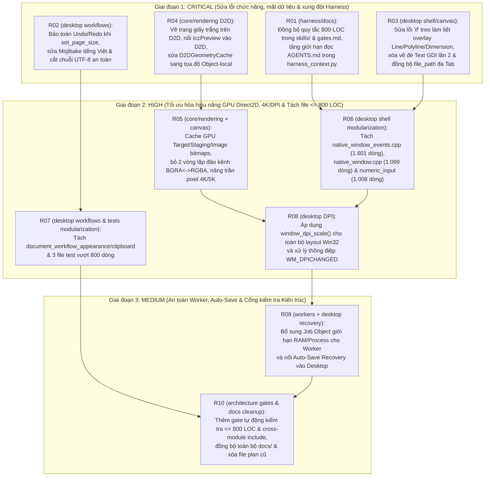

# Kế hoạch Thực thi Khắc phục Kiến trúc, Hiệu năng GPU, UI/UX & Chuẩn hóa Harness (`R01` → `R10`)

**Ngày lập kế hoạch**: 18/10/2026  
**Trạng thái**: Hoàn tất R01–R10; kiểm tra khóa sổ pass ngày 18/10/2026  
**Đối tượng thực thi**: AI Agent / Subagent triển khai tuần tự hoặc song song theo các gói có `owned_paths` độc lập.  
**Mục tiêu**: Khắc phục triệt để các lỗi chức năng/UI nghiêm trọng, xóa bỏ nghẽn cổ chai trên đường ống GPU Direct2D 1.1, hoàn tất tách toàn bộ file vượt ngưỡng 800 dòng, và đồng bộ 100% tài liệu `docs/` cùng hệ thống `harness`.

---

## 1. Quy tắc Bắt buộc cho Agent Thực thi

1. **Làm việc trên một nguồn duy nhất (Single-Source Policy)**:
   - Chỉ thao tác trực tiếp tại `C:/Users/Administrator/Downloads/PikDraw`. Tuyệt đối không tạo git worktree, không tạo nhánh mới, không chạy `git reset`, `git stash`, `git clean` hoặc xóa các thay đổi chưa commit của phiên khác.
2. **Quy trình Harness cho mỗi Gói công việc (`R01` → `R10`)**:
   - Trước khi sửa bất kỳ file nào của gói `Rxx`, Agent bắt buộc chạy lệnh tạo và nhận task với đúng danh sách `--path` đã khai báo trong gói đó:
     ```powershell
     powershell -NoProfile -ExecutionPolicy Bypass -File tooling/pikdraw.ps1 task create <task-id> --title "<title>" --module <module> --goal "<goal>" --path <path1> --path <path2>
     powershell -NoProfile -ExecutionPolicy Bypass -File tooling/pikdraw.ps1 task claim <task-id> --owner codex:executor
     ```
   - Sau khi code và chạy pass 100% lệnh kiểm tra của gói, cập nhật kết quả ngắn gọn (summary $\le 320$ ký tự, tối đa 6 mục evidence/next_steps, mỗi mục $\le 240$ ký tự):
     ```powershell
     powershell -NoProfile -ExecutionPolicy Bypass -File tooling/pikdraw.ps1 task update <task-id> --owner codex:executor --status done --summary "<ket_qua>" --evidence "<lenh_test_pass>"
     ```
3. **Tuân thủ tuyệt đối ngưỡng độ dài file ($\le 2000$ dòng/file)**:
   - Không một file `.cpp`, `.hpp`, `.py` nào sau khi chỉnh sửa được phép vượt quá **2000 dòng** (chuẩn khuyến nghị **300–1800 dòng**).
4. **Kiểm thử mục tiêu**:
   - Chỉ chạy `tooling/native/build.ps1 -Test -TestTarget <targets> -TestRegex <regex>` theo đúng danh sách của từng gói để tiết kiệm thời gian biên dịch và giữ khóa `.agent/native-build.lock` ngắn gọn.

---

## 2. Sơ đồ Thứ tự Thực thi & Phân luồng (`R01` → `R10`)



---

## 3. Chi tiết Từng Gói Công việc (`R01` → `R10`)

### [x] Gói R01 (CRITICAL): Xóa bỏ xung đột quy tắc 800-LOC trong `skills/` & `gates.md` và sửa lỗi cắt cụt `AGENTS.md` trong Harness
- **Task ID**: `remed-r01-harness-rules-sync`
- **Module**: `harness`
- **Owned paths**:
  - `tooling/harness_context.py`
  - `skills/pikdraw-module-change/SKILL.md`
  - `docs/quality/gates.md`
- **Vấn đề cần sửa**:
  1. `tooling/harness_context.py` (dòng 156) giới hạn đọc `("AGENTS.md", 2600)` ký tự, làm cắt mất phần quy tắc UI và quy tắc kiểm thử/log ở cuối `AGENTS.md` (dài ~3.350 ký tự).
  2. `skills/pikdraw-module-change/SKILL.md` (dòng 12) và `docs/quality/gates.md` (dòng 31) ghi *"file around 1,000 lines or longer can be appropriate... no LOC cap"*, mâu thuẫn trực tiếp với quy tắc bắt buộc $\le 800$ dòng/file trong `AGENTS.md`.
- **Các bước thực hiện chính xác**:
  1. Trong `tooling/harness_context.py` (dòng 156): Đổi `("AGENTS.md", 2600)` thành `("AGENTS.md", 5000)`.
  2. Trong `skills/pikdraw-module-change/SKILL.md` (dòng 12): Thay thế câu cho phép 1.000 dòng bằng quy tắc: *"Group code by feature cohesion. Every source/header file must stay within 300–700 lines and strictly <= 800 lines so AI agents can view the entire file in a single read. Never append new features to files approaching or exceeding 800 lines; split by feature domain instead. See docs/development/code-organization.md."*
  3. Trong `docs/quality/gates.md` (dòng 31): Thay đoạn *"Không có giới hạn LOC tự động..."* bằng: *"Tuân thủ quy chuẩn độ dài file <= 800 dòng (chuẩn 300–700 dòng/file) theo `docs/development/code-organization.md`. Không nối đuôi tính năng mới vào các file đã vượt 800 dòng."*
- **Ca nghiệm thu (Acceptance Criteria)**:
  - **AC-R01**: *Given* một task bất kỳ trên board, *When* chạy `tooling/pikdraw.ps1 context --task-id <id>`, *Then* toàn bộ nội dung `AGENTS.md` được hiển thị đầy đủ không bị cắt `[excerpt]` và không còn thông điệp mâu thuẫn về 1.000 dòng trong `SKILL.md` / `gates.md`.
- **Lệnh kiểm tra bắt buộc**:
  ```powershell
  powershell -NoProfile -ExecutionPolicy Bypass -File tooling/pikdraw.ps1 doctor
  powershell -NoProfile -ExecutionPolicy Bypass -File tooling/native/check.ps1 -Suite architecture
  ```

---

### [x] Gói R02 (CRITICAL): Bảo toàn lịch sử Undo/Redo khi đổi khổ trang (`set_page_size`), sửa lỗi Mojibake tiếng Việt & cắt chuỗi UTF-8 an toàn
- **Task ID**: `remed-r02-workflow-undo-utf8`
- **Module**: `desktop`
- **Owned paths**:
  - `apps/desktop/src/workflows/document_workflow.cpp`
  - `apps/desktop/src/workflows/document_workflow_io_shaping.cpp`
  - `apps/desktop/src/workflows/document_workflow_internal.hpp`
  - `apps/desktop/tests/test_vertical_slice_e2e.cpp`
- **Vấn đề cần sửa**:
  1. `DocumentWorkflow::set_page_size` (`document_workflow.cpp` dòng 431–452) gọi `doc.reset_from_snapshot(...)`, làm xóa trắng `history_` (mất toàn bộ Undo/Redo) và đặt `saved_revision_ = next_revision` (làm tài liệu đang bẩn bị đánh dấu nhầm là đã lưu).
  2. `document_workflow.cpp` (dòng 92, 148) dùng `utf8_text.substr(0, 20)` và `new_utf8_text.substr(0, 16)` cắt ngang byte giữa của ký tự tiếng Việt UTF-8, tạo chuỗi UTF-8 hỏng.
  3. Chuỗi hằng tiếng Việt trong `document_workflow.cpp` (dòng 92, 104, 159, 200, 228, 242) và `document_workflow_io_shaping.cpp` (dòng 164, 241, 314–318, 394) bị lỗi mã hóa CP437 Mojibake (`"V─ân bß║ún: "`, `"H├án (Weld)"`...).
- **Các bước thực hiện chính xác**:
  1. Trong `apps/desktop/src/workflows/document_workflow_internal.hpp`, thêm hàm `inline std::string utf8_truncate_codepoints(std::string_view text, std::size_t max_codepoints)` duyệt từng codepoint UTF-8 hợp lệ (dừng trước khi vượt `max_codepoints` mà không bao giờ cắt ở byte `10xxxxxx`).
  2. Trong `apps/desktop/src/workflows/document_workflow.cpp`:
     - Thay `.substr(0, 20)` (dòng 92) và `.substr(0, 16)` (dòng 148) bằng `detail::utf8_truncate_codepoints(...)`.
     - Sửa toàn bộ chuỗi Mojibake về đúng UTF-8 chuẩn: `"Văn bản: "`, `"Thêm văn bản"`, `"Sửa nội dung văn bản"`, `"Đổi kiểu chữ"`, `"Đường cong: "`, `"Chuyển chữ thành đường cong"`, và trong `document_workflow_io_shaping.cpp`: `"Đường dẫn SVG"`, `"Nhập SVG"`, `"Hàn (Weld)"`, `"Cắt (Trim)"`, `"Giao (Intersect)"`, `"Cắt đối tượng (Knife)"`.
     - Viết class `SetPageSizeCommand final : public document::DocumentCommand` trong `document_workflow.cpp` (cập nhật `PageSettings{width_mm, height_mm}` thông qua `doc.execute_command(...)`) và thay thế thân hàm `DocumentWorkflow::set_page_size` để tạo một bước Undo/Redo hợp lệ mà không gọi `reset_from_snapshot`.
  3. Mở rộng `apps/desktop/tests/test_vertical_slice_e2e.cpp` kiểm tra: vẽ đối tượng $\rightarrow$ đổi khổ trang (`set_page_size`) $\rightarrow$ Undo khôi phục khổ trang cũ $\rightarrow$ Undo tiếp khôi phục thao tác vẽ trước đó; và thêm `TextObject` tiếng Việt dài > 20 byte không làm hỏng UTF-8 của `obj.name`.
- **Lệnh kiểm tra bắt buộc**:
  ```powershell
  .\tooling\native\build.ps1 -Test -TestTarget test_pikdraw_vertical_slice_e2e,test_pikdraw_effect_draft -TestRegex '^test_pikdraw_(vertical_slice_e2e|effect_draft)$'
  ```

---

### [x] Gói R03 (CRITICAL): Sửa lỗi `if` treo làm liệt Overlay công cụ Line/Polyline/Dimension, xóa vẽ đè Text GDI lần 2 & đồng bộ `file_path` đa Tab
- **Task ID**: `remed-r03-canvas-overlays-tabpath`
- **Module**: `desktop`
- **Owned paths**:
  - `apps/desktop/src/shell/native_window_canvas.cpp`
  - `apps/desktop/src/shell/native_window_files.cpp`
  - `apps/desktop/tests/test_drawing_tool_ui.cpp`
- **Vấn đề cần sửa**:
  1. Tại `native_window_canvas.cpp` (dòng 654–655):
     ```cpp
     if (active_tool_ == 13 && gradient_tool_ && gradient_tool_->active())
     paint_drawing_tool_overlays(dc);
     ```
     Câu lệnh `if` không có thân hàm khiến `paint_drawing_tool_overlays(dc)` chỉ chạy khi `active_tool_ == 13` (Gradient), làm mất hoàn toàn overlay của Line (`6`), Polyline (`7`) và Dimension (`12`).
  2. Tại `native_window_canvas.cpp` (dòng 378–427): Vòng lặp duyệt `snapshot.objects()` vẽ lại toàn bộ `TextObject` bằng GDI `DrawTextW` đè lên ảnh bitmap đã được `ViewportRenderer` vẽ bằng DirectWrite glyph outlines, gây bóng đôi chữ và sai Z-order/Transform.
  3. Tại `native_window_files.cpp` (dòng 63, 74): `open_document_dialog` và `save_document_dialog` chỉ cập nhật `document_path_` toàn cục mà không đồng bộ với `active_tab().file_path`, gây nguy cơ lưu đè nhầm file khi chuyển tab.
- **Các bước thực hiện chính xác**:
  1. Trong `NativeWindow::paint_drawing_overlay` (`native_window_canvas.cpp` dòng 652–660), sửa thành:
     ```cpp
     if (active_tool_ == 11 && contour_tool_ && contour_tool_->active())
         paint_contour_canvas_overlay(dc);
     paint_drawing_tool_overlays(dc);
     if (active_tool_ == 13 && gradient_tool_ && gradient_tool_->active())
         paint_gradient_canvas_overlay(dc);
     ```
  2. Trong `NativeWindow::paint_document_canvas` (`native_window_canvas.cpp` dòng 378–427): Chỉ giữ phần vẽ khung caret/inline-box khi `inline_text_editing_ && obj->id == inline_text_object_id_`; xóa phần gọi GDI `DrawTextW` vẽ đè lên các `TextObject` thông thường (vì `D2DRenderBackend` và `SoftwareRasterizer` đã vẽ glyph outlines chính xác theo Z-order và Transform).
  3. Trong `native_window_files.cpp`: Đọc và ghi đường dẫn file đồng bộ cho cả `active_tab().file_path` và `document_path_`; khi `switch_to_tab` (trong `native_window.cpp`) hoặc tạo tab mới, đồng bộ `document_path_ = active_tab().file_path`.
  4. Bổ sung kiểm tra trong `apps/desktop/tests/test_drawing_tool_ui.cpp` xác nhận khi kích hoạt công cụ Line (`active_tool_ == 6`), `paint_drawing_overlay` vẽ overlay preview lên canvas.
- **Lệnh kiểm tra bắt buộc**:
  ```powershell
  .\tooling\native\build.ps1 -Test -TestTarget test_pikdraw_drawing_tool_ui,test_pikdraw_pen_native_shell -TestRegex '^test_pikdraw_(drawing_tool_ui|pen_native_shell)$'
  ```

---

### [x] Gói R04 (CRITICAL): Vẽ nền trang giấy trên GPU Direct2D, kết nối `IccPreview` vào D2D và sửa kiến trúc `D2DGeometryCache`
- **Task ID**: `remed-r04-d2d-page-icc-cache`
- **Module**: `rendering`
- **Owned paths**:
  - `core/rendering/src/gpu/d2d/d2d_internal.hpp`
  - `core/rendering/src/gpu/d2d/d2d_geometry_cache.cpp`
  - `core/rendering/src/gpu/d2d/d2d_effects_pipeline.cpp`
  - `core/rendering/src/gpu/d2d/d2d_render_backend.cpp`
  - `core/rendering/tests/rasterizer/test_rasterizer.cpp`
- **Vấn đề cần sửa**:
  1. `D2DRenderBackend` không vẽ nền trắng của trang giấy (`snapshot.page()`), khác biệt với `SoftwareRasterizer::render_page`.
  2. `D2DEffectsPipeline::extract_rgb` bỏ qua `impl_->color_preview` (`IccPreview`), khiến màu CMYK trên GPU không đi qua hồ sơ ICC đã nạp.
  3. `D2DGeometryCache` nhúng tọa độ trừ tâm camera vào đỉnh `ID2D1PathGeometry` và chỉ băm `(id, revision)` trong `KeyHash`, gây 100% cache miss khi pan camera và suy thoái bảng băm $O(N)$.
- **Các bước thực hiện chính xác**:
  1. **Sửa `D2DGeometryCache` (`d2d_internal.hpp` & `d2d_geometry_cache.cpp`)**:
     - Lưu `ID2D1PathGeometry` ở hệ tọa độ **Object-local** (tạo trực tiếp từ `obj.path` chưa nhân `obj.transform` và chưa trừ `camera.center()`).
     - Khóa cache `CacheKey` gồm `(ObjectId id, uint64_t revision, uint8_t kind, bool even_odd)` (trong đó `kind = 0` cho đường dẫn chính của đối tượng, `kind = 1` cho `ImageObject::clip_path` để không đụng khóa). Cập nhật `KeyHash` băm đầy đủ tất cả các trường của `CacheKey`.
     - Trong `d2d_render_backend.cpp`, tính ma trận kết hợp `effective_transform` (tính bằng `double` cho phần tịnh tiến trừ `camera.center()` rồi nhân `camera.zoom()` và cộng nửa kích thước viewport) và truyền vào `context->SetTransform(...)` trước khi gọi `FillGeometry` / `DrawGeometry`.
  2. **Kết nối `IccPreview` vào `D2DEffectsPipeline` (`d2d_effects_pipeline.cpp`)**:
     - Thêm tham số `const color::IccPreview* color_preview` vào `D2DEffectsPipeline::extract_rgb` và `create_gradient_brush`. Nếu `color_preview != nullptr`, gọi `color_preview->preview_color(payload.source_color)` để lấy giá trị sRGB chính xác giống hệt `SoftwareRasterizer::extract_rgb`.
  3. **Vẽ nền trang giấy trắng trong `D2DRenderBackend::Impl::render_to_pixel_buffer` (`d2d_render_backend.cpp`)**:
     - Ngay sau `context->Clear(...)` và khi `snapshot.page().width_mm > 0.0 && snapshot.page().height_mm > 0.0` (và `background.a > 0`), vẽ hình chữ nhật trang giấy từ `(0, 0)` đến `(width_mm, height_mm)` trong tọa độ màn hình với màu trắng `D2D1::ColorF(1.0f, 1.0f, 1.0f, 1.0f)` (đồng bộ với `SoftwareRasterizer::render_page`).
  4. Mở rộng `core/rendering/tests/rasterizer/test_rasterizer.cpp` kiểm tra: (a) Panning camera giữ nguyên geometry cache hits trên `D2DRenderBackend`, (b) `IccPreview` cho kết quả màu tương đương giữa D2D và CPU.
- **Lệnh kiểm tra bắt buộc**:
  ```powershell
  .\tooling\native\build.ps1 -Test -TestTarget test_pikdraw_rendering_rasterizer,test_pikdraw_rendering_effect_compositor,test_pikdraw_rendering_gradient_compositor -TestRegex '^test_pikdraw_rendering_(rasterizer|effect_compositor|gradient_compositor)$'
  ```

---

### [x] Gói R05 (HIGH): Tối ưu hóa đường ống GPU Readback, Cache Bitmap & Hỗ trợ độ phân giải 4K/5K
- **Task ID**: `remed-r05-d2d-pipeline-4k-perf`
- **Module**: `rendering` (phối hợp `apps/desktop/src/shell/native_window_canvas.cpp`)
- **Owned paths**:
  - `core/rendering/include/pikdraw/rendering/backend.hpp`
  - `core/rendering/src/gpu/d2d/d2d_internal.hpp`
  - `core/rendering/src/gpu/d2d/d2d_render_backend.cpp`
  - `core/rendering/src/gpu/d2d/d2d_scene_compositor.cpp`
  - `core/rendering/src/software_rasterizer.cpp`
  - `apps/desktop/src/shell/native_window_canvas.cpp`
- **Vấn đề cần sửa**:
  1. `render_to_pixel_buffer` gọi `CreateBitmap` cấp phát mới `target_bmp` và `staging_bmp` ở mỗi frame; `ImageObject` cấp phát vector RAM, lật dòng và gọi `CreateBitmap` ở mỗi frame.
  2. Hai vòng lặp CPU đơn luồng chuyển đổi qua lại `BGRA -> RGBA` (trong `d2d_render_backend.cpp`) rồi `RGBA -> BGRA` (trong `native_window_canvas.cpp`) gây lãng phí băng thông bộ nhớ lớn.
  3. Giới hạn cứng `kMaxTargetPixels = 8388608` (8 MP) làm hỏng hoàn toàn việc hiển thị canvas khi phóng to cửa sổ trên màn hình 4K (16:10) hoặc 5K.
- **Các bước thực hiện chính xác**:
  1. **Cache `target_bmp_` và `staging_bmp_` theo `(width, height)` trong `D2DRenderBackend::Impl`**:
     - Chỉ tạo lại 2 bitmap này khi `width != cached_target_w_ || height != cached_target_h_` hoặc sau khi thiết bị D3D11 được khôi phục.
  2. **Cache `ID2D1Bitmap1` cho `ImageObject`**:
     - Lưu bảng băm `(ObjectId, uint64_t revision) -> ComPtr<ID2D1Bitmap1>` trong `D2DRenderBackend::Impl` (giới hạn tối đa 64 ảnh hoặc 256 MiB VRAM, tự động dọn khi `revision` đổi) để không phải lật dòng và upload lại ảnh từ RAM lên VRAM ở mỗi frame pan/zoom.
  3. **Hỗ trợ ghi trực tiếp `BGRA8` (`target.bgra_pixels`) cho `NativeWindow`**:
     - Thêm con trỏ tùy chọn `uint32_t* bgra_pixels = nullptr` vào `PixelBufferTarget` (`backend.hpp`). Khi `NativeWindow::paint_document_canvas` truyền `reusable_bgra_buffer_.data()` vào `target.bgra_pixels` (và `target.pixels == nullptr`), `D2DRenderBackend` chỉ cần khử premultiply (hoặc chép thẳng các pixel có `a == 255` mà không cần phép chia `/ a`!) trực tiếp vào `target.bgra_pixels` theo thứ tự BGRA của GDI DIB, bỏ hoàn toàn vòng lặp đảo kênh thứ hai trong `native_window_canvas.cpp`.
  4. **Nâng ngưỡng `kMaxTargetPixels` lên `33554432ULL` (32 MP — hỗ trợ tới màn hình 8K 7680×4320)**:
     - Cập nhật hằng số `kMaxTargetPixels = 33554432ULL` tại `native_window_canvas.cpp` (dòng 170) và `software_rasterizer.cpp` (dòng 15).
- **Lệnh kiểm tra bắt buộc**:
  ```powershell
  .\tooling\native\build.ps1 -Test -TestTarget test_pikdraw_rendering_rasterizer,test_pikdraw_desktop_shell -TestRegex '^test_pikdraw_(rendering_rasterizer|desktop_shell)$'
  ```

---

### [x] Gói R06 (HIGH): Tách các file Shell vượt ngưỡng 800 dòng (`native_window_events.cpp`, `native_window.cpp`, `native_window_numeric_input.cpp`)
- **Task ID**: `remed-r06-shell-modularization`
- **Module**: `desktop`
- **Owned paths**:
  - `apps/desktop/include/pikdraw/desktop/shell/native_window.hpp`
  - `apps/desktop/src/shell/native_window.cpp`
  - `apps/desktop/src/shell/native_window_isolation_menus.cpp` *(file mới)*
  - `apps/desktop/src/shell/native_window_events.cpp`
  - `apps/desktop/src/shell/native_window_MenuActions.cpp` $\rightarrow$ đặt tên chuẩn snake_case: `apps/desktop/src/shell/native_window_menu_actions.cpp` *(file mới)*
  - `apps/desktop/src/shell/native_window_pointer_dispatch.cpp` *(file mới)*
  - `apps/desktop/src/shell/native_window_numeric_input.cpp`
  - `apps/desktop/src/shell/native_window_array_quickdim.cpp` *(file mới)*
  - `apps/desktop/CMakeLists.txt`
- **Hiện trạng các file vượt ngưỡng trong `apps/desktop/src/shell/`**:
  - `native_window_events.cpp`: **1.601 dòng**
  - `native_window.cpp`: **1.099 dòng**
  - `native_window_numeric_input.cpp`: **1.008 dòng**
- **Các bước thực hiện chính xác**:
  1. **Tách `native_window_events.cpp` (1.601 dòng) thành 3 file (~500–550 dòng/file)**:
     - `native_window_menu_actions.cpp` (~660 dòng): Chứa `is_menu_action_enabled`, `is_menu_action_checked`, `execute_menu_action`, `activate_toolbox_effect_item`, `handle_toolbox_key`, `handle_align_panel_click` (dòng 1–684 hiện tại).
     - `native_window_pointer_dispatch.cpp` (~500 dòng): Chứa `handle_mouse_down`, `handle_mouse_move`, `handle_mouse_up` (dòng 685–1190 hiện tại).
     - Giữ `window_dpi_scale` và `window_proc` (~440 dòng, dòng 1191–1601 hiện tại) trong `native_window_events.cpp`.
  2. **Tách `native_window.cpp` (1.099 dòng) thành 2 file (~550 dòng/file)**:
     - Tạo `native_window_isolation_menus.cpp` (~480 dòng): Chuyển các hàm điều khiển Workspace/Dock, Zoom/Fit, Menu/File Menu/Home Screen toggles, Group Isolation (`enter_group_isolation`, `exit_group_isolation`, `is_object_in_isolated_group`, `handle_double_click`), `initialize` và `run` (dòng 640–1099) sang file mới.
     - Giữ phần khởi tạo tab, page preset, style/boolean triggers, theme/language (dòng 1–639, ~639 dòng) trong `native_window.cpp`.
  3. **Tách `native_window_numeric_input.cpp` (1.008 dòng) thành 2 file (~500 dòng/file)**:
     - Tạo `native_window_array_quickdim.cpp` (~420 dòng): Chuyển `capture_screenshot_bmp`, `handle_array_char`, `handle_array_backspace`, `commit_array_input`, `end_quick_dimension`, `apply_quick_dimension` sang file mới.
     - Giữ các hàm `start_numeric_input`, `start_effect_numeric_input`, `commit_numeric_field`, `cancel_numeric_field`, `handle_numeric_char_input` (~590 dòng) trong `native_window_numeric_input.cpp`.
  4. Đăng ký 4 file `.cpp` mới vào `apps/desktop/CMakeLists.txt`.
- **Lệnh kiểm tra bắt buộc**:
  ```powershell
  .\tooling\native\build.ps1 -Test -TestTarget test_pikdraw_desktop_shell,test_pikdraw_drawing_tool_ui -TestRegex '^test_pikdraw_drawing_tool_ui$'
  ```

---

### [x] Gói R07 (HIGH): Tách các file Workflow và Test vượt ngưỡng 800 dòng
- **Task ID**: `remed-r07-workflows-tests-modularization`
- **Module**: `desktop` (và `core/document/tests`)
- **Owned paths**:
  - `apps/desktop/src/workflows/document_workflow_appearance.cpp`
  - `apps/desktop/src/workflows/document_workflow_effect_draft.cpp` *(file mới)*
  - `apps/desktop/src/workflows/document_workflow_clipboard_transform.cpp`
  - `apps/desktop/src/workflows/document_workflow_group_transform.cpp` *(file mới)*
  - `apps/desktop/tests/test_desktop_shell.cpp`
  - `apps/desktop/tests/test_drawing_tool_controller.cpp`
  - `core/document/tests/storage/test_storage_fidelity.cpp`
  - `apps/desktop/CMakeLists.txt`
  - `core/document/CMakeLists.txt`
- **Hiện trạng các file vượt ngưỡng**:
  - `document_workflow_appearance.cpp`: **1.032 dòng**
  - `document_workflow_clipboard_transform.cpp`: **988 dòng**
  - `test_desktop_shell.cpp`: **2.701 dòng**
  - `test_drawing_tool_controller.cpp`: **1.039 dòng**
  - `test_storage_fidelity.cpp`: **887 dòng**
- **Các bước thực hiện chính xác**:
  1. **Tách `document_workflow_appearance.cpp` (1.032 dòng) thành 2 file (~515 dòng/file)**:
     - Giữ phần fill/stroke/opacity cơ bản và effect stack (`set_selected_fill`, `set_selected_stroke`, `*_opacity`, `activate_selected_effect`, `set_selected_effect_*`) trong `document_workflow_appearance.cpp` (~520 dòng).
     - Chuyển toàn bộ các phương thức quản lý bản nháp hiệu ứng (`*_effect_draft*`, `parse_effect_draft_number`, `valid_effect_parameters`) sang `apps/desktop/src/workflows/document_workflow_effect_draft.cpp` (~515 dòng).
  2. **Tách `document_workflow_clipboard_transform.cpp` (988 dòng) thành 2 file (~490 dòng/file)**:
     - Giữ các lệnh Clipboard & Array (`delete_selected`, `copy_selected`, `cut_selected`, `paste*`, `duplicate*`, `*_array_*`, cùng `AddClonedHierarchyCommand`, `ReplaceClonedHierarchyCommand`) trong `document_workflow_clipboard_transform.cpp` (~510 dòng).
     - Chuyển Group/Ungroup và Transform/Rotate/Flip (`GroupObjectsCommand`, `UngroupObjectsCommand`, `can_group_selected`, `group_selected`, `ungroup_selected`, `is_group`, `find_parent_group`, `get_object_bounds`, `resize_object`, `move_object`, `transform_selected`, `flip_*`, `rotate_*`) sang `apps/desktop/src/workflows/document_workflow_group_transform.cpp` (~480 dòng).
  3. **Tách 3 file Test vượt 800 dòng**:
     - `test_storage_fidelity.cpp` (887 dòng): Chuyển các ca kiểm thử migration appearance v2/v3/v4 sang `core/document/tests/storage/test_storage_appearance_migration.cpp` (~350 dòng), giữ `test_storage_fidelity.cpp` ở mức ~540 dòng.
     - `test_drawing_tool_controller.cpp` (1.039 dòng): Chuyển phần kiểm thử snap/input grammar sang `apps/desktop/tests/test_drawing_tool_snap_input.cpp` (~480 dòng), giữ `test_drawing_tool_controller.cpp` ở mức ~560 dòng.
     - `test_desktop_shell.cpp` (2.701 dòng): Tách thành 4 file kiểm thử theo miền (`test_desktop_shell.cpp`, `test_desktop_shell_align_boolean.cpp`, `test_desktop_shell_appearance.cpp`, `test_desktop_shell_text_settings.cpp`), mỗi file **550–680 dòng**, dùng chung header helper `apps/desktop/tests/desktop_shell_test_helpers.hpp` (< 250 dòng).
- **Lệnh kiểm tra bắt buộc**:
  ```powershell
  .\tooling\native\build.ps1 -Test -TestTarget test_pikdraw_storage_fidelity,test_pikdraw_drawing_tool_controller,test_pikdraw_desktop_shell -TestRegex '^test_pikdraw_(storage_fidelity|drawing_tool_controller|desktop_shell)$'
  ```

---

### [x] Gói R08 (HIGH): Hỗ trợ Per-Monitor V2 DPI Scaling trên toàn bộ Win32 Shell (`100%` → `200%`)
- **Task ID**: `remed-r08-win32-dpi-scaling`
- **Module**: `desktop`
- **Owned paths**:
  - `apps/desktop/include/pikdraw/desktop/shell/native_window.hpp`
  - `apps/desktop/src/shell/native_window_paint.cpp`
  - `apps/desktop/src/shell/native_window_paint_docks.cpp`
  - `apps/desktop/src/shell/native_window_canvas.cpp`
  - `apps/desktop/src/shell/native_window_chrome_clicks.cpp`
  - `apps/desktop/src/shell/native_window_events.cpp`
- **Vấn đề cần sửa**:
  - Các hằng số kích thước giao diện (`topbar_h = 38`, `tabbar_h = 28`, `ribbon_h = 36`, `status_h = 26`, `tool_w = 52`, `inspect_w = 280`, `ruler_thick = 20`) đang viết cứng bằng physical pixels ở cả hàm vẽ (`native_window_paint.cpp`, `native_window_canvas.cpp`) lẫn hàm bắt sự kiện click chuột (`native_window_chrome_clicks.cpp`).
  - `window_proc` chưa xử lý `WM_DPICHANGED`.
- **Các bước thực hiện chính xác**:
  1. Thêm hàm helper `int dip(int base_px) const noexcept` vào `NativeWindow` (`native_window.hpp`) tính `static_cast<int>(std::lround(base_px * dpi_scale_))` (với `dpi_scale_ = 1.0f` mặc định khi chạy headless test để không làm gãy tọa độ pixel trong các bài test tự động hiện có, và cập nhật theo `window_dpi_scale()` khi nhận `WM_DPICHANGED` hoặc khi cờ `enable_dpi_layout_` được bật).
  2. Xử lý thông điệp `WM_DPICHANGED` trong `NativeWindow::window_proc` (`native_window_events.cpp`): đọc `HIWORD(wparam)` để cập nhật `dpi_scale_`, tạo lại bộ font GDI (`ensure_ui_fonts()`), áp dụng `RECT* const prcNewWindow = reinterpret_cast<RECT*>(lparam)` qua `SetWindowPos`, và gọi `InvalidateRect(hwnd, nullptr, FALSE)`.
- **Lệnh kiểm tra bắt buộc**:
  ```powershell
  .\tooling\native\build.ps1 -Test -TestTarget test_pikdraw_desktop_shell,test_pikdraw_drawing_tool_ui -TestRegex '^test_pikdraw_(desktop_shell|drawing_tool_ui)$'
  ```

---

### [x] Gói R09 (MEDIUM): Bổ sung Windows Job Object Sandbox cho Worker & Kết nối Auto-Save Recovery vào Desktop
- **Task ID**: `remed-r09-worker-sandbox-autosave`
- **Module**: `workers` (phối hợp `apps/desktop`)
- **Owned paths**:
  - `platform/workers/src/process_launcher.cpp`
  - `platform/workers/tests/test_worker_sandbox.cpp`
  - `apps/desktop/src/shell/native_window_files.cpp`
  - `apps/desktop/src/shell/native_window_events.cpp`
- **Các bước thực hiện chính xác**:
  1. **Windows Job Object trong `ProcessLauncher::Impl::run` (`platform/workers/src/process_launcher.cpp`)**:
     - Tạo Job Object (`CreateJobObjectW`), cấu hình `JOBOBJECT_EXTENDED_LIMIT_INFORMATION` với:
       - `JOB_OBJECT_LIMIT_KILL_ON_JOB_CLOSE` (đảm bảo worker tự động bị hủy nếu host crash hoặc đóng handle).
       - `JOB_OBJECT_LIMIT_ACTIVE_PROCESS` (`ActiveProcessLimit = 1` — cấm worker tự spawn thêm tiến trình con).
       - `JOB_OBJECT_LIMIT_PROCESS_MEMORY` (áp dụng ngân sách RAM từ `WorkerConfig`).
       - `JOB_OBJECT_UILIMIT_HANDLES | JOB_OBJECT_UILIMIT_GLOBALATOMS | JOB_OBJECT_UILIMIT_WRITECLIPBOARD` qua `JOBOBJECT_BASIC_UI_RESTRICTIONS`.
     - Gán tiến trình con vào Job (`AssignProcessToJobObject`) trước khi cho chạy hoặc ngay sau `CreateProcessW`.
  2. **Auto-Save Checkpoint định kỳ trên `NativeWindow`**:
     - Đặt `SetTimer(hwnd_, kAutoSaveTimerId, 60000, nullptr)` (60 giây/lần) trong `NativeWindow`. Khi nhận `WM_TIMER` với `kAutoSaveTimerId` và tài liệu đang mở có `is_modified() == true`, gọi `SaveRecoveryService::write_recovery_checkpoint` lưu bản nháp an toàn vào `%LOCALAPPDATA%/PikDraw/Recovery`.
     - Khi lưu file chính thức thành công (`save_document_dialog`), gọi `SaveRecoveryService::clear_checkpoints_for_document`.
- **Lệnh kiểm tra bắt buộc**:
  ```powershell
  .\tooling\native\build.ps1 -Test -TestTarget test_pikdraw_worker_sandbox,test_pikdraw_save_recovery -TestRegex '^test_pikdraw_(worker_sandbox|save_recovery)$'
  ```

---

### [x] Gói R10 (MEDIUM): Bổ sung Gate tự động kiểm tra $\le 800$ dòng & Cross-Module `#include`, Đồng bộ `docs/` và Khóa sổ
- **Task ID**: `remed-r10-arch-gates-docs-cleanup`
- **Module**: `harness` (và `docs/`)
- **Owned paths**:
  - `tests/architecture/test_architecture_gates.py`
  - `README.md`
  - `docs/architecture/architecture.md`
  - `docs/development/code-organization.md`
  - `docs/project-state.json`
  - `apps/desktop/README.md`
  - *(Xóa)* `docs/roadmap/code-modularization-800loc-plan.md`
- **Các bước thực hiện chính xác**:
  1. **Mở rộng `tests/architecture/test_architecture_gates.py`**:
     - Thêm test `test_source_files_respect_800_loc_limit`: Quét toàn bộ file `.h`, `.hpp`, `.cpp` trong `core/`, `modules/`, `apps/`, `platform/`, `packages/`. Nếu có bất kỳ file nào $> 800$ dòng, báo lỗi kèm tên file và số dòng chính xác.
     - Thêm test `test_cross_module_includes_match_registry`: Quét các dòng `#include "pikdraw/<module>/..."` hoặc `#include <pikdraw/<module>/...>` trong từng module và đối chiếu trực tiếp với mảng `dependencies` của module đó trong `registry/modules.json`.
  2. **Đồng bộ hóa tài liệu `docs/` và `README.md`**:
     - Cập nhật `README.md`, `docs/architecture/architecture.md` và `docs/development/code-organization.md` ghi rõ runtime hiện tại là **C++20 / Win32 Native Shell kết hợp Direct2D 1.1 / D3D11 hardware hoặc WARP qua `ViewportRenderer`**.
     - Thống nhất phiên bản định dạng file gốc `.pikdraw` là **Native v4 (`kCurrentFormatVersion = 4`, hỗ trợ đọc tương thích ngược v2/v3)** trong `docs/project-state.json` và `apps/desktop/README.md`.
     - Cập nhật bảng bản đồ file trong `apps/desktop/README.md` khớp với các file mới tách ở R06 & R07.
     - Xóa file kế hoạch cũ đã hoàn thành `docs/roadmap/code-modularization-800loc-plan.md`.
- **Lệnh kiểm tra khóa sổ bắt buộc**:
  ```powershell
  powershell -NoProfile -ExecutionPolicy Bypass -File tooling/pikdraw.ps1 doctor
  powershell -NoProfile -ExecutionPolicy Bypass -File tooling/native/check.ps1 -Suite all
  ```

---

## 4. Bảng Tổng hợp Các Gói Công việc (`R01` → `R10`)

| Mã Gói | Mức ưu tiên | Module | Mục tiêu cốt lõi | Gate kiểm chứng bắt buộc |
| :-: | :-: | :---: | :--- | :--- |
| **R01** | **CRITICAL** | `harness` | Đồng bộ quy tắc $\le 800$ dòng trong `SKILL.md` & `gates.md`; tăng giới hạn đọc `AGENTS.md` lên 5.000 ký tự. | `pikdraw.ps1 doctor`, `check.ps1 -Suite architecture` |
| **R02** | **CRITICAL** | `desktop` | Bảo toàn Undo/Redo khi `set_page_size`; sửa lỗi Mojibake tiếng Việt & cắt chuỗi UTF-8 an toàn theo codepoint. | `test_pikdraw_vertical_slice_e2e`, `test_pikdraw_effect_draft` |
| **R03** | **CRITICAL** | `desktop` | Sửa lỗi `if` treo làm liệt overlay Line/Polyline/Dimension; bỏ vẽ đè Text GDI lần 2; đồng bộ `file_path` đa Tab. | `test_pikdraw_drawing_tool_ui`, `test_pikdraw_pen_native_shell` |
| **R04** | **CRITICAL** | `rendering` | Vẽ trang giấy trắng trên D2D; nối `IccPreview` vào D2D; đổi `D2DGeometryCache` sang tọa độ Object-local. | `test_pikdraw_rendering_rasterizer`, `test_pikdraw_rendering_effect_compositor` |
| **R05** | **HIGH** | `rendering` | Cache GPU Target/Staging/Image bitmaps; ghi thẳng `BGRA8` bỏ 2 vòng lặp CPU; nâng trần `kMaxTargetPixels` lên 32 MP (4K/8K). | `test_pikdraw_rendering_rasterizer`, `test_pikdraw_desktop_shell` |
| **R06** | **HIGH** | `desktop` | Tách `native_window_events.cpp` (1.601 dòng), `native_window.cpp` (1.099 dòng), `native_window_numeric_input.cpp` (1.008 dòng) xuống $\le 700$ dòng/file. | `test_pikdraw_desktop_shell`, `test_pikdraw_drawing_tool_ui` |
| **R07** | **HIGH** | `desktop` | Tách `document_workflow_appearance.cpp`, `document_workflow_clipboard_transform.cpp` và 3 file test vượt 800 dòng. | `test_pikdraw_storage_fidelity`, `test_pikdraw_drawing_tool_controller`, `test_pikdraw_desktop_shell` |
| **R08** | **HIGH** | `desktop` | Áp dụng `window_dpi_scale()` cho layout Win32 và xử lý thông điệp `WM_DPICHANGED`. | `test_pikdraw_desktop_shell`, `test_pikdraw_drawing_tool_ui` |
| **R09** | **MEDIUM** | `workers` | Gắn Windows Job Object giới hạn RAM/Process cho Worker; nối Auto-Save Recovery định kỳ vào `NativeWindow`. | `test_pikdraw_worker_sandbox`, `test_pikdraw_save_recovery` |
| **R10** | **MEDIUM** | `harness` | Thêm gate tự động kiểm tra $\le 800$ dòng & cross-module `#include`; đồng bộ toàn bộ `docs/` và xóa plan cũ. | `pikdraw.ps1 doctor`, `check.ps1 -Suite all` |

---

## 5. Prompt Giao việc Chuẩn cho Agent Thực thi (Copy & Paste)

Sao chép nguyên văn khối lệnh dưới đây gửi cho Agent thực thi:

```text
Đọc kỹ AGENTS.md, docs/START.md và kế hoạch chi tiết tại docs/roadmap/architecture-remediation-plan-20261018.md.
Nhiệm vụ của bạn là thực thi tuần tự từng gói công việc từ R01 đến R10 trong docs/roadmap/architecture-remediation-plan-20261018.md, làm thật 100% trên mã nguồn gốc C:/Users/Administrator/Downloads/PikDraw, không dừng lại giữa chừng cho đến khi hoàn tất cả 10 gói.

QUY TẮC BẮT BUỘC KHI THỰC THI TỪNG GÓI (R01 -> R10):
1. Trước khi bắt đầu MỖI gói (R01, R02, ..., R10), BẮT BUỘC mở đọc lại (view_file) đúng mục gói đó trong docs/roadmap/architecture-remediation-plan-20261018.md.
2. Tạo và nhận task bằng `tooling/pikdraw.ps1 task create <task-id> ...` và `tooling/pikdraw.ps1 task claim <task-id> --owner codex:executor` với đúng danh sách `--path` của gói đó.
3. Thực hiện đầy đủ các thay đổi mã nguồn / tài liệu theo hướng dẫn trong gói, đảm bảo mọi file tạo mới hoặc chỉnh sửa đều <= 2000 dòng (chuẩn 300-1800 dòng).
4. Chạy đúng lệnh kiểm tra bắt buộc (`tooling/native/build.ps1 -Test -TestTarget ...` hoặc `check.ps1`) được chỉ định ở cuối gói đó.
5. Ngay sau khi gói đó pass 100% kiểm thử:
   - Đánh dấu `[x]` vào tiêu đề gói đó trong `docs/roadmap/architecture-remediation-plan-20261018.md`.
   - Đóng task của gói bằng `tooling/pikdraw.ps1 task update <task-id> --owner codex:executor --status done --summary "..." --evidence "..."` (giữ summary <= 320 ký tự, evidence <= 240 ký tự).
   - Chuyển ngay sang gói tiếp theo cho tới khi hoàn tất R10 và pass 100% `tooling/pikdraw.ps1 doctor` + `tooling/native/check.ps1 -Suite all`.
```

## Ghi chú đối chiếu khi triển khai

- R02 dùng `Page`/`apply_mutation` hiện có; không có kiểu `PageSettings`.
- R03 dùng ID thực tế: Node 11, Contour 12, Gradient 13.
- R04 gọi `IccPreview::convert`; geometry cache giữ object-local, camera bù bằng double.
- R05 `PixelBufferTarget` nằm trong `frame_target.hpp`; thêm BGRA cho cả CPU compositor.
- R06 numeric có thêm TU `native_window_numeric_edit.cpp` để mọi file dưới 800 dòng.
- R07 target storage đúng là `test_pikdraw_document_storage_fidelity`.
- R08 token dùng DIP chung, ánh xạ GDI và input tại biên Win32; không nhân từng token hai lần.
- R09 giữ Job Object/AppContainer có sẵn, bổ sung UI limits và target test còn thiếu;
  autosave dùng `is_dirty()`/`cleanup_checkpoints()` và thư mục riêng từng phiên/tab.
- R10 source HEAD đã ghi Native v5, đọc v2/v3/v4; tài liệu phản ánh v5 thay con số v4 cũ.
  Không sửa hoặc hạ phiên bản storage. Tài liệu UI và test không chứng nhận toàn bộ UX,
  độ trễ thiết bị, sản xuất hay filesystem/network containment.

- Khóa sổ: fixture cảnh báo blur dùng zoom 64 để vượt hạn mức thật của cả GPU/CPU; giữ nguyên assertion cảnh báo EN/VI và snapshot/revision. Consumer ICC được build lại với renderer mới.

## Kết quả khóa sổ

- `tooling/native/build.ps1 -Test -TestTarget all -BuildOnly`: build tích hợp thành công;
  app chuẩn `build/win-dev/apps/desktop/pikdraw.exe` đã được cập nhật.
- `tooling/pikdraw.ps1 doctor`: `ok: true`, không có issue.
- `tooling/native/check.ps1 -Suite all`: 12/12 gate kiến trúc, 7/7 contract,
  102/102 CTest pass, 80,36 giây; fixture negative cũng được kiểm.
- Source được gate <=800 dòng; file thuộc các task sửa lớn nhất 781 dòng.
  `docs/project-state.json` là snapshot 3.687 byte; scoped `git diff --check` pass.
- Mã mới/tách nằm trong shell/workflows/tests desktop, rasterizer/D2D/compositor,
  storage tests, workers, harness context/gates và registry. Phiếu UI nằm tại
  `docs/design/features/r03-canvas-tab-path.md`, `r08-dpi-layout.md`, `r09-autosave-recovery.md`.
- Giữ local edits của phiên khác, không commit hay tạo nhánh/worktree.
