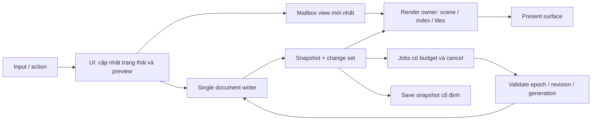

# Đặc tả kiến trúc và thuật toán đề xuất

Đọc cùng [kế hoạch](README.md), [gates](acceptance.md) và [task cards](tasks.md). Mọi cấu trúc/API mới bên dưới là proposed; P03/P04 khóa contracts trước code consumer. Giữ single writer, stable IDs, epoch/revision/generation, mm/binary64, source color/text và editable geometry hiện có.

## 1. Luồng tương tác



- UI thread sở hữu HWND, focus/IME và tool state. UI không parse file, decode ảnh, chạy Boolean lớn, flush file, chờ GPU fence hoặc render toàn scene trong callback input/paint.
- Single document writer có thể vẫn là UI owner giai đoạn đầu: chỉ publish/validate ngắn. Prepare lớn ở worker; kiểm base revision lại ngay trước commit. Root, index/delta, change set và history xuất bản nhất quán. Không chuyển tùy tiện writer sang thread khác.
- Render owner sở hữu GPU context/surface/resources. Với GDI CPU fallback, worker tạo buffer bất biến, UI chỉ blit buffer hoàn chỉnh; không dùng chung HDC/GDI object giữa worker và UI.
- Tách view sequence khỏi document revision. Zoom/pan/hover không tạo revision tài liệu. Frame mang `documentId, epoch, revision, viewSequence, backendGeneration, quality`.
- Mailbox giữ latest view, tối đa 1 pending frame request + 1 in-flight render. Coalesce hover/move/wheel preview nhưng không drop pointer-down/up, cancel, IME hay document command. Stroke sampling phải giữ mẫu có timestamp cần cho hình học; không thay tất cả bằng điểm cuối.
- UI paint dùng frame hoàn chỉnh gần nhất, overlay theo camera đang hiển thị; không ghép selection của camera mới lên ảnh camera cũ thiếu mapping. Preview transform phải biết vùng thiếu và quan hệ camera.
- Khi nhận frame/job muộn sau close/undo/cancel/backend reset: kiểm generation rồi bỏ. Resource release được xếp hàng đúng owner. Không giữ mutex tài liệu khi chờ I/O/GPU.

## 2. Contracts phải khóa

| Contract đề xuất | Nội dung tối thiểu | Consumer |
|---|---|---|
| `ChangeSet` | before/after revision, object IDs, old/new bounds, topology/style/asset/effect flags, hierarchy/order change | index, cache, tools, save |
| `SceneReadView` | root lease, index cùng revision hoặc index base + delta đầy đủ, ordered hierarchy, source/visual bounds | render, hit-test, snap |
| `RenderRequest/CompletedFrame` | view sequence, camera double, viewport/DPI, color preview identity, backend generation, quality, damage, fence/lifetime | desktop/render |
| `AssetRef/AssetProvider` | content hash, source length/codec/profile/orientation, immutable lifetime, pending/ready/error, tile keys và budgets | document, raster, storage, render |
| `EffectStack` | effect ID/version, source units, order, color/blend/alpha policy, bounds/ROI, parameters, unknown required feature | document, render, storage, UI |
| `JobToken` | documentId/epoch/base revision/generation, cancellation, bytes/work estimate, priority | compute/I/O/decoder/publish |
| `ResourceBudget` | reserved/live/retired bytes theo pool, pinned leases, CPU/shared/dedicated GPU, pressure state | tất cả caches/jobs |
| `ContainerManifest` | format/minReader/feature IDs, 64-bit ranges, directory/schema versions, checksums, source/assets, limits | storage, migration, workers |

Contracts này mở rộng C2/C3/C5/C6/C7 theo scope được coordinator cấp. Chỉ serialize DTO nguồn trung lập, không lưu SkPath/SkImage/GPU handle trong file. Mọi count/offset/stride/size phải kiểm overflow trước allocation hoặc đọc.

**Dependency:** rendering hiện không phụ thuộc `modules/raster` hay `platform/workers`. Đặt DTO nguồn/asset-provider interface tối thiểu tại document; raster tạo asset/proxy, desktop composition root inject provider/executor vào render. Không thêm include renderer→raster hoặc document→render/UI. P04 kiểm registry, chỉ thêm common runtime module nếu thực sự cần và được ADR; phương án mặc định dùng interfaces được inject, không tạo module mới.

## 3. Document và asset

Giữ persistent AVL và immutable source. `ImageObject` chuyển thành tham chiếu asset + transform/crop/mask/effect metadata; pixel storage bất biến dùng chung qua snapshot/history. Chuyển adapter cũ theo giai đoạn để không làm gãy v2/v3 reader. Transform hoặc duplicate ảnh chỉ tạo object metadata, không copy toàn ảnh; sửa pixel tạo tile mới copy-on-write. Content hash dedup source; xác minh length/hash và metadata riêng, không dedup nhầm profile/orientation.

Tách source path với render path/tessellation. Source path đã có ID node/segment, phải giữ nguyên qua undo/save/export. Geometry lớn chia chunk bất biến nếu P01 đo được copy bottleneck; không thay toàn bộ AVL bằng ECS trước evidence. Page/layer order vector lớn cũng phải đo; kéo một object không được copy lại hàng triệu IDs trong mỗi pointer move.

Pin snapshot/assets cho render, save và export; history budget minh bạch. Giải phóng lượng lớn object/tile trên cleanup executor có quota thời gian; tuyệt đối không destroy GPU object ngoài render owner. Giới hạn số revision còn giữ; không đợi destructor lâu trong input callback.

## 4. Spatial index, hit-test, snap

Chọn packed R-tree làm baseline 2D: bulk build trên snapshot nền, query bằng AABB; hỗ trợ delta insert/update/remove cho edits. P07 so với linear oracle và BVH candidate nếu scene corpus chứng minh lợi ích. Không hứa O(log N) worst case; scene tất cả chồng lên nhau vẫn trả nhiều candidates.

- Lưu source bounds và visual bounds riêng. Visual bounds gồm stroke join/cap/miter, transform, clip, group, effect extent. Bounds sai gây biến mất shadow ngoài viewport.
- Query trả IDs; giữ render order/hierarchy qua order keys, không sort lại theo material xuyên transparency/group isolation.
- Index root + delta cùng document revision. Khi bulk index chưa xong: dùng index base + tombstones/delta đủ, hoặc fallback scan correctness có ngân sách nền; không query index cũ rồi mất object vừa thêm.
- Hit-test: broad phase index → exact/narrow phase theo editable geometry. Tolerance theo DIP chuyển world; khóa selection semantics, z-order, invisible/locked, clip và group isolation. Pending asset không thể được báo thành miss một cách âm thầm.
- Snap index giữ endpoint/source node/midpoint/grid hiện có; dùng spatial candidate query và cache local geometry. Không thay bằng cạnh tile preview hoặc mesh LOD.
- Giant single path: segment hierarchy/BVH cho narrow phase; adaptive flatten cache theo transform scale/tolerance. Region crossing dùng segment intersections, không chỉ AABB. Kết quả cap vượt budget trả pending/diagnostic và hoàn thành nền, không bịa hit/miss.

## 5. Render scene, damage và tile

Tạo retained display list theo subtree; version riêng geometry/style/transform/asset/effect. Một edit không đổi toàn scene cache key nếu dependency không liên quan. Cache keys chứa object/content revisions, hierarchy/composite dependency, scale bucket, fractional origin nếu cần, DPI, color profile, alpha/blend policy, quality và backend generation.

Damage là union visual bounds cũ/mới và dependency expansion. Xóa object phải invalidate vùng cũ; đổi order/clip/group opacity phải invalidate vùng composite liên quan. Backdrop-dependent effect invalidates cả phần đọc từ background; loại chưa hỗ trợ phải báo rõ, không dùng dirty rect của object riêng lẻ.

Tile screen/render scale khởi điểm 256 hoặc 512 px; benchmark hai cỡ ở P13. Tile gồm nội dung và halo, crop chỉ lúc compose. Tách overlay selection/guides khỏi source frame. Dirty nhỏ update tile tương ứng; dirty coverage lớn chuyển full redraw theo threshold đo, không luôn chọn tiles. GPU partial redraw cần backing render target giữ nội dung ổn định; không giả swapchain buffer giữ frame trước.

Pan dịch/reproject tiles đã có, ưu tiên tile vừa lộ. Zoom dùng scale buckets có hysteresis, reprojection tạm rồi redraw đúng scale. Không transform màn hình cũ vô hạn: sau gesture settle, chạy full-quality visible refinement. Vùng chưa có dữ liệu có placeholder có trạng thái; ghi `% coverage, age_ms, quality` vào trace. Nghiệm thu FPS phải tính frame chứa phản hồi đúng, không chỉ frame lặp lại cache cũ.

Drag/resize/rotate: snapshot giữ nguyên trong preview; overlay transform selected subtree đúng thứ tự composite, bỏ bản cũ khỏi scene trong vùng đó để không vẽ đôi. Nếu group/backdrop khiến preview isolated sai, invalidate composite group hoặc hiển thị bounding preview đã công bố. Pointer-up publish một transaction và một undo entry, Escape hủy; không commit mỗi move. Preview độ chính xác cao cho đường/handle đang chỉnh; giảm chất lượng phần nền trước.

## 6. Vector, bitmap và typography

Vector: trừ origin camera/tile bằng double trước khi đổi float. Adaptive Bézier flatten theo sai số screen-space, cache local tessellation và giữ fill rule/self-intersection/cap/join. Preview sai số đề xuất ≤0,5 px; settled ≤0,25 px; sản xuất dùng source cùng tolerance riêng. Path khổng lồ cần chunk/clip mà vẫn giữ winding toàn hình; không raster từng đoạn như polygon độc lập. Không giả toàn bộ path cần GPU tessellation một lần mỗi frame.

Bitmap: giữ original compressed bytes; decode theo tile/mip ngoài UI, tile ưu tiên visible rồi prefetch giới hạn một vành. Ảnh 20.000×20.000 RGBA8 là khoảng 1,49 GiB cho **một** full buffer; tuyệt đối không eagerly decode toàn bộ nhiều ảnh như vậy. Một số codec không hỗ trợ random region decode: scanline decode trong worker sang tiled disk cache có quota, hủy được; không tuyên bố mọi JPEG đều decode tile trực tiếp. Decode/decompress budget kiểm kích thước thật và expansion ratio. Color conversion có profile key và cache, orientation/crop/alpha đúng. GPU upload từng batch bounded, tránh synchronous readback mỗi frame, hạn chế mip set resident.

Render image primitives, crop/clip và sampling phải hoạt động trước benchmark bitmap. Typography phải shape Unicode/font đúng bằng module typography, cache glyph runs/outlines theo font/size/features; glyph atlas có eviction và generation. Không dùng character-count box thay glyph outlines rồi báo scene chữ đã pass.

Software fast path: render thẳng format pixel consumer nhận nếu contracts hỗ trợ; tránh vòng RGBA→BGRA toàn canvas khi không cần. Reuse surfaces, SIMD có scalar reference và runtime feature check; worker tiles ghi vùng riêng rồi composite đúng thứ tự. Giới hạn thread theo measured throughput/latency; laptop 2C/4T thử 1–2 background compute threads để input/render còn tiến triển, không tạo pool riêng vô hạn cho từng subsystem.

## 7. Shadow, blur và effects

Hiệu ứng là stack/DAG bất biến tham chiếu nguồn, không thay pixel/path source. P22 chốt thứ tự clip→effect→opacity, object/group isolation, effect trước/sau transform, đơn vị blur sigma, alpha premultiplication và color space. Default đề xuất: Gaussian sigma theo mm local; chuyển qua transform/DPI cho preview; nonuniform scale được xử lý anisotropic hoặc canonical local layer đúng semantics. Không dùng nhãn Radius nếu thực chất là sigma mà không quy ước.

- Gaussian blur: CPU hai lượt separable horizontal/vertical giảm chi phí kernel vuông; GPU chọn filter/backend đã spike. Large sigma dùng downsample→blur→upsample cho interactive approximation, refinement chất lượng cao sau settle. Không đổi sigma nguồn theo zoom.
- Halo theo support kernel đã quy định (ví dụ finite support ±3σ có tail tolerance được oracle chấp nhận), nhân scale và cộng offset shadow; kernel khác phải tính halo khác. ROI lan ngược qua toàn chuỗi effects; halo của nhiều filters cộng/compose, không dùng 3σ cố định cho cả graph.
- Shadow: lấy alpha của source/mask, blur, tint, offset và composite theo stack; giữ cache alpha/blur khi chỉ đổi màu/offset nếu dependency cho phép. Group opacity áp dụng một lần trên group isolation.
- Cache node output theo input versions/params/ROI/scale/color/quality. Giữ tile boundaries liên tục; backdrop và blend có dependency riêng. Không reorder effect nodes để batch GPU nếu semantics đổi.
- Slider: latest-wins preview, generation token; commit một undo khi kết thúc gesture/Apply. Cancel không nhận kết quả muộn. Large ROI vượt budget thì hạ resolution preview có báo, chạy job refinement có progress/cancel.
- Giai đoạn đầu hỗ trợ Gaussian Blur + Drop Shadow, mask/opacity/clip và blend subset đã định nghĩa. Glow, displacement, motion blur, arbitrary plugin filters là task sau; không quảng cáo “mọi hiệu ứng”. Export dùng source stack và renderer full-quality, không dùng tiles preview chất lượng thấp.

## 8. Phần cứng và bộ nhớ

P18 đánh giá **một** GPU candidate mặc định Windows: Skia Ganesh qua ANGLE/D3D11, so với software và native adapter hiện có; pin Skia/ANGLE revision + compiler/options/license. Đây là lựa chọn thử nghiệm, không khẳng định build đó hỗ trợ máy hiện tại. Nếu candidate fail, coordinator ghi evidence và chọn candidate khác (ví dụ backend native khác có triển khai/test), không cho agent tự đổi cả stack. Giữ shell Win32 khi spike, không gộp rewrite Qt vào task render.

Probe device/context, required features, texture size, render format/alpha/color, shader/filter correctness, driver/OS và present; chạy feature fixtures. Chọn theo capabilities, không theo Intel/AMD/NVIDIA. Skia mô tả [ANGLE bridge](https://skia.org/docs/user/special/angle/); phải kiểm build và máy thật.

Ngân sách ban đầu đề xuất trên máy RAM 8 GB: soft **2 GiB tổng memory do app+workers quản lý**, pressure test trước 2,5 GiB; không phải cam kết mọi file đều vừa. Phân bổ thử 512 MiB source/index, 512 MiB history/pinned revisions, 512 MiB decoded/render caches, 256 MiB job scratch, 256 MiB overhead/headroom. Texture/shared GPU allocation phải được accounting vào budget của iGPU, tránh cộng trùng khi báo OS counters. Các pool mượn được trong total cap; source không vừa thì stream hoặc báo giới hạn rõ, không xóa source để thu RAM.

GPU cache target ban đầu min(256 MiB, 25% budget OS cung cấp) trên cấu hình thử; CPU cache và GPU resident cùng memory governor. API [DXGI memory budget](https://learn.microsoft.com/en-us/windows/win32/api/dxgi1_4/ns-dxgi1_4-dxgi_query_video_memory_info) cung cấp budget/usage; thiếu API thì dùng cap bảo thủ và pressure signals, không tin `AdapterRAM` là VRAM khả dụng. Máy 16/32 GB có profile riêng sau benchmark, không suy ra bằng tên GPU.

Reserve bytes trước khi enqueue/decode/upload. LRU cost-aware theo bytes/recompute cost; pinned entries không bị evict, nếu pinned vượt budget dừng job/prefetch mới và giải phóng leases hết hạn, không xoay vòng thrash. Memory pressure: bỏ prefetch → giảm cache → giảm preview scale → trì hoãn background refinements → báo thao tác quá lớn. Thermal/power slowdown phải tác động quality/work quotas, không hạ accuracy nguồn. Worker concurrency là tổng pool cap, không tổng số core nhân số subsystem.

Recoverable device-loss: tăng backend generation, ngừng submissions, giải phóng đúng owner/fences, rebuild từ CPU/file source, chuyển software đã kiểm chứng. Fatal driver crash/hang trong process không có bảo đảm tự cứu; nếu sản phẩm yêu cầu host sống qua loại này, P21 phải so spike render process isolation hoặc đưa vào giới hạn phát hành và recovery-on-restart. Không vô hạn retry driver lỗi.

## 9. Định dạng file thiết kế native v4 — candidate

Đây là **schema mới phải qua P27**; không tăng constant v3 rồi ghi layout khác. V2/v3 reader giữ nguyên, v1 tiếp tục policy đã có. Format quyết định bằng benchmark: candidate chính chunked immutable container; SQLite BLOB/container là đối chứng ở spike, không mặc định viết storage engine phức tạp hoặc đóng gói SQLite khi chưa đo.

Layout chunked đề xuất:

```text
Header: PKDR + major/minor + minReader + feature bits + document UUID
        directory offset/length (u64 LE), header checksum, saved revision
Directory: typed entries {chunkId, kind, schema, offset:u64,
            compressedBytes:u64, rawBytes:u64, codec, checksum, required}
Manifest: units, pages/layers, root IDs, color policies, required schemas
Object pages: stable IDs, hierarchy/order, transforms, style/effect refs
Source chunks: editable paths/nodes, Unicode/text/font identities
Asset chunks: original encoded assets + ICC + hashes + metadata
Effect chunks: non-destructive parameter graph and source dependencies
Optional derived chunks: thumbnails/proxies/index/mips + generator version
Footer/commit validation: directory digest and container generation
```

Offsets/counts/checksums viết field-by-field; không dump C++ struct, không serialize pointer. Directory phải bounded trước allocation. Object page mục tiêu 64–256 KiB decoded; asset chunk 1–4 MiB storage khởi điểm (khác tile pixel 256/512); P27 benchmark để khóa. Nén theo chunk/codec được pin; không nén lại JPEG/PNG tốn CPU nếu không có lợi. Hash dùng cho integrity/dedup không được quảng cáo authentication. Cần limits cho raw size, count, hierarchy depth, recursion, object pages và expansion; 64-bit offset không có nghĩa bỏ giới hạn tài nguyên.

Source là authoritative; cache/proxy/index có thể bỏ và dựng lại. Preview bytes không dùng cứu thay cho source khi source hỏng. Unknown optional chunks có thể giữ opaque; unknown required schema/effect phải refuse hoặc read-only có loss report, không edit/save rồi mất dữ liệu.

Open: đọc header/directory/manifest, dựng lightweight IDs/order/bounds đã validation; visible source pages/assets hydrate nền. Command cần dữ liệu chưa nạp trả Pending và chờ job ngoài UI; không edit một proxy như source. Thêm object registry metadata resident và hydration provider lease; publish dữ liệu sẵn sàng không thay semantic revision của file nếu nội dung nguồn không đổi, nhưng tăng residency generation và invalidates render. P04/P29 khóa chi tiết này với single-writer invariants. Dữ liệu directory/index chỉ là hint nếu chưa verify source; không dùng bounds giả cho production.

Save giai đoạn đầu: pin một snapshot → streaming write vào temporary cùng volume → flush/validate → atomic replace theo policy OS → chỉ clear dirty nếu epoch/revision vẫn khớp. Không giữ full encoded payload + full decoded assets trong RAM. Unchanged chunks có thể copy compressed byte ranges, kiểm checksum. Progressive load không cần decode mọi asset để save nếu original source chunks đã được pin.

Autosave/recovery dùng journal riêng, records có sequence/CRC/base manifest hash, commit marker và flush policy công bố; checkpoint theo thời gian/bytes có backpressure. Draft points batch theo chunk, không serialize lại toàn polyline sau mỗi ký tự. Không tự xóa journal của job đang dùng. Save As hoàn chỉnh và self-contained mặc định; linked assets là opt-in, content fingerprint, missing/changed link có relink UI và không thay nguồn âm thầm.

Incremental user save append-only chỉ là optimization sau khi temp-replace + recovery qua fault tests. P31 phải chứng minh commit-root update/torn-write/compaction/multi-process writer locks và free-space policy. Nếu chưa chứng minh, giữ streaming full save nền; UI responsiveness vẫn là yêu cầu, không ép incremental format để giảm benchmark. SQLite đối chứng cần accounting WAL/checkpoint và portable snapshot/backup; [atomic commit](https://www.sqlite.org/atomiccommit.html) và [WAL](https://www.sqlite.org/wal.html) là cơ sở khảo sát, không bằng chứng PikDraw đã durable.

Migration: v2/v3→memory source→v4 temporary→reopen+semantic compare→cho Save As; giữ file cũ. Down-save chỉ khi mọi feature biểu diễn được; cần báo loss hoặc từ chối. Preserve persistent document/object/node/segment IDs, winding, colors/profile/spot/overprint, fonts, clip/groups, effects và original asset bytes. Không lưu render float làm tọa độ nguồn.

## 10. UI dự kiến để agent không tự tạo panel mới

Tasks core chỉ thay implementation, giữ action surfaces. P26 hoàn thiện phiếu theo template trước khi code và kiểm action IDs thực tế để reuse; các ID sau là proposed, không phải bindings hiện có.

| Tính năng | Placement / action đề xuất | Scope / trạng thái / hành vi |
|---|---|---|
| Preview quality | `View > Preview Quality > Auto / Full`, `view.preview_quality` | View preference; Auto mặc định; không sửa document/export; không có toolbox mới |
| Graphics mode | `Settings > Preferences > Performance`, `app.performance_preferences` | App preference Auto/GPU verified/Software; chọn unavailable mode bị disable kèm lý do; apply backend reset giữ document |
| Blur | `Effects > Gaussian Blur…`, `effect.gaussian_blur` | Selection source; Properties > Effects; enabled khi editable selection, không locked/read-only |
| Shadow | `Effects > Drop Shadow…`, `effect.drop_shadow` | Selection source; Properties > Effects; cùng command ở menu/context/properties |
| Cancel background command | Existing status task area + Escape theo tool precedence, `job.cancel` | Hủy job token; không hủy document khác, không cướp IME Escape |

Fields: blur sigma X/Y mm finite ≥0 (default 1 mm), shadow offset X/Y mm (default 2/2), sigma 1 mm, opacity 0–100% (default 50), source color black; giới hạn cao phụ thuộc numeric domain và budget sau P22, vượt budget giữ source nhưng render preview/progress rõ. Multi-selection hiện Mixed, chỉ field user sửa mới apply toàn selection. Property bar chỉ sigma/opacity nhanh khi đang sửa effect; toàn bộ stack nằm Properties. Fields sync cùng binding. No selection không tự ghi default vào object; app preview controls vẫn dùng được. Unsupported object/effect báo lý do, không âm thầm flatten.

Drag slider tạo preview draft; Enter/Apply/kết thúc gesture commit một undo; Escape khôi phục. Đổi selection/document hủy draft theo token, giữ focus/IME đúng. Status: “Preview / Xem trước”, “Refining / Đang hoàn thiện”, “Cancelled / Đã hủy”; label EN mặc định, VI catalog. Tooltip/focus help giải thích preview không thay source và tham số theo mm; không thêm phím tắt chưa bind. SVG blur/shadow/performance theo icon set repo, accessible name từ catalog; agent cấp asset ID/path/license trong phiếu P26. Help có ví dụ chọn object → Effects → sửa → hủy/undo; không đặt hướng dẫn dài lên button. Light/dark, DPI 100/150/200%, narrow Properties, keyboard/tab order và screen reader phải review.

Nguồn API hiệu ứng tham khảo: [SkImageFilters](https://api.skia.org/classSkImageFilters.html) có Blur/DropShadow và composition; việc tồn tại API không chứng minh fidelity hay tốc độ của candidate build.
