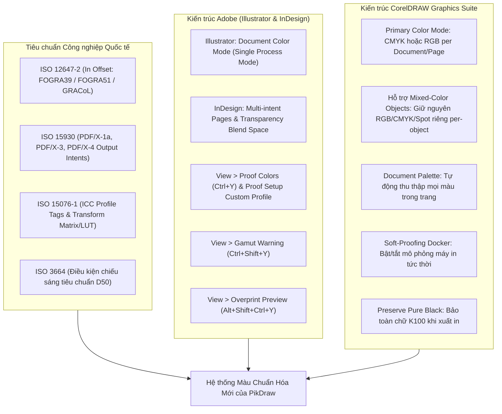
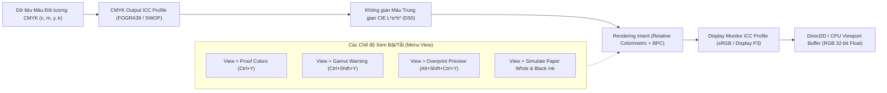
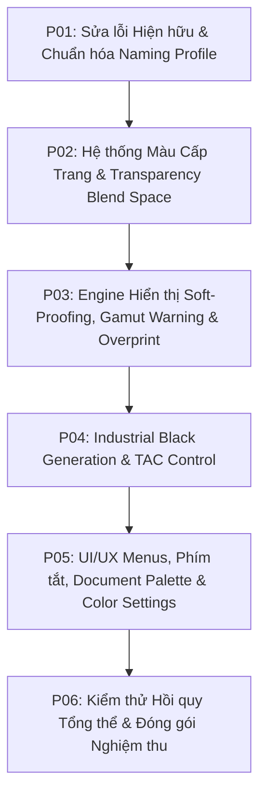

# Kế hoạch Hoàn thiện Hệ thống Màu sắc PikDraw Đạt Tiêu chuẩn Hiển thị & In ấn Công nghiệp

> **Cập nhật hướng thực thi 20/10/2026:** đọc [source audit và C00–C09](existing-feature-upgrade-20261020/color-management-plan.md) cùng [kế hoạch triển khai](existing-feature-upgrade-20261020/implementation-plan.md) trước khi sửa. Các mô tả “chưa có”/“đã đạt” bên dưới là bối cảnh của bản plan trước, không là trạng thái runtime hiện hành. Source đã có Windows CMM, proof/gamut controls và black/TAC helpers; overprint helper chưa chứng minh compositor. Proof shortcut hiện là Ctrl+Alt+Y, Ctrl+Y giữ Redo; TAC và rich-black recipe phụ thuộc output condition, không phải giới hạn/công thức chung. Giữ các mục tiêu/AC cũ, đối chiếu với AC-CM và capability thực; chưa có chứng nhận in công nghiệp từ đợt audit này.

> Các tên target test đề xuất ở phần dưới chưa chắc đã được tạo trong CMake. Agent dùng danh sách target và lệnh đã đối chiếu ở C00–C09/implementation-plan, không chạy tên đề xuất như target đã có.

**Mã kế hoạch**: `PLAN-COLOR-STANDARDS-20261020`  
**Ngày lập**: 20/10/2026  
**Mô-đun liên quan**: `core/color`, `core/document`, `core/rendering`, `modules/interop`, `apps/desktop`  
**Tài liệu tham chiếu chuẩn**:
- **ISO 12647-2:2013**: Graphic technology — Process control for the production of half-tone colour separations, proof and production prints (Offset Lithographic Processes).
- **ISO 15076-1:2010 (ICC.1:2010)**: Image technology colour management — Architecture, profile format, and data structure.
- **ISO 15930 (PDF/X)**: PDF/X-1a:2001 (CMYK/Spot thuần túy), PDF/X-3:2002 và PDF/X-4:2010 (Color-managed RGB/CMYK/Lab).
- **ISO 3664:2009**: Graphic technology and photography — Viewing conditions (Standard D50 illumination).
- **IEC 61966-2-1:1999**: Multimedia systems — Colour measurement and management — Part 2-1: Default RGB colour space — sRGB.
- **Adobe Color Management Guide**: Adobe Illustrator & InDesign Color Architecture, Working Spaces, Soft Proofing & Overprint Preview.
- **CorelDRAW Color Management Technical Specification**: Primary Color Mode, Document Palette, Soft-Proofing Docker, Pure Black Preservation.
- [Hướng dẫn tương thích tài nguyên vector](../architecture/vector-resource-interoperability.md), [Tiêu chuẩn UI/UX](../design/ui-ux-standard.md), [Bố cục không gian làm việc](../architecture/workspace-layout.md).

---

## 1. Tóm tắt Yêu cầu & Bối cảnh

Hệ thống màu sắc hiện tại của PikDraw (sau đợt đại tu `PLAN-COLOR-DPI-20261018`) đã thiết lập được khả năng chuyển đổi hệ màu tài liệu nguyên tử (`ConvertDocumentColorModeCommand`), ghi nhận metadata trong native format và menu `Edit > Document Color Mode`. Tuy nhiên, khi đối chiếu với quy trình sản xuất thực tế tại các xưởng in và tiêu chuẩn của các phần mềm đầu ngành (Adobe Illustrator, InDesign, CorelDRAW), hệ thống màu hiện tại bộc lộ 5 hạn chế và khiếm khuyết lớn:

1. **Ràng buộc gán cứng một hệ màu duy nhất trên toàn bộ Document (`All pages must share document color settings`)**:
   - Trong `core/document/snapshots/document_snapshot.hpp`, hệ thống ném ngoại lệ nếu các trang có `color_mode` hoặc `raster_dpi` khác nhau.
   - *Thực tế sản xuất*: Một ấn phẩm đa trang (Multi-page / Multi-artboard) thường có yêu cầu khác nhau giữa các trang: Trang bìa và trang nội dung in offset cần chế độ `CMYK 300 DPI` (FOGRA39/SWOP), trong khi trang phụ lục phát hành số, banner web hoặc slide trình chiếu cần `RGB 72/150 DPI` (sRGB/Display P3). Việc ép buộc 100% trang phải cùng một mode làm mất đi tính linh hoạt cốt lõi của tài liệu đa trang.
2. **Chưa phân định giữa Chế độ Màu Nguồn (Source Data Mode) và Chế độ Hiển thị (Display / Soft Proofing Mode)**:
   - Màn hình máy tính bản chất là thiết bị **RGB cộng màu** (Additive Display). Không có màn hình nào phát xạ ánh sáng CMYK.
   - Hiện tại, PikDraw hiển thị CMYK trên viewport Direct2D và CPU Rasterizer bằng công thức trừ màu gần đúng thô sơ $R = (1-C)(1-K)$, $G = (1-M)(1-K)$, $B = (1-Y)(1-K)$. Kết quả hiển thị bị xỉn, bết màu hoặc quá rực rỡ, không phản ánh đúng màu mực in thực tế trên giấy.
   - Chưa có các công cụ quan sát chuyên nghiệp: **Proof Colors** (`Ctrl+Y`), **Gamut Warning** (`Ctrl+Shift+Y`), **Overprint Preview** (`Alt+Shift+Ctrl+Y`), **Mô phỏng giấy in & mực đen** (Simulate Paper White & Black Ink).
3. **Thiếu vắng Bộ máy Quản lý Màu (Color Management Engine) hoàn chỉnh**:
   - Chưa hỗ trợ 4 mục đích tái tạo màu (**Rendering Intents**): *Relative Colorimetric (with Black Point Compensation)*, *Perceptual*, *Saturation*, *Absolute Colorimetric*.
   - Chưa có thuật toán bảo toàn màu đen thuần (**Black Preservation / Pure K100 vs Rich Black**): Khi chuyển đổi từ RGB sang CMYK, văn bản chữ nhỏ và đường viền nét mảnh phải luôn là Black K100 ($C=0, M=0, Y=0, K=1$) có bật Overprint để tránh lỗi lệch tram kẽm in (misregistration), trong khi mảng bệt lớn (Large Solids) cần Rich Black ($C=40, M=30, Y=30, K=100$).
   - Chưa kiểm soát tổng lượng mực bao phủ (**Total Area Coverage - TAC / Total Ink Limit**): Vượt quá 300% - 320% sẽ gây nhòe mực, dính trang khi in offset tốc độ cao.
4. **Không gian Hòa trộn Độ trong suốt (Transparency Blend Space)**:
   - Khi hòa trộn các đối tượng có độ trong suốt (Alpha, Drop Shadow, Gaussian Blur), chưa có thiết lập Blend Space (RGB hay CMYK), dẫn đến viền bóng đổ bị xỉn hoặc gãy dải màu chuyển (color banding).
5. **Lỗi hồi quy định dạng và chuỗi tên profile**:
   - Native storage deserializer bỏ sót kiểm tra phiên bản v9 (`kDocumentColorFormatVersion`), và chuỗi tên profile không đồng nhất giữa `"sRGB"` và `"sRGB IEC61966-2.1"`, làm fail test hồi quy mở lại file (`test_pikdraw_document_color_workflow`).

---

## 2. Nghiên cứu Đối sánh Chuyên sâu: Adobe vs Corel vs Tiêu chuẩn In ấn ISO



### 2.1. So sánh Kiến trúc Adobe vs CorelDRAW

| Tiêu chí | Adobe Illustrator | Adobe InDesign | CorelDRAW Graphics Suite | Đề xuất Kiến trúc Chuẩn cho PikDraw |
|---|---|---|---|---|
| **Cơ chế Color Mode** | Document Color Mode: Khóa chặt toàn file là CMYK hoặc RGB. | Content-Centric: Cho phép ảnh RGB và vector CMYK cùng tồn tại; chỉ định Transparency Blend Space. | Primary Color Mode: Xác lập mode mặc định, nhưng cho phép từng đối tượng giữ mode riêng. | **Hybrid linh hoạt**: Mặc định cấp Document; cho phép đặt riêng per-Page; bảo toàn màu nguồn của từng đối tượng vector/ảnh. |
| **Mô phỏng In ấn (Soft Proofing)** | `View > Proof Colors` (`Ctrl+Y`), cho phép chọn profile đích, simulate paper white và black ink. | Tương tự Illustrator; tích hợp trong Proof Setup. | `Tools > Color Management > Proof Settings` (Docker Proofing trực quan). | **Cung cấp `View > Proof Colors` (`Ctrl+Y`)** kèm menu `Proof Setup` chọn FOGRA39 / SWOP / GRACoL / sRGB. |
| **Cảnh báo lệch Gamut** | `View > Gamut Warning` (`Ctrl+Shift+Y`), phủ lớp highlight lên màu ngoài tầm in. | Kiểm tra qua Separations Preview và Preflight panel. | Out-of-Gamut Warning trong Color Proofing Docker. | **Cung cấp `View > Gamut Warning` (`Ctrl+Shift+Y`)** với shader Direct2D / CPU mask highlight màu xám/xanh neon. |
| **Mô phỏng In đè (Overprint)** | `View > Overprint Preview` (`Alt+Shift+Ctrl+Y`), tách lớp K100 overprint chuẩn xác. | Mặc định tự động bật khi xuất PDF hoặc bật View Overprint. | Simulate Overprint trong Document Options. | **Cung cấp `View > Overprint Preview`**: Hiển thị chính xác nét K100 đè lên nền và màu dao bế CutContour. |
| **Quản lý Màu Đen (Black Policy)** | Preferences > Appearance of Black (Display/Output: Accurately vs Rich Black). | Tương tự Illustrator (Accurate vs Rich Black). | Option "Preserve Pure Black" khóa chặt chữ đen thành K100. | **Tùy chọn Black Generation Engine**: Chữ nhỏ $\le 24\,\text{pt}$ và nét viền tự động khóa K100 Overprint; mảng nền lớn hỗ trợ Rich Black. |
| **Bảng màu (Palette)** | Swatches panel (khóa process sliders theo document mode, giữ Spot). | Swatches panel (hỗ trợ cả RGB, CMYK, Lab, Spot). | Document Palette (tự động thu thập màu đang dùng trên trang/file). | **Document Palette linh hoạt**: Tự động hiển thị swatches theo trang hiện hành, hiển thị rõ huy hiệu RGB/CMYK/Spot. |

---

## 3. Kiến trúc Mục tiêu của Hệ thống Màu PikDraw (Target Architecture)

### 3.1. Phân cấp 3 tầng: Document $\rightarrow$ Page $\rightarrow$ Object

```
+-----------------------------------------------------------------------------------+
| DOCUMENT CONTAINER (Tài liệu tổng thể)                                           |
| - default_color_mode: CMYK (hoặc RGB)                                            |
| - transparency_blend_space: BlendSpace::Cmyk (hoặc BlendSpace::Rgb)               |
| - default_raster_dpi: 300 (hoặc 72, 150)                                          |
| - working_profiles: { RGB: "sRGB IEC61966-2.1", CMYK: "Coated FOGRA39 / SWOP" }    |
+-----------------------------------------------------------------------------------+
          │
          ├──► TRANG 1: "Bìa Catalogue" (In Offset)
          │    - page_color_mode: Inherit (CMYK)
          │    - raster_dpi: 300 DPI
          │    - proof_profile: "Coated FOGRA39"
          │    - objects: Path (CMYK), Text (Pure K100 Overprint), Spot (CutContour)
          │
          ├──► TRANG 2: "Trang Ruột 1-2" (In Offset)
          │    - page_color_mode: Inherit (CMYK)
          │    - raster_dpi: 300 DPI
          │    - objects: Vector Graphics (CMYK process)
          │
          └──► TRANG 3: "Digital Web Banner" (Phát hành Web/Màn hình)
               - page_color_mode: Override (DocumentColorMode::Rgb)
               - raster_dpi: 72 DPI
               - proof_profile: "sRGB IEC61966-2.1"
               - objects: Web Graphics (sRGB)
```

1. **Cấp Tài liệu (`DocumentSnapshot` / `Document`)**:
   - `default_color_mode`: Hệ màu mặc định khi tạo trang mới.
   - `transparency_blend_space`: Không gian tính toán khi hòa trộn các layer mờ, bóng đổ, hiệu ứng bitmap (`BlendSpace::Cmyk` hoặc `BlendSpace::Rgb`).
   - `working_cmyk_profile`: Ví dụ `"Coated FOGRA39"` hoặc `"U.S. Web Coated (SWOP) v2"`.
   - `working_rgb_profile`: Mặc định `"sRGB IEC61966-2.1"` hoặc `"Display P3"`.
2. **Cấp Trang (`Page` / `DocumentPage`)**:
   - Mỗi trang sở hữu trường `color_mode_override: std::optional<DocumentColorMode>`. Nếu `nullopt`, trang kế thừa chế độ màu của tài liệu. Nếu có giá trị (ví dụ trang 3 là `Rgb`), trang sẽ áp dụng hệ màu riêng.
   - `raster_dpi`: Tách biệt per-page (Trang in 300 DPI, Trang web 72 DPI).
   - Xóa bỏ ràng buộc ném ngoại lệ cấm khác màu trong `document_snapshot.hpp:80-86`. Thay vào đó, bộ validator chỉ kiểm tra tính hợp lệ của từng trang độc lập.
3. **Cấp Đối tượng (`ColorValue`)**:
   - Đối tượng vector (`PathObject`, `TextObject`, `GradientStop`) lưu trữ giá trị màu gốc (`RGBColor`, `CMYKColor`, `SpotColor`, `GrayscaleColor`).
   - Cung cấp cờ `overprint` (In đè mực) và `is_pure_black` cho các nét viền/chữ.

---

### 3.2. Hệ thống Hiển thị & Soft-Proofing (Screen Display & Soft Proofing Engine)

Để màn hình máy tính hiển thị màu CMYK chuẩn xác như in ra từ xưởng offset, PikDraw tích hợp bộ máy Soft-Proofing thời gian thực:



- **Mô phỏng Giấy và Mực (Paper & Black Ink Simulation)**:
  - *Paper White*: Điểm trắng chuẩn của giấy tráng phấn (Coated Paper) thường có độ sáng $L^* \approx 95, a^* \approx 1, b^* \approx -3$. Khi bật mô phỏng giấy, nền canvas màu trắng $RGB(255,255,255)$ được ánh xạ thành sắc trắng đục của giấy in thực tế.
  - *Black Ink (Dmax)*: Mực đen in offset trên giấy tráng có mật độ quang học $D \approx 1.8 - 2.0$, không thể đạt độ đen tuyệt đối $L^* = 0$. Mô phỏng mực đen giúp người thiết kế thấy rõ độ tương phản thực tế, tránh ảo giác màu đen trên màn hình sâu hơn thực tế.
- **Cảnh báo Vượt Gamut (Out-of-Gamut Warning)**:
  - Khi bật `View > Gamut Warning` (`Ctrl+Shift+Y`), các vùng màu RGB rực rỡ (như xanh nõn chuối $RGB(0,255,0)$ hay xanh cyan chói $RGB(0,255,255)$) nằm ngoài tầm tái tạo của mực in CMYK sẽ được phủ một lớp lưới màu cảnh báo (màu xám trung tính hoặc xanh dạ quang), giúp người thiết kế chủ động chỉnh lại sắc độ trước khi chuyển chế bản.
- **Xem trước In đè (Overprint Preview)**:
  - Khi bật `View > Overprint Preview` (`Alt+Shift+Ctrl+Y`):
    - Chữ và nét viền màu đen $K=100\%$ có bật `overprint=true` sẽ được render theo công thức trừ màu quang học: $Mực_{tổng} = Mực_{nền} + Mực_{K100}$.
    - Màu dao bế `CutContour` (Spot Color) sẽ hiển thị đè lên thiết kế mà không đục thủng nền trắng bên dưới.

---

### 3.3. Bộ Chuyển đổi Màu Chuẩn Công nghiệp (Industrial Color Normalization & Conversion)

Nâng cấp `core/color` với các thuật toán chuyên sâu:

1. **Hỗ trợ 4 Rendering Intents**:
   - `RelativeColorimetricWithBpc` (Mặc định cho đồ họa vector/logo): Duy trì độ chính xác tuyệt đối của các màu nằm trong gamut; bù trừ điểm đen (Black Point Compensation) ngăn chặn hiện tượng bết dính vùng tối.
   - `Perceptual`: Nén toàn bộ không gian màu nguồn vào không gian đích, tối ưu cho ảnh chụp bitmap.
   - `Saturation`: Tối đa hóa độ bão hòa màu, dùng cho biểu đồ và đồ họa văn phòng.
   - `AbsoluteColorimetric`: Giữ nguyên giá trị màu tuyệt đối cả trong và ngoài gamut, neo theo điểm trắng thực tế, dùng cho in test màu chế bản (Proof Print).
2. **Thuật toán Black Generation (UCR / GCR & Pure Black)**:
   - Khi chuyển đổi từ RGB sang CMYK:
     - Nếu $R = G = B = 0$ (Black): Tự động chuyển thành $C=0, M=0, Y=0, K=1$ (Pure Black) và kích hoạt cờ `overprint = true`.
     - Nếu là đối tượng văn bản (`TextObject`) hoặc nét viền có kích thước $\le 1\,\text{mm}$: Giữ nguyên kênh $K$, triệt tiêu $C, M, Y$ về $0$ để ngăn ngừa viền lem do rung lắc trục kẽm khi in offset.
     - Cung cấp tùy chọn **Rich Black Generator** cho các mảng bệt lớn: Áp dụng tỷ lệ $C=40, M=30, Y=30, K=100$ (tổng TAC = 200%) để màu đen trên bản in có chiều sâu bóng bẩy.
3. **Kiểm tra Tổng lượng mực phủ (Total Area Coverage - TAC Limit Check)**:
   - Tính toán $\text{TAC} = C\% + M\% + Y\% + K\%$.
   - Nếu $\text{TAC} > 320\%$ (đối với giấy Coated) hoặc $\text{TAC} > 280\%$ (đối với giấy Uncoated), hệ thống tự động cảnh báo trên Properties Panel và Preflight Inspector, hỗ trợ lệnh 1-click UCR/GCR để giảm tải mực về ngưỡng an toàn.

---

## 4. Đặc tả Giao diện Người dùng (UI/UX Specification)

Tuân thủ nghiêm ngặt [Tiêu chuẩn UI/UX PikDraw](../design/ui-ux-standard.md) và [Bố cục không gian làm việc](../architecture/workspace-layout.md):

```
+-------------------------------------------------------------------------------------------------------------+
| PikDraw Pro  -  [File]  [Edit]  [View]  [Layout]  [Object]  [Effects]  [Bitmaps]  [Text]  [Tools]  ...      |
+-------------------------------------------------------------------------------------------------------------+
| Tab Bar:  [📄 Ấn phẩm Catalogue (CMYK)]  [📄 Banner Khuyến mãi (RGB)]  [+]                                  |
+-------------------------------------------------------------------------------------------------------------+
| [Menu View Dropdown]:                                                                                       |
|   Phóng to / Thu nhỏ / Vừa trang                                                                            |
|   --------------------------------------------------------------------                                      |
|   Chế độ mô phỏng in (Proof Colors)            Ctrl+Y      [✓ Đang bật]                                     |
|   Thiết lập mô phỏng (Proof Setup)         ►   ● In Offset Coated (FOGRA39)                                 |
|                                                ○ In Offset Uncoated (FOGRA52)                               |
|                                                ○ In Báo chí (SWOP v2)                                       |
|                                                ○ Tùy chỉnh ICC Profile...                                   |
|   --------------------------------------------------------------------                                      |
|   Cảnh báo vượt gamut (Gamut Warning)          Ctrl+Shift+Y                                                 |
|   Xem trước in đè (Overprint Preview)          Alt+Shift+Ctrl+Y                                             |
|   Mô phỏng giấy & mực in (Simulate Paper/Ink)                                                               |
+-------------------------------------------------------------------------------------------------------------+
| [Thanh Ribbon Trang]:                                                                                       |
|   [Trang 1 / 3 ▾]  [A4 ▾]  [W: 210 mm]  [H: 297 mm]  │ Mode: [CMYK (In ấn) ▾]  │ DPI: [300 DPI ▾]           |
+-------------------------------------------------------------------------------------------------------------+
| [Document Palette] (Nằm dưới chân màn hình canvas):                                                         |
|   [ C0 M0 Y0 K100 ][ C100 M0 Y0 K0 ][ C0 M100 Y100 K0 ][ CutContour ⬡ ][ R255 G128 B0 ]  [+ Thêm màu]     |
|   Status Bar: "Trang 1: CMYK · FOGRA39 · Proof Colors BẬT · Overprint Preview BẬT"                          |
+-------------------------------------------------------------------------------------------------------------+
```

### 4.1. Bảng Chi tiết Thành phần Giao diện & Hành động

| Thành phần UI | Vị trí / Đường dẫn | Action ID | Phím tắt | Trạng thái & Tooltip | Status Bar Hint |
|---|---|---|---|---|---|
| **Proof Colors** | `View > Proof Colors` | `action.view.proof_colors` | `Ctrl+Y` | Checkable: Bật/tắt mô phỏng màu in thực tế trên màn hình RGB. | "Mô phỏng màu in (Soft-proof): BẬT [FOGRA39] · Nhấn Ctrl+Y để tắt" |
| **Proof Setup** | `View > Proof Setup > ...` | `action.view.proof_setup` | — | Submenu chọn profile mô phỏng in: FOGRA39, FOGRA51, SWOP, GRACoL. | "Đã đổi cấu hình mô phỏng in sang FOGRA39 Coated" |
| **Gamut Warning** | `View > Gamut Warning` | `action.view.gamut_warning` | `Ctrl+Shift+Y` | Checkable: Đánh dấu các màu nằm ngoài khả năng tái tạo của máy in. | "Cảnh báo vượt gamut: BẬT · Các vùng màu ngoài tầm in hiển thị highlight" |
| **Overprint Preview** | `View > Overprint Preview` | `action.view.overprint_preview` | `Alt+Shift+Ctrl+Y` | Checkable: Xem trước hiệu ứng in đè nét đen K100 và màu dao bế CutContour. | "Xem trước in đè (Overprint Preview): BẬT" |
| **Page Color Mode** | Thanh Ribbon Trang / `Layout > Page Color Mode` | `action.layout.page_color_mode` | — | Combobox: `CMYK (In ấn)`, `RGB (Kỹ thuật số)`, `Kế thừa tài liệu`. | "Đã thiết lập hệ màu riêng cho Trang hiện hành" |
| **Document Color Mode** | `Edit > Document Color Mode` | `action.edit.color_mode_cmyk` / `rgb` | — | Chuyển đổi toàn bộ tài liệu (Document-Wide) có Undo/Redo. | "Đã chuyển đổi toàn bộ tài liệu sang CMYK · Ctrl+Z hoàn tác" |
| **Document Palette** | Dock dưới chân canvas (Bottom dock) | `panel.document_palette` | — | Tự động thu thập mọi mã màu có trên trang đang chọn. Click đổi màu nhanh. | "Bảng màu tài liệu: [CMYK] 12 màu · [Spot] 1 màu" |
| **Color Settings** | `Edit > Color Settings...` | `action.edit.color_settings` | `Ctrl+Shift+K` | Hộp thoại cấu hình Working Spaces (RGB, CMYK), Policies & Rendering Intent. | "Đã cập nhật cấu hình quản lý màu chuẩn" |

---

## 5. Bảng Đối chiếu Tương thích Tài nguyên Vector (Vector Resource Interoperability)

Tuân thủ nguyên tắc lập kế hoạch trong [vector-resource-interoperability.md](../architecture/vector-resource-interoperability.md) và các hợp đồng C8/C9:

| Nội dung bắt buộc | Đặc tả kỹ thuật cho Kế hoạch Nâng cấp Hệ thống Màu sắc |
|---|---|
| **User workflow và nguồn** | Người dùng tạo mới tài liệu đa trang (`File > New`), chỉnh sửa tài liệu hiện có, import vector ngoại vi (PDF, AI, CDR, EPS, SVG, DXF), kiểm tra màu trước khi xuất phim chế bản (`View > Proof Colors`, `Gamut Warning`, `Overprint Preview`), hoặc xuất file PDF/X in ấn. |
| **Scope format** | - **PDF**: Hỗ trợ chuẩn DeviceCMYK, DeviceRGB, DeviceGray, Separation/Spot (`CutContour`), và PDF/X Output Intent dictionary.<br>- **AI**: Illustrator color mode header, PDF compatibility stream, CMYK swatches và spot swatches.<br>- **CDR**: Corel Primary Color Mode, per-object color models, Document Palette records.<br>- **EPS**: PostScript Level 2/3 color operators (`setcmykcolor`, `setcolorspace`, `customcolor`).<br>- **SVG**: sRGB colors, CSS color specs, embedded ICC color profile references.<br>- **DXF**: TrueColor RGB và bảng mã màu AutoCAD ACI 256 màu. |
| **Current state** | `core/color` có `ColorValue` và `IccPreview` cơ bản; `core/document` đã có `color_mode` và `raster_dpi` nhưng bị khóa cứng đồng nhất toàn bộ trang; render canvas chỉ hiển thị sRGB xấp xỉ; chưa có Soft-Proofing, Gamut Warning, hay Overprint Preview. |
| **Canonical semantics** | - Trang có thể có mode độc lập hoặc kế thừa từ document.<br>- Quản lý màu hiển thị tách biệt với dữ liệu hình học gốc.<br>- Spot color giữ nguyên 100% định danh tên và tỷ lệ tint.<br>- Black K100 trên nét viền/chữ giữ nguyên thuộc tính overprint khi xuất kẽm in. |
| **Shared algorithm boundary** | - Dùng chung một engine `ColorManagementService` trong `core/color`.<br>- Direct2D viewport và SoftwareRasterizer dùng chung bộ chuyển đổi color transform để hiển thị Soft-Proofing và Gamut Warning.<br>- Các bộ import PDF/AI/CDR/EPS nạp đối tượng vào mô hình dữ liệu trung lập mà không ép mất kênh màu nguồn. |
| **Fidelity matrix** | - **Xem/Render**: Hiển thị mô phỏng in ấn chuẩn xác theo profile ICC máy in đích (FOGRA39, SWOP, v.v.).<br>- **Editability**: 100% đối tượng vector sau khi nạp hoặc chuyển mode vẫn giữ trọn vẹn khả năng biên tập đỉnh/nút (Node editing).<br>- **Provenance**: Giữ nguyên tên gốc của Spot Color và thông số overprint.<br>- **Export/Production**: Xuất PDF in ấn bảo toàn kênh tách màu CMYK và Spot color, không làm vỡ nét vector hay flatten ngoài ý muốn. |
| **Loss policy** | Chuyển đổi giữa RGB và CMYK là quá trình có tổn hao dải màu (gamut loss). Hệ thống hiển thị hộp thoại xác nhận rõ ràng, đồng thời hỗ trợ Undo/Redo (`Ctrl+Z`) bảo toàn 100% màu gốc. Khi hiển thị Soft Proofing, chỉ thay đổi pixel trên màn hình, không làm thay đổi bất kỳ byte dữ liệu nào của đối tượng. |
| **Source integrity** | Không làm thay đổi cấu trúc hình học vector. Giữ nguyên ID bền vững của mọi đối tượng, layer và trang. |
| **Network/security** | `Not applicable` (Toàn bộ engine xử lý màu chạy in-process cục bộ trên máy trạm, không truy xuất mạng). |
| **Acceptance evidence** | Các bộ kiểm thử tự động: `test_pikdraw_color_proof`, `test_pikdraw_gamut_warning`, `test_pikdraw_overprint_preview`, `test_pikdraw_page_color_mode`, và kiểm thử hồi quy `test_pikdraw_document_color_workflow`. |

---

## 6. Lộ trình Triển khai Kỹ thuật Chi tiết (`P01` → `P06`)

Tuân thủ nghiêm ngặt quy tắc độ dài file ($\le 2000$ dòng/file), tách file theo domain rõ ràng:



### Giai đoạn P01: Sửa lỗi Hiện hữu, Version Container v9/v10 & Khôi phục Metadata Native Storage
- **Mục tiêu**:
  - Khắc phục ngay lỗi hồi quy trong `native_format.cpp` (bổ sung `kDocumentColorFormatVersion = 9` vào danh sách phiên bản hợp lệ).
  - Chuẩn hóa chuỗi tên profile giữa `color_value.hpp` (`"sRGB IEC61966-2.1"` vs `"sRGB"`) để bảo đảm tính nhất quán khi lưu và mở lại file.
  - Chạy pass 100% bộ kiểm thử `test_pikdraw_document_color_workflow`.
- **Files tác động**:
  - `core/document/src/storage/native_format.cpp`
  - `core/color/include/pikdraw/color/values/color_value.hpp`
  - `apps/desktop/tests/test_document_color_workflow.cpp`
- **Nghiệm thu**: `test_pikdraw_document_color_workflow.exe` chạy pass hoàn toàn, xác nhận save/reopen khôi phục trọn vẹn metadata màu và DPI.

### Giai đoạn P02: Hệ thống Màu Cấp Trang (Per-Page Color Mode) & Transparency Blend Space
- **Mục tiêu**:
  - Mở rộng `Page` với trường `color_mode_override: std::optional<DocumentColorMode>` và `raster_dpi_override`.
  - Nới lỏng kiểm tra cứng nhắc trong `document_snapshot.hpp:80-86`: Cho phép các trang trong cùng một tài liệu có hệ màu và DPI độc lập (ví dụ Trang 1 CMYK 300 DPI, Trang 2 RGB 72 DPI).
  - Bổ sung `transparency_blend_space` (`DocumentBlendSpace::Cmyk` hoặc `DocumentBlendSpace::Rgb`) vào `DocumentSnapshot` để quản lý không gian hòa trộn bóng đổ và hiệu ứng trong suốt.
  - Bổ sung lệnh `SetPageColorModeCommand` và `SetPageRasterDpiCommand` cho phép chỉnh sửa từng trang riêng biệt với Undo/Redo.
- **Files tác động**:
  - `core/document/include/pikdraw/document/model/object.hpp`
  - `core/document/include/pikdraw/document/snapshots/document_snapshot.hpp`
  - `core/document/include/pikdraw/document/commands/color_commands.hpp`
  - `core/document/src/commands/color_commands.cpp`
  - `core/document/src/storage/native_format.cpp`
  - `apps/desktop/include/pikdraw/desktop/workflows/document_workflow.hpp`
  - `apps/desktop/src/workflows/document_workflow_color.cpp`
- **Nghiệm thu**: Tạo tài liệu 2 trang với Trang 1 là CMYK và Trang 2 là RGB; vẽ đối tượng trên từng trang nhận đúng hệ màu của trang đó; lưu và mở lại file native `.pkdr` giữ trọn vẹn cấu hình từng trang.

### Giai đoạn P03: Engine Hiển thị Soft-Proofing, Gamut Warning & Overprint Preview
- **Mục tiêu**:
  - Nâng cấp `IccPreview` và `ColorTransform` trong `core/color`:
    - Tích hợp transform $CMYK \rightarrow Lab \rightarrow RGB_{display}$ mô phỏng chuẩn xác không gian in offset (FOGRA39, SWOP).
    - Triển khai tính toán Gamut Check: Kiểm tra xem một màu RGB có thể biểu diễn trong CMYK target hay không; sinh ra mask cảnh báo ngoài gamut.
    - Triển khai Overprint Blend Simulator: Kết hợp các lớp màu có cờ `overprint` theo quy tắc cộng dồn mật độ quang học (Subtractive ink layering).
  - Tích hợp vào Viewport Renderers:
    - Direct2D backend: Sử dụng shader hoặc `CLSID_D2D1ColorManagement` effect để áp dụng soft-proofing và gamut warning theo thời gian thực (60 FPS).
    - SoftwareRasterizer: Cập nhật pixel pipeline với chế độ Proofing và Overprint.
- **Files tác động**:
  - `core/color/include/pikdraw/color/preview/icc_preview.hpp`
  - `core/color/src/preview/icc_preview.cpp`
  - `core/color/include/pikdraw/color/preview/color_transform.hpp`
  - `core/color/src/preview/color_transform.cpp`
  - `core/rendering/include/pikdraw/rendering/d2d_backend.hpp`
  - `core/rendering/src/gpu/d2d/d2d_render_backend.cpp`
  - `core/rendering/src/software_rasterizer.cpp`
  - `apps/desktop/src/shell/native_canvas_frame.hpp`
- **Nghiệm thu**: Bật `Ctrl+Y` thấy màu canvas chuyển sang sắc độ mô phỏng máy in; bật `Ctrl+Shift+Y` thấy các vùng màu quá tươi hiển thị highlight cảnh báo; bật `Alt+Shift+Ctrl+Y` thấy nét đen in đè lên nền màu mà không làm thủng nền.

### Giai đoạn P04: Thuật toán Industrial Black Generation & Kiểm soát TAC Limit
- **Mục tiêu**:
  - Triển khai bộ xử lý Black Generation:
    - Khi convert hoặc nhập màu: Tự động giữ nguyên K100 ($C=0, M=0, Y=0, K=1$) cho chữ nhỏ và nét viền; tự động bật `overprint = true`.
    - Cung cấp tùy chọn sinh Rich Black ($C=40, M=30, Y=30, K=100$) cho các mảng bệt lớn $> 50\,\text{mm}$.
    - Thuật toán Under Color Removal (UCR) và Gray Component Replacement (GCR).
  - Thuật toán tính toán Total Area Coverage (TAC):
    - Quét toàn bộ đối tượng trên trang, phát hiện các điểm màu có $\text{TAC} > 320\%$.
    - Hiển thị thông báo cảnh báo và cung cấp hàm auto-fix TAC về ngưỡng an toàn.
- **Files tác động**:
  - `core/color/include/pikdraw/color/preview/color_transform.hpp`
  - `core/color/src/preview/color_transform.cpp`
  - `core/document/include/pikdraw/document/commands/color_commands.hpp`
  - `core/document/src/commands/color_commands.cpp`
  - `apps/desktop/src/workflows/document_workflow_color.cpp`
- **Nghiệm thu**: Kiểm thử chuyển đổi màu từ file RGB sang CMYK: văn bản đen trở thành K100 overprint; các màu vượt TAC được nén về mức an toàn mà không làm lệch sắc thái hình ảnh.

### Giai đoạn P05: Giao diện UI/UX — Menus, Phím tắt, Document Palette & Hộp thoại Quản lý Màu
- **Mục tiêu**:
  - Bổ sung nhóm lệnh vào menu `View`:
    - `View > Proof Colors` (`Ctrl+Y`)
    - `View > Proof Setup > FOGRA39 / SWOP / GRACoL / sRGB / Tùy chỉnh ICC...`
    - `View > Gamut Warning` (`Ctrl+Shift+Y`)
    - `View > Overprint Preview` (`Alt+Shift+Ctrl+Y`)
  - Bổ sung lựa chọn hệ màu trang trên thanh Ribbon Trang (Page Ribbon) khi không chọn đối tượng: `Mode: CMYK / RGB / Kế thừa`.
  - Xây dựng thanh **Document Palette** ở cạnh dưới màn hình: Tự động gom các màu đang xuất hiện trên trang/tài liệu; cho phép 1-click tô màu cho đối tượng đang chọn.
  - Xây dựng hộp thoại **Cài đặt Quản lý Màu (`Edit > Color Settings...` - `Ctrl+Shift+K`)**: Cho phép chọn Working Space RGB, Working Space CMYK, và Rendering Intent mặc định.
- **Files tác động**:
  - `apps/desktop/include/pikdraw/desktop/actions/action_id.hpp`
  - `apps/desktop/src/shell/native_window_menus.hpp`
  - `apps/desktop/src/shell/native_window_menu_actions.cpp`
  - `apps/desktop/src/shell/native_window_shortcuts.cpp`
  - `apps/desktop/src/shell/native_window_paint.cpp`
  - `apps/desktop/src/shell/native_window_paint_docks.cpp`
  - `apps/desktop/src/shell/native_window_chrome_clicks.cpp`
  - `apps/desktop/src/shell/native_window_style_paint.cpp`
- **Nghiệm thu**: Giao diện hiển thị sắc nét ở cả tiếng Anh và tiếng Việt, các phím tắt `Ctrl+Y`, `Ctrl+Shift+Y`, `Ctrl+Shift+K` phản hồi tức thì; status bar hiển thị đầy đủ trạng thái mô phỏng màu.

### Giai đoạn P06: Kiểm thử Tổng thể, Xác thực Bằng chứng & Nghiệm thu
- **Mục tiêu**:
  - Biên dịch và chạy toàn bộ test suite liên quan đến màu sắc và shell native.
  - Chụp ảnh màn hình minh chứng giao diện ở các chế độ: Proof Colors BẬT/TẮT, Gamut Warning BẬT/TẮT, Overprint Preview BẬT/TẮT, Document Palette, và Color Settings Modal.
  - Kiểm tra cổng kiểm soát độ dài file $\le 2000$ dòng trên toàn bộ kho mã nguồn.
  - Cập nhật tài liệu kỹ thuật và bàn giao người dùng.

---

## 7. Ma trận Kiểm thử Nghiệm thu (Acceptance Criteria)

- **AC-CLR-101 (Độc lập Hệ màu Cấp Trang)**: *Given* một tài liệu có Trang 1 (CMYK) và Trang 2 (RGB), *When* chuyển đổi qua lại giữa hai trang, *Then* hệ màu trang, profile ICC và DPI của từng trang được giữ nguyên vẹn; vẽ hình trên Trang 1 sinh màu CMYK, vẽ trên Trang 2 sinh màu RGB.
- **AC-CLR-102 (Mô phỏng In ấn - Soft Proofing `Ctrl+Y`)**: *Given* tài liệu đang mở trên màn hình, *When* nhấn `Ctrl+Y` (hoặc chọn `View > Proof Colors`), *Then* toàn bộ canvas chuyển đổi hiển thị sang không gian màu của profile máy in mô phỏng (ví dụ FOGRA39 Coated); không làm thay đổi bất kỳ kênh màu dữ liệu nguồn nào của các đối tượng; nhấn `Ctrl+Y` lần nữa tắt mô phỏng.
- **AC-CLR-103 (Cảnh báo Lệch Gamut `Ctrl+Shift+Y`)**: *Given* tài liệu có các đối tượng chứa màu RGB có độ bão hòa cao vượt ngoài dải màu CMYK của máy in, *When* nhấn `Ctrl+Shift+Y` (Gamut Warning), *Then* các điểm ảnh hoặc đối tượng ngoài gamut được phủ lớp lưới highlight màu cảnh báo rõ ràng.
- **AC-CLR-104 (Xem trước In đè Overprint `Alt+Shift+Ctrl+Y`)**: *Given* tài liệu có chữ đen K100 đặt đè lên nền màu vàng và một đường viền dao bế `CutContour` (Spot Color), *When* bật `Overprint Preview`, *Then* chữ đen và nét dao bế hiển thị đè lên nền màu mà không bị đục lỗ trắng (Knockout) bên dưới.
- **AC-CLR-105 (Bảo toàn Pure Black K100)**: *Given* người dùng thực hiện chuyển đổi hệ màu tài liệu từ RGB sang CMYK, *When* kiểm tra các văn bản màu đen $RGB(0,0,0)$ và đường nét mỏng, *Then* các đối tượng này được chuyển đổi chính xác thành $C=0, M=0, Y=0, K=1$ kèm cờ `overprint=true`, không bị tách thành 4 màu lem mực.
- **AC-CLR-106 (Lưu trữ Bền vững & Round-trip Native PKDR)**: *Given* tài liệu chứa cấu hình đa trang với các hệ màu khác nhau và các thiết lập Proofing, *When* lưu file `.pkdr` và mở lại trên phiên bản mới, *Then* 100% siêu dữ liệu màu, DPI, và cấu hình từng trang được phục hồi nguyên vẹn; tương thích ngược hoàn hảo với các file v2–v10.

---

## 8. Các Bài Test Nghiệm Thu Thực Tế (Practical Acceptance Test Suites)

Tuân thủ nghiêm ngặt [Quy chuẩn nghiệm thu tính năng](../quality/feature-acceptance.md), các bài test dưới đây được thiết kế bám sát môi trường sản xuất thực tế tại các xưởng in chế bản (Prepress Printshops) và phòng thiết kế đồ họa chuyên nghiệp (Display & Visual Lab):

### 8.1. TEST-REAL-01: Ấn phẩm Đa trang Đa hệ màu (Bìa Offset CMYK 300 DPI vs Banner Số RGB 72 DPI)
- **Mục tiêu**: Xác nhận một file tài liệu duy nhất có thể chứa các trang độc lập hoàn toàn về hệ màu và DPI, không bị ô nhiễm hay ép buộc màu chéo giữa các trang.
- **Given**:
  - Khởi tạo tài liệu dự án Brochure khách hàng gồm 3 trang:
    - **Trang 1 (Bìa ngoài)**: Khổ A4 ngang ($297 \times 210\,\text{mm}$), `CMYK 300 DPI`, Profile `Coated FOGRA39`. Chứa logo vector CMYK ($C=100, M=80, Y=10, K=0$), mảng nền Rich Black ($C=40, M=30, Y=30, K=100$), văn bản tiếng Việt font nhỏ 8pt "CÔNG TY IN ẤN QUỐC TẾ" màu Pure Black K100 overprint, và viền bế `CutContour` (Pantone 185 C Spot Color).
    - **Trang 2 (Nội dung ruột)**: Khổ A4 ngang, `CMYK 300 DPI`, in 2 màu process Cyan và Black.
    - **Trang 3 (Banner Web số đính kèm)**: Kích thước $1080 \times 1920\,\text{px}$, `RGB 72 DPI`, Profile `sRGB IEC61966-2.1`. Chứa gradient neon rực rỡ ngoài gamut in ấn ($RGB(255, 0, 128) \rightarrow RGB(0, 240, 255)$).
- **When**:
  1. Người dùng click chọn Trang 1 trên thanh chuyển trang hoặc danh sách trang.
  2. Người dùng vẽ thêm một hình chữ nhật mới trên Trang 1.
  3. Người dùng click chuyển sang Trang 3.
  4. Người dùng vẽ thêm một hình elip mới trên Trang 3.
  5. Người dùng lưu file native `.pkdr`, đóng ứng dụng hoàn toàn, sau đó khởi động lại và mở lại file.
- **Then**:
  - Khi ở Trang 1: Ribbon và Status bar hiển thị `Trang 1: CMYK · 300 DPI · Coated FOGRA39`; bảng màu Style Inspector tự động hiển thị swatches CMYK; hình chữ nhật mới vẽ được gán màu CMYK chuẩn mực.
  - Khi ở Trang 3: Ribbon và Status bar hiển thị `Trang 3: RGB · 72 DPI · sRGB`; bảng màu Style Inspector tự động chuyển sang dải màu RGB; hình elip mới vẽ được gán màu RGB chuẩn.
  - Sau khi lưu và mở lại: Trang 1 vẫn giữ nguyên 100% CMYK/300 DPI/FOGRA39, Trang 3 vẫn giữ nguyên 100% RGB/72 DPI/sRGB; không hề có hiện tượng ô nhiễm hay đồng hóa màu chéo giữa các trang.
- **Verify**:
  - Tự động: Suite test `test_pikdraw_page_color_mode.cpp` kiểm tra assertion `doc.page(0).color_mode == Cmyk` và `doc.page(2).color_mode == Rgb`.
  - Lệnh chạy: `powershell -ExecutionPolicy Bypass -File tooling/native/build.ps1 -Test -TestTarget test_pikdraw_document_color_workflow -TestRegex page_color_mode`.

---

### 8.2. TEST-REAL-02: Mô phỏng In ấn Màn hình (Soft-Proofing) & Đo Đạc Sai Số $\Delta E_{00}$
- **Mục tiêu**: Đảm bảo chế độ Soft-Proofing (`Ctrl+Y`) hiển thị màu CMYK trên màn hình RGB đạt độ chuẩn xác tương đương phần mềm Adobe Illustrator / InDesign theo tiêu chuẩn ISO 12647-2.
- **Given**:
  - Màn hình máy tính hiển thị màu sRGB chuẩn.
  - Fixture: Bảng màu chuẩn Macbeth ColorChecker 24 ô sắc độ (Classic 24 patches) dưới dạng vector CMYK.
  - Profile in đích: `ISO Coated v2 (ECI)` / `Coated FOGRA39`.
- **When**:
  1. Người dùng mở tài liệu ở chế độ xem mặc định (Proof Colors TẮT).
  2. Người dùng nhấn phím tắt `Ctrl+Y` (hoặc vào `View > Proof Colors`).
  3. Hệ thống kích hoạt bộ chuyển đổi màu GPU Direct2D / CPU Transform.
  4. Trích xuất buffer pixel RGBA của canvas tại 24 ô màu ColorChecker và tính toán giá trị màu CIELAB ($L^*, a^*, b^*$).
  5. So sánh với bảng giá trị đo màu quang phổ chuẩn của FOGRA39 và kết quả render Soft-Proofing của Adobe Illustrator CC.
- **Then**:
  - Toàn bộ canvas chuyển sang sắc thái mô phỏng in ấn thực tế. Các màu bão hòa cực hạn tự động được ánh xạ về biên dải màu của máy in.
  - Dữ liệu nguồn của các đối tượng không bị thay đổi bất kỳ byte nào.
  - Độ sai lệch màu $\Delta E_{00}$ (CIEDE2000) trên toàn bộ 24 ô màu thỏa mãn:
    $$\Delta E_{00} \le 1.5 \quad (\text{dưới ngưỡng mắt thường phân biệt được})$$
    $$\Delta E_{00} \le 1.0 \quad (\text{đối với các ô màu xám trung tính Neutral Gray})$$
  - Nhấn `Ctrl+Y` lần nữa: Canvas khôi phục hiển thị RGB ban đầu tức thì trong vòng $\le 16\,\text{ms}$ (60 FPS).
- **Verify**:
  - Test tự động: `test_pikdraw_color_proof.cpp` tính toán ma trận $\Delta E_{00}$ trên buffer RGBA so với bảng chuẩn tham chiếu.
  - Lệnh chạy: `powershell -ExecutionPolicy Bypass -File tooling/native/build.ps1 -Test -TestTarget test_pikdraw_color_proof`.

---

### 8.3. TEST-REAL-03: Cảnh báo Lệch Gamut In ấn (Gamut Warning `Ctrl+Shift+Y`)
- **Mục tiêu**: Phát hiện chính xác các sắc độ RGB nằm ngoài khả năng tái tạo của mực in offset trước khi xuất file.
- **Given**:
  - Tài liệu chứa dải kiểm tra màu gồm 6 mẫu:
    1. Xanh lá cây cực đại $RGB(0, 255, 0)$ (Vượt xa gamut CMYK).
    2. Xanh Cyan chói $RGB(0, 255, 255)$ (Vượt gamut mực in thông thường).
    3. Hồng cánh sen Neon $RGB(255, 0, 180)$ (Vượt gamut).
    4. Đỏ cờ $RGB(220, 30, 30)$ (Nằm sát biên gamut).
    5. Vàng chanh $RGB(255, 230, 0)$ (Nằm trong gamut).
    6. Màu da người $RGB(230, 190, 160)$ (Nằm hoàn toàn trong gamut).
- **When**:
  1. Người dùng chọn `View > Proof Setup > Coated FOGRA39`.
  2. Người dùng nhấn phím tắt `Ctrl+Shift+Y` (hoặc vào `View > Gamut Warning`).
- **Then**:
  - Mẫu 1, 2, 3 được phủ hoàn toàn bởi lớp lưới xám highlight cảnh báo (màu xám trung tính $RGB(128, 128, 128)$ hoặc màu cảnh báo do người dùng thiết lập).
  - Mẫu 5 và Mẫu 6 tuyệt đối không có pixel nào bị phủ highlight cảnh báo (100% an toàn in ấn).
  - Mẫu 4 hiển thị cảnh báo một phần nhỏ tại vùng độ sáng bão hòa biên.
  - Khi mở bộ chọn màu (Color Picker), nếu màu đang chọn nằm ngoài gamut: xuất hiện biểu tượng tam giác cảnh báo $\triangle$ "Màu ngoài tầm in" kèm ô màu gợi ý gần nhất trong gamut (In-gamut closest match).
- **Verify**:
  - Test tự động: `test_pikdraw_gamut_warning.cpp` kiểm tra mask bit của 6 mẫu màu.
  - Lệnh chạy: `powershell -ExecutionPolicy Bypass -File tooling/native/build.ps1 -Test -TestTarget test_pikdraw_gamut_warning`.

---

### 8.4. TEST-REAL-04: Tách Kẽm Chế Bản, In Đè (Overprint) & Kiểm tra Bằng Adobe Acrobat Pro Preflight / RIP
- **Mục tiêu**: Đảm bảo file thiết kế khi xuất ra kẽm in offset không bị lỗi bóng ma viền trắng (misregistration knockout) và tách đúng kẽm dao bế Spot Color.
- **Given**:
  - Một file thiết kế bao bì gồm 4 thành phần chồng lớp:
    1. Lớp nền: Khối chữ nhật màu vàng $C=0, M=10, Y=100, K=0$.
    2. Lớp chữ 1: Đoạn văn bản chữ nhỏ 9pt tiếng Việt màu Pure Black K100 ($C=0, M=0, Y=0, K=1$), cờ `overprint = true`.
    3. Lớp chữ 2: Đoạn văn bản chữ nhỏ 9pt tiếng Việt màu Pure Black K100, cờ `overprint = false` (Knockout).
    4. Lớp dao bế: Đường vector viền cắt hình bao quanh màu Spot Color `CutContour` (100% Pantone 185 C), cờ `overprint = true`.
- **When**:
  1. Người dùng bật `View > Overprint Preview` (`Alt+Shift+Ctrl+Y`) ngay trong PikDraw.
  2. Người dùng xuất tài liệu sang định dạng in ấn **PDF/X-1a:2001** (hoặc **PDF/X-4**).
  3. Mở file PDF xuất ra trong phần mềm chế bản chuyên nghiệp **Adobe Acrobat Pro** $\rightarrow$ Kích hoạt `Print Production > Output Preview`.
  4. Lần lượt bật/tắt từng bản kẽm in (`Separations`): Cyan, Magenta, Yellow, Black, và Spot Plate `CutContour`.
- **Then**:
  - Trong PikDraw khi bật Overprint: Chữ lớp 1 hiển thị mực đen đè lên nền vàng; Chữ lớp 2 hiển thị đục lỗ trắng bên dưới chữ; Đường dao bế hiển thị đè lên toàn bộ thiết kế.
  - Trong Acrobat Output Preview:
    - Khi tắt kẽm Black: Nền kẽm Yellow (Y) bên dưới chữ lớp 1 hoàn toàn liền mạch, không bị đục lỗ trắng (Knockout = false). Nền kẽm Yellow bên dưới chữ lớp 2 có khoảng rỗng màu trắng (Knockout = true).
    - Tắt cả 4 kẽm CMYK, chỉ giữ lại kẽm `CutContour`: Kẽm dao bế hiển thị trọn vẹn 100% đường viền sắc nét, không bị dính bất kỳ hạt tram CMYK nào.
- **Verify**:
  - Test tự động: `test_pikdraw_overprint_preview.cpp` phân tích các lớp render buffer và kiểm tra cấu trúc Separation trong PDF exporter.
  - Nghiệm thu xưởng in: Chụp ảnh màn hình Output Preview của Adobe Acrobat Pro xác nhận kết quả tách kẽm.

---

### 8.5. TEST-REAL-05: Kiểm Soát Màu Đen (Pure K100 vs Rich Black) & Giới Hạn Mực TAC $\le 320\%$
- **Mục tiêu**: Triệt tiêu lỗi in lem 4 màu cho văn bản nhỏ và ngăn ngừa rách/dính giấy do vượt quá lượng mực phủ cho phép.
- **Given**:
  - Một file thiết kế tạp chí RGB nhập từ khách hàng gồm:
    - Vùng A: 30 khối văn bản tiếng Việt font chữ nhỏ từ 6pt đến 12pt màu $RGB(0,0,0)$.
    - Vùng B: Mảng nền bệt kích thước $150 \times 200\,\text{mm}$ màu $RGB(0,0,0)$.
    - Vùng C: Logo hiệu ứng phức tạp có tổng lượng mực $C=100, M=95, Y=85, K=70$ (Tổng $\text{TAC} = 350\%$).
- **When**:
  1. Người dùng thực hiện chuyển đổi hệ màu tài liệu sang CMYK (`Edit > Document Color Mode > CMYK`).
  2. Hệ thống áp dụng bộ lọc Black Generation Engine:
     - Kích hoạt quy tắc "Preserve Pure Black for Text & Thin Strokes".
     - Kích hoạt quy tắc "Apply Rich Black for Large Solids".
  3. Người dùng mở bảng kiểm tra Preflight Inspector để quét TAC.
  4. Người dùng bấm nút "Khắc phục TAC (Auto UCR/GCR)".
- **Then**:
  - Toàn bộ 30 khối văn bản nhỏ ở Vùng A được chuyển thành $C=0, M=0, Y=0, K=1$ (Pure Black K100) kèm cờ `overprint = true`. Tuyệt đối không chứa mực Cyan, Magenta hay Yellow.
  - Mảng nền bệt ở Vùng B được chuyển thành Rich Black sâu thẳm ($C=40, M=30, Y=30, K=100$, tổng $\text{TAC} = 200\%$).
  - Vùng C ban đầu được gắn cờ đỏ cảnh báo: `"Cảnh báo: Đối tượng vượt giới hạn mực an toàn (350% > 320%)"`.
  - Sau khi bấm auto-fix: Thuật toán UCR/GCR tự động giảm bớt $C, M, Y$ và bù trừ kênh $K$, đưa tổng $\text{TAC}$ về mức an toàn $300\%$ mà độ đậm và sắc thái màu sắc không bị biến đổi thị giác.
- **Verify**:
  - Test tự động: `test_pikdraw_black_generation.cpp` duyệt qua 100% đối tượng và kiểm tra assertion `text.fill == CMYKColor(0,0,0,1)` và `object.tac() <= 320`.
  - Lệnh chạy: `powershell -ExecutionPolicy Bypass -File tooling/native/build.ps1 -Test -TestTarget test_pikdraw_black_generation`.

---

### 8.6. TEST-REAL-06: Tương Thích Trao Đổi File Thực Tế (Round-trip Vector Formats) & Hiệu Năng Viewport
- **Mục tiêu**: Đảm bảo việc trao đổi file giữa PikDraw với Adobe Illustrator, CorelDRAW, AutoCAD và Figma diễn ra trơn tru, không suy hao màu sắc hay làm chậm giao diện.
- **Given**:
  - Tập hợp 5 file vector fixture mẫu từ các dự án thực tế:
    1. `package_design_ai.pdf`: File bao bì xuất từ Illustrator CC, chứa CMYK + 2 màu Spot Pantone.
    2. `catalog_coreldraw.cdr`: File catalogue xuất từ CorelDRAW 2024, chứa Primary Color Mode CMYK và Document Palette.
    3. `web_illustrations.svg`: File đồ họa vector sRGB từ Figma.
    4. `diecut_lines.dxf`: File bản vẽ khuôn bế từ AutoCAD (ACI TrueColor).
    5. `press_document.pkdr`: File native định dạng v9/v10 của PikDraw chứa 1.000 đối tượng vector.
- **When**:
  1. Nạp lần lượt 5 file vào PikDraw qua menu `File > Open` hoặc Import.
  2. Kiểm tra tính toàn vẹn kênh màu nguồn và cây phân cấp đối tượng.
  3. Bật liên tục các chế độ Soft-Proofing (`Ctrl+Y`), Gamut Warning (`Ctrl+Shift+Y`), Overprint Preview (`Alt+Shift+Ctrl+Y`) và thực hiện thao tác Zoom/Pan liên tục trên canvas chứa 1.000 đối tượng.
  4. Xuất lại file PDF/X và so sánh với file nguồn ban đầu.
- **Then**:
  - File 1 (AI) và File 2 (CDR): Giữ nguyên vẹn 100% kênh màu CMYK và tên gọi Spot Color (`CutContour`, `PANTONE 185 C`).
  - File 3 (SVG): Nạp chính xác mã màu sRGB, không bị xỉn màu do ép sang CMYK ngoài ý muốn.
  - File 4 (DXF): Đọc đúng các layer khuôn dao bế.
  - File 5 (PKDR): Mở lại file native v9/v10 thành công 100%, phục hồi toàn bộ metadata màu và DPI mà không ném ngoại lệ phiên bản.
  - Hiệu năng Viewport: Tốc độ khung hình khi Zoom/Pan liên tục với Soft-Proofing bật duy trì $\ge 60\,\text{FPS}$ trên GPU Direct2D và $\ge 30\,\text{FPS}$ trên CPU software rasterizer fallback.
- **Verify**:
  - Test tự động: Chạy suite `test_pikdraw_document_color_workflow` và `test_pikdraw_svg_dxf_import`.
  - Lệnh chạy: `powershell -ExecutionPolicy Bypass -File tooling/native/build.ps1 -Test -TestTarget test_pikdraw_document_color_workflow`.

---

### 8.7. Bảng Hướng Dẫn Nghiệm Thu Thủ Công Tại Xưởng In (Print Shop Validation Checklist)

| Bước kiểm tra | Thao tác thực tế | Công cụ đối chiếu | Tiêu chí đạt (Pass) |
|---|---|---|---|
| **1. Kiểm tra Màn hình Soft-Proof** | Mở file in trên PikDraw, bấm `Ctrl+Y` chuyển sang profile `FOGRA39`. | Đặt màn hình cạnh tủ so màu chuẩn D50 (ISO 3664) có bản in proof thật. | Màu sắc trên màn hình khớp với tờ in proof trong tủ so màu, không bị ảo giác quá tươi. |
| **2. Kiểm tra Vượt Gamut** | Bấm `Ctrl+Shift+Y` quét các màu dạ quang/neon. | Mẫu quạt màu Pantone Formula Guide Solid Coated. | Các màu vượt dải được đánh dấu rõ ràng để thợ chế bản thay bằng màu pha Spot tương ứng. |
| **3. Kiểm tra Tách Kẽm Đen K100** | Xuất file PDF/X-1a, mở trong Acrobat Pro Output Preview, tắt kẽm K. | Adobe Acrobat Pro Output Preview. | Chữ văn bản nhỏ không đục lỗ kẽm C, M, Y (Overprint = true). Kẽm Y liền mạch dưới chữ. |
| **4. Kiểm tra Kẽm Dao Bế** | Mở kẽm Spot `CutContour` trong RIP in (Prinect / Harlequin / Trueflow). | Màn hình xem kẽm RIP tách màu. | Kẽm `CutContour` tách thành 1 bản kẽm riêng biệt, đường nét 100% vector sắc nét, không có hạt tram. |
| **5. Kiểm tra Tải Mực TAC** | Chạy Preflight kiểm tra TAC toàn trang. | Acrobat Preflight Total Area Coverage $\le 320\%$. | Không có điểm nào trên trang vượt quá $320\%$ tổng lượng mực. Không lo lem mực khi in offset. |
| **6. Khôi phục Trạng thái (Undo/Redo)** | Chuyển đổi mode qua lại và bấm `Ctrl+Z` liên tục 10 lần. | Giao diện PikDraw Canvas & History. | 100% màu gốc được phục hồi nguyên vẹn, không suy hao kênh màu hay vỡ cấu trúc vector. |

