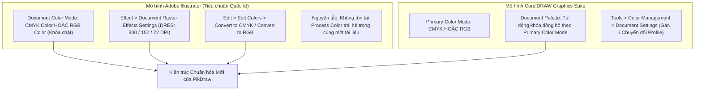

# Kế hoạch Đại tu Kiến trúc Hệ màu Tài liệu (Document Color Mode) & Độ phân giải Raster DPI

**Mã kế hoạch**: `PLAN-COLOR-DPI-20261018`  
**Ngày lập**: 18/10/2026  
**Mô-đun liên quan**: `core/color`, `core/document`, `modules/interop`, `apps/desktop`  
**Tài liệu tham chiếu chuẩn**: Adobe Illustrator Color Management Guide, CorelDRAW Primary Color Mode Specification, ISO 12647-2 (Offset Print), [Hướng dẫn tương thích vector](../architecture/vector-resource-interoperability.md), [Hợp đồng C4](../../contracts/c4-color-typography.md), [Hợp đồng C8](../../contracts/c8-import-fidelity.md), [Tiêu chuẩn UI/UX](../design/ui-ux-standard.md).

---

## 1. Tóm tắt Yêu cầu & Bối cảnh

Theo phản ánh trực tiếp từ người dùng và kết quả rà soát hiện trạng:
1. **Chuyển cài đặt DPI và chuyển hệ màu vào menu `Edit`**: Bỏ nút `[CMYK · 300 DPI]` đang bị gán cứng (hardcoded) trên thanh thuộc tính trang (Page Ribbon), đưa các lệnh chuyển đổi hệ màu tài liệu và độ phân giải hiệu ứng raster (DPI) vào menu `Edit` (`Edit > Document Color Mode` và `Edit > Document Raster Effects DPI`).
2. **Thiết lập nguyên tắc hệ màu tài liệu duy nhất (Single Document Color Mode Principle)**: Khi tạo tài liệu mới (`File > New`), nếu người dùng chọn `CMYK` hoặc `RGB`:
   - Trang làm việc được gán Profile màu mặc định tương ứng (`sRGB` cho RGB, `ISO Coated v2 (ECI)` / `U.S. Web Coated SWOP` cho CMYK).
   - Kiểu đối tượng mặc định (`default_style_`), bảng màu tô (`editor_palette`), bộ chọn màu (color picker) và các công cụ vẽ hình/văn bản/bảng biểu phải khóa chặt và hoạt động đồng nhất theo hệ màu đã chọn.
3. **Chuyển đổi nguyên tử toàn bộ tài liệu (Atomic Document-Wide Conversion)**: Khi người dùng vào menu `Edit` để đổi hệ màu làm việc (từ RGB sang CMYK hoặc ngược lại):
   - Chuyển đổi **toàn bộ 100% đối tượng** trong file làm việc (mọi trang, mọi layer: Path fill, Path stroke, Gradient stops, Text fill, Drop Shadow effect color) thành một giao dịch nguyên tử có thể Hoàn tác (`Undo/Redo`).
   - Xóa bỏ triệt để tình trạng trong 1 file làm việc tồn tại hỗn tạp cả màu RGB lẫn CMYK process, ngăn ngừa lỗi sai màu nghiêm trọng khi xuất phim chế bản, in Proof và in offset/kỹ thuật số.

---

## 2. Phân tích Thực trạng Sai lệch Logic Màu trong PikDraw

Qua kiểm tra toàn bộ mã nguồn `core/color`, `core/document` và `apps/desktop`, hệ thống màu hiện tại có 4 lỗ hổng kiến trúc nghiêm trọng:

```
HIỆN TRẠNG LỖI CỦA PIKDRAW:
[UI Tab] color_mode="CMYK", dpi=300 (Chỉ là biến UI tạm bợ)
   │
   ├─► [core/document] HOÀN TOÀN KHÔNG BIẾT Color Mode & Profile là gì!
   │   (Page chỉ có width_mm, height_mm; DocumentSnapshot không có ColorSpace)
   │
   ├─► [Page Ribbon] Hardcode tĩnh dòng chữ "CMYK · 300 DPI" (Click không làm gì)
   │
   ├─► [Style Inspector] Cho phép tự do bấm [RGB] hoặc [CMYK] làm đảo màu lộn xộn
   │
   └─► [Shape Tools] add_rectangle(), add_ellipse(), Text... luôn tạo ra màu RGBColor!
       (File CMYK nhưng bên trong toàn bộ là đối tượng RGB pha tạp)
```

### 2.1. Lỗ hổng 1: Mô hình `Document` / `Page` không có siêu dữ liệu hệ màu và DPI
- `pikdraw::document::Page` ([object.hpp](../../core/document/include/pikdraw/document/model/object.hpp#L209)) chỉ lưu `width_mm`, `height_mm` và `layers`.
- `pikdraw::document::DocumentSnapshot` ([document_snapshot.hpp](../../core/document/include/pikdraw/document/snapshots/document_snapshot.hpp)) và `pikdraw::document::Document` ([document.hpp](../../core/document/include/pikdraw/document/document.hpp)) không hề có trường lưu trữ `color_mode`, profile ICC liên kết (`ProfileIdentifier`) hay `raster_dpi`.
- Thay vào đó, `color_mode` (`"CMYK"`) và `dpi` (`300`) chỉ được lưu dưới dạng chuỗi và số nguyên tạm bợ trên `NativeWindow::DocumentTab` ([native_window.hpp](../../apps/desktop/include/pikdraw/desktop/shell/native_window.hpp#L173-L174)), hoàn toàn vô hình đối với core logic, định dạng lưu trữ native file (`.pkdr`), xuất file và engine render.

### 2.2. Lỗ hổng 2: Giao diện hiển thị giả lập và nút cứng ngắc
- Tại [native_window_paint.cpp:537](../../apps/desktop/src/shell/native_window_paint.cpp#L537), mã vẽ giao diện gán cứng:
  ```cpp
  draw_rib_btn(533, 665, L"CMYK · 300 DPI", false, col_teal);
  ```
  bất kể tài liệu được tạo với hệ màu hay DPI nào. Tại [native_window_chrome_clicks.cpp:180-190](../../apps/desktop/src/shell/native_window_chrome_clicks.cpp#L180-L190), click vào nút này không có bất kỳ xử lý nào.
- Tại [native_window_style_paint.cpp:447-449](../../apps/desktop/src/shell/native_window_style_paint.cpp#L447-L449) và [native_window_style_events.cpp:210-211](../../apps/desktop/src/shell/native_window_style_events.cpp#L210-L211), giao diện Style Inspector cung cấp 2 nút `[RGB]` và `[CMYK]` cho phép người dùng tự do chuyển đổi bảng màu mà không liên quan gì đến hệ màu của tài liệu. Biến `palette_cmyk_` mặc định là `false` (RGB) dù tab tài liệu ghi là `"CMYK"`.
- Hộp thoại sửa màu [native_style_dialog.cpp:180-186](../../apps/desktop/src/shell/native_style_dialog.cpp#L180-L186) cho phép chọn từng model màu per-object qua Combobox, biến tài liệu thành một mớ màu lẫn lộn.

### 2.3. Lỗ hổng 3: Đối tượng mới và kiểu mặc định bỏ qua hệ màu tài liệu
- `EditorStyle default_style_` ([object_style.hpp](../../apps/desktop/include/pikdraw/desktop/presenters/object_style.hpp#L9-L15)) khởi tạo mặc định bằng `color::RGBColor{0.0, 0.65, 0.8, 1.0}`.
- Các hàm tạo đối tượng trong [document_workflow.cpp](../../apps/desktop/src/workflows/document_workflow.cpp#L76-L270) (`add_rectangle`, `add_ellipse`, `add_vietnamese_text`, `create_table`, `convert_text_to_curves`) đều dùng `parse_hex_color` sinh ra `RGBColor`, làm cho một file CMYK khi vẽ hình chữ nhật hoặc nhập văn bản lại chứa toàn bộ đối tượng RGB!

### 2.4. Lỗ hổng 4: Không có Command chuyển đổi hệ màu toàn trang
- Trong toàn bộ `core/document` và `DocumentWorkflow`, không có lệnh nào để chuyển đổi hệ màu tài liệu. Khi xuất in ấn, hệ thống không thể đảm bảo tính toàn vẹn kênh màu CMYK thực tế (Black K tách lớp, overprint viền đen K100, bảo toàn Spot color).

---

## 3. Nghiên cứu Kiến trúc Chuẩn: Adobe Illustrator & CorelDRAW

Để khắc phục triệt để, PikDraw phải tuân thủ nghiêm ngặt nguyên lý quản lý màu tiêu chuẩn của hai phần mềm đồ họa vector hàng đầu thế giới:



### 3.1. Adobe Illustrator: Document Color Mode & DRES
1. **Một hệ màu duy nhất (Strict Single Color Space)**: Illustrator quy định mỗi tệp vector chỉ có **duy nhất một chế độ màu tài liệu** (`CMYK Color` hoặc `RGB Color`). Không có khái niệm tài liệu vừa chứa màu vẽ RGB vừa chứa màu vẽ CMYK process. Khi tài liệu ở chế độ CMYK, mọi thao tác chọn màu (Color Picker, Swatches, Color Palette) đều tự động khóa về CMYK slider (C, M, Y, K %).
2. **Chuyển đổi hệ màu tài liệu qua Menu**:
   - Menu chuẩn: `File > Document Color Mode > CMYK Color` hoặc `RGB Color` (kèm lối tắt tại `Edit > Edit Colors > Convert to CMYK / Convert to RGB`).
   - Khi chuyển đổi, Illustrator thực hiện **chuyển đổi đồng bộ toàn bộ tài liệu (Document-Wide Atomic Conversion)** thông qua ICC Color Engine (ACE) từ không gian nguồn sang không gian đích.
3. **Cài đặt DPI hiệu ứng raster riêng biệt (DRES)**:
   - Menu: `Effect > Document Raster Effects Settings...` (hoặc cấu hình trong `Edit`).
   - Tách rời hoàn toàn hình học vector (vốn vô hạn độ phân giải) với độ phân giải tính toán của các hiệu ứng raster (Drop Shadow, Gaussian Blur, Inner Glow). Các mức chuẩn: **High (300 ppi)** cho in ấn, **Medium (150 ppi)** cho in quảng cáo/băng rôn khổ lớn, **Screen (72 ppi)** cho web/màn hình.

### 3.2. CorelDRAW: Primary Color Mode & Document Palette
1. **Primary Color Mode**: Trong CorelDRAW, mỗi tài liệu khi tạo mới bắt buộc chọn Primary Color Mode (`CMYK` hoặc `RGB`).
2. **Bảng màu tài liệu (Document Palette)**: Bảng màu này tự động sinh ra và khóa theo Primary Color Mode. Khi tạo tài liệu CMYK, Document Palette chỉ chứa các ô màu CMYK và Spot color.
3. **Bảo toàn Spot Color (Màu pha/Màu cắt bế)**: Cả Illustrator và CorelDRAW đều giữ nguyên định danh Spot Color (ví dụ: `CutContour`, `PANTONE 185 C`) khi chuyển đổi chế độ màu process, chỉ cập nhật alternate color preview tương ứng.

---

## 4. Kiến trúc Mục tiêu của PikDraw

### 4.1. Tầng `core/color`: Bộ chuyển đổi Hệ màu Chuẩn hóa (Color Normalization Service)
Bổ sung các định nghĩa và hàm chuyển đổi chính xác vào `core/color`:
- Kiểu dữ liệu định danh:
  ```cpp
  enum class DocumentColorMode : uint8_t {
      Cmyk = 0,
      Rgb = 1
  };
  ```
- Dịch vụ chuyển đổi màu chuẩn mực `convert_color_to_mode`:
  ```cpp
  ColorValue convert_color_to_mode(
      const ColorValue& source,
      DocumentColorMode target_mode,
      const IccPreview* icc_preview = nullptr);
  ```
  - **RGB $\rightarrow$ CMYK**: Nếu có ICC Transform từ `IccPreview`, chuyển qua ICC. Nếu không có ICC, dùng công thức bù trừ chuẩn công nghiệp ($K = 1 - \max(R,G,B)$, chia tỷ lệ độ sáng chính xác) bảo đảm màu đen $R=G=B=0$ luôn chuyển thành Black $C=0, M=0, Y=0, K=1$ (tránh hiện tượng 4 màu lem mực khi in văn bản).
  - **CMYK $\rightarrow$ RGB**: Chuyển đổi mô phỏng trừ màu chính xác $R = (1-C)(1-K)$, v.v. hoặc qua ICC Transform sang sRGB.
  - **Spot Color Policy**: Giữ nguyên `spot_name`, `tint` và cờ `overprint`. Cập nhật `alternate_rgb` hoặc biểu diễn tương đương phù hợp chế độ xem đích.
  - **Grayscale**: Chuyển thành $K = 1 - \text{gray}$ trong CMYK hoặc $R=G=B=\text{gray}$ trong RGB.

### 4.2. Tầng `core/document`: Siêu dữ liệu Tài liệu & Lưu trữ Bền vững Native Container
1. **Mở rộng `Page` / `DocumentSnapshot`**:
   - Thêm thuộc tính `color_mode` (`DocumentColorMode`), `color_profile` (`std::string`), và `raster_dpi` (`int32_t`, mặc định 300 cho CMYK, 72 cho RGB) vào `DocumentSnapshot` và `Page`.
2. **Cập nhật `NativeFormat` container ([native_format.hpp](../../core/document/include/pikdraw/document/storage/native_format.hpp))**:
   - Nâng cấp schema phiên bản container native (với migration an toàn tương thích ngược cho các file v2–v8).
   - Lưu trữ `color_mode` và `raster_dpi` trong payload của container PKDR để khi mở lại file, hệ màu và DPI được khôi phục 100%.

### 4.3. Tầng Command & Transaction: `ConvertDocumentColorModeCommand`
Tạo một transaction command nguyên tử kế thừa `document::DocumentCommand`:
- **Đầu vào**: `DocumentColorMode target_mode`, `std::string target_profile`.
- **Thực thi (`execute`)**:
  - Ghi nhận trạng thái màu cũ của toàn bộ đối tượng trong document.
  - Cập nhật `color_mode` và `raster_dpi` của document.
  - Duyệt qua từng trang (`DocumentPage`), từng layer, từng đối tượng:
    - Đối với `PathObject`: chuyển đổi `fill`, `stroke`, và toàn bộ điểm màu trong `fill_gradient->stops`.
    - Đối với `TextObject`: chuyển đổi `fill`, `stroke`.
    - Đối với `Appearance`: chuyển đổi màu đổ bóng `DropShadowEffect::color`.
  - Áp dụng vào document trong 1 transaction duy nhất.
- **Hoàn tác (`undo`)**: Khôi phục chính xác 100% màu gốc của từng đối tượng trước khi chuyển đổi.
- Tạo thêm `SetDocumentRasterDpiCommand` cho phép đổi DPI raster effects (72, 150, 300) với Undo/Redo.

### 4.4. Tầng `apps/desktop`: Thiết kế lại Giao diện Người dùng (UI/UX)
1. **Hộp thoại Tạo Tài liệu Mới (`File > New`)**:
   - Khi chọn `CMYK (In ấn)`: Document color mode đặt thành `CMYK`, DPI mặc định `300`, Profile mặc định gán `ISO Coated v2 (ECI)` / `SWOP`, `default_style_` khởi tạo màu CMYK, Style Inspector palette khóa sang `CMYK`.
   - Khi chọn `RGB (Màn hình)`: Document color mode đặt thành `RGB`, DPI mặc định `72`, Profile mặc định gán `sRGB`, `default_style_` khởi tạo màu RGB, Style Inspector palette khóa sang `RGB`.
2. **Xóa bỏ nút gán cứng trên Page Ribbon**:
   - Xóa bỏ nút hardcode tĩnh `[CMYK · 300 DPI]` tại tọa độ (533, 665) trong `native_window_paint.cpp`.
   - Thay thế bằng thông tin hiển thị trạng thái chuẩn hoặc tối ưu không gian hiển thị cho các công cụ kích thước trang.
3. **Menu `Edit` Mới**:
   - Bổ sung nhóm lệnh quản lý hệ màu và DPI vào menu `Edit`:
     - `Edit > Document Color Mode > ● CMYK (In ấn) / ○ RGB (Màn hình)`
     - `Edit > Document Raster Effects DPI > ● 300 DPI (Cao / In ấn) / ○ 150 DPI (Trung bình) / ○ 72 DPI (Màn hình)`
   - Khi chuyển hệ màu, thực hiện thông qua `ConvertDocumentColorModeCommand` kèm thông báo trạng thái rõ ràng ở status bar.
4. **Bảng Thuộc tính Style Inspector (Properties Panel)**:
   - Xóa bỏ 2 nút bấm chuyển đổi thủ công `[RGB]` và `[CMYK]` (hình upload `media_1792286784675_9baabb5c.png`).
   - Hiển thị nhãn cố định hệ màu của tài liệu hiện hành: ví dụ `BẢNG MÀU TÀI LIỆU (CMYK)` hoặc `DOCUMENT PALETTE (RGB)` kèm huy hiệu Profile ICC đang áp dụng (`ICC: ISO Coated v2` hoặc `ICC: sRGB`).
   - Bảng màu 18 ô swatches tự động hiển thị bảng màu CMYK nếu tài liệu là CMYK, hoặc RGB nếu tài liệu là RGB; không cho phép bấm chuyển lung tung gây lẫn lộn màu.
   - Thêm nút liên kết: `Đổi hệ màu tài liệu trong Edit...` hoặc hướng dẫn người dùng vào menu `Edit`.
5. **Đồng bộ hóa Các công cụ Vẽ và Soạn thảo**:
   - `add_rectangle`, `add_ellipse`, `add_vietnamese_text`, `create_table`, Pen tool, Line/Polyline tool, Text tool tự động lấy màu từ `default_style_` phù hợp với hệ màu tài liệu hiện hành.

---

## 5. Bảng Đối chiếu Tương thích Tài nguyên Vector (Vector Resource Interoperability)

Tuân thủ nguyên tắc lập kế hoạch trong [vector-resource-interoperability.md](../architecture/vector-resource-interoperability.md) và các hợp đồng C8/C9:

| Nội dung bắt buộc | Đặc tả kiến trúc cho Kế hoạch Hệ màu & DPI |
|---|---|
| **User workflow và nguồn** | Người dùng tạo mới file (`File > New`), mở file native (`.pkdr`), import tài nguyên vector ngoại vi (PDF, AI, CDR, EPS, SVG, DXF) hoặc chuyển đổi hệ màu tài liệu (`Edit > Document Color Mode`). |
| **Scope format** | - **PDF**: Color space (DeviceRGB, DeviceCMYK, DeviceGray, Separation/Spot).<br>- **AI**: Illustrator color mode header, PDF-compatible stream colors.<br>- **CDR**: Corel Primary Color Mode, fills/outlines CMYK/RGB.<br>- **EPS**: PostScript setcolorspace / setcmykcolor / setrgbcolor.<br>- **SVG**: sRGB colors, CSS color specs, embedded ICC profile references.<br>- **DXF**: ACI (AutoCAD Color Index) và TrueColor RGB. |
| **Current state** | `core/color` có `ColorValue` (RGB, CMYK, Spot, Gray), `IccPreview` (Windows ICM). Chưa có `DocumentColorMode` cấp document, chưa có lưu trữ bền vững trong native format, chưa có lệnh chuyển đổi toàn bộ tài liệu. |
| **Canonical semantics** | Mọi đối tượng vector trong tài liệu PikDraw phải tuân theo `DocumentColorMode` hiện hành. Đối tượng process color phải đồng nhất hệ màu với tài liệu. Spot Color giữ nguyên danh xưng màu pha và tint ratio. |
| **Shared algorithm boundary** | - Dùng chung một hàm chuẩn hóa `convert_color_to_mode` trong `core/color`.<br>- Dùng chung `ConvertDocumentColorModeCommand` cho mọi luồng chuyển đổi.<br>- Renderer đọc color mode từ document snapshot để áp dụng IccPreview tương ứng. |
| **Fidelity matrix** | - **Xem/Render**: Hiển thị mô phỏng sRGB chuẩn xác theo ICC proofing profile.<br>- **Editability**: 100% đối tượng sau chuyển đổi vẫn giữ nguyên khả năng biên tập vector.<br>- **Provenance**: Giữ nguyên tên gốc của Spot Color và thông số overprint.<br>- **Export/Production**: Xuất PDF in ấn bảo toàn kênh CMYK tách lớp, đen K100 không bị chuyển thành màu pha 4 lớp (rich black) ngoài ý muốn. |
| **Loss policy** | Chuyển đổi giữa RGB và CMYK là chuyển đổi có tổn hao dải màu (gamut loss). Hệ thống hiển thị thông báo xác nhận trước khi thực hiện giao dịch, giải thích rõ các giá trị màu process sẽ được ánh xạ lại, đồng thời cung cấp khả năng hoàn tác (`Ctrl+Z`) bảo toàn 100% màu gốc. |
| **Source integrity** | Không làm sai lệch cấu trúc hình học, không flatten vector khi chuyển hệ màu. Giữ nguyên ID bền vững của mọi đối tượng. |
| **Network/security** | `Not applicable` (toàn bộ xử lý màu và DPI chạy in-process trong không gian bộ nhớ máy trạm, không gọi mạng). |
| **Acceptance evidence** | Các bộ kiểm thử: `test_pikdraw_color_mode_conversion`, `test_pikdraw_document_color_metadata`, `test_pikdraw_edit_menu_color_actions`, và kiểm thử hồi quy `test_pikdraw_desktop_shell`. |

---

## 6. Đặc tả Giao diện UI/UX Chi tiết

Tuân thủ [Tiêu chuẩn UI/UX PikDraw](../design/ui-ux-standard.md) và [Bố cục không gian làm việc](../architecture/workspace-layout.md):

```
+-------------------------------------------------------------------------------------------------------------+
| PikDraw Pro  -  [File]  [Edit]  [View]  [Layout]  [Object]  [Effects]  [Bitmaps]  [Text]  [Tools]  ...      |
+-------------------------------------------------------------------------------------------------------------+
| Tab Bar:  [📄 Bản vẽ 1 (CMYK)]  [📄 Bản vẽ 2 (RGB)]  [+]                                                    |
+-------------------------------------------------------------------------------------------------------------+
| Ribbon Trang: [A4 ▾]  [W: 210 mm]  [H: 297 mm]  [▯ Dọc]  [▭ Ngang]   (ĐÃ XÓA NÚT CỨNG "CMYK · 300 DPI")      |
+-------------------------------------------------------------------------------------------------------------+
| [Edit Menu Dropdown]:                                                                                       |
|   Hoàn tác (Undo)                  Ctrl+Z                                                                   |
|   Làm lại (Redo)                   Ctrl+Y                                                                   |
|   ---------------------------------------                                                                   |
|   Cắt / Sao chép / Dán...                                                                                   |
|   ---------------------------------------                                                                   |
|   Hệ màu tài liệu (Color Mode)         ►  [● CMYK (In ấn chế bản)     ]                                     |
|                                           [○ RGB (Màn hình & Kỹ thuật số)]                                  |
|   ---------------------------------------                                                                   |
|   Độ phân giải hiệu ứng (DPI)          ►  [● 300 DPI (Cao / In ấn)      ]                                     |
|                                           [○ 150 DPI (Trung bình)       ]                                   |
|                                           [○ 72 DPI (Màn hình)          ]                                   |
+-------------------------------------------------------------------------------------------------------------+
| Style Inspector (Phải):                                                                                     |
|   BẢNG MÀU TÀI LIỆU · CMYK                                                                                  |
|   [ICC: ISO Coated v2 (ECI)]  (Khóa theo hệ màu tài liệu, không còn nút bấm [RGB]/[CMYK] lung tung)         |
|   [■][■][■][■][■][■][■][■][■]  (18 ô Swatches chuẩn CMYK)                                                   |
|   [■][■][■][■][■][■][■][■][■]                                                                               |
|   ℹ Chuyển hệ màu hoặc DPI: vào menu Edit                                                                   |
+-------------------------------------------------------------------------------------------------------------+
```

### 6.1. Bảng Chi tiết Thành phần Giao diện & Hành động

| Thành phần | Vị trí / Đường dẫn | Action ID / Định danh | Trạng thái & Phạm vi | Tooltip & Hướng dẫn sử dụng | Status Bar Hint |
|---|---|---|---|---|---|
| **Lệnh CMYK** | `Edit > Document Color Mode > CMYK` | `action.edit.color_mode_cmyk` | Checkable (Được đánh dấu nếu tài liệu đang là CMYK) | "Chuyển toàn bộ màu trong tài liệu sang CMYK chuẩn in ấn (Ctrl+Z để hoàn tác)" | "Đã chuyển tài liệu sang hệ màu CMYK chuẩn in ấn · Ctrl+Z hoàn tác" |
| **Lệnh RGB** | `Edit > Document Color Mode > RGB` | `action.edit.color_mode_rgb` | Checkable (Được đánh dấu nếu tài liệu đang là RGB) | "Chuyển toàn bộ màu trong tài liệu sang RGB cho hiển thị số (Ctrl+Z để hoàn tác)" | "Đã chuyển tài liệu sang hệ màu RGB màn hình · Ctrl+Z hoàn tác" |
| **Lệnh DPI 300** | `Edit > Document Raster Effects DPI > 300 DPI` | `action.edit.raster_dpi_300` | Checkable (Đánh dấu khi DPI = 300) | "Độ phân giải 300 DPI cho hiệu ứng bóng mờ và làm mờ (chuẩn in ấn chất lượng cao)" | "Độ phân giải hiệu ứng raster đặt thành 300 DPI (High)" |
| **Lệnh DPI 150** | `Edit > Document Raster Effects DPI > 150 DPI` | `action.edit.raster_dpi_150` | Checkable (Đánh dấu khi DPI = 150) | "Độ phân giải 150 DPI (phù hợp pano, áp phích khổ lớn)" | "Độ phân giải hiệu ứng raster đặt thành 150 DPI (Medium)" |
| **Lệnh DPI 72** | `Edit > Document Raster Effects DPI > 72 DPI` | `action.edit.raster_dpi_72` | Checkable (Đánh dấu khi DPI = 72) | "Độ phân giải 72 DPI (tối ưu hiển thị web và màn hình)" | "Độ phân giải hiệu ứng raster đặt thành 72 DPI (Screen)" |
| **Hộp thoại Tạo mới** | `File > New` (`New Document Modal`) | Modal tạo tài liệu | Cho phép chọn CMYK hoặc RGB | "Khóa hệ màu và profile chuẩn ngay khi khởi tạo bản vẽ mới" | "Đã tạo tài liệu mới với hệ màu chuẩn" |
| **Page Ribbon** | Thanh Ribbon khi không chọn đối tượng | Tọa độ cũ (533, 665) | ĐÃ XÓA BỎ NÚT CỨNG | Không còn hiển thị chuỗi text tĩnh gây hiểu nhầm | Giải phóng không gian hiển thị cho các công cụ bố cục trang |
| **Style Inspector** | Dock bên phải (Properties tab) | Bảng màu nguồn | Khóa đồng bộ 100% với hệ màu tài liệu | Bảng màu process khóa theo tài liệu; hiển thị profile ICC hiện hành | "Bảng màu tài liệu khóa theo hệ màu của trang làm việc" |

---

## 7. Phân đoạn Triển khai Kỹ thuật Chi tiết (`C01` → `C05`)

Tuân thủ nghiêm ngặt quy tắc độ dài file ($\le 2000$ dòng/file), tách file theo domain và không làm gián đoạn các task khác:

### Giai đoạn C01: Tầng `core/color` — Định nghĩa `DocumentColorMode` và Dịch vụ Chuyển đổi Chuẩn mực
- **Mục tiêu**: Bổ sung enum `DocumentColorMode` và hàm `convert_color_to_mode` trong `core/color`.
- **Files tác động**:
  - `core/color/include/pikdraw/color/values/color_value.hpp`
  - `core/color/include/pikdraw/color/preview/color_transform.hpp`
  - `core/color/src/preview/color_transform.cpp`
  - `core/color/tests/values/test_color_values.cpp`
- **Nghiệm thu**: Test chuyển đổi đầy đủ các cặp RGB $\leftrightarrow$ CMYK, Grayscale, Spot color. Bảo đảm màu đen RGB(0,0,0) chuyển thành K100 ($C=0, M=0, Y=0, K=1$) thay vì 4 màu lem.

### Giai đoạn C02: Tầng `core/document` — Tích hợp Siêu dữ liệu Hệ màu & DPI vào Document & Native Storage
- **Mục tiêu**: Bổ sung `color_mode`, `color_profile_name`, `raster_dpi` vào `Page`, `DocumentSnapshot` và serialization trong `NativeFormat`.
- **Files tác động**:
  - `core/document/include/pikdraw/document/model/object.hpp`
  - `core/document/include/pikdraw/document/snapshots/document_snapshot.hpp`
  - `core/document/include/pikdraw/document/document.hpp`
  - `core/document/include/pikdraw/document/storage/native_format.hpp`
  - `core/document/src/storage/native_format.cpp`
  - `core/document/tests/storage/test_storage_fidelity.cpp`
- **Nghiệm thu**: Lưu và đọc lại file native `.pkdr` giữ nguyên vẹn 100% `color_mode` và `raster_dpi` (tương thích ngược hoàn toàn với phiên bản container cũ).

### Giai đoạn C03: Tầng Commands & Workflows — Lệnh Chuyển đổi Nguyên tử Toàn bộ Tài liệu với Undo/Redo
- **Mục tiêu**: Viết class `ConvertDocumentColorModeCommand` và `SetDocumentRasterDpiCommand`.
- **Files tác động**:
  - `core/document/include/pikdraw/document/commands/color_commands.hpp` (Tạo mới $\le 400$ dòng)
  - `core/document/src/commands/color_commands.cpp` (Tạo mới $\le 500$ dòng)
  - `apps/desktop/include/pikdraw/desktop/workflows/document_workflow.hpp`
  - `apps/desktop/src/workflows/document_workflow.cpp`
  - `apps/desktop/tests/test_vertical_slice_e2e.cpp`
- **Nghiệm thu**: Chuyển đổi hệ màu tài liệu với hàng trăm đối tượng khác nhau (Path fill, stroke, gradient stops, text fill, drop shadow color), sau đó bấm Undo khôi phục 100% màu ban đầu.

### Giai đoạn C04: Tầng `apps/desktop` Shell — Menu `Edit`, New Document Modal, Dọn dẹp Page Ribbon & Khóa Bảng màu
- **Mục tiêu**:
  - Nối menu `Edit` với các action chuyển đổi hệ màu và DPI.
  - Xóa bỏ nút gán cứng `[CMYK · 300 DPI]` tại `native_window_paint.cpp:537`.
  - Khóa bảng màu Style Inspector theo hệ màu của tab tài liệu đang chọn.
  - Đồng bộ việc khởi tạo đối tượng mới (`add_rectangle`, `add_ellipse`, `Text`, `Table`, `Pen`...) theo hệ màu tài liệu.
- **Files tác động**:
  - `apps/desktop/src/shell/native_window_menus.hpp`
  - `apps/desktop/src/shell/native_window_menu_actions.cpp`
  - `apps/desktop/src/shell/native_window_paint.cpp` (Lưu ý: Tách phần paint thanh ribbon sang file phụ nếu file vượt 2000 dòng!)
  - `apps/desktop/src/shell/native_window_chrome_clicks.cpp`
  - `apps/desktop/src/shell/native_window_style_paint.cpp`
  - `apps/desktop/src/shell/native_window_style_events.cpp`
  - `apps/desktop/src/shell/native_window_modal_clicks.cpp`
  - `apps/desktop/src/shell/native_window.cpp`

### Giai đoạn C05: Kiểm thử Tổng thể, Chụp ảnh Minh chứng & Khóa sổ
- **Mục tiêu**:
  - Biên dịch và chạy toàn bộ test suite liên quan: `test_pikdraw_color`, `test_pikdraw_document_storage`, `test_pikdraw_desktop_shell`, `test_pikdraw_vertical_slice_e2e`.
  - Chụp ảnh màn hình kiểm thử giao diện tiếng Việt và tiếng Anh.
  - Kiểm tra cổng độ dài file $\le 2000$ dòng trên toàn bộ kho mã nguồn.
  - Cập nhật tiến độ task ngắn gọn và bàn giao.

---

## 8. Ma trận Kiểm thử Nghiệm thu (Acceptance Criteria)

- **AC-CLR-01 (Tạo tài liệu mới chuẩn hệ màu)**: *Given* người dùng mở `File > New`, *When* chọn CMYK và nhấn Tạo tài liệu, *Then* tab mới được gán Color Mode CMYK, Profile ICC CMYK, và vẽ bất kỳ hình chữ nhật / hình elip / văn bản nào cũng sinh ra màu CMYK chuẩn, bảng màu Style Inspector hiển thị bảng màu CMYK.
- **AC-CLR-02 (Xóa bỏ nút gán cứng trên Page Ribbon)**: *Given* không có đối tượng nào được chọn trên canvas, *When* quan sát thanh Page Ribbon, *Then* nút cứng `[CMYK · 300 DPI]` không còn xuất hiện; thanh công cụ hiển thị rõ ràng, chuyên nghiệp.
- **AC-CLR-03 (Chuyển hệ màu qua Menu Edit)**: *Given* tài liệu đang ở chế độ RGB với 10 đối tượng (Path fill, stroke, gradient, text, shadow), *When* chọn `Edit > Document Color Mode > CMYK`, *Then* toàn bộ 10 đối tượng được chuyển sang CMYK trong 1 transaction duy nhất, không còn sót bất kỳ mã màu RGB nào; bảng màu Style Inspector tự động chuyển sang CMYK.
- **AC-CLR-04 (Hoàn tác chuyển hệ màu)**: *Given* vừa thực hiện chuyển hệ màu tài liệu từ RGB sang CMYK, *When* nhấn `Ctrl+Z` (Undo), *Then* hệ màu tài liệu và toàn bộ đối tượng phục hồi 100% giá trị màu RGB ban đầu.
- **AC-CLR-05 (Chuyển độ phân giải Raster Effects DPI)**: *Given* tài liệu có đối tượng áp dụng hiệu ứng Drop Shadow hoặc Gaussian Blur, *When* chọn `Edit > Document Raster Effects DPI > 150 DPI`, *Then* thông số DPI được lưu vào tài liệu, khung buffer hiệu ứng tính toán lại theo độ phân giải mới; nhấn `Ctrl+Z` hoàn tác về DPI cũ.
- **AC-CLR-06 (Bảo toàn Spot Color)**: *Given* tài liệu chứa đối tượng có màu pha `CutContour` (Spot Color), *When* chuyển đổi hệ màu giữa CMYK và RGB, *Then* danh xưng `CutContour` và tỷ lệ `tint` được giữ nguyên vẹn 100%, không bị ép thành màu process.
