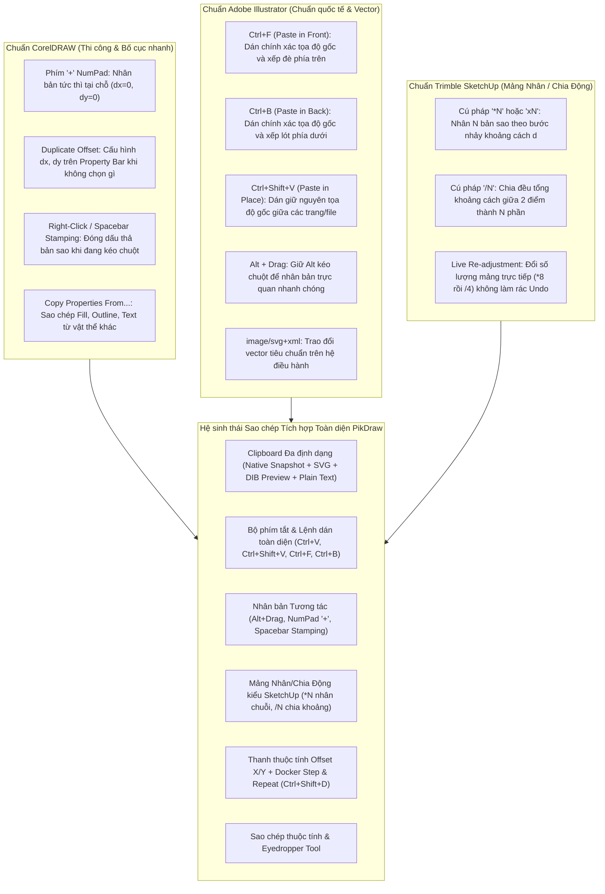
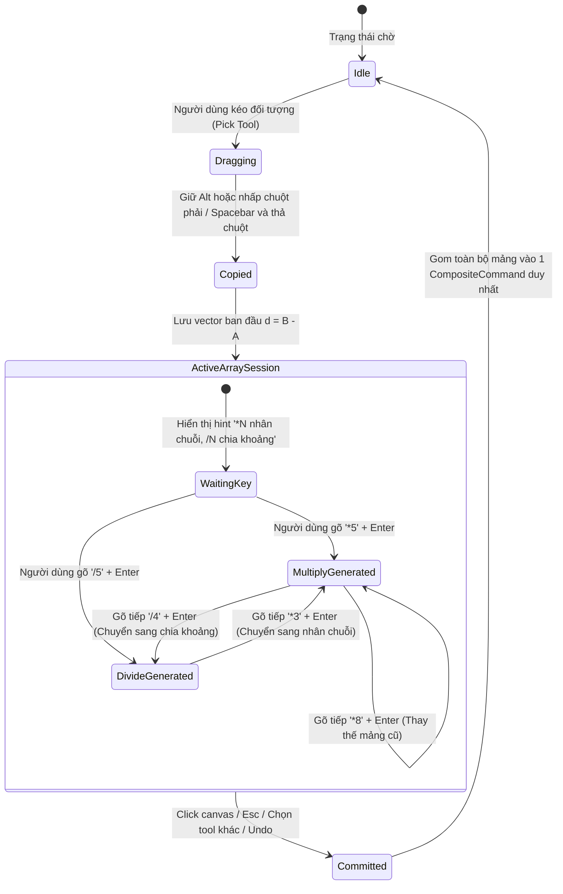

# Kế hoạch và Lộ trình Kiến trúc: Hệ sinh thái Sao chép, Clipboard và Mảng Nhân/Chia PikDraw

Trạng thái: **Đặc tả Kế hoạch & Kiến trúc đề xuất (Proposed Roadmap)**.  
Ngày lập: 17/10/2026 (Cập nhật bổ sung Mảng Nhân/Chia kiểu SketchUp).  
Phạm vi: Toàn bộ hệ sinh thái sao chép, cắt, dán, nhân bản tham số, mảng nhân/chia khoảng cách trực quan và sao chép thuộc tính trong PikDraw.  
Tham chiếu tiêu chuẩn: CorelDRAW Technical Suite 2024/2025, Adobe Illustrator CC 2025/2026, Trimble SketchUp Pro 2024/2026, [Chuẩn UX/UI](../design/ui-ux-standard.md), [Bố cục Workspace](../architecture/workspace-layout.md), [Tương thích tài nguyên vector](../architecture/vector-resource-interoperability.md), [Hợp đồng C8](../../contracts/c8-import-fidelity.md), [Hợp đồng C9](../../contracts/c9-appearance-effects.md).

---

## 1. Tổng quan và Hiện trạng hệ thống

### 1.1. Hiện trạng trong mã nguồn PikDraw
Qua khảo sát toàn bộ codebase hiện hành:
1. **Menu Edit:** Các mục `Cut`, `Copy`, `Paste` đang ở trạng thái giữ chỗ (`is_disabled = true`, chưa gán phím tắt `Ctrl+X`, `Ctrl+C`, `Ctrl+V`).
2. **Khay nhớ tạm Windows (Windows Clipboard):** Chưa có module hoặc lớp trừu tượng nào giao tiếp với Win32 Clipboard API (`OpenClipboard`, `EmptyClipboard`, `SetClipboardData`, `GetClipboardData`).
3. **Nhân bản đối tượng (`duplicate_selected`):**
   - Đã có một hàm prototype trong `DocumentWorkflow` gắn với `Ctrl+D`.
   - *Hạn chế hiện tại:* Khoảng cách dịch chuyển bị gán cứng $15.0\,\text{mm}$; chưa có giao diện trên thanh thuộc tính để người dùng chỉnh sửa $dx, dy$; chưa xử lý re-mapping ID cho đường cong authoring (`EditablePath`: `SubpathId`, `NodeId`, `SegmentId`), dẫn đến nguy cơ xung đột ID phần tử hình học khi chỉnh sửa điểm nút sau khi nhân bản.
4. **Tương tác chuột & Phím tắt:** Chưa hỗ trợ các thao tác kinh điển của dân đồ họa như giữ `Alt` kéo chuột để nhân bản, nhấn phím `+` NumPad để nhân bản tại chỗ, hoặc nhấn phím Spacebar để "đóng dấu" bản sao trong lúc kéo.
5. **Nhu cầu Nhân / Chia khoảng cách ban đầu (SketchUp Linear Array):** Trong thiết kế quảng cáo, kiến trúc, bảng hiệu, việc nhân bản hàng loạt chi tiết (thanh lam, chấn song, bóng LED, tem nhãn, lỗ đục CNC) đòi hỏi cơ chế nhân chuỗi theo bước nhảy ban đầu (`*N`) hoặc chia đều khoảng cách giữa 2 điểm đầu - cuối (`/N`) một cách trực quan cực nhanh.
6. **Năng lực Interop:** Module `modules/interop` đã có sẵn bộ chuyển đổi SVG hoàn chỉnh (`SvgExporter` và `SvgImporter`) được bảo vệ bởi sandbox broker, là nền tảng hoàn hảo để trao đổi vector hai chiều với các phần mềm đồ họa khác qua clipboard.

---

## 2. Đối chiếu Tiêu chuẩn Công nghiệp: CorelDRAW vs. Illustrator vs. SketchUp

PikDraw kết hợp tinh hoa từ **3 chuẩn mực công nghiệp** hàng đầu:



### Bảng so sánh chi tiết tính năng

| Tính năng | Adobe Illustrator | CorelDRAW | Trimble SketchUp | Giải pháp tích hợp trong PikDraw |
| :--- | :--- | :--- | :--- | :--- |
| **Dán cơ bản (`Ctrl+V`)** | Dán vào giữa viewport | Dán vào giữa viewport | Dán vào con trỏ chuột | Dán vào giữa viewport hiện tại (hoặc lệch $+10\,\text{mm}$ nếu cùng màn hình). |
| **Dán tại chỗ (`Paste in Place`)** | `Ctrl+Shift+V` | Tự động giữ vị trí nếu paste sang trang khác | N/A | Hỗ trợ lệnh `Ctrl+Shift+V` (Paste in Place) giữ nguyên tọa độ $(x, y)$ tuyệt đối. |
| **Dán theo thứ tự vẽ (`Front/Back`)** | `Ctrl+F` (Front) / `Ctrl+B` (Back) | Phải dùng lệnh Order sau khi paste | N/A | Hỗ trợ cả `Ctrl+F` (Paste in Front) và `Ctrl+B` (Paste in Back). |
| **Nhân bản nhanh tại chỗ** | Phải dùng `Ctrl+C` rồi `Ctrl+F` | **Phím `+` trên NumPad** | N/A | Hỗ trợ phím `+` NumPad: Tạo bản sao tại $(x, y)$, tự động chọn bản sao mới. |
| **Nhân bản kéo chuột** | Giữ `Alt` khi kéo chuột | Nhấp chuột phải khi đang kéo chuột trái | Giữ `Ctrl` khi dùng lệnh Move | **Hỗ trợ cả hai:** Giữ `Alt` kéo chuột VÀ nhấp chuột phải / nhấn Spacebar khi kéo. |
| **Nhân chuỗi bản sao theo khoảng ban đầu** | `Ctrl+D` (lặp lại biến đổi đơn lẻ) | `Ctrl+D` (lặp lại theo offset) | **Gõ `*N` hoặc `xN`** ngay sau khi kéo copy | **Chuẩn SketchUp:** Sau khi kéo copy khoảng $\vec{d}$, gõ `*5` (Enter) tạo chuỗi 5 bản sao cách đều $\vec{d}$. |
| **Chia đều tổng khoảng cách** | Blend Tool (phải tạo 2 đối tượng rồi blend) | Phải dùng công cụ Align/Distribute | **Gõ `/N`** ngay sau khi kéo copy đến điểm cuối | **Chuẩn SketchUp:** Kéo đối tượng đến điểm cuối, gõ `/5` (Enter) chia đều khoảng cách làm 5 phần. |
| **Thay đổi mảng linh hoạt (Live Re-adjust)** | Không hỗ trợ (phải Undo) | Không hỗ trợ (phải Undo) | **Hỗ trợ đổi tức thì:** Gõ `*5` rồi gõ tiếp `*8` hoặc `/4` | **Hỗ trợ đổi tức thì trong phiên Active Array Session**, chỉ tính là 1 bước Undo duy nhất. |
| **Mảng tham số (Array/Repeat)** | Object > Transform > Transform Each | Docker `Step and Repeat` (`Ctrl+Shift+D`) | N/A | Hỗ trợ panel `Step and Repeat` (`Ctrl+Shift+D`) với cả 2 chế độ: **Offset (Multiply)** & **Between (Divide)**. |
| **Sao chép thuộc tính màu/nét** | Eyedropper Tool (`I`) | `Edit > Copy Properties From…` | Match Photo / Paint | Hỗ trợ cả menu `Copy Properties From…` và `Eyedropper Tool` trên toolbox. |
| **Trao đổi với app ngoài** | Clipboard MIME `image/svg+xml` | Clipboard MIME `image/svg+xml`, Metafile | N/A | Hỗ trợ xuất/nhập đồng thời Native JSON, SVG XML và 32-bit DIB Bitmap Preview. |

---

## 3. Kiến trúc Kỹ thuật: Mảng Nhân / Chia Động (SketchUp-Style Array Engine)

### 3.1. Phiên làm việc Mảng Động (Active Array Session State Machine)

Để hỗ trợ người dùng gõ lệnh nhân/chia ngay sau khi di chuyển/sao chép mà không làm rác lịch sử Undo:



#### Thuật toán chi tiết:
1. **Multiply Array (`*N` hoặc `xN`):**
   - Khoảng cách cơ sở: $\vec{d} = B - A$.
   - Số lượng bản sao cần tạo thêm: $N - 1$ (vì bản sao đầu tiên tại $B$ đã được tạo khi thả chuột).
   - Tọa độ bản sao thứ $k$ ($k = 2 \dots N$):
     $$\vec{P}_k = \vec{P}_A + k \cdot \vec{d}$$
2. **Divide Array (`/N`):**
   - Vị trí thả chuột $B$ được xem là **điểm kết thúc (End Marker)** của tổng khoảng cách $\vec{D} = B - A$.
   - Bước chia đều:
     $$\vec{s} = \frac{\vec{D}}{N}$$
   - Bản sao tại $B$ được giữ nguyên (tương ứng vị trí $k = N$).
   - Hệ thống chèn thêm $N - 1$ bản sao phân bổ đều ở các vị trí trung gian:
     $$\vec{P}_k = \vec{P}_A + k \cdot \vec{s} \quad (k = 1, 2, \dots, N-1)$$
3. **Quản lý Vùng nhớ & Bất biến ID trong Session:**
   - Trong quá trình Live Re-adjustment (người dùng đổi từ `*5` sang `*8` hoặc `/4`):
     - Tất cả các đối tượng được sinh ra bởi lần gõ trước đó sẽ bị xóa bỏ khỏi `DocumentTree`.
     - Cấp phát `ObjectId` và `EditablePath` element IDs mới cho danh sách đối tượng mới.
     - Toàn bộ phiên chỉ tạo ra **đúng một bản ghi duy nhất** trong Undo Stack khi kết thúc phiên.

---

## 4. Kiến trúc Khay nhớ tạm Windows Đa định dạng (Multi-Format Clipboard Engine)

Khi người dùng thực hiện `Copy` hoặc `Cut`, PikDraw tổng hợp và đưa lên Windows Clipboard đồng thời **4 định dạng dữ liệu**:

```
+---------------------------------------------------------------------------------+
|                                WINDOWS CLIPBOARD                                |
+---------------------------------------------------------------------------------+
| 1. "PikDraw.DocumentSnapshot.v1" (Private Native Binary/JSON)                   |
|    - Lưu giữ 100% cấu trúc đối tượng, cây phân cấp Group, Appearance graph,     |
|      EditablePath authoring curves, Font metric và Metadata nội bộ.             |
|                                                                                 |
| 2. "image/svg+xml" & CF_UNICODETEXT (Standard Vector Interchange)               |
|    - Xuất dữ liệu vector SVG chuẩn qua SvgExporter.                             |
|    - Cho phép dán trực tiếp sang Illustrator, CorelDRAW, Inkscape, Figma, Web.  |
|                                                                                 |
| 3. CF_DIBV5 / CF_DIB (32-bit ARGB Raster Bitmap Preview)                        |
|    - Render snapshot đối tượng thành ảnh bitmap độ phân giải cao có alpha.     |
|    - Cho phép dán ngay vào Photoshop, Word, PowerPoint, Zalo, Telegram, v.v.    |
|                                                                                 |
| 4. CF_UNICODETEXT (Plain Text fallback)                                         |
|    - Nếu đối tượng được chọn là TextObject, trích xuất chuỗi text thuần túy.    |
+---------------------------------------------------------------------------------+
```

#### Bất biến về Định danh và Tái cấp phát ID (ID Re-mapping Invariant)
- **ObjectId:** Mọi đối tượng dán, nhân bản hoặc sinh ra trong mảng `*N`, `/N` đều phải nhận `generate_object_id()` mới duy nhất.
- **GroupObject:** Đệ quy duyệt cây con, cấp phát `ObjectId` mới cho tất cả các đối tượng con và cập nhật danh sách `children_ids` của nhóm bản sao.
- **EditablePath (Authoring Curves):** Nếu `PathObject` có chứa `authoring_source`, **BẮT BUỘC** deep-clone cấu trúc đường cong và sinh mới toàn bộ `SubpathId`, `NodeId`, `SegmentId` bằng `generate_path_element_id<Id>()`. Không được tái dùng ID điểm nút cũ để tránh lỗi trong công cụ Node Tool.

---

## 5. Đặc tả Giao diện & Trải nghiệm Người dùng (UI/UX Placement)

### 5.1. Menu Edit mở rộng

```text
Edit
  ├── Undo                          Ctrl+Z
  ├── Redo                          Ctrl+Y
  ├─────────────────────────────────────────
  ├── Cut                           Ctrl+X
  ├── Copy                          Ctrl+C
  ├── Paste                         Ctrl+V
  ├── Paste in Place                Ctrl+Shift+V
  ├── Paste in Front                Ctrl+F
  ├── Paste in Back                 Ctrl+B
  ├─────────────────────────────────────────
  ├── Duplicate                     Ctrl+D
  ├── Step and Repeat…              Ctrl+Shift+D
  ├── Copy Properties From…
  ├─────────────────────────────────────────
  ├── Delete                        Del
  ├── Select All                    Ctrl+A
  └── Deselect                      Esc
```

### 5.2. Contextual Property Bar (Thanh thuộc tính nhanh phía trên)

1. **Khi không có Selection (Chế độ mặc định trang / Pick Tool):**
   - Vị trí: Cạnh các ô kích thước trang và hướng trang.
   - Nhãn: `Offset X:` [ `5.0 mm` ] &nbsp; `Offset Y:` [ `5.0 mm` ].
   - Tác dụng: Cấu hình bước nhảy cho `Ctrl+D` (chuẩn CorelDRAW).

2. **Khi vừa hoàn thành kéo sao chép (Active Array Session):**
   - Ô nhập chuyển sang trạng thái nhận lệnh mảng: `Array: [ *1 ]` (chuẩn SketchUp VCB).
   - Người dùng có thể gõ trực tiếp `*5` hoặc `/5` rồi nhấn Enter, hoặc dùng con lăn chuột cuộn để tăng/giảm nhanh số lượng bản sao.

### 5.3. Bảng Dock Properties: Section "Duplicate & Array"

Hỗ trợ đầy đủ cả 2 phương thức:
- **Tab Step (Multiply):** Số lượng bản sao $N$, khoảng cách bước nhảy $dx, dy$.
- **Tab Between (Divide):** Tổng khoảng cách $L_x, L_y$, số khoảng chia $N$. Hệ thống hiển thị preview khoảng cách giữa các tâm (center-to-center) và khoảng cách lọt lòng (edge-to-edge gap).
- **Nút hành động:** `[ Apply ]`.

---

## 6. Lộ trình Triển khai Cập nhật (Phased Implementation)

### 🚀 Phase 1: Bộ động cơ Clipboard Hệ thống & Lệnh Dán cơ bản
- Xây dựng lớp trừu tượng Windows Clipboard Win32 (`native_clipboard.hpp / .cpp`).
- Hiện thực hàm Deep-Clone và ID Re-mapping cho `ObjectVariant` và `EditablePath`.
- Kích hoạt menu và phím tắt `Ctrl+X`, `Ctrl+C`, `Ctrl+V`, `Ctrl+Shift+V`, `Ctrl+F`, `Ctrl+B`.
- Bổ sung test suites kiểm tra không trùng lặp ID và hoàn tác 1 bước.

### ⚡ Phase 2: Nhân bản Tương tác & Động cơ Mảng SketchUp (`*N` & `/N`)
- **Phím `+` NumPad:** Nhân bản tức thì tại chỗ $(dx=0, dy=0)$.
- **Cử chỉ chuột:** `Alt + Drag` và `Spacebar Stamping` trong lúc kéo chuột.
- **Động cơ Mảng Động SketchUp:**
  - Bộ bắt phím `Active Array Session` sau khi kéo copy.
  - Xử lý cú pháp `*N` (Multiply Array) và `/N` (Divide Array).
  - Hỗ trợ Live Re-adjustment trong phiên (đổi `*5` sang `*8` hoặc `/4` thay thế mảng tức thì).
  - Thu gom toàn bộ mảng vào 1 transaction duy nhất khi kết thúc phiên.
- **Thanh thuộc tính:** Gắn 2 trường `Duplicate Offset X, Y` trên Context Property Bar.

### 🛠️ Phase 3: Step & Repeat Nâng cao, Sao chép Thuộc tính & Interop Ngoài
- Mở rộng panel / modal `Step and Repeat` (`Ctrl+Shift+D`) hỗ trợ cả 2 chế độ Offset & Between.
- Hiện thực menu `Edit > Copy Properties From…` và công cụ `Eyedropper Tool` (`I`).
- Hoàn thiện xuất/nhập vector qua clipboard với Adobe Illustrator và CorelDRAW qua `image/svg+xml`.

---

## 7. Kế hoạch Kiểm thử & Đảm bảo Chất lượng (Quality Gates)

| Nhóm kiểm thử | Mục tiêu kiểm tra | Cách thức thực hiện |
| :--- | :--- | :--- |
| **Unit Test: Deep-Cloning** | Kiểm tra toàn bộ `ObjectId`, `SubpathId`, `NodeId`, `SegmentId` của bản sao đều mới và không trùng lặp với bản gốc. | Test suite C++ `test_pikdraw_document_cloning`. |
| **Unit Test: SketchUp Array Multiplier** | Kéo khoảng cách $100\,\text{mm}$, gõ `*5` $\rightarrow$ kiểm tra tọa độ 5 bản sao tại $100, 200, 300, 400, 500\,\text{mm}$. | Test suite `test_pikdraw_array_engine`. |
| **Unit Test: SketchUp Array Divider** | Kéo khoảng cách $1000\,\text{mm}$, gõ `/5` $\rightarrow$ kiểm tra 4 bản sao trung gian tại $200, 400, 600, 800\,\text{mm}$ và bản sao cuối tại $1000\,\text{mm}$. | Test suite `test_pikdraw_array_engine`. |
| **Integration Test: Live Re-adjust** | Gõ `*5` rồi gõ tiếp `/4` trong cùng phiên $\rightarrow$ kiểm tra mảng cũ bị hủy sạch và mảng mới thay thế, Undo 1 bước hoàn tác tất cả. | CTest `test_pikdraw_desktop_shell`. |
| **Integration Test: Clipboard Win32** | Mở/đóng clipboard an toàn, không rò rỉ bộ nhớ `GlobalAlloc`, xử lý lỗi khi clipboard bị khóa bởi app khác. | Test suite `test_pikdraw_clipboard_native`. |
| **Fidelity Test: Interop SVG** | Object $\rightarrow$ SvgExporter $\rightarrow$ Clipboard $\rightarrow$ SvgImporter $\rightarrow$ Verify Geometry & Colors. | CTest `test_pikdraw_interop_clipboard`. |
