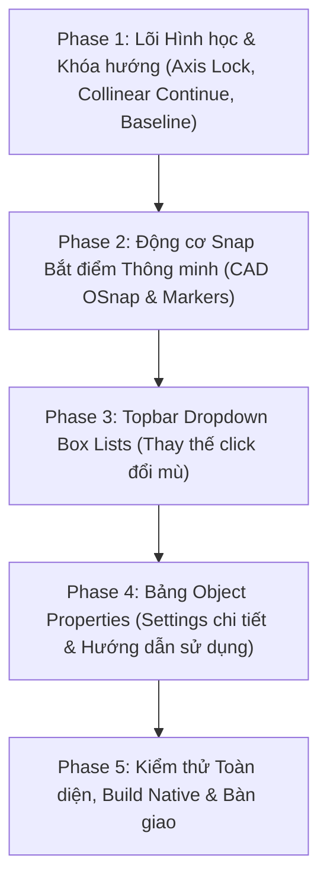

# Kế hoạch Đại tu Tính năng Đo kích thước Kỹ thuật (CAD / Xây dựng & Cơ khí) — PikDraw

- **Mã kế hoạch**: `PLAN-DIM-CAD-20261022`
- **Ngày lập**: 22/10/2026
- **Trạng thái**: Bản thảo kế hoạch chi tiết (Drafted Specification & Execution Plan)
- **Chuẩn tham chiếu**: TCVN 5705:1993, ISO 129-1, ASME Y14.5, AutoCAD `DIMCONTINUE` / `DIMBASELINE`, SolidWorks Smart Dimensioning, CorelDRAW Technical Suite.
- **Phạm vi tác động**:
  - `apps/desktop/src/tools/dimension_tool_controller.hpp/.cpp` (Bộ điều khiển công cụ đo kích thước)
  - `core/geometry/src/dimensions/dimension_geometry.cpp` (Hình học đường đo và đường dóng)
  - `core/document/src/annotations/dimension_layout.cpp` (Bố cục và định dạng kích thước)
  - `apps/desktop/src/shell/native_window_dimension_property_bar.cpp` (Contextual Topbar & Dropdown Box Lists)
  - `apps/desktop/src/shell/native_window_paint_docks.cpp` (Bảng Object Properties & Hướng dẫn sử dụng)
  - `apps/desktop/src/shell/native_window_canvas_overlays.cpp` (Hiển thị Snap Markers & Overlays)

---

## 1. Hiện trạng & Phân tích nguyên nhân gốc rễ (Root Cause Analysis)

Dựa trên phản hồi người dùng và 3 ảnh thực tế cung cấp:

### 1.1. Lỗi Dim nhanh liên tục (Continue Dimension) bị xiên vẹo, lệch bậc thang (Ảnh 1)
- **Hiện tượng**: Khi dùng chức năng *🔗 Continue Dimension* đo nối tiếp qua các hình chữ nhật, các đoạn đo bị xiên chéo (`61.02 mm`, `8.37 mm`, `60.97 mm`, `5.98 mm`, `61.29 mm`, `33.49 mm`), đường dóng bị nghiêng vẹo, các đường đo nằm ở các độ cao khác nhau thay vì trên cùng một đường thẳng.
- **Nguyên nhân kỹ thuật**:
  1. Công cụ đang ở chế độ `LinearOrientation::Aligned` (Đo xiên tự do theo 2 điểm click). Khi người dùng bắt điểm vào các góc có cao độ $Y$ hơi chênh lệch (dù chỉ 1 vài pixel), vector $\vec{v} = p_2 - p_1$ bị nghiêng.
  2. Trong hàm `compute_continuous_placement`: với chế độ `Aligned`, pháp tuyến $\vec{n} = \{-u_y, u_x\}$ được tính lại độc lập cho từng cặp điểm! Do đó mỗi đoạn đo mới lại xoay theo một góc nghiêng mới và tính độ dời placement ở vị trí mới.
  3. **Thiếu cơ chế ràng buộc đường cơ sở chung (Collinear Baseline Alignment)**: Trong tiêu chuẩn CAD (AutoCAD `DIMCONTINUE`), mọi đoạn đo trong chuỗi nối tiếp bắt buộc phải nằm trên **cùng một đường thẳng tắp duy nhất** (cùng $Y$ nếu đo ngang, cùng $X$ nếu đo dọc, hoặc cùng đường thẳng $L_0$ nếu đo xiên).
  4. **Thiếu tính năng Khóa hướng đo (Axis Lock)**: Chưa có tùy chọn khóa cứng hướng Ngang (0°), Dọc (90°) hoặc Góc xiên 45° trong lúc đo liên tục.

### 1.2. Thuật toán Snap bắt điểm còn thô sơ, thiếu thông minh
- **Hiện trạng**: Hàm `DimensionToolController::update_snap` hiện tại chỉ kiểm tra 4 góc và 4 trung điểm của khung bao AABB (`bounds()`), cộng với các node của path.
- **Thiếu sót so với yêu cầu kỹ thuật cơ khí & xây dựng**:
  - Không bắt được **Trung điểm cạnh thực tế (Midpoint)** của các phân đoạn đa giác, đoạn thẳng, hình đa giác phức tạp.
  - Không bắt được **Điểm vuông góc (Perpendicular)** từ điểm xuất phát tới cạnh đối diện.
  - Không bắt được **Giao điểm (Intersection)** giữa các đối tượng giao nhau.
  - Không bắt được **Tâm đường tròn / cung tròn thực (Center)** và các **Điểm phần tư (Quadrant 0°, 90°, 180°, 270°)**.
  - Thiếu **Snap Marker trực quan** (hình vuông cho Node, tam giác cho Midpoint, hình tròn/dấu cộng cho Center, góc vuông cho Perpendicular, dấu X cho Intersection).
  - Thiếu **Snap Tooltip / Badge** hiển thị tức thời cạnh con trỏ chuột (ví dụ: `Node`, `Midpoint`, `Perpendicular`).

### 1.3. Bảng Object Properties (bên phải) bỏ quên Dimension (Ảnh 2)
- **Hiện trạng**: Khi mở công cụ Dimension hoặc khi click chọn 1 đối tượng Dimension trên canvas, tab `Objects` trong dock bên phải hoàn toàn không hiển thị bảng thuộc tính chuyên dụng của Dimension, mà rơi vào trạng thái rỗng:
  `Page size: 297 mm × 210 mm mm` (chú ý: lỗi lặp đơn vị `mm mm`)
  `Select an object to inspect its size (mm).`
- **Yêu cầu**: Cần tích hợp trọn vẹn mục `PROPERTIES · DIMENSION` với đầy đủ các trường thiết lập:
  - Giá trị đo thật & ô nhập Text ghi đè (Text Override / Prefix / Suffix như `Ø`, `R`, `±0.05`).
  - Chọn đơn vị, số chữ số thập phân, kiểu mũi tên, cỡ mũi tên, cỡ chữ.
  - Khoảng hở chân dóng (Offset from origin) và độ nhô đầu dóng (Extension line overshoot).
  - **Khung Hướng dẫn sử dụng nhanh (Quick Step-by-Step Guide)** giải thích rõ ràng các bước đo, phím tắt (`Shift` khóa hướng, `Esc` hủy/dừng).

### 1.4. Cài đặt trên Topbar chuyển đổi "mù" vòng tròn (Ảnh 3)
- **Hiện trạng**: Các nút `[0.00]`, `[mm ▾]`, `[◀-▶ ▾]`, `[0.25 mm ▾]`, `[T: 3 mm ▾]` trên thanh thuộc tính ngữ cảnh hiện đang dùng cơ chế `cycle_...()`: click 1 cái thì nhảy tuần tự mù sang giá trị tiếp theo. Người dùng không thấy được danh sách tùy chọn và phải click nhiều lần rất mất thời gian.
- **Yêu cầu**: Chuyển đổi thành **Dropdown Box List (danh sách menu sổ xuống)** chuẩn Win32 (`TrackPopupMenu` với checkmark `✓` đánh dấu giá trị đang chọn), nhấp vào là thấy toàn bộ danh sách và chọn chính xác ngay lập tức.

### 1.5. Hạn chế của Đo Bán kính (R), Đường kính (Ø) và Thiếu tùy chọn Vị trí Văn bản
- **Đo Bán kính ($R$) & Đường kính ($\varnothing$) chưa thông minh**:
  - Khi click vào đối tượng, hệ thống chỉ lấy bounding box để suy đoán bán kính $R = \text{width} / 2$, không nhận diện được đường tròn thực tế, cung tròn (Arc) hay góc bo (Fillet) trong path.
  - Cách bố trí đường dẫn (Leader layout) còn đơn điệu: chưa phân biệt khi con trỏ ở trong hình tròn (Inside leader từ tâm ra mép) hay ở ngoài hình tròn (Outside leader kèm đường gãy khuỷu ngang); chưa có tùy chọn vẽ **Dấu tâm (Center Mark $+ / \oplus$)**.
  - Đường kính ($\varnothing$) chưa hỗ trợ kiểu đo xuyên tâm 2 mũi tên (Through-center diameter) chuẩn CAD cơ khí.
- **Thiếu cài đặt vị trí chữ số kích thước (Text Placement Settings)**:
  - Chưa cho người dùng tùy chọn chữ số nằm **Phía trên đường kích thước (Above Line)** hay **Nằm giữa ngắt đường kích thước (In-line / Centered)**.
  - Chưa hỗ trợ tùy chọn chữ số **Luôn nằm ngang (Always Horizontal)** để dễ đọc bản vẽ kỹ thuật từ một hướng cố định.

### 1.6. Thiếu Layer Kích thước Chuyên dụng & Khả năng Sửa Hàng loạt (Batch Editing)
- **Quản lý Layer**: Hiện tại các đối tượng Dimension được tạo trên Layer hiện hành, nằm lẫn lộn với các hình vẽ vector thông thường. Người dùng không có cách nào bật/tắt ẩn hiện hoặc khóa toàn bộ đường kích thước cùng một lúc như trong AutoCAD (`Layer DIM`) hay CorelDRAW.
- **Chỉnh sửa hàng loạt khi không chọn 1 đường dim cụ thể**: Khi người dùng muốn đổi màu tất cả các đường kích thước, đổi cỡ chữ hoặc đổi kiểu mũi tên cho toàn bộ bản vẽ, hiện tại bắt buộc phải click từng đường một rất thủ công. Khi không chọn đối tượng nào, bảng Properties chưa cho phép chỉnh sửa Style mặc định hoặc áp dụng hàng loạt cho tất cả các đường đo hiện có.
- **Phân chia trách nhiệm Topbar vs Bảng Properties**: Thanh Topbar có không gian ngang hạn chế, nếu nhồi nhét quá nhiều nút sẽ bị tràn và rối mắt. Cần giữ Topbar tinh gọn chỉ với các thiết lập hay dùng nhất (hướng đo, kiểu đo, đơn vị, số lẻ, mũi tên, vị trí trên/giữa), toàn bộ các thiết lập chi tiết, màu sắc, layer, dung sai và hướng dẫn sử dụng phải đưa vào Bảng Properties bên phải.

---

## 2. Tiêu chuẩn Kỹ thuật Xây dựng & Cơ khí Tham chiếu

```
  Chuẩn Kỹ thuật (ISO 129-1 / TCVN 5705 / AutoCAD / SolidWorks):

  1. Chuỗi kích thước liên tục (DIMCONTINUE / Chain Dimension):
     +---------------+-------+-----------------+
     |               |       |                 |
     |<--- 60.00 --->|<-8.00>|<---- 60.00 ---->|  <-- Chung 1 đường gióng baseline (Collinear)
     |               |       |                 |
     |   [HÌNH 1]    |       |    [HÌNH 2]     |

  2. Kích thước song song xếp tầng (DIMBASELINE / Stacked Dimension):
     |<-------------------- 128.00 ----------->|  <-- Tầng 2 (+8mm)
     |<--- 60.00 --->|                         |  <-- Tầng 1
     |               |                         |
     |   [HÌNH 1]    |        [HÌNH 2]         |
     ^
    Gốc chuẩn (Datum Origin)

  3. Vị trí văn bản kích thước (Text Placement):
     (A) Nằm phía trên đường liền (Above Line - ISO 129 / TCVN 5705):
               60.00 mm
         |-------------------|
         |                   |

     (B) Nằm ở giữa ngắt đường đo (Inline / Centered - ASME Y14.5 / AutoCAD):
         |------ 60.00 ------|
         |                   |

  4. Bán kính (R) & Đường kính (Ø):
     (A) Radius Inside:                 (B) Radius Outside (Leader):
             +---------> R 20.00                       /--- R 20.00
            / \                                       /
           ( + )                                    ( + )

     (C) Diameter Through-Center:       (D) Diameter Leader with Center Mark:
           <---+---> Ø 40.00                     --+--     /--- Ø 40.00
            \  |  /                                |      /
             ( + )                               ( + )---/
```

1. **Chuỗi kích thước liên tục (Chain Dimension / Continue)**:
   - Các đường kích thước của tất cả các đoạn đo trong chuỗi **bắt buộc phải nằm trên cùng một đường thẳng cơ sở (Collinear Baseline)**.
   - Khoảng cách giữa 2 đường dóng của các đoạn liền kề chia sẻ chung một đường dóng tại điểm mút.
   - Nếu khoảng cách quá hẹp ($< 8\,\text{mm}$), số đo tự động đảo ra ngoài hoặc lùi so le để tránh đè chữ.
2. **Kích thước song song dóng từ một gốc (Baseline Dimension / Stacked)**:
   - Xuất phát từ cùng một điểm gốc chuẩn (Datum Point).
   - Các đường kích thước xếp song song, cách nhau một bước chuẩn đều đặn ($8\,\text{mm} \sim 10\,\text{mm}$).
3. **Đo Bán kính ($R$) & Đường kính ($\varnothing$)**:
   - **Bán kính ($R$)**: Tự động nhận diện cung tròn/đường tròn; tự chuyển đổi Inside/Outside theo vị trí chuột; hỗ trợ dấu tâm Center Mark ($+$).
   - **Đường kính ($\varnothing$)**: Hỗ trợ 2 kiểu: Xuyên tâm (Through-center, 2 mũi tên đối diện) và Đường dẫn (Leader qua tâm với gạch ngang landing shelf).
4. **Vị trí & Định hướng văn bản kích thước (Text Placement & Alignment)**:
   - **Nằm trên đường đo (Above Line)**: Đường kích thước chạy liền mạch, số đo đặt cao hơn line $0.75 \sim 1.0\,\text{mm}$ (chuẩn ISO/TCVN).
   - **Nằm giữa ngắt đường đo (Inline / Centered)**: Đường kích thước ngắt quãng để chèn số đo vào giữa (chuẩn ASME / AutoCAD).
   - **Định hướng**: Song song với đường đo (Aligned) hoặc Luôn nằm ngang (Horizontal).
5. **Đầu mút kích thước (Dimension Terminators)**:
   - **Mũi tên kín (Closed Filled Triangle)**: Dùng cho bản vẽ cơ khí, chế tạo máy, chi tiết gia công.
   - **Vạch chéo 45° (Architectural Tick `/`)**: Dùng cho bản vẽ kiến trúc, xây dựng, kết cấu dân dụng, nội thất.
   - **Chấm tròn (Dot `●`)**: Dùng cho sơ đồ điện, mạch in, bảng mạch và các không gian hẹp.

---

## 3. Kế hoạch Triển khai Chi tiết (5 Phase)



### Phase 1: Đại tu Lõi Hình học & Khóa Hướng Đo (Axis Lock & Continue Baseline)

#### Mục tiêu:
Khắc phục triệt để hiện tượng đường dim bị xiên lệch khi đo liên tục; thêm tính năng khóa hướng ngang/dọc/45°.

#### Chi tiết kỹ thuật:
1. **Bổ sung chế độ Khóa trục đo (`DimensionAxisLock`)**:
   - `Auto`: Tự nhận diện hướng chủ đạo theo góc tạo bởi 2 điểm đầu ($\Delta X > \Delta Y \Rightarrow$ Ngang, ngược lại $\Rightarrow$ Dọc).
   - `Horizontal` (Khóa Ngang - 0° / 180°): Chỉ đo khoảng cách $\Delta X$, đường dóng tuyệt đối thẳng đứng, đường đo tuyệt đối nằm ngang.
   - `Vertical` (Khóa Dọc - 90° / 270°): Chỉ đo khoảng cách $\Delta Y$, đường dóng tuyệt đối nằm ngang, đường đo tuyệt đối thẳng đứng.
   - `Angle45` (Khóa Xiên 45°): Đo theo phương xiên 45° hoặc 135°.
   - `Aligned` (Tự do theo 2 điểm): Dành cho cạnh xiên bất kỳ.
2. **Hỗ trợ phím giữ `Shift` tức thời (Ortho / 45° Snap Constraint)**:
   - Khi đang rê chuột chọn điểm thứ 2 hoặc kéo vị trí đường đo: Giữ phím `Shift` sẽ tự động khóa con trỏ chuột về góc gần nhất trong các góc chuẩn: $0^\circ, 45^\circ, 90^\circ, 135^\circ, 180^\circ$.
3. **Thuật toán Chuỗi kích thước liên tục Collinear (`compute_continuous_placement`)**:
   - Khi kích hoạt Continue Dimension từ một đoạn dim có sẵn:
     - Lưu lại **Đường cơ sở chuẩn (Reference Baseline Line)** của đoạn dim đầu: điểm gốc $P_{\text{base}}$, hướng vector đơn vị $\vec{u}_{\text{dim}}$ và khoảng cách offset dóng $d_{\text{offset}}$.
     - Với mỗi điểm $P_{\text{next}}$ tiếp theo được click:
       - Điểm đầu $P_1$ lấy từ điểm cuối của đoạn trước.
       - Điểm thứ hai $P_2 = P_{\text{next}}$.
       - Vị trí `placement_point` của đoạn mới được **chiếu vuông góc trực tiếp lên cùng đường thẳng $L_0$ của đoạn đầu**, bất kể người dùng click chuột ở cao độ nào!
       - Kết quả: 100% tất cả các đoạn dim liên tiếp đều nằm trên cùng một đường thẳng tắp, không bao giờ bị lệch hay giật cấp!
4. **Bổ sung tính năng Đo xếp tầng song song (Baseline Dimension)**:
   - Thêm nút/chế độ *📶 Baseline*: Cho phép click liên tiếp các điểm mút, tạo ra các đường kích thước cùng chung điểm gốc ban đầu nhưng xếp tầng cách đều nhau lên trên (khoảng cách $8\,\text{mm}$ tiêu chuẩn ISO).
5. **Cơ chế Đo Bán kính (R) & Đường kính (Ø) Thông minh (Smart Radial & Diametric Layout)**:
   - **Nhận diện hình học thông minh**: Thay vì chỉ đo theo bounding box, hệ thống phân tích hình học thực của path để trích xuất tâm và bán kính chính xác của cung tròn (Arc segment), góc bo (Fillet) hoặc hình tròn thực tế.
   - **Tự động chuyển đổi Bố cục Trong/Ngoài (Inside vs Outside Layout)**:
     - Khi con trỏ chuột nằm *bên trong* cung tròn ($d < r$): Mũi tên chỉ từ tâm ra mép ngoài (Inside Leader), chữ số nằm trên đường bán kính bên trong hình tròn.
     - Khi con trỏ chuột nằm *bên ngoài* cung tròn ($d > r$): Tự động tạo đường dẫn có điểm gãy khuỷu (Elbow) và thanh đỡ nằm ngang (Landing Shelf) chứa chữ số `R 25.00`.
   - **Tùy chọn Dấu tâm (Center Mark $+ / \oplus$)**: Tự động vẽ dấu chữ thập tâm tại tâm đường tròn / cung tròn đo với kích thước chuẩn ($2 \sim 3\,\text{mm}$ kéo dài).
   - **Đường kính xuyên tâm (Through-Center Diameter)**: Đo đường kính bằng đường đo đi qua tâm với 2 mũi tên ở 2 đầu chạm mặt đường tròn, hoặc đường dẫn 1 mũi tên kèm gạch ngang.
6. **Bộ xử lý Vị trí Văn bản Kích thước (Text Placement Engine)**:
   - **`Above Line` (Nằm phía trên line)**: Đường kích thước chạy liền nét 100%, số đo đặt phía trên cách đường đo $0.75 \sim 1.0\,\text{mm}$ theo chuẩn ISO 129-1 / TCVN 5705:1993.
   - **`Inline / Centered` (Nằm giữa ngắt line)**: Đường kích thước tự động ngắt quãng ở giữa thành 2 đoạn với khoảng hở vừa vặn hộp chữ theo chuẩn ASME Y14.5 / AutoCAD.
   - **`Text Alignment` (Định hướng chữ)**: Hỗ trợ `Aligned` (song song xoay theo góc đường đo) và `Horizontal` (luôn nằm ngang $0^\circ$ dễ đọc).

---

### Phase 2: Nâng cấp Động cơ Snap Bắt Điểm Thông minh (CAD OSnap Engine)

#### Mục tiêu:
Cung cấp khả năng bắt điểm siêu chính xác vào các đối tượng vector trên canvas giống AutoCAD/SolidWorks.

#### Chi tiết kỹ thuật:
1. **Mở rộng các chế độ bắt điểm (`DimensionSnapType`)**:
   - `Node` / `Endpoint`: Đỉnh góc, điểm nút của đường path (hình vuông xanh Cyan $\square$).
   - `Midpoint`: Trung điểm của từng cạnh thực tế trên path/polygon (hình tam giác vàng $\triangle$).
   - `Center`: Tâm của hình tròn, hình elip, tâm đường cong hoặc tâm hình học (vòng tròn có tâm $\odot$).
   - `Intersection`: Điểm giao cắt thực tế giữa 2 cạnh đối tượng (chữ X đỏ $\times$).
   - `Perpendicular`: Điểm hạ vuông góc từ điểm đo thứ nhất tới cạnh đối tượng đang rê chuột qua (biểu tượng góc vuông $\llcorner$).
   - `Quadrant`: 4 điểm góc phần tư của hình tròn / elip (0°, 90°, 180°, 270°) (hình thoi tím $\diamond$).
2. **Trực quan hóa Snap Markers trên Canvas Overlays (`native_window_canvas_overlays.cpp`)**:
   - Khi chuột tiến vào bán kính snap (12 DIP):
     - Vẽ marker hình học đặc trưng nổi bật tại tọa độ snap.
     - Vẽ đường dóng phụ nét đứt màu vàng/cyan kết nối con trỏ chuột tới điểm snap.
     - Hiển thị Tooltip HUD nhỏ bên cạnh con trỏ: `[Điểm mút - Endpoint]`, `[Trung điểm - Midpoint]`, `[Tâm - Center]`, `[Vuông góc - Perpendicular]`.
3. **Tối ưu hóa hiệu năng Snap bằng Spatial Index**:
   - Tận dụng `aabb_index` để chỉ truy vấn các đối tượng nằm trong vùng lân cận con trỏ chuột, đảm bảo độ mượt 60 FPS ngay cả với bản vẽ hàng nghìn đối tượng.

---

### Phase 3: Thay thế Click "Đổi Mù" bằng Dropdown Box List trên Contextual Topbar

#### Mục tiêu:
Loại bỏ hoàn toàn thao tác click mù xoay vòng, thay bằng menu sổ xuống trực quan hiển thị đầy đủ tùy chọn với checkmark `✓`.

#### Chi tiết kỹ thuật:
1. **Dropdown Số chữ số thập phân (`[0.00 ▾]`)**:
   - Nhấp chuột mở popup menu tại tọa độ nút bấm:
     - `✓ 0       (Số nguyên: 61 mm)`
     - `  0.0     (1 số thập phân: 61.0 mm)`
     - `  0.00    (2 số thập phân: 61.02 mm - Chuẩn CAD)`
     - `  0.000   (3 số thập phân: 61.020 mm - Cơ khí chính xác)`
     - `  0.0000  (4 số thập phân: 61.0200 mm)`
2. **Dropdown Đơn vị đo (`[mm ▾]`)**:
   - Danh sách:
     - `✓ mm (Milimét - Cơ khí & Chế tạo)`
     - `  cm (Centimét)`
     - `  m  (Mét - Kiến trúc & Xây dựng)`
     - `  in (Inch - Hệ Anh/Mỹ)`
     - `  ft (Feet - Xây dựng US)`
     - `  pt (Point - In ấn)`
     - `  px (Pixel)`
3. **Dropdown Kiểu đầu mút (`[◀-▶ ▾]`)**:
   - Danh sách:
     - `✓ ◀-▶ Mũi tên nhọn kín (Closed Filled - Chuẩn ISO Cơ khí)`
     - `  /--/ Vạch chéo 45° (Architectural Tick - Kiến trúc & Xây dựng)`
     - `  ●--● Chấm tròn (Dot - Giản đồ & Mạch điện)`
     - `  ◁-▷ Mũi tên rỗng (Open Arrow)`
     - `  --- Không đầu mút (None)`
4. **Dropdown Độ dày nét dóng & nét đo (`[0.25 mm ▾]`)**:
   - Danh sách theo tiêu chuẩn ISO 128:
     - `  0.13 mm (Nét cực mảnh)`
     - `  0.18 mm (Nét mảnh CAD)`
     - `✓ 0.25 mm (Nét tiêu chuẩn ISO)`
     - `  0.35 mm (Nét trung bình)`
     - `  0.50 mm (Nét đậm)`
     - `  0.70 mm (Nét rất đậm)`
5. **Dropdown Cỡ chữ số đo (`[T: 3 mm ▾]`)**:
   - Danh sách:
     - `  1.8 mm (Ghi chú nhỏ)`
     - `  2.5 mm (Bản vẽ khổ A4)`
     - `✓ 3.0 mm (Tiêu chuẩn bản vẽ A3/A4)`
     - `  3.5 mm (Bản vẽ khổ A2)`
     - `  5.0 mm (Bản vẽ khổ lớn A1/A0)`
     - `  7.0 mm (Tiêu đề kích thước tổng thể)`
6. **Dropdown Vị trí & Định hướng Văn bản kích thước (`[Vị trí: Trên line ▾]`)**:
   - Danh sách:
     - `✓ Nằm phía trên đường đo (Above Line - Chuẩn ISO/TCVN)`
     - `  Nằm giữa ngắt đường đo (In-line Break - Chuẩn ASME/AutoCAD)`
     - `--------------------------------`
     - `✓ Nghiêng theo đường đo (Aligned)`
     - `  Luôn nằm ngang (Always Horizontal - 0°)`
7. **Bộ nút chọn hướng đo & Khóa trục trên Topbar**:
   - Bố cục trực quan:
     `[Tự do (Aligned)]` `[Ngang (H)]` `[Dọc (V)]` `[45°]` `[R / Ø]` `[Góc]` `|` `[🔗 Nối tiếp (Continue)]` `[📶 Xếp tầng (Baseline)]` `[⚡ Nhanh W×H]`

---

### Phase 4: Tích hợp Bảng Object Properties bên phải (Settings Chi tiết & Hướng dẫn sử dụng)

#### Mục tiêu:
Khi kích hoạt công cụ Dimension hoặc khi click chọn 1 đối tượng Dimension trên canvas, bảng Properties bên phải hiển thị đầy đủ bảng điều khiển chuyên dụng và hướng dẫn thao tác từng bước.

#### Chi tiết kỹ thuật:
1. **Khắc phục lỗi lặp đơn vị (`210 mm mm`)**:
   - Sửa hàm in khổ trang tại dòng 918-920 trong `native_window_paint_docks.cpp`: loại bỏ việc nối chuỗi hậu tố đơn vị lần thứ 2 khi `format_mm_display` đã có sẵn đơn vị.
2. **Tích hợp Section `PROPERTIES · KÍCH THƯỚC (DIMENSION)` trong Tab Objects**:
   - Khi `active_tool_ == 10 || is_dimension_object_selected()`:
     - **Tiêu đề section**: `THUỘC TÍNH · KÍCH THƯỚC KỸ THUẬT (DIMENSION)` màu Teal nổi bật.
     - **Nhóm 1: Kết quả đo & Nội dung văn bản**:
       - Giá trị đo thực tế (Measured Value, ví dụ: `61.02 mm` hoặc `R 25.00 mm` hoặc `Ø 50.00 mm`).
       - Ô nhập Text ghi đè / Ghi chú (Note Template / Override, ví dụ: `<> mm`, `2x <>`, `Ø<>`, `<> ±0.02`).
     - **Nhóm 2: Kiểu dáng kỹ thuật (CAD Dimension Style)**:
       - Nút chọn kiểu đo: Ngang / Dọc / Xiên / Bán kính / Đường kính / Góc / Nối tiếp / Xếp tầng.
       - Nút chọn kiểu đầu mút: Mũi tên cơ khí / Vạch chéo kiến trúc 45° / Chấm tròn.
       - Ô nhập cỡ mũi tên (`Arrow size`: mặc định $3.0\,\text{mm}$).
       - Ô nhập khoảng hở chân dóng (`Offset from origin`: mặc định $1.5\,\text{mm}$).
       - Ô nhập độ nhô đầu dóng (`Extension line overhang`: mặc định $2.0\,\text{mm}$).
     - **Nhóm 3: Bố cục Vị trí Văn bản & Bán kính / Đường kính**:
       - Nút chuyển vị trí chữ số: `[Nằm trên line (Above)]` / `[Nằm giữa ngắt line (In-line)]`.
       - Nút chuyển định hướng chữ: `[Song song line (Aligned)]` / `[Luôn nằm ngang (Horizontal)]`.
       - Ô nhập khoảng hở chữ (`Text gap`: mặc định $1.0\,\text{mm}$).
       - Tùy chọn Bán kính / Đường kính: Nút bật/tắt `Dấu tâm (Center Mark +)` và chọn kiểu đường kính `[Xuyên tâm (Through-center)]` / `[Đường dẫn (Leader)]`.
     - **Nhóm 4: Quản lý Layer Chuyên dụng & Chỉnh sửa Hàng loạt (Batch Editing)**:
       - **Quản lý Layer kích thước (`Layer Dimensions`)**:
         - Mọi đường đo và text kích thước tự động gom vào Layer chuyên biệt `Dimensions` (tự động tạo nếu chưa có).
         - Nút `[👁 Hiện / Ẩn tất cả Dim]`: Bật/tắt hiển thị toàn bộ đường kích thước trên bản vẽ chỉ với 1 click.
         - Nút `[🔒 Khóa / Mở khóa tất cả Dim]`: Khóa toàn bộ đường dim để tránh click chọn nhầm khi chỉnh sửa chi tiết đồ họa khác.
       - **Chỉnh sửa Hàng loạt (Batch Dimension Style Editing)**:
         - Khi *không chọn 1 đường dim cụ thể*: Các ô thiết lập (Màu nét, Màu chữ, Cỡ chữ, Độ dày nét, Kiểu mũi tên, Đơn vị, Vị trí chữ...) đóng vai trò là Style mặc định cho các nét đo mới.
         - Nút `[⚡ Áp dụng cho tất cả đường Dim]`: Cho phép áp dụng đồng loạt màu nét, màu chữ, cỡ chữ, độ dày nét, kiểu mũi tên cho TOÀN BỘ các đường kích thước hiện có trên bản vẽ!
         - Nút `[💾 Đặt làm mặc định]`: Lưu cấu hình hiện hành làm mặc định cho các tài liệu mới.
     - **Nhóm 5: Hướng dẫn sử dụng nhanh từng bước (Quick Step-by-Step Guide)**:
       - Hiển thị khung hướng dẫn rõ ràng ngay dưới các thuộc tính:
         > **Hướng dẫn thao tác công cụ Đo kích thước:**
         > 1. **Bấm điểm thứ nhất**: Rê chuột đến đối tượng, hệ thống sẽ tự động bắt dính điểm mút ($\square$), trung điểm ($\triangle$) hoặc tâm ($\odot$).
         > 2. **Bấm điểm thứ hai**: Điểm kết thúc đoạn cần đo.
         > 3. **Kéo chuột định vị đường đo**: Nhấp chuột lần cuối để đặt đường kích thước.
         > - **Mẹo phím tắt & Thao tác nhanh**:
         >   - Giữ **Shift**: Khóa hướng đo Ngang (0°), Dọc (90°) hoặc Chéo 45°.
         >   - Bật **🔗 Nối tiếp (Continue)**: Đo chuỗi liên hoàn thẳng tắp chỉ với 1 click mỗi điểm.
         >   - Bật **📶 Xếp tầng (Baseline)**: Đo song song từ một gốc chuẩn cố định.
         >   - Khi không chọn đối tượng nào: Chỉnh sửa thuộc tính trong bảng này rồi bấm **[⚡ Áp dụng cho tất cả]** để đổi màu, cỡ chữ, nét vẽ hàng loạt.
         >   - Nhấn **Esc**: Hủy thao tác đang vẽ hoặc dừng chuỗi đo.

---

### Phase 5: Kiểm thử Toàn diện, Build Native & Nghiệm thu Tính năng

#### Mục tiêu:
Xây dựng test suite tự động và kiểm tra tính chính xác hình học, kiểm thử giao diện Win32, build ứng dụng `pikdraw.exe` chính thức.

#### Danh mục kiểm thử:
1. **Test lõi hình học (`test_dimension_geometry.cpp`)**:
   - Kiểm tra tính Collinear của chuỗi Continue Dimension: 5 đoạn liên tiếp phải có cùng tọa độ đường đo $Y$ (khi đo ngang) hoặc cùng $X$ (khi đo dọc), sai số $< 10^{-6}\,\text{mm}$.
   - Kiểm tra tính toán khoảng cách xếp tầng Baseline Dimension: các đường dim cách nhau chính xác khoảng cách $8.0\,\text{mm}$.
   - Kiểm tra khóa hướng đo 0°, 45°, 90°.
2. **Test bắt điểm Snap (`test_dimension_tool_controller.cpp`)**:
   - Kiểm tra bắt dính chính xác vào Midpoint thực tế của cạnh tam giác, hình chữ nhật, polygon.
   - Kiểm tra bắt dính Center của hình tròn và Perpendicular lên cạnh đối diện.
3. **Test giao diện Desktop Shell (`test_desktop_shell.cpp`)**:
   - Kiểm tra phản hồi Topbar Dropdown menu khi click vào nút Decimals, Unit, Arrow style, Line width, Text size.
   - Kiểm tra hiển thị bảng Properties Dimension trong dock bên phải khi chọn công cụ hoặc chọn đối tượng.
   - Kiểm tra hiển thị đúng khổ trang, không bị lặp `mm mm`.
4. **Biên dịch bản chạy chính thức**:
   - Chạy `tooling/native/build.ps1 -Test` đảm bảo 100% test pass.
   - Biên dịch `pikdraw.exe` hoàn chỉnh.

---

## 4. Bảng So sánh Trước & Sau Đại tu

| Tiêu chí | Trước khi đại tu | Sau khi đại tu (Chuẩn CAD / Kỹ thuật) |
| :--- | :--- | :--- |
| **Đo liên tục (Continue)** | Bị xiên chéo, lệch bậc thang, đường dóng nghiêng vẹo theo từng click. | **Thẳng hàng tuyệt đối (Collinear Baseline 100%)**, các đoạn đo cùng nằm trên một đường thẳng duy nhất. |
| **Khóa hướng đo (Axis Lock)** | Chỉ có nút chuyển Aligned/Horiz/Vert tĩnh, không có khóa 45°, không hỗ trợ Shift khóa hướng động. | Đầy đủ khóa **Ngang (0°), Dọc (90°), Chéo 45°**, giữ **Shift** tự động snap khóa hướng tức thời. |
| **Đo xếp tầng (Baseline)** | Chưa hỗ trợ. | **Hỗ trợ đầy đủ (DIMBASELINE)** dóng từ 1 gốc chuẩn, tự động xếp tầng cách đều $8\,\text{mm}$. |
| **Snap bắt điểm** | Chỉ bắt 4 góc và tâm của khung bao AABB hình chữ nhật. | **Đầy đủ CAD OSnap**: Điểm mút ($\square$), Trung điểm cạnh thực ($\triangle$), Tâm hình tròn ($\odot$), Giao điểm ($\times$), Điểm vuông góc ($\llcorner$). |
| **Chỉ báo Snap (Feedback)** | Chỉ có chấm tròn nhỏ mờ nhạt. | **Marker hình học đặc trưng + Đường dóng phụ + Tag chữ** (`Endpoint`, `Midpoint`, `Center`...). |
| **Thanh Topbar ngữ cảnh** | Click đổi "mù" vòng tròn từng giá trị một rất ức chế. | **Dropdown Box List sổ xuống** hiển thị toàn bộ tùy chọn kèm checkmark `✓` chọn ngay tức thì. |
| **Kiểu đầu mút** | Chỉ có 3 kiểu cơ bản. | Bổ sung đầy đủ chuẩn cơ khí (**Mũi tên kín**) & xây dựng (**Vạch chéo 45° Architectural Tick**, **Chấm tròn Dot**, **None**). |
| **Bảng Properties bên phải** | Bỏ trống hoàn toàn khi mở Dimension tool hoặc chọn kích thước. | **Bảng Properties chuyên dụng** đầy đủ thông số hình học, kiểu dáng, đường dóng, và **Hướng dẫn sử dụng từng bước**. |
| **Hiển thị khổ trang** | Lỗi hiển thị lặp `Page size: 297 mm × 210 mm mm`. | Đã sửa chuẩn xác `Page size: 297 mm × 210 mm`. |
