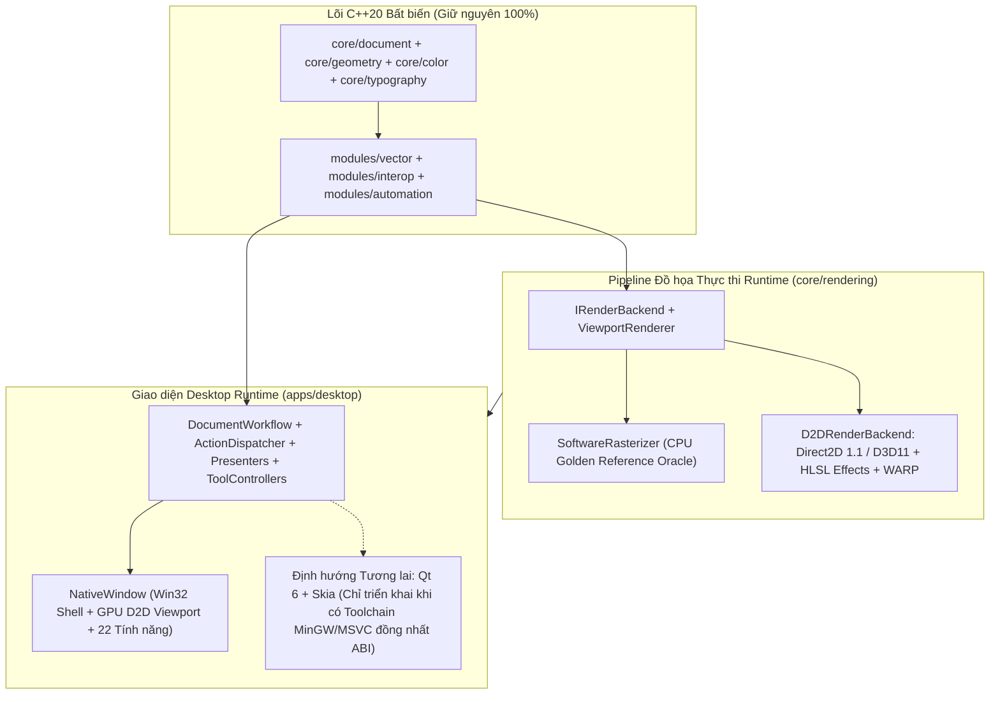

# Lộ trình tích hợp GPU Rendering (Direct2D 1.1 / D3D11) trên Native Shell & Định hướng Kiến trúc Qt 6 / Skia

Trạng thái: **Kế hoạch kỹ thuật chiến lược — Đã cập nhật theo Hướng A (Thực thi 100% GPU Direct2D Thật, Zero Stub/Mock)**.
Đối chiếu: [C3 Rendering](../../contracts/c3-rendering.md), [C8 Import Fidelity](../../contracts/c8-import-fidelity.md), [C9 Appearance/Effects](../../contracts/c9-appearance-effects.md), [Tương thích tài nguyên vector](../architecture/vector-resource-interoperability.md), [Chuẩn UX/UI](../design/ui-ux-standard.md), [Kế hoạch khắc phục kiến trúc](architecture-remediation-plan-20261018.md).

---

## 1. Chiến lược Kiến trúc Thực tế (Hướng A — Zero Fake Code, 100% Native ABI Compatibility)

### Bối cảnh Toolchain & Lý do chọn Hướng A
1. **Ràng buộc ABI của Toolchain hiện hành**:
   - Trình biên dịch duy nhất của dự án là `llvm-mingw-20261006-ucrt-x86_64` (Clang++ sử dụng **GNU/Itanium C++ ABI**).
   - Các gói prebuilt C++ biên dịch bằng MSVC (`msvc2022_64`) như Qt 6 MSVC hoặc `skia.lib` MSVC không thể link trực tiếp với MinGW Clang++ do khác biệt C++ name mangling và STL layout.
   - **Quy tắc bất di bất dịch**: Tuyệt đối cấm tạo class/header giả lập (`qt_compat.hpp`, Skia stub rỗng) hoặc ép `D2DRenderBackend` gọi ngầm về `SoftwareRasterizer` để tạo "test pass giả".
2. **Giải pháp Kỹ thuật Thực chất (Direct2D 1.1 + Direct3D 11 + DXGI COM API)**:
   - Direct3D 11 (`d3d11.h`), DXGI (`dxgi1_2.h`) và Direct2D 1.1 (`d2d1_1.h`, `d2d1effects.h`) là các **COM Interface nhị phân cấp hệ điều hành của Windows** (giao tiếp qua bảng `vtable` chuẩn C/COM, độc lập hoàn toàn với C++ ABI).
   - Có sẵn 100% trong Windows SDK đi kèm `llvm-mingw` (`-ld3d11 -ld2d1 -ldxgi -ldwrite -luuid -lwindowscodecs`).
   - Cho phép tăng tốc phần cứng GPU thật 100% (kèm `D3D_DRIVER_TYPE_WARP` fallback) ngay trên cửa sổ `NativeWindow` hiện tại mà vẫn bảo toàn tuyệt đối 22 tính năng đang hoạt động.



---

## 2. Nguyên tắc Kỹ thuật Bất biến (C3, C8, C9, Giới hạn 800 dòng & Chống Giả lập)

1. **Cấm tuyệt đối Mock / Stub / Bypass ngầm**:
   - Không được viết các hàm vỏ bọc trả về `true` giả tạo hoặc đẩy toàn bộ frame sang `SoftwareRasterizer` khi chạy ở chế độ GPU (`D2DRenderBackend`).
   - Khi test `D2DRenderBackend` với `PixelBufferTarget` (bao gồm cả `target.pixels` và `target.premultiplied_rgba`), bắt buộc phải render thật trên `ID2D1DeviceContext` và thực hiện **GPU Staging Bitmap Readback** (`D2D1_BITMAP_OPTIONS_CPU_READ`) về RAM.
2. **Quy tắc 800 dòng/file**:
   - Mọi file code trong `core/rendering/src/gpu/d2d/*` và `apps/desktop/src/shell/*` phải tuân thủ ngưỡng **300–700 dòng, tối đa 800 dòng**.
3. **Chiếu tọa độ tương đối theo Camera (Contract C3)**:
   - Trước khi nạp đỉnh vào `ID2D1PathGeometry`, phải trừ tâm Camera bằng `double`:
     $$x_{\text{local}} = \text{static\_cast<float>}(X_w - C_x), \quad y_{\text{local}} = \text{static\_cast<float>}(Y_w - C_y)$$
   - Tuyệt đối không nhân trực tiếp tọa độ thế giới `double` lớn vào ma trận `float` của GPU để tránh rung hình (jitter) khi zoom sâu ở xa gốc tọa độ.
4. **Không rò rỉ kiểu dữ liệu GPU vào Core (Contract C3 §4)**:
   - Các kiểu `ID3D11Device`, `ID2D1DeviceContext`, `ID2D1Bitmap1` bị cấm tuyệt đối trong `core/document`, `core/geometry`, `modules/vector` và `contracts/`.
5. **Chuẩn hóa hiệu ứng C9 trên GPU**:
   - Thứ tự kết hợp màu (compositing) trên GPU phải tuân thủ C9: `Fill/Stroke Opacity -> Object-local Effects (Gaussian Blur / Drop Shadow) -> Object Affine Transform -> Object Opacity -> Object Blend Mode vs Backdrop`.
   - `SoftwareRasterizer` được giữ lại làm **Golden Reference Oracle** để kiểm chứng độ khớp pixel.

---

## 3. Lộ trình Triển khai Chi tiết (6 Giai đoạn Thực chất: G01 → G06)

### [x] DONE Giai đoạn G01: Nền tảng GPU Surface, Spatial R-Tree & Damage Tracking (`core/rendering`)
- **Mục tiêu**: Chuẩn bị hạ tầng truy vấn không gian $O(\log N)$ và cơ chế tính toán vùng bẩn (Damage Rect) trước khi đưa xuống GPU.
- **Owned paths**:
  - `core/rendering/include/pikdraw/rendering/spatial_index.hpp`
  - `core/rendering/src/culling/spatial_index.cpp`
  - `core/rendering/include/pikdraw/rendering/damage_tracker.hpp`
  - `core/rendering/src/culling/damage_tracker.cpp`
  - `core/rendering/include/pikdraw/rendering/backend.hpp`
- **Kết quả đã đạt**:
  - `SpatialIndex` (BVH) và `DamageTracker` hoạt động chuẩn xác, pass 100% `test_pikdraw_rendering_culling`.

---

### [x] DONE Giai đoạn G02: `D2DRenderBackend` Direct2D GPU và PixelBuffer Readback cho profile được hỗ trợ (`core/rendering/src/gpu/d2d/`)
- **Mục tiêu**: Loại bỏ các bypass CPU khi D2D đã khởi tạo; vẽ các primitive/effects được hỗ trợ trực tiếp bằng Direct2D 1.1 / D3D11 và trả lỗi rõ ràng cho dữ liệu/combination chưa hỗ trợ. Đây không phải cam kết hỗ trợ toàn bộ profile C9.
- **Owned paths**:
  - `core/rendering/include/pikdraw/rendering/d2d_backend.hpp`
  - `core/rendering/src/gpu/d2d/d2d_internal.hpp`
  - `core/rendering/src/gpu/d2d/d2d_device_manager.cpp` (< 500 dòng)
  - `core/rendering/src/gpu/d2d/d2d_geometry_cache.cpp` (< 500 dòng)
  - `core/rendering/src/gpu/d2d/d2d_effects_pipeline.cpp` (< 650 dòng)
  - `core/rendering/src/gpu/d2d/d2d_render_backend.cpp` (< 700 dòng)
  - `core/rendering/tests/rasterizer/test_rasterizer.cpp`
- **Hạng mục công việc bắt buộc**:
  1. **Xóa bỏ Bypass sang CPU**:
     - Trong `d2d_render_backend.cpp`, xóa bỏ hàm `find_unsupported_d2d_feature()` và xóa bỏ đoạn `if (target.premultiplied_rgba != nullptr) return true;` trong `should_use_software()`.
     - Chỉ fallback sang `SoftwareRasterizer` khi biến môi trường `PIKDRAW_RENDER_BACKEND=cpu` hoặc khi khởi tạo cả D3D11 Hardware lẫn WARP đều thất bại.
  2. **Hỗ trợ đầy đủ 5 loại đối tượng & Ma trận biến đổi (`Transform2D`)**:
     - Áp dụng đúng `obj.transform` (`a, b, c, d, tx, ty`) kết hợp phép chiếu Camera-relative (`camera.center()`) lên `ID2D1DeviceContext` hoặc `ID2D1TransformedGeometry`.
     - Hỗ trợ đầy đủ Fill Rule (`D2D1_FILL_MODE_WINDING` cho NonZero, `D2D1_FILL_MODE_ALTERNATE` cho EvenOdd) và Stroke Style (`ID2D1StrokeStyle1` cho LineCap, LineJoin, MiterLimit, DashArray, Hairline minimum $1.0 / \text{zoom}$).
     - Hỗ trợ `LinearGradient` (`ID2D1LinearGradientBrush`) và `RadialGradient` (`ID2D1RadialGradientBrush`) với bảng màu preview đã qua `IccPreview` (nếu có).
     - Hỗ trợ `TextObject` (chuyển thành `Path2D` qua `pikdraw_typography` kèm `obj.transform`), `ImageObject` (tạo `ID2D1Bitmap` từ `obj.pixels_rgba`, áp dụng `obj.bounds_rect`, `obj.transform` và `obj.clip_path`), và `GroupObject` (duyệt đệ quy các phần tử con).
  3. **Hiệu ứng C9 & Chế độ hòa trộn trên GPU (`d2d_effects_pipeline.cpp`)**:
     - Vẽ đối tượng có hiệu ứng (`GaussianBlurEffect`, `DropShadowEffect`) hoặc `blend_mode != Normal` lên offscreen `ID2D1BitmapRenderTarget` / `ID2D1CommandList`, chạy qua chuỗi `ID2D1Effect` (`CLSID_D2D1GaussianBlur`, `CLSID_D2D1Shadow`, `CLSID_D2D1Blend`) và hợp nhất xuống target chính theo đúng thứ tự C9.
     - Kiểm tra giới hạn ngân sách hiệu ứng (bán kính blur/shadow hoặc kích thước surface vượt ngưỡng C9) để ghi nhận `RenderDiagnostic` chính xác.
  4. **GPU Staging Readback cho cả `pixels` (BGRA8) và `premultiplied_rgba` (Float)**:
     - Sau `context->EndDraw()`, copy từ GPU Target Bitmap sang CPU Readback Bitmap (`D2D1_BITMAP_OPTIONS_CPU_READ | D2D1_BITMAP_OPTIONS_CANNOT_DRAW`) và gọi `Map(D2D1_MAP_OPTIONS_READ)`.
     - Chép dữ liệu vào `target.pixels` (nếu khác null) VÀ giải mã sang mảng float `target.premultiplied_rgba` (nếu khác null) ngay từ dữ liệu đọc về từ GPU.
     - Cập nhật `out_metric->used_gpu = true` (hoặc thêm cờ xác nhận rõ ràng frame được vẽ bởi D2D).
- **Lệnh kiểm tra bắt buộc**:
  `powershell -File tooling/native/build.ps1 -Test -TestTarget test_pikdraw_rendering_rasterizer,test_pikdraw_rendering_effect_compositor -TestRegex '^test_pikdraw_rendering_(rasterizer|effect_compositor)$'`

---

### [x] DONE Giai đoạn G03: Dọn Sạch Code Stub Skia & Kết Nối `D2DRenderBackend` vào `ViewportRenderer` (`core/rendering`)
- **Mục tiêu**: Xóa bỏ hoàn toàn các file stub Skia không hoạt động thực tế và đưa `D2DRenderBackend` trở thành engine tăng tốc mặc định của `ViewportRenderer`.
- **Owned paths**:
  - `cmake/PikDrawDependencies.cmake`
  - `core/rendering/CMakeLists.txt`
  - `core/rendering/src/renderer.cpp`
  - `core/rendering/include/pikdraw/rendering/renderer.hpp`
  - *(Xóa)* `core/rendering/include/pikdraw/rendering/skia_backend.hpp`
  - *(Xóa)* `core/rendering/src/gpu/skia/`
  - *(Xóa)* `core/rendering/tests/gpu_independent/`
- **Hạng mục công việc bắt buộc**:
  1. Xóa sạch thư mục `core/rendering/src/gpu/skia/`, file header `skia_backend.hpp` và test stub `core/rendering/tests/gpu_independent/`; gỡ bỏ cấu hình Skia stub khỏi `CMakeLists.txt` và `PikDrawDependencies.cmake`.
  2. Cập nhật `ViewportRenderer` (`core/rendering/src/renderer.cpp`):
     - Khởi tạo `D2DRenderBackend` làm backend mặc định trên Windows (có thể chuyển đổi qua biến môi trường `PIKDRAW_RENDER_BACKEND=d2d|cpu` hoặc hàm cấu hình runtime).
     - Giữ `SoftwareRasterizer` sẵn sàng khi chạy chế độ `cpu` hoặc khi cần đối chiếu Golden Oracle.
- **Lệnh kiểm tra bắt buộc**:
  `powershell -File tooling/native/build.ps1 -Test -TestTarget test_pikdraw_rendering_culling,test_pikdraw_rendering_rasterizer,test_pikdraw_rendering_gradient_compositor -TestRegex '^test_pikdraw_rendering_'`

---

### [x] DONE Giai đoạn G04: Tích Hợp Tăng Tốc GPU Direct2D & Damage Tracking Vào `NativeWindow` Canvas (`apps/desktop/src/shell/`)
- **Mục tiêu**: Nối đường ống `ViewportRenderer` (GPU Direct2D) và `DamageTracker` trực tiếp vào vùng vẽ Canvas của cửa sổ Win32 `NativeWindow`, đạt tốc độ 60–120 FPS mượt mà mà giữ nguyên 100% 22 chức năng hiện có.
- **Owned paths**:
  - `apps/desktop/include/pikdraw/desktop/shell/native_window.hpp`
  - `apps/desktop/src/shell/native_window_canvas.cpp` (< 750 dòng)
  - `apps/desktop/src/shell/native_window_canvas_overlays.cpp` (< 750 dòng)
  - `apps/desktop/src/shell/native_window_paint.cpp` (< 750 dòng)
  - `apps/desktop/src/shell/native_window_paint_status.cpp` (status bar/backend badge)
- **Hạng mục công việc bắt buộc**:
  1. `NativeWindow::paint_document_canvas()` chụp snapshot rồi gọi `ViewportRenderer::render_frame()`; trên Windows backend mặc định là `D2DRenderBackend` nếu D3D11 hardware/WARP khởi tạo được.
  2. D2D dùng `SpatialIndex` cho culling. `DamageTracker` hợp nhất bounds cũ/mới và giới hạn vùng RGBA→BGRA/GDI cache copy khi camera/viewport ổn định; Direct2D vẫn vẽ và readback toàn frame, chưa phải GPU partial-render.
  3. Bảo toàn tuyệt đối toàn bộ lớp phủ tương tác (`native_window_canvas_overlays.cpp`: khung chọn, tay nắm xoay, đường gióng, thước đo, preview công cụ Pen/Node/Contour/Gradient/Dimension, HUD kích thước SketchUp) vẽ chồng chính xác lên trên khung hình Canvas đã được GPU kết xuất.
  4. Hiển thị trạng thái backend trên Status Bar: `GPU: Direct2D 1.1`, `Direct2D: WARP`, `Backend: CPU Fallback`, hoặc `Direct2D: unavailable` sau device loss.
- **Lệnh kiểm tra bắt buộc**:
  `powershell -File tooling/native/build.ps1 -Test -TestTarget test_pikdraw_drawing_tool_ui,test_pikdraw_pen_native_shell,test_pikdraw_vertical_slice_e2e -TestRegex '^test_pikdraw_(drawing_tool_ui|pen_native_shell|vertical_slice_e2e)$'`

---

### [x] DONE Giai đoạn G05: Kiểm Thử Nghiệm Thu Thực Tế (Zero-Fallback GPU Proof), Xuất Ảnh Chụp & Benchmark 60/120 FPS
- **Mục tiêu**: Chứng minh bằng pixel buffer, ảnh chụp giao diện và số đo frame rằng Direct2D vẽ GPU cho feature set được nêu trong test, không replay qua CPU khi GPU render lỗi, và chạy lại native shell acceptance cases.
- **Owned paths**:
  - `apps/desktop/CMakeLists.txt`
  - `apps/desktop/tests/test_desktop_shell.cpp`
  - `core/rendering/tests/rasterizer/test_rasterizer.cpp`
- **Tiêu chí nghiệm thu bắt buộc**:
  1. **Zero-Fallback GPU Proof**:
     - Kiểm thử Path transform, Linear/Radial Gradient, `TextObject` Unicode, Image, Group, Gaussian Blur và Drop Shadow. Bài test yêu cầu D2D device khỏe, `RenderMetric.used_gpu == true`, mọi object được render và không có diagnostic lỗi; so pixel với `SoftwareRasterizer` bằng mean RGB error ≤ 12 và foreground overlap ≥ 0,70.
  2. **Nghiệm thu Trực quan trên Giao diện Build (Visual Screenshot Evidence)**:
     - `test_pikdraw_desktop_shell` gọi `NativeWindow::capture_screenshot_bmp`; ví dụ `basic-effects-properties-english.bmp` lưu tại temp `pikdraw-desktop-shell-test-20261017`, thể hiện Ribbon, Toolbox, Inspector, canvas với Blur/Shadow và badge Direct2D. Ảnh đã được kiểm tra trực quan trên lượt nghiệm thu.
  3. **22-Point Feature Parity Gate**:
     - Đối chiếu và chạy pass 100% các bộ test giao diện desktop (`test_pikdraw_desktop_shell`, `test_pikdraw_drawing_tool_ui`, `test_pikdraw_pen_native_shell`, `test_pikdraw_gradient_native_shell`, `test_pikdraw_embedded_mcp_http`).
  4. **Hiệu năng (Frame Time)**:
     - Đo warmed median 9 mẫu sau ba warmup trên 10.000 đối tượng qua `D2DRenderBackend` + `SpatialIndex`; gate dùng 8,3 ms khi adapter hardware được báo và 16,6 ms trên WARP. Kết quả chỉ mô tả máy chạy test, không suy rộng sang phần cứng khác.

---

### [x] DONE Giai đoạn G06: Chuẩn Hóa Tài Liệu Trung Thực & Đóng Lộ Trình (Chống Xung Đột Ngữ Cảnh)
- **Mục tiêu**: Đồng bộ toàn bộ tài liệu trong repo khớp 100% với sự thật runtime sau khi hoàn thành tích hợp GPU Direct2D.
- **Owned paths**:
  - `AGENTS.md`, `docs/START.md`, `docs/project-state.json`
  - `docs/architecture/workspace-layout.md`, `core/rendering/README.md`, `apps/desktop/README.md`
  - `contracts/c3-rendering.md`, `registry/modules.json`
  - `docs/roadmap/gpu-rendering-and-qt6-roadmap.md`
- **Danh mục đồng bộ bắt buộc**:
  1. **`AGENTS.md` & `docs/START.md`**: Ghi rõ Direct2D hardware/WARP vẽ frame, staging/readback về pixel buffer, GDI chép frame và vẽ overlays; SoftwareRasterizer là CPU fallback/oracle. Qt 6 và Skia vẫn là thiết kế định hướng chờ toolchain đồng nhất ABI.
  2. **`core/rendering/README.md` & `contracts/c3-rendering.md`**: Cập nhật bảng API/Implementation ghi nhận `SpatialIndex`, `DamageTracker` và `D2DRenderBackend` đã chạy runtime thực chất.
  3. **`apps/desktop/README.md` & `docs/architecture/workspace-layout.md`**: Cập nhật bản đồ các file `native_window_*.cpp` và `document_workflow_*.cpp` sau khi tách mô-đun dưới 800 dòng.
  4. **`docs/project-state.json` & `registry/modules.json`**: Cập nhật snapshot hiện hành (đảm bảo `project-state.json` dưới 8.000 byte, không nối đuôi nhật ký dài).
  5. **Chạy cổng kiểm tra kiến trúc cuối cùng**:
     - `powershell -File tooling/pikdraw.ps1 doctor` (0 issues).
     - `powershell -File tooling/native/check.ps1` (9/9 gates pass).

---

## 4. Bảng Kiểm tra Bảo toàn 100% Chức năng Hiện có (22-Point Feature Parity Checklist)

> [!IMPORTANT]
> Trong suốt quá trình thực hiện G02–G06, Agent **tuyệt đối không được làm mất hoặc suy giảm** bất kỳ tính năng nào trong 22 tính năng đang chạy dưới đây trên `NativeWindow`:

| # | Nhóm | Chức năng hiện có bắt buộc giữ nguyên 100% | Nguồn logic hiện tại |
| :-: | :--- | :--- | :--- |
| 1 | **Màn hình & Tab** | Màn hình Home (tạo tài liệu mới, mẫu preset A4/A3/CNC/Web, mở file gần đây) & Thanh Tab đa tài liệu (`create_new_tab`, `switch_tab`, `close_tab`). | `native_window_paint_home.cpp`, `DocumentWorkflow` |
| 2 | **Tài liệu & I/O** | Lưu/Mở định dạng gốc `.pikdraw` (v5), tự động khôi phục nháp (Crash Recovery Draft), Nhập/Xuất SVG & DXF qua Worker v2. | `native_window_files.cpp`, `DocumentWorkflow` |
| 3 | **Pick & Marquee** | Chọn đơn, Shift+Click, Ctrl+Click; kéo trái $\rightarrow$ phải (Window selection), kéo phải $\rightarrow$ trái (Crossing selection); khung chọn không viền xanh rối mắt. | `native_window_selection.cpp`, `VectorController` |
| 4 | **Biến đổi & Xoay** | 8 tay nắm scale (Shift giữ tỉ lệ, Alt scale từ tâm); click lần 2 vào đối tượng để bật chế độ Xoay (4 góc xoay + kéo tâm xoay `custom_pivot_world_`). | `native_window_selection.cpp`, `native_window_selection_paint.cpp` |
| 5 | **Nhân bản Mảng** | `Ctrl+D`, `Alt+Drag` nhân bản theo khoảng kéo; gõ nhanh `*N` (nhân chuỗi khoảng cách) hoặc `/N` (chia đều khoảng cách) ngay sau khi di chuyển/nhân bản. | `native_window_shortcuts.cpp`, `DocumentWorkflow` |
| 6 | **Quick Shapes & Gõ kích thước** | Vẽ Hình chữ nhật (`R`), Elip (`E`), Đa giác (`Y`); giữ nguyên công cụ sau khi vẽ, cho phép pick trực tiếp đối tượng khác và **gõ nhanh kích thước kiểu SketchUp (`30,60` + Enter, `Esc` hủy)**. | `native_window_selection.cpp`, `apply_quick_dimension()` |
| 7 | **Line & Polyline** | Công cụ Đoạn thẳng (`L`) và Đường gấp khúc (`Shift+L`) kèm nhập tọa độ số học tuyệt đối/tương đối/cực (`@50,30`, `100<45`). | `drawing_tool_controller.cpp`, `native_drawing_input.cpp` |
| 8 | **Pen Tool (Bézier)** | Công cụ Bút vẽ (`P`): tạo neo thẳng/cong, kéo tiếp tuyến đối xứng/gãy góc (Alt), nối dài đường hở, đóng đường kín, preview cao su thời gian thực. | `pen_tool_controller.cpp`, `native_window_events.cpp` |
| 9 | **Node Edit Tool** | Công cụ Chỉnh điểm Node (`F10`): quét chọn nhiều node, di chuyển node, chỉnh tiếp tuyến Bézier, chuyển chế độ Cusp/Smooth/Symmetric, thêm/xóa node. | `node_tool_controller.cpp` |
| 10 | **Contour / Offset** | Công cụ Đường viền đồng tâm (`Ctrl+F9` / Contour): kéo tạo đường offset trong/ngoài với kiểu góc Miter/Round/Bevel. | `contour_tool_controller.cpp` |
| 11 | **Dimension Tool** | Công cụ Ghi kích thước kỹ thuật (`D`): đo ngang, dọc, chéo, góc, bán kính/đường kính tự động bắt điểm. | `dimension_tool_controller.cpp` |
| 12 | **Gradient Tool** | Công cụ Tô chuyển sắc (`G`): kéo trục Linear/Radial trực tiếp trên canvas, thêm/xóa/kéo các điểm dừng màu (color stops), chỉnh góc và bán kính. | `gradient_tool_controller.cpp`, `gradient_properties.cpp` |
| 13 | **Knife & Boolean** | Công cụ Dao cắt (`K` / `split_objects_by_line`) chia tách hình khối; các phép toán Boolean: Hàn (`Weld`), Cắt (`Trim`), Giao (`Intersect`). | `DocumentWorkflow`, `native_window_selection.cpp` |
| 14 | **Group & Isolation** | Nhóm (`Ctrl+G`), Rã nhóm (`Ctrl+U`); click đúp vào nhóm để vào **Chế độ Cô lập (Isolation Mode)** chỉnh sửa phần tử con, nhấn `Esc` hoặc click ngoài để thoát. | `DocumentWorkflow`, `native_window_events.cpp` |
| 15 | **Align & Distribute** | Căn chỉnh (Trái, Phải, Giữa ngang, Đỉnh, Đáy, Giữa dọc) và Phân bổ đều khoảng cách theo vùng chọn hoặc theo trang in; Lật ngang/dọc (Flip H/V) & Thứ tự lớp (Z-Order). | `DocumentWorkflow`, `native_window_events.cpp` |
| 16 | **Text & Typography** | Công cụ Chữ (`T`): gõ trực tiếp trên canvas (Inline Text Editing hỗ trợ tiếng Việt Unicode), chọn Font thật của hệ thống, cỡ chữ (pt/mm), đậm/nghiêng/gạch chân, căn lề. | `native_window_events.cpp`, `pikdraw_typography` |
| 17 | **Màu nguồn & ICC** | Bảng swatch RGB & CMYK (click trái đổi Fill, click phải đổi Stroke, ô None gạch chéo); hộp thoại chỉnh màu chi tiết; nạp ICC/ICM profile chuyển đổi màu chuẩn in ấn. | `object_style.cpp`, `native_window_color_profiles.cpp` |
| 18 | **Appearance & Effects** | Độ đục độc lập (Object Opacity, Fill Opacity, Stroke Opacity), 4 chế độ hòa trộn (Normal, Multiply, Screen, Overlay), ngăn xếp hiệu ứng **Gaussian Blur** & **Drop Shadow** (kéo bóng trực tiếp trên canvas). | `DocumentWorkflow`, `object_compositor.cpp` |
| 19 | **Snap & Guidelines** | Bảng bật/tắt truy bắt điểm (`F3`: Endpoint, Midpoint, Center, Intersection, Grid); kéo từ thước đo ngang/dọc ra tạo **Đường gióng (Guidelines)**, chọn và di chuyển/xóa thước gióng. | `snap_status_controller.cpp`, `native_window_canvas.cpp` |
| 20 | **Camera & Hairline** | Pan bằng phím `Space` giữ + kéo chuột hoặc chuột giữa; Zoom tại vị trí con trỏ chuột; hiển thị nét mảnh tối thiểu (Hairline minimum) không bị mất nét khi thu nhỏ cực đại. | `native_window_canvas.cpp`, `native_window_shortcuts.cpp` |
| 21 | **Settings & Đa ngữ** | Hộp thoại Cài đặt 4 tab (Chung, Hiển thị Dark/Light, Đơn vị & Lưới CNC, Phím tắt & Kết nối AI/MCP); chuyển đổi tức thời Tiếng Việt / Tiếng Anh không mất trạng thái. | `native_window_paint_settings_modal.cpp` |
| 22 | **Automation (MCP & COM)** | Máy chủ nhúng MCP Streamable HTTP (`127.0.0.1:8765/mcp`) và Named Pipe (`\\.\pipe\pikdraw_automation`) hoạt động trực tiếp trên cửa sổ đang mở. | `embedded_mcp_http_host.cpp`, `automation_pipe_host.cpp` |

---

## 5. Ma trận Tương thích Tài nguyên Vector trên GPU Direct2D

Tuân thủ [hướng dẫn tương thích tài nguyên vector](../architecture/vector-resource-interoperability.md), việc nâng cấp lên GPU Rendering giữ nguyên biên giới kiến trúc của các định dạng vector:

| Nội dung đánh giá | Quy định trong lộ trình GPU Direct2D |
| --- | --- |
| **User workflow và nguồn** | Người dùng mở file local hoặc nhập tài nguyên qua broker của host. GPU renderer tuyệt đối không tự gọi mạng hoặc tự tải linked assets. |
| **Scope format** | **SVG, DXF**: Đã có worker import đưa về `DocumentSnapshot` -> được hưởng lợi trực tiếp từ tăng tốc GPU Direct2D. **PDF, AI, CDR, EPS**: Tiếp tục đi qua worker cách ly (C6/C8) ánh xạ vào mô hình trung lập trước khi GPU render. |
| **Current state** | Runtime Windows dùng `ViewportRenderer` → Direct2D 1.1/D3D11 hardware hoặc WARP → staging/readback PixelBuffer → GDI backbuffer/overlays. `SpatialIndex` cull large snapshots; `DamageTracker` giới hạn copy dirty-region khi view ổn định nhưng không giảm full-frame GPU render/readback. `SoftwareRasterizer` là CPU fallback/oracle. D2D hiện trả lỗi cho non-Normal blend trên Drop Shadow node; không tuyên bố mọi C9 case hoàn tất. |
| **Canonical semantics** | `PathObject`, `TextObject`, `GroupObject`, `ImageObject`, đơn vị `mm` (binary64), transform, màu nguồn (RGB/CMYK/Spot) và đồ thị hiệu ứng C9 giữ nguyên 100% trong `core/document`. |
| **Shared algorithm boundary** | Các adapter định dạng (SVG/DXF/PDF/AI/CDR/EPS) chuẩn hóa dữ liệu về `DocumentSnapshot`. Cả `SoftwareRasterizer` và `D2DRenderBackend` đọc chung một snapshot và áp dụng chung công thức chiếu tọa độ C3 + quy tắc hiệu ứng C9. |
| **Fidelity matrix** | Đối tượng native/editable được vẽ bằng GPU vector pipeline. Vùng `reference-only` được vẽ như surface tham chiếu có gắn nhãn cảnh báo trên Inspector, không đưa vào đường xuất CNC/sản xuất. |
| **Loss policy** | Khi tài nguyên nhập vào có hiệu ứng vượt ngân sách bộ nhớ (texture > 16.384 px hoặc vượt trần MiB của C9), `D2DRenderBackend` báo `RenderDiagnostic` rõ ràng, không tự ý làm phẳng (flatten) âm thầm. |
| **Source integrity** | Giữ nguyên SHA-256 source hash, provenance metadata, thuộc tính màu nguồn và stable IDs khi lưu/mở lại hoặc chuyển đổi giữa các backend render. |
| **Network/security** | Parser vẫn chạy trong sandbox worker `platform/workers` không có quyền mạng. GPU backend chỉ nhận dữ liệu đã qua kiểm duyệt schema và giới hạn bộ nhớ của host. |
| **Acceptance evidence** | Kiểm chứng bằng: (1) `used_gpu`/diagnostics và pixel parity GPU Readback với `SoftwareRasterizer` trong rasterizer test, (2) native shell screenshot và interaction tests, (3) warmed 10k-object frame benchmark trên máy chạy test. Đây không phải proof cho input-to-present latency hay fidelity mọi tài nguyên nhập. |

---

## 6. Prompt Giao việc Chuẩn cho Agent Thực thi (`G02` $\rightarrow$ `G06`)

Sao chép nguyên văn đoạn prompt dưới đây gửi cho Agent để thực thi tuần tự từ G02 đến G06:

```text
Đọc kỹ AGENTS.md, contracts/c3-rendering.md, contracts/c9-appearance-effects.md và docs/roadmap/gpu-rendering-and-qt6-roadmap.md.
Nhiệm vụ của bạn là triển khai tuần tự từng giai đoạn từ G02 đến G06 trong docs/roadmap/gpu-rendering-and-qt6-roadmap.md, làm thật 100% theo Hướng A (Direct2D 1.1 / D3D11 GPU trên Win32 NativeWindow), không dừng lại giữa chừng cho đến khi hoàn tất.

QUY TẮC BẮT BUỘC (TUYỆT ĐỐI KHÔNG VI PHẠM):
1. Cấm Tuyệt Đối Giả Lập (Zero Stub / Zero CPU Bypass):
   - Ở G02: Phải xóa bỏ hàm chặn `find_unsupported_d2d_feature()` và xóa bỏ nhánh `if (target.premultiplied_rgba != nullptr) return true;` trong `d2d_render_backend.cpp`.
   - Mọi phép vẽ (Path có Transform2D, Linear/Radial Gradient, Text outlines, Image, Group, Gaussian Blur, Drop Shadow, Blend Mode) phải được thực thi thật sự bằng `ID2D1DeviceContext` trên GPU/WARP và đọc pixel ngược về RAM qua Staging Bitmap (`D2D1_BITMAP_OPTIONS_CPU_READ`) cho cả `target.pixels` lẫn `target.premultiplied_rgba`.
   - Ở G03: Xóa sạch toàn bộ code stub trong `core/rendering/src/gpu/skia/`, `skia_backend.hpp` và `core/rendering/tests/gpu_independent/`.
2. Chống Quên Plan & Quản lý Task Harness theo từng Giai đoạn:
   - Trước khi bắt đầu MỖI giai đoạn (G02, G03, G04, G05, G06), BẮT BUỘC mở đọc lại (`view_file`) đúng mục giai đoạn đó trong `docs/roadmap/gpu-rendering-and-qt6-roadmap.md`.
   - Tạo và claim task bằng `tooling/pikdraw.ps1 task create` / `task claim` với đúng `owned_paths` của giai đoạn đó.
   - Sau khi kiểm thử giai đoạn đó pass 100%, đánh dấu `[x] DONE` vào tiêu đề giai đoạn đó trong `docs/roadmap/gpu-rendering-and-qt6-roadmap.md` rồi đóng task trước khi sang giai đoạn kế tiếp.
3. Ngưỡng độ dài file (<= 800 dòng):
   - Mọi file `.hpp` / `.cpp` tạo mới hoặc chỉnh sửa phải dưới 800 dòng.
4. Bảo toàn 100% 22 Chức năng trên Win32 NativeWindow:
   - Giữ nguyên toàn bộ giao diện và sự kiện của `NativeWindow`, chỉ nâng cấp đường ống render Canvas sang `ViewportRenderer` (chạy `D2DRenderBackend` + `SpatialIndex` + `DamageTracker`).
5. Khóa sổ & Chuẩn hóa Tài liệu ở G06:
   - Cập nhật tài liệu trung thực với năng lực runtime thực tế, chạy `powershell -File tooling/pikdraw.ps1 doctor` và `powershell -File tooling/native/check.ps1` đạt PASS 100%.
```
