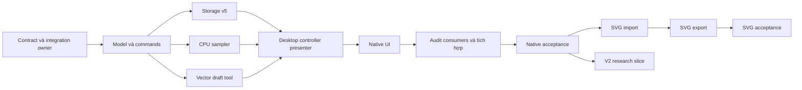

# Gradient — nghiên cứu, backend và kế hoạch giao agent

Ngày: 17/10/2026. Task: `gradient-design-plan-20261017`. Trạng thái: **plan, chưa triển khai Gradient**.
Đầu mối đọc: tài liệu này → [phiếu UI](../design/features/gradient.md) → [nghiệm thu](../quality/gradient-acceptance.md).
Áp dụng [AGENTS](../../AGENTS.md), [protocol](../agents/PROTOCOL.md), [chuẩn UI](../design/ui-ux-standard.md),
[workspace](../architecture/workspace-layout.md), [C8](../../contracts/c8-import-fidelity.md),
[C9](../../contracts/c9-appearance-effects.md) và [vector interoperability](../architecture/vector-resource-interoperability.md).
Quyết định kiến trúc ở [ADR 0012 — Proposed](../decisions/0012-gradient-paint.md), chưa đổi hợp đồng runtime.

## 1. Mục tiêu và ranh giới bàn giao

Người dùng chọn path, tạo/chỉnh chuyển sắc trực tiếp trên canvas hoặc nhập số trong Properties,
thấy cùng một kết quả, Undo được và lưu/mở lại vẫn chỉnh sửa được. Gradient là paint của fill,
không phải một filter trong effect stack; Blur/Shadow nhận ảnh fill đã được dựng như các paint khác.
Không thay Win32/GDI bằng Qt/Skia. Không cần server/web backend; “backend” ở đây là core C++20,
document commands, storage, CPU renderer và adapter.

Bản plan cung cấp quyết định đủ để agent tự code, không chờ người dùng điền phiếu UI.
Các action, API, files mới và test target mang tên Gradient dưới đây đều là **đề xuất**, không có sẵn.
Task planning không dispatch agent, không sửa runtime, không xác nhận UX/performance/fidelity.

## 2. Nguồn chính thức đã đọc

Truy cập 17/10/2026. Help online không pin binary của ứng dụng; fixture tương thích phải ghi build thật.
Đây là tham khảo hành vi công khai, không phải tài liệu thuật toán nội bộ hoặc quyền sao chép icon.

| Nguồn | Điều đã xác minh, dùng để phân tích |
| --- | --- |
| [Adobe — Gradients overview](https://helpx.adobe.com/illustrator/desktop/paint-and-fill/create-and-edit-gradients/gradients-overview.html), cập nhật 27/10/2025 | Linear, Radial, Freeform; Freeform có Points/Lines; có tool và panel điều khiển. |
| [Adobe — Linear](https://helpx.adobe.com/illustrator/desktop/paint-and-fill/create-and-edit-gradients/create-and-apply-a-linear-gradient.html), 11/03/2026 | Angle, slider, opacity/location; truy cập từ Properties và Control panel. |
| [Adobe — Radial](https://helpx.adobe.com/illustrator/desktop/paint-and-fill/create-and-edit-gradients/create-and-apply-radial-gradients.html), 11/03/2026 | Thêm Aspect Ratio để chỉnh hình dạng chuyển sắc. |
| [Adobe — Freeform](https://helpx.adobe.com/illustrator/desktop/paint-and-fill/create-and-edit-gradients/create-and-apply-freeform-gradients.html), 11/03/2026 | Điểm màu hoặc đường màu là cách biểu diễn riêng, không chỉ thêm stop trên một trục. |
| [Adobe — Stroke](https://helpx.adobe.com/illustrator/desktop/paint-and-fill/create-and-edit-gradients/apply-gradients-on-stroke.html), 27/10/2025 | Có Within/Along/Across stroke; mỗi cách cần mapping riêng. |
| [Adobe — Perceptual](https://helpx.adobe.com/illustrator/desktop/paint-and-fill/create-and-edit-gradients/control-perceptual-interpolation-in-gradients.html), 28/10/2025 | Method Perceptual khác Classic; trang này cảnh báo raster hóa khi lưu PDF/SVG. |
| [CorelDRAW — Fountain fills](https://product.corel.com/help/CorelDRAW/Documentation-Windows/CorelDRAW-en/CorelDRAW-Fountain-fills.html) | Bốn kiểu Linear/Elliptical/Conical/Rectangular; Interactive Fill, property bar và Properties phối hợp. Có node màu, transparency, vị trí, midpoint; repeat/mirror/reverse, scale/skew/rotate và steps. |
| [W3C SVG 1.1 — Paint servers](https://www.w3.org/TR/SVG11/pservers.html), [color interpolation](https://www.w3.org/TR/SVG11/painting.html#ColorInterpolationProperty) | Linear/radial, gradientUnits/Transform, stop-color/opacity và spread; nền để thiết kế adapter SVG, không phải bằng chứng importer hiện có hỗ trợ. |

**Suy luận thiết kế của PikDraw:** học thao tác trực tiếp + nhập số chính xác từ hai ứng dụng,
nhưng chọn schema và semantics có version riêng. Không suy từ tên “Radial/Elliptical”, “Classic”,
“Midpoint” hay “Smooth” rằng công thức và xuất file tương đương. Perceptual cần test riêng;
không gán nhãn ấy cho linear-light RGB hoặc một phép nội suy tự chọn.

## 3. Hiện trạng đã kiểm trên source

HEAD tham chiếu `11512046d23fac08059ecd37382179283b4530a0`; checkout có nhiều local edits.
HEAD không định danh toàn bộ source; planning có baseline/handoff snapshot riêng trong `.agent`.
Không dùng kết quả test cũ trong project-state như pass của task này.

| Điểm tích hợp thật | Đã có / thiếu gì |
| --- | --- |
| `core/document/include/pikdraw/document/model/object.hpp` | `PathObject.fill/stroke` là `ColorValue`, có `has_fill/has_stroke`, transform và Appearance. Chưa có Gradient paint. Text riêng; nhóm chưa đủ semantics để mở scope. |
| `core/document/include/pikdraw/document/effects/effect_stack.hpp` | Object/fill/stroke opacity và ordered effects; không nhét Gradient vào đây thành Gaussian/Shadow node. |
| `core/document/src/commands/appearance_commands.cpp` | Atomic replacement pattern có thể tham khảo; Gradient cần command paint, không lợi dụng Appearance để giấu dữ liệu. |
| `core/document/src/storage/{native_format,object_codec,color_codec,appearance_codec}.cpp` | Native v2/v3/v4 reader, v4 writer. Chưa có gradient record; reader kiểm version. |
| `core/rendering/src/raster/path_paint.cpp` | Fill hiện dùng một `RasterColor` cho vùng winding. Cần sampler trong covered spans, vẫn giữ fast path solid. |
| `core/rendering/src/effects/object_compositor.cpp` | Paint tham gia float scratch/compositor; phải kiểm cả direct và effect surfaces, không chỉ canvas thường. |
| `apps/desktop/include/pikdraw/desktop/presenters/object_style.hpp` | `EditorStyle` và selection mixed hiện mang màu solid. Cần summary paint có kind và mixed theo field. |
| `apps/desktop/src/shell/native_window_style*.cpp`, `native_window_menus.hpp` | Bề mặt Properties/Style và menu có thật; dùng lại, không tạo dock cạnh tranh. |
| `modules/interop/src/format_capability_matrix.cpp` | SVG static 1.0/1.1 subset import/export prototype; DXF ASCII `dxf-entities-v1` import prototype. PDF/AI/CDR/EPS reject. |
| `modules/interop/src/adapters/svg_importer.cpp` | Allowlist paint/attributes hạn chế, chưa có Gradient adapter. “SVG supported” không mở quyền gradients. |

Dependency đã đọc từ `registry/modules.json`: document → geometry/color/typography;
rendering → document/geometry/color/typography; vector → document/geometry/typography;
interop → document/geometry/color/typography; desktop tiêu thụ các module. Không thêm dependency
document → rendering/interop/desktop hoặc vector → desktop/rendering. Nếu thêm direct dependency
khác phải cập nhật registry và review ở G00, không chỉ sửa CMake.

## 4. Phân kỳ sản phẩm

| Mốc | Phạm vi phải hoàn chỉnh | Chưa mở trong mốc |
| --- | --- | --- |
| V1 native | Path fill Linear, Radial tròn/ellipse tâm trùng; 2–256 stops, color/alpha, midpoint, Pad/Repeat/Reflect, Reverse/Fit, transform; canvas + bar + Properties; atomic commands, native save/reopen, clipboard clone và regression effects | Text, stroke Gradient, group/layer paint, off-center focus, presets, nhập Gradient từ format khác |
| V1 SVG | Slice riêng sau V1 native: SVG 1.1 static linearGradient và centered radialGradient theo subset mục 9; import/edit/native save/export/reopen | Perceptual, midpoint khác 50% khi export exact, source AI/CDR round-trip |
| V2 | Conical và Rectangular native, từng kiểu qua render/command/storage/UI/fixtures riêng | Không mở bằng một enum hoặc icon chưa có renderer |
| V3 nghiên cứu | Radial focus, stroke Within/Along/Across, Text với outline thật, preset assets, màu CMYK/spot có semantics nội suy/print đầy đủ | Không gom Freeform và Mesh thành V1 “đầy đủ” |
| Đề án riêng | Freeform Points/Lines; Mesh với topology; PDF/AI/CDR/EPS adapters | Cần ADR/schema/oracles/budget riêng trước khi dispatch code |

V1 chỉ cho chỉnh selection Path, không sửa mặc định đối tượng mới khi selection rỗng.
Path có vùng fill hợp lệ; open subpath theo quy tắc đóng ngầm của renderer hiện tại.
Khóa/read-only/nhóm/Text/bitmap làm cả batch không hợp lệ; không sửa âm thầm một phần selection.
Thêm “Gradient mặc định”, gradient stroke hoặc transparency mask là scope mới.

## 5. Hợp đồng paint đề xuất cho G00/G01

### 5.1. Nguồn dữ liệu và authority

Lộ trình tương thích source: giữ `PathObject.fill` làm màu solid được nhớ, thêm
`std::shared_ptr<const GradientPaint> fill_gradient` nullable và accessor `effective_fill_paint()`.
Authority duy nhất: `has_fill == false` → None; còn lại pointer có giá trị → Gradient; còn lại → Solid(fill).
Không dùng `fill` làm fallback nhìn thấy khi Gradient unsupported; phải báo lỗi render/export.
Chuyển solid có chủ đích: ghi `fill`, xóa pointer; chuyển None: tắt `has_fill`, giữ paint để bật lại.
Paint không được có vòng tham chiếu hoặc callback/parser handle. Snapshot chia sẻ immutable paint;
sửa thay toàn value, không sửa vector stops xuyên snapshot.

Đây là migration bridge để giữ solid consumers; G09 phải audit mọi chỗ đọc/ghi/copy `fill`.
Không xem chỉ thêm pointer là đã tích hợp. Long-term tagged PaintSource tổng quát được hoãn;
không migrate stroke/Text cùng lúc để mở scope ngoài yêu cầu.

```cpp
// Contract sketch; G00 chốt tên thật, không phải API đã tồn tại.
enum class GradientKind : uint8_t { Linear = 0, Radial = 1 };
enum class GradientSpread : uint8_t { Pad = 0, Repeat = 1, Reflect = 2 };
enum class GradientInterpolation : uint8_t { EncodedSRGBStraightAlpha = 0 };
struct GradientStop {
  uint64_t id;                 // stable, nonzero; ordered tie identity
  double offset;              // [0,1], không phải mm
  color::ColorValue color;    // channels/alpha/overprint nguồn giữ nguyên
  double opacity;             // [0,1], riêng color alpha
  double midpoint_to_next;    // [0.01,0.99], terminal luôn 0.5
};
struct GradientPaint {
  uint32_t schema_major;      // 1
  uint32_t schema_minor;      // 0
  uint64_t id;                // paint instance; shared immutable snapshots
  GradientKind kind;
  GradientSpread spread;
  GradientInterpolation interpolation;
  geometry::Transform2D gradient_to_object;
  std::vector<GradientStop> stops;
  // provenance reference: C8/C9; schema tường minh, không URL/token tự fetch
};
```

IDs cấp qua allocator ổn định hiện có và reserve sau load. Undo/redo giữ IDs, đổi revision monotonic;
clone đối tượng cấp paint/stop IDs mới qua remapper, snapshot COW không remap.
Không dùng pointer address hoặc số thứ tự stop làm identity. Không chỉnh ColorValue khi đổi theme,
profile preview, zoom hoặc ngôn ngữ. Profile/provenance dùng cơ chế có version ở C4/C5/C8;
không giả đã có ICC embedding per-stop.

### 5.2. Invariants, khoảng trùng và thao tác ramp

- 2–256 stops/paint; giới hạn tổng đề xuất 1.000.000 stops/document, đồng thời vẫn chịu native byte budget.
  Đây là guardrail thiết kế, chưa phải bằng chứng hiệu năng. Preflight checked arithmetic trước cấp phát.
- IDs duy nhất; mọi scalar finite; offsets tăng không giảm; source ColorValue hợp lệ; opacity đúng range.
  Offset đầu/cuối có thể nằm bên trong [0,1]; ngoài khoảng stops lấy màu terminal.
- Stops cùng offset là hard edge, giữ thứ tự vector ổn định. Với t đúng điểm trùng lấy stop cuối tại điểm ấy;
  phía trái tiến đến stop đầu trong cụm. Không chia cho zero, không sort bằng ID.
- Kéo vượt stop khác: giữ ID, đổi vị trí trong thứ tự; reset midpoint của các interval đổi cặp lân cận về 50%.
  Nếu cùng offset, drop sau phần tử cuối của cụm; Undo phục hồi thứ tự/midpoint cũ.
- Thêm stop tại t dùng màu/alpha đã sample từ paint preview chuẩn; desktop truyền ColorValue RGB mới
  với alpha bằng sample effective alpha và stop opacity mới =1 cho tool (vector không gọi renderer).
  Không chép cùng alpha vào cả hai nơi rồi nhân hai lần. Các stop cũ giữ source channels. Hai interval mới
  midpoint 50%; không hứa ramp bất biến khi interval cũ có midpoint khác 50%. UI báo trường hợp ấy trong Help.
- Xóa stop khi còn >2; interval nối mới midpoint 50%. Tối thiểu 2 thì disable Delete với lý do.
- Reverse: offset' = 1-offset, đảo cả thứ tự tie, interval midpoint' = 1-midpoint tương ứng;
  geometry không đổi. Reverse hai lần phục hồi cùng IDs và thông số.
- Không tự chèn 0/1, clamp malformed native data hay sửa ID trùng để “load được”. Adapter SVG có bước
  normalization riêng theo standard, phải ghi provenance/diagnostic khi canonicalize.

### 5.3. Geometry chuẩn và transform

Source axes +X phải, +Y lên, tọa độ object-local mm/binary64. `gradient_to_object` biến không gian
Gradient chuẩn q sang object local; render dùng inverse của camera × object × gradient matrix.
Linear có t=q.x; Radial tâm q=(0,0), bán kính chuẩn 1, t=hypot(q.x,q.y).
Affine matrix cho ellipse/rotation/skew nhập từ nguồn; không dùng khoảng cách trong screen pixels.
Không lấy dot product sau nonuniform transform rồi giả rằng gradient normal vẫn vuông góc trục trên màn hình.

Default Linear: trục từ giữa cạnh trái đến giữa cạnh phải bounds local, 0° hướng +X.
Default Radial: tâm bounds, rx=W/2, ry=H/2. Matrix quyết định đầy đủ; Angle/Length/Aspect trên UI
là projections/editors, không phải bộ giá trị authoritative thứ hai.
Tạo bằng drag Linear A→B: matrix có origin A, cột X=B-A, cột Y là phép xoay +90° của B-A.
Tạo bằng drag Radial C→R: origin C, cột X=R-C, cột Y=xoay +90°(R-C)×H/W của bounds lúc bắt đầu;
radius/aspect handles sau đó sửa matrix, không sửa path. Đổi Type giữ stops/colors/spread/midpoints,
reset geometry về default type trên từng bounds; Apply mới commit, Cancel phục hồi matrix cũ.
Matrix singular/non-finite → reject edit/import rõ ràng; không vẽ solid fallback. Guardrail v1 đề xuất:
n=max(|a|,|b|,|c|,|d|), n>0; tính determinant trên coefficients chia n để tránh overflow và yêu cầu
|det(A/n)|>1e-12, inverse và kết quả map phải finite. Đây là relative degeneracy gate, không phải toàn bộ
condition-number estimate. Giới hạn source mm đề xuất |coordinate|/radius/length <=1e9; positive length
còn phải qua relative gate, không epsilon screen. G00 đưa các số này vào contract/vectors và đối chiếu
host geometry limits trước G01; nếu host chặt hơn dùng giới hạn chặt hơn, không nới host âm thầm.
Không gọi `Transform2D::inverted()` default absolute determinant epsilon như một relative test.
Path bounds 0 area không tạo default Gradient.

Object move/rotate/scale/flip mang paint cùng object. Sửa node không tự refit paint; `Fit to object`
là lệnh riêng, một Undo, đưa matrix về default type trên bounds mới. SVG objectBoundingBox được resolve
thành local matrix lúc nhập; sau edit node dùng semantics local đã ghi, giữ basis gốc trong provenance.
Đây là chủ đích edit của PikDraw, không hứa giữ live binding bbox của ứng dụng nguồn.

Spread trước khi tìm interval: Pad clamp(t,0,1); Repeat t-floor(t); Reflect đặt r=t-2floor(t/2),
lấy r nếu r<=1, còn lại 2-r. Test số âm, integers, biên 1 và tọa độ lớn trước khi tối ưu.
Không wrap theo pixel/tile origin.

Interval không trùng: u=(t-a)/(b-a), m=midpoint. Remap v=0.5*u/m khi u<=m,
ngược lại v=0.5+0.5*(u-m)/(1-m). Đây là **midpoint piecewise-linear PikDraw v1**;
không tuyên bố đúng Acceleration/Smooth/midpoint của Corel hoặc Illustrator.

### 5.4. Màu, alpha và effects

V1 duy nhất `EncodedSRGBStraightAlpha`: convert từng stop nguồn qua session ICC preview hiện có
sang encoded sRGB; nội suy RGB straight và alpha hiệu dụng `(source alpha × stop opacity)` độc lập
theo v; chỉ premultiply sau sample. Nhân fill opacity một lần ở paint stage; compositor giữ stroke
opacity riêng, dựng effects theo thứ tự và áp object opacity một lần lên kết quả như C9 hiện hành.
Không nhân object opacity thêm trong sampler. Không dùng AlphaBlend/GDI GradientFill làm oracle
hoặc nhánh cho ra semantics khác với software raster.

CMYK/spot vẫn giữ nguyên nguồn tại từng stop và có preview theo module color; không phải nội suy
CMYK/spot inks, separation, overprint hoặc print proof đã kiểm. Unsupported/missing profile theo
diagnostic hiện có; không đổi source thành RGB vì preview. Scalar semantic oracle độc lập kiểm
transparent colored stop, không âm thầm chuyển premultiplied interpolation để “bớt viền”.
Linear-light/Perceptual/hue CW/CCW chỉ được mở sau có stable method ID, formula, storage và fixtures.

## 6. Commands và lifecycle

`SetFillPaintCommand` nhận batch replacement theo ObjectId, prevalidate toàn bộ đối tượng, lock,
paint IDs/stops/quota, rồi một transaction. Không dùng loop nhiều commands để tạo Undo n lần.
No-op không dirty/Undo. Lỗi một target giữ nguyên tất cả. G01 reuse writer checks C2, không tự
ghi mutable root từ UI, renderer, importer hoặc preview.

```text
Idle → Editing(base doc/epoch/revision, targets, selection_generation)
Editing → update draft → prepared preview(snapshot + transient replacements)
pointer-up / Apply → writer checks → một commit → Idle
Esc / Cancel / stale / document-close → discard draft + invalidate generation → Idle
```

Một canvas drag commit khi pointer-up; mỗi drag một Undo. Properties nhóm nhiều field trong một
draft có Preview mặc định ON, Apply/Cancel; Enter xác nhận field rồi Apply chỉ khi focus ở nút Apply,
không vừa nhập field đã commit document. Tool không có hai draft song song. Chuyển focus bar↔Properties
giữ draft; đổi selection/tool/document, Undo/Redo hoặc source revision thay đổi hủy draft trước thao tác,
báo ngắn “Đã hủy thay đổi Gradient chưa áp dụng”; không commit ngầm.
Capture lost hủy gesture chưa pointer-up; app deactivation giữ Properties draft nhưng ngừng gesture.

Preview không sửa revision, history, dirty hoặc native save snapshot. Save đang có draft chỉ lưu source
đã commit, có hint còn thay đổi chưa áp dụng. Clipboard trong lúc draft lấy committed snapshot.
Result async gắn doc ID/epoch/base revision/selection generation/draft generation/profile generation;
kiểm lại khi publish lẫn commit. Cancel tăng generation trước giải phóng tài nguyên. Dù V1 chạy sync,
không bỏ các token session. Không reuse EffectDraft để sửa stack khi đang sửa Gradient.

## 7. Renderer và ngân sách

G03 thêm prepared paint: validate một lần, inverse matrix một lần, convert stops một lần/job,
binary search stop intervals hoặc span cursor có đo; không ICC convert/cấp phát mỗi pixel.
Giữ scanline winding/implicit close và clipping hiện có, gọi sampler tại tâm pixel covered.
Solid dùng nguyên fast path. Render source không tăng bounds hình học; handles chỉ thuộc overlay/damage.
Effects scratch nhận cùng sampler với matrix đúng cho filter-local origin; zoom/camera/ROI không làm paint trôi.

Oracle ban đầu analytic/scalar; LUT/SIMD/dither không bật trước parity/error budget riêng. Ramp trên
Properties và canvas phải dùng cùng prepared sampler/color policy. Không dùng CSS/web gradient làm preview.
Cache key gồm paint ID + nội dung/hash/version + snapshot root/revision + object transform + profile
generation + target color format/scale liên quan; transient draft thêm generation. Không chỉ dựa vào paint ID.
Cache giữ ownership immutable và budget; lỗi/quota/cancel trả incomplete diagnostic, không frame success thiếu fill.

Ngân sách đề xuất để G03 đo: prepared ramp cache LRU tối đa 16 MiB/session; không surface toàn trang riêng
cho Gradient; áp trần pixel/work hiện có và kiểm tổng active scratch với effects. G00 pin arithmetic bounds;
G10 đo CPU p50/p95 với solid control cùng máy/cùng fixture và memory cache/scratch thực tế.
Mục tiêu product thao tác phản hồi trong 33,3 ms là target chưa được đo; không đặt nhãn 60 FPS.
Present interval, CPU/offscreen, RAM/GPU và input-to-visible là các số riêng. Không có dụng cụ đo thì ghi chưa đo.

## 8. Lưu file, migration và clone

G02 đề xuất native **v5**, vẫn đọc v2/v3/v4; tất cả document mới save v5 khi slice được bật.
Minimum compatible 5, gradient schema 1.0 và record length-framed sau source/appearance theo C5 cập nhật.
Không giấu gradient record trong v4 hoặc ghi màu fallback để bản cũ mở sai mà không báo.
Old reader reject v5; save-back v4 không trong scope. Golden v2/v3/v4 load → solid semantics giữ nguyên.

Gradient record chứa kind/spread/interpolation, IDs, matrix doubles, source ColorValues, stop opacity,
midpoint, provenance reference; không chứa compiled sampler/LUT/Win32 handle/pointer.
Ngay cả `has_fill=false`, remembered Gradient cũng phải lưu/đọc/validate để bật lại không mất dữ liệu.
Reader kiểm count × size overflow, record boundaries, enum/version, CRC, UTF-8, finite/ranges,
unique IDs và quota trước publish. Unknown schema/type reject với thông báo, không bỏ paint.
Save/export chốt một immutable snapshot; save r không clear dirty của edit r+1.
G02 phải thử truncation/malformed record và giữ native originals; không overwrite fixture input.

Clipboard/deep clone, duplicate, array, contour/Boolean style propagation phải đi qua helper paint chính thức;
clone remap IDs, transform giữ paint matrix local, không rơi về remembered solid.
G09 xác định rõ style donor cho Boolean theo hành vi hiện có, không tự thêm Gradient “spanning selection”.
Trước khi bật V1 native, G09 thêm guard vào SVG exporter hiện có: gặp Gradient thì reject rõ, không
xuất remembered solid. G08 nhận lại file exporter theo lượt sau G10 để mở exact Gradient SVG subset;
đây là chuyển ownership tuần tự, không hai agent cùng sửa. Native capability không được tạo lỗ silent-loss
trong nút Export SVG đang tồn tại.
Production geometry không đổi vì Gradient; màu chuyển sắc không tạo đường cắt/CAM hay toolpath mới.

## 9. Ma trận liên thông theo representation

Mỗi hàng dưới đây tách hiện trạng và đích; tất cả kết quả Gradient hiện là **chưa hỗ trợ/chưa nghiệm thu**.
Không có quyết định bật PDF/AI/CDR/EPS trong task Gradient. Fixtures ghi version/build thật trước enable;
không chọn một file bất kỳ làm bằng chứng toàn họ định dạng.

| Format/version/representation | Gradient + adapter đích | Xem/render | Editability | Metadata nguồn | Export/round-trip | Sản xuất |
| --- | --- | --- | --- | --- | --- | --- |
| PKDR v2/v3/v4 → v5 | G02 migrate solid; v5 canonical Linear/Radial | Native G03, chưa đo | G01/G04/G06, chưa nghiệm thu | IDs/colors/native schema; provenance G00 | Native save/reopen G02, không source AI/CDR | Geometry regression; in màu chưa đánh giá |
| SVG 1.1 static; linearGradient | G07 riêng: defs+local URL, units, affine, offsets/color/opacity, Pad/Repeat/Reflect | Qua canonical sampler; cần fixture/oracle | Native editable đúng subset | hash/element ID/units/transform/source method/adapter build | G08 exact với midpoint 50%, encoded-sRGB và representable colors; mở lại target app riêng | Geometry giữ; print/color profile chưa chứng nhận |
| SVG 1.1 static; centered radialGradient | G07 map cx=fx, cy=fy, r>0, affine ellipse; reject lệch focus | Như trên, chưa có evidence | Chỉ subset centered | Giữ radial basis gốc và mapping | G08 cùng subset, không nhầm centered với focal | Như trên |
| SVG2 mesh/href ngoài file/CSS ngoài subset | Chưa có adapter; không fetch | Không có renderer reference đã chứng minh | Unsupported; không giả editable | Diagnostic theo locator khi parser xác định được | Reject; explicit conversion cần pipeline riêng | Blocked |
| PDF 1.x/2.0; axial/radial shading/functions | Adapter PDF riêng; version feature chưa pin, phải có task/corpus trước enable | Chưa có PDF adapter | Không suy từ PDF render | C8 staging nếu task sau thực hiện | Chưa có exporter; shading types khác không gom | Chưa đánh giá |
| AI PDF-compatible; bản AI/build phải pin | Nhánh PDF qua adapter PDF, giữ representation tag | Chưa có adapter | Không suy ra authoring stops/artboards/effects | Source AI + PDF representation, không đổi nhãn thành native AI | Không AI round-trip | Chưa đánh giá |
| AI authoring; version chưa chốt | Adapter riêng hoặc unsupported; Freeform/Mesh không map thành linear | Unsupported hiện tại | Unsupported | Opaque preservation chỉ khi C5 thực sự có khả năng | Không AI writer | Blocked |
| CDR; từng version/build phải lập catalog | Adapter CDR riêng, Linear/Elliptical/Conical/Rectangular và color/midpoint map riêng | Chưa có adapter | Không suy từ tên Corel Fountain Fill | C8/C9 gồm source params/version/locator | Không CDR export; không hứa round-trip | Chưa đánh giá |
| EPS/PostScript; level/converted representation chưa chốt | Interpreter/adapter riêng, isolation/license/limits riêng | Unsupported hiện tại | Conversion không tự thành editable nguyên bản | Giữ original + conversion report nếu có pipeline | Chưa có writer | Blocked |
| DXF ASCII dxf-entities-v1 | Import geometry hiện có; Gradient HATCH ngoài profile, không áp dụng ở V1 | Không mở Gradient từ support DXF geometry | Giữ khả năng geometry subset, gradient reject | Unit/entity provenance theo adapter | Không DXF export | Không suy CNC từ Gradient |

G07 không viết chung parser cho mọi format. Resolve SVG local refs/cycle/depth/count trong worker;
host validate proposal và strict lifecycle C6/C8 trước atomic apply. Update worker import record codec
cùng gradient records; không truyền parser objects, source paths hoặc tin enum của worker.
Subset V1 SVG pin `color-interpolation=sRGB`, local defs/href được kiểm, explicit attributes và CSS hiện
có sau allowlist audit; missing/unhandled CSS inheritance không mặc định gọi là equivalent.
SVG stop offsets normalization/degenerate linear/r=0 theo W3C được kiểm độc lập; degenerate có thể normalize
thành Solid terminal với provenance + diagnostic, không gọi là gradient editable nguyên biểu diễn.
Midpoint native khác 50% không biểu diễn exact bằng stops SVG hữu hạn theo công thức này; exporter reject
hoặc explicit approximation qua task riêng có error budget. CMYK/spot đổi sang SVG RGB là loss conversion,
không export silently. Existing effect/blend export restrictions vẫn hiệu lực.

Nguồn online không là feature tải asset trong V1: không broker/network UI mới. Nếu sau này nhận asset
URL, áp broker nguồn người dùng khởi tạo, source hash/license/attribution, quota và deny linked fetch theo
vector guide. Parser và renderer không tự mở mạng; test không chứa dữ liệu khách hàng/token.

## 10. DAG và ownership cho agent con

Đây là catalog dispatch, **không phải task board đã chạy**. Coordinator create/claim từng task khi tới lượt,
kiểm lease hiện tại, đọc scoped AGENTS/README và baseline trước sửa. Mọi agent ở source gốc; không worktree,
không commit/stash/reset. Một agent có thể làm nhiều task liên tiếp, nhưng ownership phải kết thúc rõ.



Paths trong mỗi dòng là ownership đề xuất, không blanket cho toàn module. Tên file mới là đích cụ thể;
file đang tồn tại dùng đúng đường kiểm trên source. Dấu `{a,b}` là liệt kê cần mở thành từng `--path`,
không truyền wildcard vào claim. Agent được đọc dependency nhưng không sửa file task khác.

| Task / đầu ra / deps | Owned paths đề xuất | Điều kiện xong và handoff |
| --- | --- | --- |
| **G00** Contract + điều phối, đầu tiên và các lượt integration tuần tự | `contracts/{c5-storage,c7-actions-ui,c9-appearance-effects}.md`; `docs/decisions/0012-gradient-paint.md`; 3 tài liệu Gradient; `docs/project-state.json`; `registry/modules.json`; `core/{document,rendering}/CMakeLists.txt`; `modules/{vector,interop}/CMakeLists.txt`; `apps/desktop/CMakeLists.txt` | Chốt types/IDs, relative inverse threshold, byte/count/work limits, C5 record layout/order, API vectors và target names trước G01. CMake chỉ G00 sửa; kiểm G00 đã release trước agent kế tiếp claim. Không giữ leases dài ở CMake khi task dimensions đang sở hữu. |
| **G01** model/commands; sau G00 | `core/document/include/pikdraw/document/model/{object,validation,gradient_paint}.hpp`; `core/document/src/model/gradient_paint.cpp`; `core/document/include/pikdraw/document/commands/gradient_commands.hpp`; `core/document/src/commands/gradient_commands.cpp`; `core/document/tests/model/test_gradient_paint.cpp`; `core/document/tests/commands/test_gradient_commands.cpp` | Validations tại document ingress, stable IDs, effective accessor, batch/no-op/lock/reject/undo; AC-G01/G02/G04. Handoff headers + invariant vectors + exact test target yêu cầu G00 đăng ký. |
| **G02** native storage; sau G01 | `core/document/include/pikdraw/document/storage/native_format.hpp`; `core/document/src/storage/{native_format,object_codec,gradient_codec}.cpp`; `core/document/src/storage/byte_codec.hpp`; `core/document/tests/storage/test_gradient_storage.cpp`; bổ sung `test_storage_fidelity.cpp` khi cần | V5 + legacy golden + malformed/budget + save snapshot, AC-G05. Không sửa model contract khi phát hiện thiếu: trả G00. |
| **G03** sampler/render; sau G01 | `core/rendering/include/pikdraw/rendering/gradient_sampler.hpp`; `core/rendering/src/raster/{gradient_sampler.cpp,path_paint.cpp,path_raster.hpp}`; `core/rendering/src/effects/object_compositor.cpp`; `core/rendering/tests/rasterizer/test_gradient_pixels.cpp`; `core/rendering/tests/effects/test_gradient_compositor.cpp` | Scalar oracle, transforms/spread/hard edges/alpha và direct+effects parity, AC-G03/G06/G07. Không chạm blur kernel/culling của task khác. |
| **G04** tool semantics; sau G01 | `modules/vector/include/pikdraw/vector/tools/gradient_tool.hpp`; `modules/vector/src/tools/gradient_tool.cpp`; `modules/vector/tests/tools/test_gradient_tool.cpp` | Draft state machine, handles, hit-test DIP converted ở boundary, batch targets, commit/cancel/stale; AC-G08. Không Win32 hoặc renderer dependency. |
| **G05** desktop controller/presenter; sau G02/G03/G04 | `apps/desktop/src/tools/gradient_tool_controller.{hpp,cpp}`; `apps/desktop/include/pikdraw/desktop/presenters/gradient_properties.hpp`; `apps/desktop/src/presenters/gradient_properties.cpp`; `apps/desktop/tests/test_gradient_tool_controller.cpp` | Summary mixed, draft ownership và prepared preview binding; đưa replacements tới writer hiện có; AC-G08/G09. Controller độc lập, không sửa shell/workflow ở lượt này. |
| **G06** Win32 UI integration; sau G05 | `apps/desktop/include/pikdraw/desktop/shell/native_window.hpp`; `apps/desktop/src/shell/native_window{.cpp,_events.cpp,_paint.cpp,_canvas.cpp,_shortcuts.cpp,_menus.hpp,_style.cpp,_style_events.cpp,_style_paint.cpp}`; thêm `native_window_gradient{.cpp,_paint.cpp,_events.cpp}` khi trách nhiệm rõ; `apps/desktop/resources/icons/{tool-gradient,gradient-linear,gradient-radial,gradient-reverse}.svg`; `apps/desktop/tests/test_gradient_native_shell.cpp` | Đủ menu/bar/Properties/overlay/help/icon/keyboard, AC-G09/G10/G11. Không split file vì quota dòng; wire helper mới vào đúng đường sự kiện hiện có. |
| **G09** consumer audit/tích hợp native; sau G06, tuần tự | `apps/desktop/include/pikdraw/desktop/presenters/object_style.hpp`; `apps/desktop/src/presenters/object_style.cpp`; `modules/vector/{include/pikdraw/vector/gestures/style_tool.hpp,src/gestures/style_tool.cpp}`; `apps/desktop/{include/pikdraw/desktop/workflows/document_workflow.hpp,src/workflows/document_workflow.cpp}`; `apps/desktop/src/clipboard/native_clipboard.{hpp,cpp}`; `core/document/{include/pikdraw/document/model/clone_utils.hpp,src/model/clone_utils.cpp,src/commands/contour_commands.cpp,tests/model/test_clone_utils.cpp}`; `modules/interop/{src/writers/svg_exporter.cpp,tests/writers/test_svg_exporter.cpp}`; `apps/desktop/tests/test_gradient_consumers.cpp` | Audit mọi fill read/write/clone/Boolean/Contour/save/export, quyết định giữ hoặc chuyển solid rõ; cấp paint/stop IDs mới khi tạo object từ style donor; thêm SVG export-reject guard trước native enable; AC-G12. Release exporter trước G08. Nếu source thực nằm chỗ khác, G00 chỉnh owned paths trước sửa. Không sửa test_desktop_shell của lease khác. |
| **G10** nghiệm thu native; sau G09 | `apps/desktop/tests/test_gradient_e2e.cpp`; `core/rendering/tests/benchmark_gradient.cpp`; `docs/reviews/gradient-native-20261017.md`; `artifacts/evidence/gradient-native-20261017` | Build app chuẩn + focused regressions Debug/Release, UI thực, perf report có scope; cập nhật AC results. Bug trả owner; không claim toàn runtime để tiện sửa. G00 cập nhật project-state sau evidence. |
| **G07** SVG import; sau G10 | `modules/interop/src/adapters/{svg_importer.cpp,svg_gradient_adapter.hpp,svg_gradient_adapter.cpp,svg_import_record_codec.cpp,svg_worker_adapter.cpp}`; `modules/interop/tests/adapters/{test_svg_gradient_adapter.cpp,test_svg_gradient_worker.cpp}`; fixtures an toàn dưới `modules/interop/tests/fixtures/gradient` | Normalize đúng subset và worker codec/host validation, AC-G13/G14; không mở toàn CSS/defs. |
| **G08** SVG export; sau G07 | `modules/interop/src/writers/svg_exporter.cpp`; `modules/interop/tests/writers/test_svg_gradient_exporter.cpp`; `modules/interop/src/format_capability_matrix.cpp` | Exact subset/reject loss, metadata/report, AC-G15. Capability registry chỉ ghi rows đạt, không nâng cả SVG/PDF. |
| **G11** SVG nghiệm thu; sau G08 | `docs/reviews/gradient-svg-20261017.md`; `modules/interop/tests/gradient/test_gradient_roundtrip.cpp`; `artifacts/evidence/gradient-svg-20261017` | AC-G13–G16, source-app version/oracle/structure/export evidence; G00 update state. |
| **G12** V2 specification, sau G10; chưa dispatch mặc định | `docs/design/features/gradient-v2.md`; `docs/quality/gradient-v2-acceptance.md` | Conical `atan2` seam/start-angle/negative wrap và Rectangular metric/affine vectors được định nghĩa riêng; task model/storage/render/UI mới theo cùng protocol. Không sửa v1 enum trước spec. |

**Luồng song song cho tối đa 3 agent con:** sau G01 đã consumer review, G02/G03/G04 có file scopes rời nhau;
G00 chỉ đăng ký CMake theo lượt khi các agent không build. G05 → G06 → G09 tuần tự vì shell/workflow shared.
G07/G08 cố ý tuần tự để pin import semantics trước export. Một coordinator giữ lịch build/lock; không
agent nào dùng direct CMake/build tree khác để né lock. G10/G11 chạy sau source đã ổn định, không khi owner khác đang sửa consumer.

Snapshot task list lúc planning có leases ở core document/desktop/geometry CMake của dimensions,
rendering culling/blur và một số tests desktop/effects/MCP. Đây là cảnh báo scheduling phải kiểm lại;
không lấy lease status này làm sự thật lâu dài. G00 chưa được quyền sửa CMake đang có owner khác.

## 11. Lệnh và mẫu dispatch

Mỗi prompt cho agent ghi đủ: goal, task ID, owner, source root, deps đã nhận snapshot nào,
owned paths explicit, đọc mục 5–9 + UI/AC liên quan, output, exact checks, phần không được mở rộng.
Không chuyển full chat, không giao “làm toàn bộ Gradient” cho nhiều agent cùng lúc.

```powershell
# Chạy tại source gốc; điền đường cụ thể từ bảng, không claim thư mục cả module.
./tooling/pikdraw.ps1 task list
./tooling/pikdraw.ps1 task create gradient-g01-model --title 'Gradient model và commands' --module document --goal 'Thực hiện G01 của plan Gradient, giữ invariants và AC đã giao' --provider codex --base HEAD --path core/document/include/pikdraw/document/model/object.hpp --path core/document/include/pikdraw/document/model/validation.hpp --path core/document/include/pikdraw/document/model/gradient_paint.hpp --path core/document/src/model/gradient_paint.cpp --path core/document/include/pikdraw/document/commands/gradient_commands.hpp --path core/document/src/commands/gradient_commands.cpp --path core/document/tests/model/test_gradient_paint.cpp --path core/document/tests/commands/test_gradient_commands.cpp
./tooling/pikdraw.ps1 task claim gradient-g01-model --owner gradient-g01 --provider codex
./tooling/pikdraw.ps1 context --task-id gradient-g01-model
```

Lệnh create G01 liệt kê scope đầy đủ tại thời điểm planning; kiểm lease và path drift trước chạy.
Khi path/contract thiếu, agent báo file + lý do + đề xuất, coordinator bổ sung task hoặc
chuyển owner tuần tự; không tự sửa shared files. Có thể tự quyết routine UI đúng phiếu và tiếp tục.

Các target Gradient dưới đây **sẽ được G00 đăng ký**, không phải lệnh đã chạy trong task planning:

```powershell
./tooling/native/build.ps1 -Configuration Debug -Test -TestTarget test_pikdraw_document_gradient,test_pikdraw_document_gradient_commands,test_pikdraw_document_gradient_storage -TestRegex '^test_pikdraw_document_gradient($|_)'
./tooling/native/build.ps1 -Configuration Debug -Test -TestTarget test_pikdraw_rendering_gradient,test_pikdraw_rendering_gradient_compositor -TestRegex '^test_pikdraw_rendering_gradient'
./tooling/native/build.ps1 -Configuration Debug -Test -TestTarget test_pikdraw_vector_gradient,test_pikdraw_gradient_tool_controller,test_pikdraw_gradient_native_shell -TestRegex '^test_pikdraw_(vector_gradient|gradient_tool_controller|gradient_native_shell)$'
./tooling/native/build.ps1 -Configuration Debug -Target pikdraw
```

G10 thêm target native e2e/consumer rồi chạy cùng regression hiện có: document commands/storage/clone,
rendering pixels/float scratch/compositor, editor tools và SVG save rejection; Release lặp focused targets
vì có khác biệt build configuration. G11 chạy interop gradient adapter/worker/export/roundtrip targets
do G00 đăng ký. Không mặc định full CTest/harness cho mỗi task; mở rộng khi contract fallout chứng minh cần.

Handoff theo PROTOCOL: source_baseline/source_snapshot/hash, changed paths, AC IDs, command/exits,
ảnh/fixture/oracle ID và kết quả, giới hạn, next action. Evidence ghi “chưa chạy” thay chỗ trống.
Giữ test regression trong suite; dọn test/log/output dùng một lần do task tạo; không xóa file task khác.

## 12. Gates, rủi ro và điều kiện dừng

| Gate/rủi ro | Quyết định / điều kiện không được vượt |
| --- | --- |
| Hai nguồn paint/solid fallback | G09 audit xong trước enable UI; unsupported không được dựng màu solid thay Gradient. |
| Sai transform/ảnh filter-local | G03 oracle nonuniform/flip/translation + effect scratch parity; fail thì chưa enable preview. |
| Màu/alpha khác giữa control và canvas | Cùng sampler; pin interpolation method; thiếu ICC/print evidence ghi giới hạn, không sửa source. |
| Mất dữ liệu khi save/clipboard/Boolean | G02/G09 native roundtrip và consumer vectors phải đạt trước native mốc hoàn tất. |
| Concurrent owners và build race | Không claim đè; build khi source ổn định, đúng lock. Block ở một path vẫn tiếp tục docs/tests/path độc lập. |
| Fake fidelity/unsupported source | Chưa có adapter/reference renderer thì reject; không gọi bitmap fallback là editable vector. |
| Rendering budget | Refusal/incomplete rõ; đo solid control và scratch; không tăng quota chỉ để benchmark pass. |
| UI không truy cập được | Properties menu khi dock đóng/narrow, keyboard numeric/cancel, mixed/locked phải qua AC thực. |

Definition of Done **V1 native**: G00–G06/G09/G10 đạt đúng snapshot; AC-G01–G12 và G16 áp dụng,
native save/reopen/Undo/clone, ảnh Win32 và measured limits được bàn giao; state ghi chỉ Path fill
Linear/Radial và các giới hạn thật. Không đợi G07/G08 để gọi native slice hoàn tất, nhưng không gọi
SVG Gradient supported trước G11. V1 SVG có Definition of Done riêng theo AC-G13–G16.

Task planning hoàn tất khi 3 tài liệu nhất quán, source links/ownership/DAG và docs checks đạt;
Gradient runtime vẫn chưa triển khai. Mọi kết quả execution ở các phase trên hiện **chưa chạy**.
