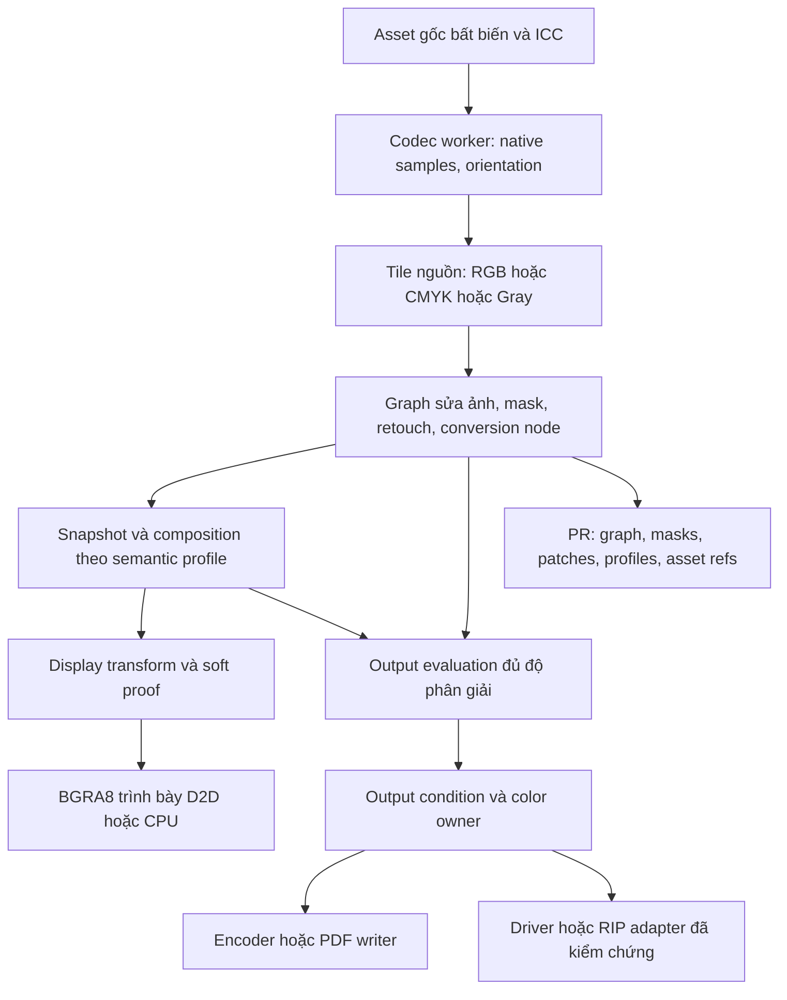

# 03 — Dữ liệu, pipeline màu, hiệu năng và trao đổi định dạng

[Kế hoạch chính](../image-editing-color-print-20261024.md). Kiến trúc dưới đây là đích mở rộng
của asset/tile/graph đang có; không khẳng định các interface đề xuất đã được triển khai.

## 1. Luồng dữ liệu và trách nhiệm module

Đây là flow trách nhiệm, không là đồ thị link CMake. Graph có các nhánh bypass khi CMYK cần
giữ channel; display là projection, không làm authority cho mẫu màu nguồn hoặc file xuất.

| Thành phần | Sở hữu | Boundary |
| --- | --- | --- |
| `core/document` | Image/asset/graph/mask/retouch descriptors, commands, immutable snapshots, storage | Không chứa codec/CMM handle, GPU texture, UI control hoặc process API |
| `core/color` | Profile resource, typed channel layouts/color semantics, CMM interface, conversions, proof/gamut, color metrics | Không phụ thuộc desktop/raster/production; không dùng display RGB làm output CMYK |
| `modules/raster` | Tile evaluator, masks/retouch algorithms, histogram, scheduling và cache | Giữ dependency document/color; executor được inject, không gọi UI/process host trực tiếp |
| `core/rendering` | Scene composition, raster provider interface consumer, D2D/CPU presentation | Interface ở core/C6, implementation ở raster được inject; không include `modules/raster` |
| `modules/interop` | Codecs, native sample/ICC metadata, per-format import/export và reports | Giữ adapters riêng; không sở hữu Undo, không lưu model vendor vào document |
| `platform/workers` | Job lifecycle, cancellation, process/handle limits, validation | Raster không phụ thuộc ngược workers; thêm dependency raster cho evaluator worker nếu triển khai |
| `modules/production/print` đề xuất | Output condition, preflight, test-sheet layout, print run/measurement services | Module production chưa hoàn chỉnh; phần print là slice riêng, không cần hoàn thành CNC/nesting trước |
| `apps/desktop` | Composition root, UI/actions/presenters, Print dialog/driver adapter | Chỉ gửi request qua service; không decode/evaluate toàn ảnh trong event loop |

Khi đưa print vào production, cập nhật registry/CMake cho `production → color` nếu dùng trực tiếp;
giữ `document/geometry` hiện có. Raster/render providers được inject qua interface trung lập.
Desktop chỉ thêm dependency production khi slice được tạo. Interop không phải phụ thuộc production:
composition root chuyển output snapshot/strips/plates và options sang encoder. Không tạo cycle
`interop → production → interop` hoặc `document → raster → document`.

## 2. Schema dữ liệu đích

Mở rộng `RasterSourceDescriptor`/`RasterEditGraph`, không duy trì model chỉnh ảnh thứ hai.
Tên type dưới đây là **đề xuất**; wire/storage IDs phải được đăng ký khi triển khai.

| Nhóm | Trường cần có |
| --- | --- |
| Source | AssetId, source revision/hash, locator/mode, 64-bit length, codec/representation, frame, immutable encoded source |
| Native samples | Pixel size, channel layout/order, sample type U8/U16/F32, bits/channel, planar/interleaved, endian, alpha association |
| Color binding | Actual source ICC resource/hash hoặc explicit untagged state; working binding; camera/RAW interpretation nếu có |
| Geometry | EXIF orientation và applied state, source pixel rectangle, node-space transforms; đơn vị pixel khác mm bố trí |
| Node | Stable node ID, stable operation code, parameter schema, algorithm semantic version, inputs/order, enabled, opacity, blend policy, mask ref |
| Mask | MaskId/revision, raster/path/procedural kind, coordinate-space ID/transform, density/feather, tile asset refs hoặc expression bounded |
| Retouch | Layer/patch IDs, touched tile deltas hoặc stroke recipe, sample graph prefix/revision, clone anchor, seed, brush definition |
| Derived data | Thumbnail/tile pyramid/histogram/proof buffers; reconstructible, không thay source authority |
| Output variant | Output condition/resource IDs, graph override/output conversion, PPI/size/sharpening; tham chiếu master và revision |
| Run record | Frozen snapshot/asset/profile/recipe IDs, engine version, route, timestamp, output hash, chart/measurement IDs; không tự ghi vào artwork |

Không persist `std::variant.index()` làm opcode. Enum/node kind và semantic version dùng wire ID
ổn định, schema validate bounds/count/finite values. Không chạy script hoặc expression tùy ý trong preset.

Giới hạn graph hiện có 1.024 nodes là một giới hạn cấu trúc, không là cap file ảnh.
Đánh giá lại độ sâu/count và chi phí mask/filter trước mở rộng; UI báo giới hạn cụ thể,
không bỏ validator hoặc nhận graph vô hạn chỉ vì source lớn.

## 3. Hai tuyến sửa RGB và CMYK

### RGB master

Decode giữ native RGB + ICC → đưa vào working RGB đã chọn bằng conversion có danh tính →
chạy các node theo miền của chúng → composition → display/profile monitor hoặc output profile.
Nguồn 16 bit không qua RGBA8 ở bước giữa. Wide-gamut cần float/U16 từ codec qua evaluator đến encoder;
display SDR 8 bit không được làm mất độ chính xác master.

### CMYK giữ separation

Decode giữ C/M/Y/K và ICC → crop/resample/channel curves/mask/retouch tương thích CMYK →
xuất cùng condition theo preserve-numbers hoặc explicit reseparation → ICC display projection khi xem.
Không RGB-round-trip khi Undo, toggle proof, pan/zoom hoặc export preserve-numbers.

Node chỉ hỗ trợ RGB không tự chuyển ảnh CMYK. UI cho lựa chọn tạo conversion node sang RGB,
hoặc một nhánh output riêng; hiển thị mất khả năng giữ separation khi đã đổi miền.
Lab creative adjustment cũng phải có conversion boundary/version, không tráo byte ba kênh RGB thành Lab.

`RasterPixelColorBasis::ConvertedToSRgb` hiện hành phải được đọc đúng khi migrate. Nếu preview pixels
đã được convert thì không áp embedded ICC thêm lần nữa. Muốn native samples CMYK/16 bit phải decode
lại từ original bằng codec có capability đó; chỉ giữ ICC bytes bên cạnh RGBA8 chưa đáp ứng yêu cầu.

## 4. Color service và engine

Một `ColorTransformService` mở rộng phục vụ ảnh, paints, proof và export. Request chứa actual
source/destination resources, input/output pixel layouts, intent, BPC, adaptation/proof flags và
operation purpose. Result có capability/diagnostic; fallback gần đúng là trạng thái riêng.

Chọn **adapter Little CMS làm hướng ưu tiên** cho U16/F32, Gray/Lab, BPC và proof/gamut; giữ adapter
Windows hiện có cho đường đã kiểm chứng. P0 pin tag/hash/license và so vectors trước khi bật;
release 2.19 là mốc tài liệu tra được, không tự download/lấy nhánh latest trong build sản phẩm.
Không thay engine âm thầm giữa hai lần export. [Nguồn S31–S32](01-references-and-baseline.md).

Các capability tối thiểu cần phân biệt:

| Capability | Hành vi phải có |
| --- | --- |
| RGB/CMYK/Gray U8/U16 | Transform strip/tile đúng layout; alpha không bị đổi; interleaved/planar mapping có test |
| Float RGB/Lab | Giữ extended values theo policy; định nghĩa unit/range, reject NaN/Inf; không hứa HDR chỉ vì có F32 |
| Intent/BPC | Intent thật được áp; BPC unsupported bị disable và báo, không nhận field rồi bỏ qua; absolute proof có policy BPC riêng |
| Proof | Source → simulated condition → display/proofer có chain và flags; phân biệt simulate paper và black |
| Gamut | CMM proof/gamut predicate hoặc thuật toán bounded đã kiểm với reference; diagnostic RGB round-trip cũ có nhãn riêng |
| Preserve K/DeviceLink | Capability nâng cao riêng; same-profile identity giữ số nguyên trạng; different-profile CMYK không tự hứa giữ K |
| Monitor | Desktop lấy profile theo monitor cho display transform và dựng lại preview khi cửa sổ đổi monitor; profile không khả dụng mới fallback system sRGB. Thiết bị đo/hiệu chuẩn và cache theo thế hệ còn là gate |

Transform có ownership/thread policy rõ; không dùng mutable global alarm/intent state cho nhiều
job đồng thời. Cache theo profile bytes hash + options + layouts + engine/version. Hỏng/missing
profile có báo lỗi hữu ích; production export không tự lùi về công thức CMYK gần đúng.

## 5. Alpha, composition, mask và node reorder

- Source alpha là coverage riêng. Color transforms dùng unassociated color; masks không được đi qua ICC.
  Filter/resample có alpha dùng premultiplied color trong working domain đã công bố; safe unpremultiply.
- Mỗi node khai báo `input_space → output_space`, halo, edge mode và mask-space mapping. Crop/orientation
  lưu transform từ source pixels; scale/rotate không sửa tọa độ brush đã lưu một cách ngầm định.
- Mask gắn trước hoặc sau geometry có ý nghĩa khác nhau. Reorder kiểm graph validity và remap có
  oracle; nếu không remap được thì disable thao tác kèm lý do, giữ node/mask gốc.
- Retouch sample current+below được chốt vào graph prefix hoặc immutable sampling snapshot.
  Tránh sample từ output có chính stroke đó. Healing cần biên/hàng xóm và solver bounded.
- Page/scene có vector và ảnh dùng C9 hiện hành khi preview. Đầu ra CMYK có transparency/overprint
  cần output composition model riêng được version/test; không dùng display blend cache làm bản kẽm.
- Tạo/đổi mask, reset/reorder/remove và stroke completion đều qua command/transaction. Không thay
  snapshot từ completion callback của worker mà bỏ kiểm logical writer.

## 6. Tile, công việc bất đồng bộ và tài nguyên

1. Tile size/LOD kế thừa foundation; benchmark quyết định cấu hình, không hardcode theo suy đoán hãng.
   ROI/halo yêu cầu được merge; dirty rectangle chỉ invalidation phần bị ảnh hưởng.
2. Cache key có asset revision, graph digest/semantic version, node/mask revisions, tile coordinates,
   LOD, sample format, working ICC/CMM version. Proof/display key thêm monitor/proof generation.
   Raw tile cache không cần bị xóa chỉ vì người dùng đổi proof view.
3. Một budget chung tính CPU/GPU tiles, source decode, worker scratch, histogram, Undo/retouch và
   export buffers. Reserve trước, RAII release, evict/spill/pause; không đặt cap tùy ý lên file nguồn.
4. Mỗi node khai báo scratch/halo/worst-case work và cancellation cadence. Global operations chạy
   bounded pass ngoài UI; preview coarse xuất hiện sớm, final pass có progress/chất lượng được ghi rõ.
5. GPU preview và CPU export dùng cùng semantics/reference vectors. D2D hardware/WARP/CPU đều có
   đường tile; không phát sinh full-frame master decode chỉ để CPU fallback.
6. Job token gồm document epoch/revision, object/asset revision, graph generation và destination
   generation. Undo, đổi tab, đóng tài liệu, relink hay đổi profile làm kết quả cũ không còn commit được.
7. Hủy export có cleanup phần tạm, chỉ atomic publish khi xong; không ghi đè file đầu ra cũ bằng file
   nửa chừng. Dừng batch giữ report các item hoàn tất, artwork edits có transaction policy rõ.
8. Linked asset bị đổi giữa chừng phải dùng snapshot immutable/verified handle hoặc dừng và đề nghị
   Update; không trộn các hàng/tile của hai phiên bản source trong cùng bản xuất.

## 7. Lưu .pr, version và tương thích

Payload hiện hành v23 và graph schema 1 không đủ biểu diễn node/mask/planes mới. Khi triển khai:

1. Chọn schema graph kế tiếp và payload version chưa sử dụng sau khi đọc source lúc đó. Không lấy
   container v24 làm graph version, không ghi số “v25” trước khi kiểm registry/source mới nhất.
2. Giữ reader/migration v2–v23 payload và v2–v24 container trong phạm vi reader đang nhận; thêm fixtures
   độc lập. Legacy RGBA8 + ICC giữ pixel basis cũ; không tự giả native CMYK/16-bit chỉ từ tên profile.
3. `.pr` tự chứa cần stream/dedup assets/profiles/masks/retouch với offsets/counts 64 bit đã validate;
   native blob stream còn mở phải hoàn thiện theo plan ảnh lớn. Mất cache vẫn mở và dựng lại được.
4. Linked mode giữ locator/hash/revision và missing state. Package/Embed là thao tác rõ; machine-local
   path hoặc asset-store descriptor đơn lẻ không làm file portable.
5. Unknown node phiên bản mới: giữ opaque bytes/source nếu schema cho phép và mở read-only/reference
   với report; chặn chỉnh/xuất production khi evaluator không biết semantics. Không âm thầm skip node.
6. Save/Open, autosave/recovery và Undo giữ cùng asset revisions, IDs, ICC/mask refs. Test crash/partial
   file/quota/CRC invalid, rollback, relink và close/reopen trong khi job chạy.
7. Lưu original source và graph không tự tạo source-format round-trip. Native editability và export
   JPEG/TIFF/PSD/PDF là các capability riêng.

## 8. Ma trận định dạng đích của kế hoạch

Mỗi adapter phải công bố version/representation/compression/bit/channel subset. Bảng này là
**yêu cầu phát triển**, không bật tất cả thành capability hiện có.

| Format / representation | Render và chỉnh sửa | Provenance / original | Source export round-trip và production |
| --- | --- | --- | --- |
| PNG 8/16 RGB/Gray/alpha | P2: native samples, ICC/gAMA/sRGB priority rõ; chỉnh graph; không có CMYK PNG | Giữ original/hash, orientation/chunk metadata theo policy | PNG edited image là flattened pixels; không mang graph/layers. Color chunks phải khớp output, không ghi metadata mâu thuẫn |
| JPEG baseline/progressive RGB | P2–P3: ICC, EXIF orientation, native decode; alpha không tồn tại | Giữ encoded original và metadata được duyệt | Re-encode lossy, có quality/chroma subsampling; export alpha cần matte. Extract original có thể giữ bytes nhưng không phản ánh edits |
| JPEG CMYK/YCCK | P3: decoder có native C/M/Y/K; kiểm Adobe marker/inversion và ICC | Giữ model/marker/source bytes | Chỉ bật khi độc lập kiểm số channel/appearance; WIC RGBA preview không đủ làm native CMYK export |
| TIFF/BigTIFF | P2–P3 RGB/Gray/CMYK8/16, alpha association; strip/tile, compression subset, endian; multi-page có chọn frame | Giữ source và per-frame metadata/profile | Export TIFF flattened full-res với tags đúng; graph/layers không tự round-trip. BigTIFF offsets >4 GiB cần gate riêng |
| BMP | Kế thừa adapter hiện có; khai báo bit layout subset, không tự hứa ICC đầy đủ | Giữ original | Đầu ra display/basic; không chọn làm CMYK/proof master |
| PSD/PSB | P8, theo version/layer/mask/blend/adjustment subset; reference-only khi không map được | Giữ original, adapter build/loss list | Native .pr không chứng minh PSD/PSB round-trip. Chỉ xuất layer subset đã test, không silent flatten |
| Camera RAW | P8, theo camera/codec/version; develop thành graph RGB với camera profile | Giữ RAW bất biến và develop parameters | Không ghi ngược sensor RAW; TIFF/PNG/JPEG là output conversion, không RAW round-trip |
| PDF / AI PDF-compatible | Bitmap resource theo ICC/Decode/soft mask và page transforms; scene vector giữ riêng | Giữ object/resource identity/provenance trong subset C8 | PDF output writer/PDF-X có gate riêng. Không rasterize toàn trang để nhận editable import |
| AI authoring | Theo adapter authoring riêng nếu có; PDF view không chứng minh live-image effect | Giữ representation nguồn và phần chưa map | Không hứa AI authoring export từ ảnh RGB hoặc PDF-compatible import |
| CDR version family | Raster resources đi vào model chung qua mapping đã kiểm, PowerClip/vector không bị thay | Pin libcdr/representation, original và fidelity report | Corel effect/bitmap filters không tự map theo tên; source export CDR và production kiểm riêng |
| EPS conversion | Reader/interpreter subset, color/profile report; converted raster khác native editable source | Giữ source/converted representation và build | RGB output không chứng minh CMYK/spot EPS giữ đủ; legacy exchange có loss report |
| SVG profile | Image resources, clip/mask/filter subset; không fetch mạng/script trong parser | Link/embed/source hashes và transform | SVG thường đưa pixel RGB, báo CMYK/spot conversion; không tuyên bố source CMYK round-trip |
| DXF entity set | Không áp dụng chỉnh pixel/channel cho entity CAD; giữ geometry/unit/layer | Nếu IMAGE entity được hỗ trợ thì raster link đi qua adapter riêng | Không mang ICC/channel graph/print separations trong entity set hiện hành; không ép sửa ảnh sang DXF |
| .pr | Lưu source/graph/masks/retouch/ICC và stable IDs theo schema mới | Embedded portable hoặc Linked có trạng thái rõ | Native save/reopen là gate riêng; không thay thế proof/export/RIP fixtures |

Đọc [C8](../../../contracts/c8-import-fidelity.md), [C9](../../../contracts/c9-appearance-effects.md)
và [vector interoperability](../../architecture/vector-resource-interoperability.md).
Mỗi fixture báo riêng **render, editability, provenance, source export round-trip, production**;
unsupported chọn giữ reference, conversion tường minh hoặc reject trước commit.
