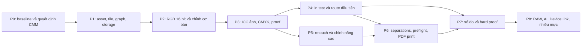

# 06 — Kế hoạch triển khai, test và release gate

[Kế hoạch chính](../image-editing-color-print-20261024.md). Những bước dưới đây theo dõi
triển khai và acceptance theo từng mốc. Test code, thao tác UI native, profile máy in và đo
hiệu năng/ΔE vật lý là các bằng chứng riêng, không thay thế cho nhau.

## Trạng thái thực thi

Cập nhật 24/10/2026: P1 đang làm, chưa đạt điều kiện đi tiếp vì disk store mới là session tạm;
tile, native streaming và full-resolution export chưa nối end-to-end. Lát cắt crop/exposure đã chạy qua dialog Win32 thật được test tự
điền, action, cùng node ID, Undo/Redo, lưu–mở `.pr` và lệnh Export Bitmap Master TIFF; Release
`test_pikdraw_raster_profile_workflow` pass 1/1 với kích thước, ICC và pixel oracle (RGB cho phép
tối đa 2 mức lượng tử hóa WIC, alpha chính xác). Đây xác nhận lát cắt UI-to-export này, không xác nhận
ảnh full-resolution, tile hay hiển thị trực quan. Lượt gần nhất cũng link canonical
`build/win-dev/apps/desktop/pikdraw.exe` thành công. `test_pikdraw_drawing_tool_ui` từng timeout ở
snap-index readiness; benchmark từng đo 10.51 ms so với ngưỡng 8.3 ms, chưa được kiểm lại ở lát cắt
này. Gate TIFF CMYK16/ICC/DPI đã pass riêng; monitor proof, in test, separations, đo ΔE và máy in
thật vẫn chưa được chấp nhận.

Cập nhật sau triển khai: model giữ buffer RGBA16LE bất biến cạnh preview RGBA8; graph schema v3
lưu/reopen buffer và đọc/migrate schema v1/v2. Preview áp crop/flip/rotate/exposure trên nguồn
16-bit trước khi đổi sang RGBA8 cho renderer. Bộ test raster/storage/action liên quan pass 5/5 và
canonical Release build pass. Đây mới là kiểm chứng code-level với buffer nạp trực tiếp; page composite
16-bit vẫn chưa có nên AC-IE-06 vẫn chưa đạt.

Bổ sung triển khai 24/10/2026: PNG16 RGB đã đi từ decoder qua worker/IPC vào `ImageObject` với
buffer RGBA16LE và preview RGBA8; desktop regression xác nhận commit, `.pr` save/reopen, Undo/Redo
giữ nguyên các mẫu 16-bit. Adapter/worker/import tests pass. API ghi TIFF RGBA16LE cũng có pixel
round-trip test riêng; desktop page-export vẫn ghép/ghi RGBA8 nên page-composite U16 và AC-IE-06 chưa đạt.
Graph schema v4 bổ sung Levels theo kênh composite/R/G/B, có gamma/input/output
levels trên sRGB mã hóa, giữ alpha, identity bit-exact và evaluator 8/16-bit. Menu/action mở dialog
Levels; command dùng graph node ổn định, preview fingerprint, `.pr` round-trip, Undo/Redo. Bốn test
raster evaluator/vertical slice/document storage/desktop actions pass; năm test decoder/worker adapter/
TIFF16 writer/worker import/desktop raster import pass. Histogram API U8/U16 với coverage mask,
exact-code bins, clipping/mean và cancellation có pixel test. Properties hiện vẽ RGB sau graph và
alpha coverage bằng nét chấm qua service nền; U16 giữ exact bins và chart gom 256 bucket. Chart chưa
áp mask hoặc ICC/proof; thao tác UI native chưa được xác nhận trực quan. Curves RGB
năm điểm đã có graph/evaluator/menu và test round-trip; P2 vẫn chưa đạt vì selective HSL ranges,
masks, Properties dùng chung với bar, ICC pixel/profile và
full-resolution page export còn thiếu.
P1 source-store/tile nối đầy đủ vào placement, native streaming và gate ảnh lớn vẫn còn dở.
`RasterAssetStore` có SHA-256 theo buffer 1 MiB và API xác minh theo luồng, hủy được, kèm tiến độ.
`test_pikdraw_raster_assets` Release pass 1/1 cho vector SHA, nguồn nhiều block, range read và
hủy/không để partial. Desktop import hiện dùng per-import store tạm, nhưng `.pr`/export chưa đọc
stream từ store; nguồn vẫn còn trong RAM. Đây chưa đóng AC-IE-01..05.

Bổ sung cầu nối P1: core document khai báo `RasterSourceProvider` runtime; `ImageObject` giữ provider
cạnh descriptor bền, còn `RasterAssetReader` triển khai giao diện và interop decoder đọc theo hàng
qua `RasterAssetByteSource`. Regression Release `test_pikdraw_interop_raster_asset_byte_source`
pass 1/1: Embedded asset được WIC giải mã theo hàng, `.pr` save/reopen giữ bytes/descriptor nhưng
bỏ provider theo process; Linked sparse đọc đúng offset trên 4 GiB. Nguồn mã hóa không bị gom vào
một buffer. Desktop raster import nay chép encoded source theo block vào per-import disk session,
gắn Embedded descriptor SHA-256 và reader provider vào `ImageObject`; lifetime session và memory
reservation theo snapshot/Undo. Release `test_pikdraw_raster_assets` và `test_pikdraw_desktop_import`
pass 2/2, kiểm range read, hủy/copy, WIC đọc hàng từ provider sau khi xóa file gốc, cùng `.pr` giữ
bytes/descriptor nhưng không serialize provider/lease. Nguồn vẫn còn trong RAM cho serializer `.pr`;
desktop open chép lại từ RAM vào temp session để dựng provider mới. Provider/session không persistent,
nên vẫn có bản disk thứ hai và chưa giảm RAM. Renderer/export chưa đọc qua provider. Tile,
native streaming và gate ảnh lớn end-to-end vẫn chưa đạt.

Bổ sung tiến độ import P1 24/10/2026: khi raster source được stage vào session, callback báo byte đã
chép/tổng byte và UI status hiển thị phần trăm cùng dung lượng; callback vẫn coalesce tối đa mỗi 50 ms,
nhưng luôn gửi mốc hoàn tất. `test_pikdraw_desktop_import` Release pass 1/1 (71,75 giây), xác nhận
source byte count hoàn tất trên raster import và chạy corpus CDR/PDF/AI/EPS. Canonical Release
`pikdraw.exe` đã relink sau test. Đây chưa xác nhận status trên cửa sổ native bằng capture, không giảm
RAM nguồn và không đóng persistent store/reopen, tile, streaming hay AC-IE-01..05.

Bổ sung P1 24/10/2026: `.pr` schema v24 thêm bảng dùng chung cho encoded raster source và buffer
RGBA8/RGBA16LE; serializer deduplicate byte-for-byte giống nhau kể cả khi mỗi object đang giữ
allocation riêng, còn reader gán cùng immutable buffer cho các image references. File có bảng này dùng chunk container v25;
reader vẫn nhận container v24/schema v23. `test_pikdraw_document_storage` và
`test_pikdraw_document_storage_fidelity` Release pass 2/2, gồm source/sample content dedup và reopen.
Storage fidelity rerun pass 1/1 với asset 256 KiB: bốn image references gồm hai source contents
nhỏ hơn bốn source riêng trên 128 KiB; RGBA8 khác nhau vẫn giữ buffer riêng, RGBA16LE giống nhau
dùng chung buffer. Desktop import suite/raster vertical slice pass 2/2;
raster worker adapter, worker import và desktop raster import pass 3/3.
Đây là một phần storage của AC-IE-01; raster store/tile vẫn chưa nối desktop import/export,
khác biệt pixel payload vẫn tăng theo từng nội dung riêng, và streaming/large-source/UI/Undo gate chưa đạt.

Bổ sung P1 evaluator 24/10/2026: nếu crop là node đầu tiên và được bật, evaluator đọc các hàng
trực tiếp từ immutable source view và chỉ cấp reservation cho vùng crop; Exposure/Levels và các
node tone/color dạng pointwise chỉnh tại chỗ trên working frame. Regression dùng nguồn 4×2 với
quota đúng kích thước crop 1×1
ở cả U8 (4 byte) và U16 (8 byte); pixel oracle, alpha, stride có padding và quota pass
`test_pikdraw_raster_evaluator` Release **1/1**. Tối ưu này tránh bản sao làm việc toàn ảnh ở
đường crop đầu tiên; import vẫn giữ decoded source trong model và native container vẫn dùng full-buffer I/O,
nên không khép source-store/tile integration hay AC-IE-01..05.

Bổ sung tiếp 24/10/2026: action `Bitmaps > Export Bitmap Master (TIFF)…` ghi ảnh chọn ở kích thước
pixel graph đã đánh giá. Service đánh giá graph trên RGBA8/RGBA16LE, nhúng ICC RGB khớp basis mẫu,
giữ DPI và ghi TIFF 16-bit khi có master U16. Regression tạo ảnh 2×1 U16, áp crop, xuất/đọc TIFF
1×1 rồi kiểm pixel, alpha, DPI, bit depth, ICC; unknown color basis bị từ chối trước khi tạo tệp.
`test_pikdraw_raster_bitmap_export` và `test_pikdraw_desktop_actions` pass 2/2. Đây không khép
page composite 16-bit, tile/lazy source, BigTIFF, export CMYK, Save dialog native hay in thật. Action
chỉ giữ/nhúng profile RGB hiện hành; chưa hỗ trợ chuyển profile cho U16.

Bổ sung 24/10/2026: `Properties > Histogram RGB nguồn` dùng `RasterHistogramService` với key
document/epoch/revision/object/source/encoding/dimensions; selection hoặc snapshot đổi sẽ hủy job cũ.
RGBA8 packed `RRGGBBAA` được đếm trực tiếp, không tạo bản sao toàn ảnh; RGBA16LE đếm đủ 65.536
mã/kênh. `test_pikdraw_raster_histogram` và `test_pikdraw_raster_histogram_service` pass 2/2 sau
lazy worker; `test_pikdraw_desktop_actions` pass. Canonical Release `pikdraw.exe` link thành công.
`test_pikdraw_snap_properties_ui` và `test_pikdraw_units_settings_ui` pass; `test_pikdraw_desktop_shell`
và `test_pikdraw_artboard_tool_ui` tái hiện segfault, chưa có stack trace. AC-IE-09 vẫn partial:
chưa có histogram sau graph/mask hoặc channel view; Properties chưa được kiểm
trực quan trong cửa sổ app ở lượt này.

Cập nhật P2 histogram 24/10/2026: `RasterHistogramService` có mode Source/Edited;
Properties chuyển sang mã RGB sau edit graph và vẽ alpha coverage bằng nét chấm. U8 packed đi thẳng vào một working frame có quota,
U16 giữ RGBA16LE; quota edited histogram 256 MiB, không fallback sang histogram nguồn khi lỗi.
Regression xác nhận Exposure U8 cho mã 176/90/47 và giữ alpha 127, đồng thời source mode giữ
mã gốc; evaluator, vertical slice, preview, histogram service và bitmap export Release pass 5/5.
Rerun Release bổ sung kiểm tra alpha exact/display bins ở U8/U16 và alpha sau Exposure trong Edited
mode; `test_pikdraw_raster_histogram` cùng `test_pikdraw_raster_histogram_service` pass 2/2.
Source painter compile thành công vào `libpikdraw_desktop.a`. Sau khi cửa sổ test được đóng,
lệnh `-Configuration Release -Target pikdraw` link thành công và hai histogram targets tiếp tục
pass. AC-IE-09 vẫn partial vì chưa có
mask/channel view, ICC/proof histogram hoặc kiểm tra Properties trực quan trên cửa sổ app;
Windows capture lần trước timeout dù tiến trình báo Responding; lượt này chỉ xác nhận dữ liệu chart
và bản Release đã link, chưa xác nhận hình vẽ trên cửa sổ.

Bổ sung source 24/10/2026, chờ lượt kiểm cuối: bốn chip R/G/B/A* trong Histogram Properties bật/tắt
đường kênh riêng và báo trạng thái; đây chỉ đổi phần vẽ, không sửa histogram/document. Linear mask
có `gradient_angle_degrees` (0° trái→phải, góc dương theo chiều kim đồng hồ), được lưu trong graph
schema v16; graph cũ đọc với 0°. Dialog chỉ hiện Angle cho shape Linear; evaluator project coverage
trên bounds và cache preview fingerprint có angle. Đã thêm pixel regression 90°/invalid angle và
storage round-trip góc 37,5° vào suite hiện hữu. Chưa chạy build/test theo yêu cầu đợi code các phase.

Bổ sung P3 24/10/2026: `Bitmaps > Convert Bitmap Profile to sRGB` chuyển pixel của một ảnh có ICC RGB
nhúng chưa áp dụng sang profile sRGB hệ thống bằng Relative Colorimetric, BPC off. Worker có kiểm
hủy theo block, progress, admission RAM, xác nhận snapshot/selection trước commit; command giữ source
encoded bytes, ICC và graph, đồng thời giữ master RGBA16LE khi có. `test_pikdraw_raster_profile_conversion`,
`test_pikdraw_document_raster_profile_commands`, `test_pikdraw_document_storage`,
`test_pikdraw_desktop_actions` pass 4/4; `test_pikdraw_raster_profile_workflow` dispatch Action ID thật,
chạy worker, Undo/Redo và `.pr` reopen pass 1/1. Lượt đầu integration fixture thiếu `media_type`, đã
sửa fixture và dọn output CTest theo RunId. Sau đó `native_window_raster_profile.cpp` được biên dịch và
canonical Release `pikdraw.exe` link lúc 10:41 UTC; timestamp executable sau source mới nhất của lát cắt.
Lệnh `-Configuration Release -Target pikdraw -LockWaitSeconds 120` chạy lại sau khi đóng app và pass;
Ninja chỉ stage worker vì các dependency của app đã up-to-date. Histogram/alpha Release suite
`test_pikdraw_raster_histogram`, `test_pikdraw_raster_histogram_service`, `test_pikdraw_raster_evaluator`
và `test_pikdraw_raster_preview_service` pass 4/4. Chưa kiểm menu bằng chuột/Properties trực quan;
intent/BPC tùy chỉnh, CMYK source, proof/gamut và in test vẫn mở; P3 và mốc B chưa đạt.

Bổ sung P3 Assign 24/10/2026: `Bitmaps > Assign Bitmap Profile…` nhận ICC RGB cho một ảnh, giữ nguyên
mẫu RGBA8/U16, alpha, graph và source encoded bytes; `AssignRasterImageProfileCommand` ghi active ICC/basis,
Undo/Redo và `.pr` round-trip. `RasterEditPreviewService` chuyển profile chưa áp dụng sang system sRGB
trên worker, cache theo revision/profile/buffer và cung cấp ảnh đã diễn giải cho renderer mà không sửa master.
Cùng profile đích được xử lý như no-op pixel; ICC không được CMM hỗ trợ bị chặn trước commit. Lệnh Release
`tooling/native/build.ps1 -Configuration Release -Test -TestTarget @('test_pikdraw_document_raster_profile_commands','test_pikdraw_raster_preview_service','test_pikdraw_desktop_actions','test_pikdraw_raster_profile_workflow') -TestRegex '^(test_pikdraw_document_raster_profile_commands|test_pikdraw_raster_preview_service|test_pikdraw_desktop_actions|test_pikdraw_raster_profile_workflow)$' -LockWaitSeconds 120` pass 4/4; verbose preview/workflow pass 2/2, có scalar CMM oracle và menu Assign → Undo/Redo → Convert → `.pr` reopen. Chưa kiểm file picker/menu bằng thao tác native, monitor profile, gamut/proof hoặc máy in. P3 và mốc B vẫn chưa đạt.

Bổ sung 24/10/2026: schema graph v5 thêm HSL master không phá hủy với Hue ±180°,
Saturation/Lightness ±100%; evaluator chạy trên RGBA8 và RGBA16LE sRGB mã hóa,
giữ alpha, cho kết quả identity bit-exact và giữ màu xám dưới chỉnh Hue. `.pr`
đọc schema cũ và round-trip node HSL mới. `Bitmaps > Hue/Saturation/Lightness…`
mở dialog Apply/Cancel và ghi cùng graph command có Undo/Redo; action/menu/model,
storage và evaluator regression đã bổ sung. `test_pikdraw_raster_bitmap_export`
đã đánh giá HSL trên pixel xanh U16, xuất TIFF 16-bit, đọc lại thành pixel đỏ,
đồng thời giữ alpha, DPI, kích thước và ICC; bộ evaluator/storage/action/export
Release và `test_pikdraw_raster_vertical_slice` pass 5/5; vertical slice kiểm
command, `.pr` save/reopen, pixel evaluator, Undo/Redo. Đây chưa phải dải màu chọn lọc,
chưa có giá trị preview trước/sau ngay trong dialog, chưa kiểm tra thao tác UI
trực quan, và không hỗ trợ chỉnh HSL trên native CMYK/Lab; P2 vẫn còn mở.

Bổ sung P3 primitive 24/10/2026: `ProfileColorTransform::convert_process16le` chuyển
pixel RGB/RGBA16LE ↔ CMYK/CMYKA16LE theo ICC source/destination trên Windows CMM,
giữ alpha, xử lý batch tối đa 8.192 pixel, có callback hủy/tiến độ; caller chỉ công bố output
khi cả operation thành công. `test_pikdraw_icc_preview` dùng cặp sRGB → RSWOP có trên máy,
so RGB16→CMYK16 với `ColorValue` scalar, kiểm alpha/layout/overlap/hủy; Release pass 1/1.

Bổ sung P3 export 24/10/2026: menu `Bitmaps > Export CMYK Bitmap Master (TIFF)…` cho ảnh RGB
đang chọn mở chọn profile và rendering intent; BPC hiện disabled, nêu rõ lý do chưa được hỗ trợ.
Action kiểm tra source color basis, profile và khả năng tạo transform trước khi bật; thao tác xuất
được đưa qua worker, có hủy và kiểm headroom. Raster service đánh giá graph full dimensions,
chuyển nguồn về working sRGB khi cần, flatten alpha trên trắng ở linear light rồi chuyển ICC sang
CMYK16. TIFF classic lưu bốn kênh 16-bit, strip, ICC, DPI; output >4 GiB bị từ chối an toàn, chưa
có BigTIFF. Writer regression dùng WIC đọc lại channel samples và decoder kiểm profile/DPI; export
regression parse samples độc lập, so với ICC transform oracle của pixel đã flatten. Lệnh
`tooling/native/build.ps1 -Configuration Release -Test -TestTarget @('test_pikdraw_interop_raster_image_writer','test_pikdraw_raster_bitmap_export','test_pikdraw_desktop_actions') -TestRegex '^(test_pikdraw_interop_raster_image_writer|test_pikdraw_raster_bitmap_export|test_pikdraw_desktop_actions)$' -LockWaitSeconds 120`
pass 3/3; `tooling/native/build.ps1 -Configuration Release -Target pikdraw -LockWaitSeconds 120`
link canonical app thành công. UI native chưa xác nhận trực quan do Computer Use session
không trả về ứng dụng Windows nào. P3 vẫn partial: Assign/Convert gắn vào document, CMYK nguồn
native/preserve-numbers, Gray/Lab, BPC, monitor, soft proof/gamut và driver/print route còn mở.

Bổ sung P2 Curves 24/10/2026: graph schema v6 append kind ổn định, đọc schema cũ rồi migrate;
node lưu channel RGB tổng hợp/R/G/B và năm giá trị đầu ra tại X cố định 0/25/50/75/100%.
Evaluator U8/U16 chạy piecewise linear, identity bit-exact, giữ alpha, kiểm giới hạn, cancellation
và memory budget. Menu action Bitmaps > Curves… mở modal Apply/Cancel; mỗi target channel giữ
node riêng và sửa lại dùng cùng ID. Preview fingerprint và sRGB processing gate nhận Curves.
Vertical slice kiểm hai channel cùng graph, save/reopen .pr, pixel output, Undo hai bước và Redo;
cùng evaluator/storage/action tests pass. Đây là Curves nhập số 5 điểm, chưa phải graph kéo
thả/spline, chưa có per-node mask, sample picker hoặc channel CMYK. UI native chưa được thao tác
trực quan xác nhận.

Bổ sung P2 White Balance 24/10/2026: graph schema v7 thêm node temperature/tint tương đối, giới hạn
mỗi trường ±100%; evaluator áp gain theo linear-light sRGB cho U8/U16, giữ alpha, nhận cancellation
và memory budget. Bitmaps > White Balance… mở modal song ngữ với Apply/Cancel; cùng node ID được
cập nhật, có Undo/Redo và status hint. Action chỉ bật cho một ảnh sRGB có nguồn được giữ lại.
Acceptance gồm U8/U16, nhiệt độ/tint, identity/boundary, alpha, graph save/reopen, pixel output và Undo/Redo;
native Release build runner đã pass 5/5 evaluator/storage/vertical-slice/menu/export targets; test
export riêng sau khi bổ sung WB pixel assertion pass 1/1; evaluator rerun với U16/tint pass 1/1;
canonical Release pikdraw.exe đã link.
Đây là chỉnh màu tương đối, không phải nhiệt độ Kelvin/RAW; chưa có picker vùng xám, thanh Properties/bar
hay xác nhận UI native trực quan. P2 vẫn mở vì còn selective HSL, mask, shared Properties, page composite
16-bit và profile conversion.

Bổ sung P2 Vibrance 24/10/2026: action song ngữ, dialog Apply/Cancel, graph node kind 9/schema v8,
evaluator sRGB RGBA U8/U16, cache fingerprint và sRGB processing gate đã nối. Thuật toán PikDraw tăng
saturation của màu ít bão hòa mạnh hơn màu đã rực, giữ nguyên xám trung tính, giảm saturation theo tỷ lệ
khi kéo âm; không mô phỏng nhận diện da của ứng dụng khác. Regression bao gồm màu xám/màu rực, tăng/giảm,
U16, alpha, identity, miền tham số, `.pr` save/reopen, pixel output, Undo/Redo và menu. Lệnh
`tooling/native/build.ps1 -Configuration Release -Test -TestTarget @('test_pikdraw_document_commands','test_pikdraw_document_storage','test_pikdraw_raster_evaluator','test_pikdraw_raster_vertical_slice','test_pikdraw_raster_preview_service','test_pikdraw_desktop_actions','test_pikdraw_raster_bitmap_export') -TestRegex '^(test_pikdraw_document_commands|test_pikdraw_document_storage|test_pikdraw_raster_evaluator|test_pikdraw_raster_vertical_slice|test_pikdraw_raster_preview_service|test_pikdraw_desktop_actions|test_pikdraw_raster_bitmap_export)$' -VerboseTests -LockWaitSeconds 120`
pass **7/7**; canonical Release `build/win-dev/apps/desktop/pikdraw.exe` đã relink. Dialog native chưa được
xác nhận trực quan. P2 vẫn mở vì masks, shared Properties, composite U16 và profile conversion
còn thiếu; P1 tile/source-store tích hợp đầy đủ và native streaming cũng chưa hoàn tất.

Bổ sung P2 Selective HSL 24/10/2026: action song ngữ và dialog Apply/Cancel điều chỉnh sáu dải Hue
60° với feather; mỗi dải có node riêng trong graph kind 10/schema v9. Evaluator sRGB RGBA U8/U16
dùng trọng số smoothstep, giữ nguyên pixel xám và alpha; cache fingerprint và cổng xử lý sRGB đã nối.
Storage, pixel/boundary/U16, save/reopen/Undo/Redo, preview và menu/action Release tests pass 7/7 qua
tooling/native/build.ps1 với bảy target raster/document/desktop phù hợp. Dialog chưa được xác nhận
trực quan; P2 còn mask workflow, shared Properties, composite U16 và profile conversion. P1
source/tile/lazy integration cùng native streaming vẫn mở.

Bổ sung P5 mask cơ bản 24/10/2026: graph schema v11 lưu mask bitmap coverage hoặc rectangle feathered
theo tọa độ frame trước node; evaluator blend 7 loại pointwise adjustment, xác thực kích thước theo
thứ tự Crop/Rotate, bảo toàn alpha và đưa mask vào cache fingerprint. Menu `Bitmaps > Local Exposure
Mask…` (`action.bitmap.adjust.local_exposure_mask`) tạo Exposure node mới có vùng chữ nhật, density/invert/feather, Undo/Redo
qua command. Regression evaluator bitmap/rectangle, kích thước sai, model, command Undo/Redo và `.pr`
save/reopen đã được thêm nhưng chưa chạy theo yêu cầu chỉ kiểm tra một lượt ở cuối. Cập nhật tiếp
P5: graph schema v16 lưu linear-gradient có góc và radial-gradient tâm→biên; evaluator U8/U16
blend mask và inversion, `.pr` lưu geometry/góc (schema cũ đọc góc 0°), UI Local Exposure chọn
ba hình dạng và góc tuyến tính qua cùng command. Evaluator và storage regressions đã được bổ sung,
chưa chạy. Cọ/refine, mask overlay, vector masks và gắn mask từ UI cho mọi node còn thiếu; P5 và
mốc C chưa đạt.

P4 direct-print code 24/10/2026: `File > Print Test Sheet…` chỉ nhận DEVMODE khai báo ICM method
NONE hoặc SYSTEM; app gọi `SetICMMode(ICM_ON)` và bật lại sau `StartPage`, đồng thời ẩn/vô hiệu hóa
Print to File. Driver/device-owned ICM bị từ chối để giảm rủi ro chuyển đổi kép. Snapshot/condition
đóng băng trước worker; chart dùng khổ/PPI vật lý, DIB gắn `LCS_sRGB`; render, StartDoc, StartPage,
StretchDIBits, EndPage/EndDoc/AbortDoc và xóa DC đều chạy trên worker. Action/menu, cleanup và lỗi
đã nối. Chưa build/test hoặc gửi job thật; profile đích, mực/giấy, ruler, scale vật lý và ΔE chưa xác minh.

## 1. Thứ tự thực hiện và deliverables



P8 là các nhánh mở rộng độc lập sau khi boundary liên quan ổn định; không nhất thiết tất cả
chờ cùng một ngày phát hành. Độ lớn S/M/L/XL dưới đây chỉ so sánh rủi ro/phạm vi; không phải
ước lượng tuần hoặc cam kết thời hạn. P0 mới có cơ sở chốt effort theo nhân lực/thiết bị.
Phần nhập/so số đo P7 có thể chạy sau tuyến P4 đã đạt; hard proof cần chain RGB đã kiểm hoặc
nền plates P6 theo model của condition. Không bắt in test RGB phải chờ toàn bộ spot separations.

| Bước / độ lớn | Việc thực hiện | Phạm vi source dự kiến | Điều kiện kết thúc |
| --- | --- | --- | --- |
| P0 / M | Audit diffs, paths/model/UI/export; corpus RGB/CMYK/16-bit/alpha/profile; CMM/library/license/build feasibility; driver/RIP capabilities; digital oracle và baseline latency/RAM | Existing raster/color/interop/rendering/desktop, contracts và CMake đọc trước | Có ma trận codec/sample/ICC thật; có quyết định engine và print route kiểm được; mọi pending node chỉ là plan |
| P1 / XL | Nối source store/provider/tile jobs vào desktop; hoàn thiện streaming/native portability cần thiết; node descriptors/IDs/semantic version; mask schema và command; crop/exposure vertical slice | `core/document/model`, `commands`, `storage`; `modules/raster`; core provider interface; interop/workers; composition root desktop | Source nguyên vẹn, full-res crop/exposure sửa lại được qua UI, Undo/reopen/export; không dùng proxy thay master; AC-IE-01..05 |
| P2 / L | Native RGB/Gray U8/U16 đến encoder, float evaluator; resample, Light/Levels/Curves/WB/HSL/Vibrance; histogram; basic masks; before/after; Properties/catalog/help | Raster `operations/tone`, `operations/color`, `mask`; desktop presenters/tools/Properties; codec precision paths | Basic controls có thuật toán thật và identity/boundary vectors; bar/Properties cùng state; AC-IE-06..12, 23..25 |
| P3 / XL | CMM adapter, native CMYK samples và source ICC basis; Assign/Convert pixel graph, intents/BPC, monitor pipeline/proof/gamut; K/channel preservation | `core/color/cmm` đề xuất; profile service; raster color nodes; interop CMYK TIFF/JPEG; display/output projection | AC-IE-13..18; same-profile no-op giữ bytes/channels; thiếu capability không báo proof/production đúng |
| P4 / L | OutputCondition/presets, output variant; crop/grid/diagnostic layout; export test sheet; direct-print route RGB do WCS hoặc driver quản lý đã xác minh; output sharpening cơ bản | `modules/production/print` đề xuất; desktop print presenter/driver adapter; interop streaming encoders; registry/CMake nếu có dependency mới | Tối thiểu export test + một route in thật, scale/profile/owner đúng; AC-IE-26..29 |
| P5 / XL | Local/channel adjustments, mixer/selective/replace/match, masks/refine, clone/heal/patch/paint/dodge, detail filters/LUT/grain, preset/batch | Raster tách `channels`, `selection`, `retouch`, `filters`, `analysis`; desktop tool controllers/presenters | AC-IE-19..22, 30..31; source sampling deterministic; không full-image copy mỗi stroke; help và lifecycle đủ |
| P6 / XL | Output CMYK/spot plate model, overprint/knockout/transparency, pixel TAC/preflight, black policy, PDF print/X writer subset + validator/RIP | Color/output semantics, production preflight, rendering output provider, interop writer; core schema nếu cần | AC-IE-32..36; per-plate oracle thật; PDF/X đúng subset và output intent; không screen-RGB approximation |
| P7 / L + thiết bị | CGATS/CSV import, ΔE00, run compare/repeatability, proof A→B, chart/profile verification và xưởng in | Production measurement/run services, UI tables/reports, tests + fixtures hợp lệ | AC-IE-37..41; records có điều kiện đo, patch coverage, route và source/profile hashes; qualification tách riêng |
| P8 / theo nhánh | RAW/Lab/HDR, PSD/PSB subset, subject/inpaint/AI, DeviceLink/white ink/varnish/duotone/profile building | Adapter/operation/schema riêng theo capability, worker/plugin khi cần | Phiếu UI + corpus/license/quota + acceptance của từng nhánh; không mở rộng capability từ một sample |

Mỗi bước có một lát cắt **UI event → action → presenter → command/model → evaluator → storage →
export → Undo/Redo**. Không hoàn thành bước chỉ bằng API/headless probe hoặc thêm field/action ID.
P1 tiếp tục phần còn thiếu của [plan ảnh lớn](../raster-import-large-assets-20261021.md), không làm lại phần
đã pass. Khi phát hiện source mới đã có capability, tái sử dụng và bổ sung gate thiếu thay vì xóa viết lại.

## 2. Tổ chức code và hợp nhất

- File đề xuất theo domain, ví dụ `operations/tone/levels.cpp`, `operations/color/hsl.cpp`,
  `retouch/clone.cpp`, `mask/coverage.cpp`, `analysis/histogram.cpp`, `print/test_sheet.cpp`,
  `measurement/cgats_reader.cpp`. Đây không là yêu cầu tên path đã tồn tại.
- Bắt buộc giữ file code dưới 2.000 dòng, ưu tiên 300–1.800; tách trước khi thêm form/painter
  lớn vào native shell. Không đưa cả bộ sửa ảnh vào `native_window.cpp`/`object.hpp`.
- Core model/schema/contracts C4/C5/C6/C8/C9, action IDs, registry/CMake và composition root là
  điểm tích hợp cần xử lý tuần tự trong source gốc. Không tạo worktree, task lease hoặc nhánh task.
- Mỗi feature thêm presenter/field descriptor trước; bar/Properties không giữ hai bản giá trị
  và validation. Numeric/IME/toolbox state dùng hạ tầng chung, không ghi shortcut trực tiếp vào paint code.
- Bổ sung capability registry theo sample/layout/format/operation/engine. Menu chỉ bật khi đủ
  model/evaluator/storage/UI/export tương ứng; một feature RGB-only không mang nhãn CMYK full support.
- External dependency pin version/hash và license trong cơ chế repo. Profile, lens database,
  chart, fonts/ảnh và model AI có nguồn/license riêng, không suy ra từ license CMM.

## 3. Corpus và oracle cần chuẩn bị

| Nhóm fixture | Tối thiểu và mục tiêu |
| --- | --- |
| Native RGB/Gray | U8/U16 ramps, near-neutral, skin/product image, transparency; embedded sRGB/Adobe RGB/Display P3 và untagged/mismatch |
| Native CMYK | U8/U16 TIFF; JPEG CMYK/YCCK với marker/inversion; K-only/composite black; cùng/khác ICC, TAC vượt/đúng giới hạn |
| Masks/edges | Hair/soft edge, checker alpha, hidden RGB ở alpha=0, tile boundaries, feather/crop/rotate/reorder, vector mask |
| Retouch | Known source/target patterns, clone across tiles, heal illumination edge, sample current/below/composite, seed/repeatability |
| Print scene | Ảnh + text nhỏ + vector/gradient + spot + knockout/overprint/transparency, cùng nguồn ở nhiều vị trí/kích thước |
| Large assets | 24 MP và 200 MP U16, encoded source ≥1 GiB, BigTIFF offsets >4 GiB, sequential codec, multiple linked/embedded copies |
| Format interchange | Per-adapter/version/representation PDF/AI/CDR/EPS/SVG và DXF N/A ở tài liệu 03; PSD/RAW để gate P8 riêng |
| Measurements | Synthetic CGATS/CSV missing/duplicate/misordered IDs/invalid units; known ΔE00 pairs; actual measured run trên máy/vật liệu đã ghi |
| Malformed/cancel | Invalid ICC/tag count, dimensions/overflow, truncated source, unsupported nodes, read quota, disk full, link modified mid-job |

Oracle gồm: analytic vectors cho công thức; independent pixel/reference implementation cho
kernel/alpha; CMM reference với options/profile hashes; source-app exports dùng đúng build/profile
cho appearance; independent parser cho channels/metadata; validator + RIP plates cho print;
spectrophotometer/reference data cho màu vật lý. Có thể kiểm cả CPU/D2D/WARP nhưng so ba đường
chung code không tự tạo oracle độc lập.

Không yêu cầu pixel identity toàn cục với Photoshop/Corel nếu thuật toán khác. Khi cần mapping
interop effect phải có tolerance/parameter mapping riêng theo C8/C9 và loss report.

## 4. Acceptance chức năng và lifecycle

Các ID ở đây là yêu cầu, ban đầu **NOT RUN**. Kết quả sau triển khai ghi trực tiếp theo gate
và evidence cần thiết; không sinh snapshot/handoff hoặc giữ dump tạm làm tài liệu.

| ID | Given / When | Then và bằng chứng cần có |
| --- | --- | --- |
| AC-IE-01 | Import nguồn rồi duplicate/crop hai placement | Source hash giữ nguyên; shared asset, graph independent; một placement không đổi placement khác |
| AC-IE-02 | Từ canvas/menu sửa crop/exposure, đổi lại node | Đúng image/node ID, không append node trùng; một logical Undo/Redo, render đổi tương ứng |
| AC-IE-03 | Save/reopen .pr có graph/ICC/mask/patch | Giữ IDs/source/model/precision/recipe, pixel output đúng oracle; máy khác thiếu cache vẫn mở embedded được |
| AC-IE-04 | Đổi link trong lúc evaluate/export, cancel/close/Undo/reopen | Không trộn source revisions; stale completion không commit; không còn file dở/draft rơi vào artwork |
| AC-IE-05 | Ảnh ≥1 GiB/BigTIFF >4 GiB và thiếu RAM/đĩa | Checked reads/count/offset, bounded live work, pause/cancel/retry; không dùng preview thay full source |
| AC-IE-06 | RGB/Gray U16 gradient, chỉnh rồi export U16 | Phân biệt được values khác nhau dưới 1/255; không quantize RGBA8 ở giữa; bit/channels/profile đọc lại đúng |
| AC-IE-07 | Levels/Curves/Exposure identity và boundary | Vectors đúng, invalid params bị từ chối; endpoints/gamma/EV theo semantic version, không NaN/Inf |
| AC-IE-08 | Light/HSL/WB/Vibrance từng control riêng | Có tác dụng đúng phạm vi, zero identity, clipping/hue wrap/neutral cases; không nhiều slider chung hiệu ứng giả |
| AC-IE-09 | Histogram full/masked/channel sau sửa | Counts/statistics đúng fixture; sampled preview có nhãn, stale histogram không thay final |
| AC-IE-10 | Mask mềm trên ảnh trong suốt, blur/resample trên nền trắng/đen | Coverage/alpha apply đúng một lần, không viền đen/trắng; tile/full-region oracle khớp |
| AC-IE-11 | Crop/rotate/resize mask rồi reorder node | Mask bám đúng coordinate space hoặc thao tác invalid bị chặn; Undo khôi phục đúng vị trí/ID |
| AC-IE-12 | Export ở kích thước lớn hơn preview với output sharpen/dither | Dùng source/graph thật; radius/scale/seed đúng; encoder strips và decode lại đạt precision/matte policy |
| AC-IE-13 | Assign ICC lên ảnh rồi Undo | Số native channels/hash không đổi, interpretation/profile thay; chỉ scope ảnh được chọn |
| AC-IE-14 | Convert RGB↔CMYK/Gray hoặc same-model khác ICC | Channel values đúng CMM/reference theo options; alpha giữ; source và metadata đủ để undo; same-profile là no-op hợp lệ |
| AC-IE-15 | CMYK preserve-numbers, solo/edit K, save/export | Untouched C/M/Y/K giữ nguyên số ở chế độ bảo toàn; no RGB round-trip; direct K edit chỉ đổi channel/mask được chọn |
| AC-IE-16 | Đổi intent/BPC, profile hỏng/thiếu/unsupported | CMM thực thi hoặc disable/report; không silent fallback/ignore flag; production output không nhận approximate là managed |
| AC-IE-17 | Toggle proof/gamut/monitor trên scene mixed | Source/revision/history không đổi; chain và overlays theo profile; oracle phân biệt diagnostic RGB với gamut thực |
| AC-IE-18 | ICC pixels đã converted-to-sRGB và source embedded profile khác | Không double-convert; native sample recovery chỉ khi decode original đúng capability |
| AC-IE-19 | Channel Mixer/Selective/Replace trên fixtures xác định | Công thức và scope chuẩn của PikDraw; view channel không đổi plate; RGB slider CMYK không đổi image model |
| AC-IE-20 | Clone/heal/patch qua biên tile và reorder/Undo | Source sampling snapshot đúng; solver bounded; không loop/halo; một stroke một Undo; reopen vẫn đúng |
| AC-IE-21 | Denoise/sharpen/clarity/blur/grain ở LOD khác nhau | Halo/edge/radius/precision đúng descriptor; seed tái lập; GPU/CPU đạt tolerance, final không lấy preview |
| AC-IE-22 | Preset/batch trên ảnh khác model/size/locked | Validate version/profile/mask coordinate; chỉ eligible items, không mutate source chung; cancel giữ trạng thái được báo đúng |
| AC-IE-23 | Dock đóng/bar hẹp, mở Curves và sửa advanced field | Đúng section/node, tìm được mọi field đã hỗ trợ, bar/Properties đồng bộ; mở bảng không thêm Undo |
| AC-IE-24 | Numeric focus/Tab/IME, mixed selection, tool/pan/flyout | Không mất draft, shortcut không cướp input; selection/active tool/hover/focus tách đúng |
| AC-IE-25 | Native UI ở kích thước/scale/theme mục tiêu | Labels/fields/Apply/Cancel/hint đủ, tab order/access names; screenshot và thao tác thật, báo thiết bị chưa kiểm |
| AC-IE-26 | Tạo crop test có thước chuẩn rồi export/in | Đúng mm/PPI/scale và placement; ruler vật lý 100 mm đo lại theo độ chính xác thiết bị ghi trong run |
| AC-IE-27 | Generate lưới biến thể rồi chọn một ô | Đúng field/unit/delta/cell ID; baseline giữ nguyên, apply chỉ output variant/preset; master không bake |
| AC-IE-28 | App/driver/RIP color owner với control patches | Đọc bytes/file/spool hoặc route probe và đo thực để phát hiện double conversion; driver unknown chưa nhận verified |
| AC-IE-29 | Test export/direct print thất bại/cancel/disk full | Report đúng trạng thái, không mất file cũ/nguồn, không duplicate submit job khi retry; ít nhất một route in thật được kiểm |
| AC-IE-30 | Manual/subject mask và refine trên tóc/soft alpha | Quality theo corpus/edge metrics; manual refine sửa được; AI branch chưa có thì không hiện như đã hỗ trợ |
| AC-IE-31 | LUT/preset ngoài miền/size/schema và linked source missing | Validate input/output space, không đọc file tùy ý hoặc clamp im lặng; report actionable |
| AC-IE-32 | Scene CMYK/spot có knockout/overprint/transparency | Per-plate output so independent RIP/reference, identity/names/tints đúng; eye-off chỉ đổi view |
| AC-IE-33 | Pixel TAC gồm overlap/alpha/gradient | Full output TAC/max/area đúng plate oracle; sampled estimate có nhãn; spot/white chưa đo báo riêng |
| AC-IE-34 | K-only text, composite-black photo, white-overprint | Black policy đúng role và condition; không đổi toàn ảnh sang K100/force OP; original semantics giữ qua Undo |
| AC-IE-35 | Export TIFF CMYK16/PDF print/X subset | External decode/validator đọc model/profile/channels/OutputIntent/fonts/boxes đúng; không suy ra PDF/X chỉ từ metadata |
| AC-IE-36 | C8 source format + node không map được | Report riêng render/edit/source/round-trip/production; conversion/ref-only/reject rõ, không rasterize toàn scene âm thầm |
| AC-IE-37 | CIEDE2000 supplementary pairs và XYZ/Lab units | Khớp expected values trong sai số số học; test hue-boundary/neutral cases, không tự gọi là code CIE chứng nhận |
| AC-IE-38 | CGATS/CSV nhập reordered/missing/duplicate/bad metadata | Match theo ID, validate units/condition/coverage; thiếu dữ liệu không gắn pass; mean/p95/max đúng |
| AC-IE-39 | Hard proof condition A trên proofer B | Chain/labels/profile hashes và paper/black options đúng; số đo theo reference A, không chỉ profile B |
| AC-IE-40 | In lại cùng/khác media/mode/profile | Run immutable, repeatability có dữ liệu; thay condition tạo run/preset version mới, không kế thừa pass cũ |
| AC-IE-41 | Qualification contract proof được yêu cầu | Có control strip/license, standard/version/tolerance, measurement/condition phù hợp; nội bộ/test bằng mắt không thành certified |
| AC-IE-42 | Undo/Redo/export lặp, nhiều tabs + worker jobs | Không leak source/tile/transform/handles hoặc tích lũy nửa job; budget trở về idle envelope sau evict/quiescence |

## 5. Precision và tolerance

- Preservation/no-op: source encoded bytes/hash, stable IDs và native channel integers phải giữ
  chính xác khi workflow công bố preserve. Image display change không được coi là source change.
- Analytic vectors: chọn sai số theo math/sample type, lưu tolerance cạnh fixture; cần negative
  tests không khớp tolerance khi cố tình dùng encoded/linear hoặc channel-order sai.
- RGB8 preview/output: mục tiêu ban đầu max 1 code value trên fixture pointwise không resample;
  U16/float và filter cần tolerance riêng. Không lấy ngưỡng RGB8 để chứng minh 16-bit precision.
- Digital ICC: cùng profile/options/engine version có determinism contract. Cross-CMM so vùng
  in-gamut và các intent/flags được hỗ trợ; đặt ngưỡng ΔE sau P0, không ép hai engine khác semantics
  đạt pixel identity hoặc bỏ outlier để báo pass.
- Vật lý: tolerance preset theo job/tiêu chuẩn được chọn và coverage đầy đủ; không áp ngưỡng
  ICC digital thành ngưỡng đo bản in. Chưa có measurement thì trạng thái chưa đo.

## 6. Hiệu năng — mục tiêu phải đo, chưa phải kết quả

Reference ban đầu: Windows, RAM 8 GiB, 4 CPU threads, SSD; ghi CPU/GPU/driver/build và
D2D hardware/WARP/CPU, viewport size/monitor scale cho từng run. Cache budget cấu hình theo
headroom/budget service; không có hard cap file nguồn mới.

| Workload | Mục tiêu đề xuất | Phương pháp |
| --- | --- | --- |
| P2 pointwise adjustment trên preview cạnh dài 1024 px của ảnh 24 MP U16 | Input→useful preview p95 ≤100 ms; viewport quality settle p95 ≤500 ms | Native event timestamp → presented generation; warm/cold tách, ít nhất 30 samples |
| Retouch/mask brush ROI phổ biến | Input→visible stroke p95 ≤50 ms trong điều kiện reference | Đo event→present, brush size/spacing và zoom được ghi; không suy từ evaluator timing |
| Cancel / profile switch / tab close | UI phản hồi ≤50 ms; job check cancellation ≤500 ms trong đoạn làm việc chia được | Native routing + worker timestamps; codec không cancellable phải báo boundary |
| Cache/tile và 200 MP/nguồn GiB | Peak live reservations nằm trong budget; không tỷ lệ với số lần duplicate nguồn; không full-image copy mỗi edit | Peak private bytes/working set/GPU/scratch/temp I/O, asset/ref counts, pressure traces |
| Save/reopen/export | Full-resolution đúng, bounded buffers; throughput đo theo codec/bit/mode và dung lượng thật | Stage times/peak memory/output bytes; không gán mọi codec một deadline giả |
| Startup/idle | Không eager load model AI/đọc ảnh/master hoặc dựng CMM cho mọi profile; theo startup gate hiện có | So cold/warm baseline cùng build config; biến động phải có giải thích và số đo |

Không suy ra 60 FPS từ thời gian kernel hoặc headless render. Nếu mục tiêu latency không đạt,
đo vị trí tốn thời gian rồi hạ preview work/concurrency/LOD hợp lý, giữ full-quality output.
Không âm thầm hạ bit depth/resolution hoặc xóa Undo để đạt benchmark.

## 9. Cập nhật triển khai P2 — Exposure field

Property bar và Object inspector dùng chung `NumericFieldId::RasterExposureEv` / field key
`raster.exposure_ev`. Chỉ cho một bitmap editable có preview sRGB; số hữu hạn −10…+10 EV;
commit giữ document revision và selection context, rồi ghi cùng Exposure node qua command/Undo.
Node hiện có giữ ID, enabled state và mask; node mới nhận ID kế tiếp. Dialog Exposure thay tham số
trên cùng node mà không bỏ mask. Workflow regression đã mở rộng cho range rejection, mask, Undo/Redo
và reopen; lượt build/test cuối chưa chạy. Đây chưa đóng AC-IE-23 cho mọi node hoặc xác nhận thao tác
bar/Properties bằng cửa sổ native và các DPI.

## 7. Test targets và lệnh khi triển khai

Các target dưới đây được thấy trong CMake ngày 24/10/2026. Lệnh là **hướng dẫn chạy sau khi
có code**, không phải kết quả đã chạy trong lượt kế hoạch.

```powershell
./tooling/native/build.ps1 -Configuration Release -Test -TestTarget @('test_pikdraw_raster_assets','test_pikdraw_raster_cache','test_pikdraw_color','test_pikdraw_icc_preview','test_pikdraw_document_commands','test_pikdraw_document_storage','test_pikdraw_document_storage_fidelity','test_pikdraw_document_color_workflow') -TestRegex '^(test_pikdraw_raster_assets|test_pikdraw_raster_cache|pikdraw_color_tests|test_pikdraw_icc_preview|test_pikdraw_document_commands|test_pikdraw_document_storage|test_pikdraw_document_storage_fidelity|test_pikdraw_document_color_workflow)$'

./tooling/native/build.ps1 -Configuration Release -Test -TestTarget @('test_pikdraw_desktop_import','test_pikdraw_desktop_shell') -TestRegex '^(test_pikdraw_desktop_import|test_pikdraw_desktop_shell)$'

./tooling/native/build.ps1 -Configuration Release -Target pikdraw
```

Mở rộng test module hiện có trước; các suite mới evaluator/mask/retouch/print/measurement được
đăng ký theo nhu cầu thật. Không chạy tên target đề xuất như thể đã tồn tại. Trước mỗi bước,
đọc lại CMake/runner để tránh dùng danh sách stale. Selected suite không thay toàn bộ suite liên quan.

Build/test chỉ qua runner, dùng `.agent/native-build.lock`; không xóa lock của process còn chạy,
không kill app giữ canonical EXE. App nghiệm thu duy nhất `build/win-dev/apps/desktop/pikdraw.exe`.

Mỗi test dùng `PIKDRAW_TEST_OUTPUT_DIR` nếu runner cấp hoặc owner directory dưới
`build/win-dev/test-output/<run-id>`. Fixture reusable/source test giữ trong suite theo convention;
generated fixture/probe/chart/design/dump/trace/screenshot/log tạm tự dọn cả exception/failure.
CTests thành công runner dọn; thất bại đọc lỗi rồi dọn bằng
`tooling/native/clean-test-artifacts.ps1` theo tham số runner hiện hành và path đã xác minh.
Không xóa customer assets, đo/in test người dùng chủ động lưu, backup/recovery hoặc canonical binary.

## 8. Gate phát hành và báo cáo

| Mốc | Bắt buộc | Chưa được công bố từ mốc đó |
| --- | --- | --- |
| A: Basic Image Editor | P0–P2, precision/source/Undo/storage/export/UI, các AC áp dụng và regression cũ | CMYK/proof/RIP/retouch/AI chưa đạt gate riêng |
| B: Managed Color + Test Print | P3–P4, ICC/CMYK/proof đúng subset, test export và một direct-print route thật, scale/profile/owner kiểm được | Contract proof/spot/overprint/PDF-X full support hoặc profile tự tạo |
| C: Advanced Image Editing | P5 masks/retouch/detail/channel/preset/batch, performance và lifecycle | Mọi kernel/vendor format/RAW/AI parity |
| D: Verified Print Workflow | P6–P7, independent plate/RIP/validator, physical measurements và conditions | Chứng nhận tiêu chuẩn ngoài quy trình qualification thực tế |
| E: Extended Capability | P8 theo từng nhánh, adapter/model/license/gates của chính nhánh đó | Một capability pass không bật tất cả RAW/PSD/DeviceN/AI |

Báo trực tiếp commands/exit, source paths, corpus/app build/profile hashes, measurement method,
timing/memory/tolerance, AC pass/fail/not-run và giới hạn chưa kiểm. Capability chỉ đổi trạng thái
sau gate thật; project-state giữ snapshot ≤8.000 byte, không append lịch sử. Không giữ hàng loạt
dump/ảnh/log dưới docs làm bằng chứng. Kết quả in người dùng chủ động lưu là artifact sản phẩm riêng.

Đợt viết plan hoàn tất khi các tài liệu liên kết đủ, menu/field/scope/Undo và output/acceptance
không mâu thuẫn; điều đó không tự đóng bất kỳ AC runtime nào trong bảng trên.

Bổ sung P2 Light 24/10/2026: schema raster v12 thêm node `Light` với Exposure, Contrast,
Highlights, Shadows, Whites, Blacks. Evaluator xử lý sRGB U8/U16 ở linear light, giữ alpha,
blend được mask và có miền giá trị xác định. `Bitmaps > Light…` cập nhật cùng node qua command;
regression được thêm cho pixel, identity, precision, alpha, command Undo/Redo, `.pr` round-trip,
action và menu-to-export workflow. Lượt build/test Release duy nhất vẫn đang chờ tới khi hoàn tất code.
Properties/bar chưa đồng bộ nên P2, AC-IE-23 và mốc A chưa đạt.

Bổ sung P7 24/10/2026: service so sánh measurement có ngưỡng mean/p95/max tường minh và tách
coverage (complete) khỏi assessment (assessed/passed); thiếu tolerance không thể thành pass.
Schema .pdmr v1 có bounds 64 MiB/250.000 patch, checksum CRC32, Lab/XYZ và metadata điều kiện;
writer dùng file tạm cạnh đích rồi atomic replace. File quá giới hạn, ID trùng, số liệu sai,
trailing bytes và checksum hỏng đều bị từ chối trước khi publish. File > Import Measurement Run…
có CGATS/CSV picker, save dialog và artifact. File > Compare Measurement Runs chọn hai run,
so khớt điều kiện và patch ID, cho nhập ngưỡng tùy chọn, rồi ghi CSV atomic với điều kiện hai bên,
metrics và trạng thái từng patch. Regression/API/menu source đã được thêm nhưng chưa chạy theo yêu cầu
chỉ test một lượt cuối; thao tác native UI chưa được kiểm. Đây là so sánh hai run đã khai báo, chưa là
chart chuẩn độc lập hay proof A→B. Hard proof hai thiết bị, physical measurement, printer/RIP và
qualification tại xưởng vẫn chưa đạt; mốc D chưa đóng.

Bổ sung P5 Clone Stamp 24/10/2026: graph schema v14 lưu source/target anchor chuẩn hóa theo frame
(được giữ tương thích trong schema v16 cho gradient mask),
bán kính theo cạnh ngắn, hardness và opacity; một dab lấy patch nguồn từ graph prefix bất biến rồi
blend RGBA8/RGBA16LE theo alpha premultiplied. Scratch patch có reservation và trần 128 MiB,
cancellation theo hàng, vượt budget thì từ chối toàn operation. `Bitmaps > Clone Stamp Dab…` ghi một
node mới qua command/Undo; dialog cho nhập tâm pixel, bán kính, hardness và opacity. Đã thêm regression
pixel chồng vùng, alpha/U16, validation, save/reopen và Undo/Redo vào suite; theo yêu cầu hiện chưa
chạy build/test. Đây mới là dab số học một lần, chưa có pointer brush/spacing/alignment, sample từ
composite đa layer, healing/spot heal/patch/painted masks hay tool stroke ROI; P5 và mốc C vẫn mở.

P2 Exposure field: property bar và Object inspector dùng chung `raster.exposure_ev`, validator −10…+10,
document/selection revision scope và `SetRasterEditNodeCommand`. Node hiện có giữ ID, enabled state và
mask; node mới nhận ID tiếp theo. Dialog cũng cập nhật cùng node và không bỏ mask. Workflow regression
bao phủ range rejection, mask, Undo/Redo và `.pr` reopen; chưa chạy. Đây chưa đóng AC-IE-23 cho mọi
node hoặc xác nhận native pointer/focus/DPI.

P4 destination provenance: worker lấy profile đầu ra từ printer DC bằng `GetICMProfileW`, băm nội dung
tối đa 16 MiB và yêu cầu SHA-256 hợp lệ trước khi gửi job. Hash tách khỏi RGB source profile, condition
ID in trên chart có hash đầy đủ. Hash chỉ nhận diện file mà Windows trả tại thời điểm job; driver/profile
association, giấy/mực, thước, physical output và ΔE vẫn cần thiết bị. Regression route validation đã thêm,
đợi lượt test Release cuối.

Bổ sung Color Balance trước lượt Release cuối: graph schema v17 thêm node theo dải
Shadows/Midtones/Highlights, ba trục RGB/màu bù, preserve-luminosity, mask blend và xử lý U8/U16;
`.pr` cũ vẫn đọc theo schema đã lưu. `Bitmaps > Color Balance…` nối action thật, dialog Apply/Cancel,
stable node ID riêng mỗi dải, giữ mask, Undo/Redo và save/reopen. Regression source đã mở rộng cho
evaluator identity/range/mask/alpha/U16, storage node v17, menu labels/action ID và dialog workflow.
Inspector Properties bổ sung selector ba vùng, ba numeric fields ±100% và Preserve Luminosity; click
range/field/toggle đi qua handler chuột thật, cùng validator, node ID, mask, enabled state và command Undo.
Desktop workflow source bao phủ pointer dispatch, sửa node đang disabled mà không tự bật lại, sửa highlight,
toggle/Undo/Redo; test chưa chạy theo yêu cầu
gom vào một lượt Release cuối. Property bar vẫn dùng menu action để mở draft; thao tác native trực quan,
P2 và mốc A còn mở.

Bổ sung P1 source provider: raster import giờ chuyển source assembly vào disk session theo block rồi giải
phóng vector và RAM reservation trước commit; `NativeFormat` ghi asset provider-only vào payload theo
khối 64 KiB. Khi mở `.pr`, source table được xác minh và stage lại thành provider, sau đó snapshot mới
giải phóng vector source đã deserialize. Regression interop/raster đã đổi sang provider-only để kiểm
save/reopen và phục hồi; chưa chạy trước lượt Release cuối. Đây mới giảm bản sao source tồn tại sau
import/open: serializer vẫn giữ cả payload và container trong RAM, loader vẫn đọc cả file, renderer,
tile/LOD và export full-resolution chưa dùng provider; AC-IE-01..05 và P1 còn mở.

Bổ sung P2 Light Properties: inspector có tab Light với EV dùng chung `raster.exposure_ev` trên property
bar, cùng Contrast/Highlights/Shadows/Whites/Blacks. Mỗi trường cập nhật node Light hiện có theo stable
ID và giữ enabled/mask; EV tôn trọng giới hạn node Light ±5 EV hoặc Exposure ±10 EV. Regression workflow
đã thêm thao tác `handle_chrome_click`, commit số, node ID, Undo/Redo và save/reopen `.pr`; chưa chạy
đến lượt Release duy nhất. Các control khác Levels/Curves/color, native visual/DPI và full AC-IE-23
còn mở.

Bổ sung P2 HSL/Vibrance Properties 25/10/2026: tab HSL thêm field Hue −180…+180° và Saturation,
Lightness, Vibrance −100…+100%. Commit sửa node HSL/Vibrance hiện có, giữ ID/enabled/mask, hoặc tạo
node khi chưa có; dùng cùng graph command/Undo semantics và field descriptor. Desktop workflow source
thêm click tab/field, giá trị Hue âm thập phân, stable node ID, Undo/Redo và `.pr` reopen. Chưa chạy
Release; Levels/Curves/WB/Selective HSL/Channel Mixer chưa có cùng inspector và AC-IE-23 còn mở.

Bổ sung P1 save 25/10/2026: `NativeFormat::serialize_to` phát header và từng record chunk trực tiếp
vào file tạm độc quyền; CRC container được cập nhật tăng dần và patch vào header sau khi ghi, trước
flush/atomic replace. Payload đi qua writer buffer 1 MiB, provider source được đọc 64 KiB mỗi lượt;
`SaveRecoveryService::atomic_save` dùng đường này. API `serialize()` vẫn gom container cho callers hiện có.
Loader vẫn đọc toàn bộ file và bung payload trong RAM; provider chưa nối tile/renderer/full-resolution export,
nên P1/AC-IE-05 còn mở. Kiểm chứng Release được hoãn tới đúng lượt cuối theo yêu cầu.

Bổ sung P3 monitor preview 25/10/2026: desktop lấy profile RGB gắn với display device của monitor chứa
cửa sổ, chuyển các preview source/page từ ICC sang profile đó, tự dựng lại transform ở WM_MOVE khi đổi
monitor và WM_DISPLAYCHANGE khi cấu hình display đổi. Nếu profile monitor không đọc hoặc validate được,
dùng profile sRGB hệ thống; menu Color Profiles hiển thị tên profile đang dùng. Regression ICC xác nhận
API nhận display destination rõ ràng và giữ alpha. Chưa có thao tác native/visual xác nhận, đo thiết bị,
đánh giá Windows compositor/GDI hoặc proof/gamut oracle đầy đủ; P3 vẫn mở.

Bổ sung P2 Levels Properties 25/10/2026: tab Levels trong Properties có chọn composite/R/G/B và năm
field black/white input, gamma, black/white output; commit kiểm tra miền và thứ tự đen < trắng,
giữ stable node ID, enabled state, mask và dùng command/Undo chung. Regression workflow đã thêm pointer
dispatch, mức không hợp lệ, mask, Undo/Redo và `.pr` reopen; chưa chạy. Curves/WB/Selective HSL/Channel
Mixer chưa cùng inspector; AC-IE-23 và mốc A vẫn mở.

Bổ sung P2 Properties 25/10/2026: tab Curves cho chọn composite/R/G/B và sửa năm output anchor tại
input cố định; tab Levels có thêm White Balance nhiệt độ/tint tương đối trên linear-light sRGB, không
gắn nhãn Kelvin. Tab Thêm mở hai hộp thoại Selective HSL/Channel Mixer. Click/commit giữ ID, enabled,
mask và dùng command/Undo chung; workflow regression bao gồm kênh, mask, Undo/Redo và `.pr` reopen,
kể cả thao tác Channel Mixer qua nút Properties. Chưa chạy Release; Selective HSL/Channel Mixer chưa
có field inline đồng bộ với property bar, visual/focus/DPI vẫn chưa nghiệm thu và AC-IE-23 còn mở.

Bổ sung P3 soft proof 25/10/2026: menu Color Profiles có bốn rendering intent cho Proof Colors và
lưu trong tùy chọn v2; loader vẫn nhận v1. ICC preview tạo/cached transform theo intent và display
profile, proof RGB qua profile CMYK đích rồi tới monitor, proof CMYK áp intent khi lên monitor; lỗi
transform không âm thầm tiếp tục đường preview RGB thường. BPC vẫn không khả dụng trên Windows CMM.
Regression source kiểm đủ bốn intent, output hữu hạn và giữ alpha với nguồn RGB/CMYK nếu SWOP có
trên máy. Chưa chạy build/Release hay kiểm trực quan; gamut overlay, compositor/GDI, monitor thật và
physical proof vẫn cần gate riêng, vì vậy P3 và mốc B còn mở.
