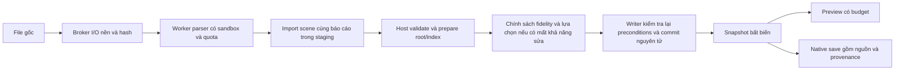

# Kế hoạch CDR/AI/EPS/SVG/PDF: ổn định, fidelity và khả năng chỉnh sửa

Ngày: 2026-10-16. Trạng thái: **đặc tả đề xuất; chưa triển khai trong task này**.
Task: import-resilience-plan-20261016. Baseline: ed5bd9c4f0dcb9b8c8bef749863e052c3d299419.
Quyết định kiến trúc: [ADR 0006](../decisions/0006-format-import-resilience.md).

## 1. Kết quả cần đạt và giới hạn cam kết

File lỗi phải kết thúc bằng lỗi có kiểm soát; file vượt năng lực phải báo giới hạn.
Job import hỏng không làm thay đổi tài liệu đang mở. File đã nhận phải có báo cáo đủ để
người thiết kế biết phần nào sửa được, phần nào chỉ xem được và phần nào không đủ dùng sản xuất.

Không có cơ sở kỹ thuật để hứa mọi file độc quyền mở đúng 100%, giữ mọi hiệu ứng/layer và
không bao giờ crash. Mục tiêu phát hành là **không mất dữ liệu âm thầm trong phạm vi công bố**,
có fault evidence và recovery policy. Lỗi kernel, hết RAM toàn hệ thống, lỗi host hoặc driver
cùng process cần phạm vi xử lý riêng theo [ADR 0002](../decisions/0002-runtime-and-hardware.md).

Mỗi format/version/feature có năm kết quả độc lập: hiển thị, chỉnh sửa, metadata nguồn,
đường sản xuất và export/reopen đích. Không lấy preview đúng làm chứng cứ cho các kết quả còn lại.

## 2. Những gì code nền thực sự cho thấy

Đây là khảo sát tĩnh trên commit nền, không phải một lần nghiệm thu runtime mới. Main đang có
local edits và dữ liệu riêng; task chỉ tạo hai tài liệu trong worktree riêng.

| Bằng chứng tại baseline | Hệ quả cho kế hoạch |
| --- | --- |
| [START](../START.md) còn ghi foundation, [project state](../project-state.json) ghi M1 complete nhưng còn các limitations cũ | Cần task coordinator chỉnh trạng thái theo revision tích hợp; không dùng nhãn milestone làm evidence |
| [SVG importer](../../modules/interop/src/adapters/svg_importer.cpp) dùng regex, xử lý subset rect/path/text; đường đọc file gom vào string | Chưa thể claim XML/SVG tổng quát, arc đầy đủ, layer/group/style/units đúng hoặc bounded import file lớn |
| Importer báo filter/mask/clip/script unsupported nhưng vẫn có thể success; [workflow](../../apps/desktop/src/workflows/document_workflow.cpp) chỉ xét success/objects rồi AddObject từng đối tượng | Cần chính sách loss bắt buộc và một transaction import; hiện chưa chứng minh all-or-nothing, hierarchy hoặc giữ report |
| [FormatCapabilities](../../modules/interop/include/pikdraw/interop/capabilities/format_capabilities.hpp) có SVG/PNG/JPEG import và SVG/PDF/PNG export, nhưng [registry khác](../../modules/interop/src/format_capability_matrix.cpp) từ chối mọi format | Có hai nguồn capability trái nhau; declaration PNG/JPEG/PDF không chứng minh adapter hoặc luồng UI đã chạy |
| [Worker](../../platform/workers/src/worker_main.cpp) trả unsupported cho ImportRequest | Hạ tầng IPC/canary chưa phải CDR/AI/EPS converter; SVG workflow hiện gọi importer trực tiếp |
| [C6](../../contracts/c6-workers.md) ghi PKWP/64 MB/CRC32/512 MB; [DTO](../../modules/interop/include/pikdraw/interop/ipc_dto.hpp) dùng PIKC/v1/16 MiB, raw bytes và 100.000 objects/depth 64; [JobLimitsConfig](../../platform/workers/include/pikdraw/workers/job_object.hpp) mặc định 256 MiB | Phải hòa giải contract/runtime trong task được scope riêng trước nâng cấp protocol/quota |
| [Job Object implementation](../../platform/workers/src/job_object.cpp) đặt memory/process/kill-on-close; không đặt CPU hard cap tại đây | Below-normal priority và CPU hard cap cần implementation/evidence riêng; chưa được claim từ tên cpu_rate_control trong C6 |

Không mở corpus riêng trong thư mục cdr của main, không đưa file khách hàng vào Git/context.

## 3. Chọn công nghệ theo định dạng

| Đầu vào | Hướng chọn cho spike triển khai | Khả năng được phép công bố sau khi pass |
| --- | --- | --- |
| SVG | libxml2 đọc XML trong worker; PikDraw xử lý cây SVG, CSS subset và units theo spec | Từng feature đã kiểm chứng; script/animation/foreign content có policy rõ |
| PDF | PDFium trong worker, build tắt V8/JavaScript và XFA; không chạy document actions | Preview và editable subset theo API/fixtures; source print semantics cần gate riêng |
| AI có PDF | Kiểm tra có PDF representation hợp lệ rồi đi adapter PDF | “AI qua biểu diễn PDF”; không nhận toàn bộ dữ liệu Illustrator authoring |
| CDR | libcdr + librevenge; nhận drawing callbacks trực tiếp vào import scene | Version/feature whitelist theo corpus; CDR mới không tự động coi như version cũ |
| EPS/PostScript | Worker Ghostscript chuyển sang PDF, rồi host chạy worker PDFium ở bước tiếp theo | Converted representation có loss report; layers/parametric effects chưa được bảo đảm |
| AI không có PDF | Nhận diện PostScript legacy nếu phù hợp rồi đi nhánh EPS đã đạt gate; loại khác unsupported | Nghiên cứu có phân loại; không thử mù mọi converter |
| PNG/JPEG và ảnh nhúng | Decoder trong worker với pixel/decompression/orientation/ICC limits | Asset raster với metadata; không nhận là vector chỉnh sửa được |

Đây là lựa chọn hướng khảo sát, chưa phải dependency được duyệt để phân phối. Trước build
phải pin tag/commit, checksum, compiler/options, transitive dependencies và license inventory.
Repo đang có LICENSE Apache-2.0; giấy phép dependency cần đánh giá riêng, không đổi license repo
để lách gate. EPS tiếp tục disabled khi chưa giải quyết nhánh AGPL/commercial của Ghostscript.

Với libxml2: từ chối DTD/external entities, XInclude, catalog và resource loader ngoài broker;
không bật entity substitution, recovery hoặc huge/unlimited mode để cứu file. Chọn build có
controls phù hợp và kiểm bằng XXE/entity-expansion fixtures; network flag của XML library
không thay sandbox OS. SVG use/CSS/resource references cần cycle/count/depth limits riêng.

Không dùng SVG/PDF làm trung gian bắt buộc cho mọi format. Chuyển CDR qua SVG có thể bỏ
metadata trước khi host biết; callback trực tiếp cũng chỉ giữ được dữ liệu reader thực sự phát ra.
Nếu API thiếu source colors/layers/effects, coverage phải là unknown hoặc reference-only.

PDFium là lựa chọn đầu tiên vì có API object/render công khai và đã nằm trong candidates của
repo. Cần spike để xác định build size, font/ICC exposure, clip/group/OCG extraction và precision.
FPDFPathSegment_GetPoint trả float: ghi độ chính xác adapter thực tế, đo sau transform/units;
cast sang binary64 không đủ để nhận là source-quality. Nếu public API không đáp ứng, giữ bản
PDF reference và mở task extractor/engine khác; chưa khóa dependency đó cho đường CNC/in màu.

## 4. Pipeline mở file

Điều phối đặt ở application/composition của desktop, ngoài view; interop giữ adapter/mapping
và DTO, workers giữ process/IPC. Theo registry hiện tại: workers → interop → document; không
thêm interop → workers hoặc document → interop. Model/provenance/transaction trung lập thuộc
document/contracts, không chứa type parser/PDFium/Qt/Skia. Reader callback được adapter chuyển
thành proposal phù hợp; core/document không gọi converter hoặc giải mã file bên thứ ba.

1. UI tạo job với document ID/epoch/base revision/job ID/generation và policy. I/O, hash và
   nhận diện nội dung thực hiện ngoài UI. Không load DLL parser/font/image từ file nguồn vào editor.
2. Broker lấy bản sao nguồn bất biến hoặc handle chỉ đọc cho đúng nguồn, có size/hash và quota
   disk. Kiểm tra race thay file; UNC/removable storage cần I/O có deadline riêng. File staging
   có tên/ACL do host tạo, không lấy đường dẫn ghi từ payload. Bản nguồn phải hoàn tất trước commit.
3. Worker chỉ nhận handle/blob đã cấp, không có quyền đọc cả thư mục người dùng; mạng tắt,
   không spawn child, inherited handles allowlist. Linked asset/font/profile được broker cấp riêng
   sau lựa chọn hợp lệ; không tự fetch URL, chạy macro/script hoặc gọi ứng dụng cài trên máy.
4. Worker tạo import scene cùng report. Host xử lý như dữ liệu không tin cậy: version, bytes,
   count, checked arithmetic, depth, finite/range, reference cycles, hierarchy, geometry và assets.
   Validation/prepare nặng chạy nền có quota; document IDs được writer cấp hoặc xác thực, không
   nhận ID worker như quyền sửa object hiện có. Ánh xạ source ID → native ID ổn định được lưu.
5. Preview có thể đến sớm và ghi rõ tạm thời; nó thuộc staging, không trở thành document từng phần.
   Nếu có loss/unknown coverage, hiển thị lựa chọn cụ thể trước commit. User tiếp tục sửa tài liệu
   trong thời gian đó sẽ làm base revision cũ; writer phải từ chối proposal và báo chạy lại.
6. Writer kiểm tra lại tất cả preconditions tại commit, công bố root/index/assets/report cùng revision
   và một undo unit. Cancel/timeout/worker crash/close/undo/job replacement làm proposal cũ vô hiệu.
   Không merge ngầm bằng read-set hoặc bỏ qua strict revision khi contract chưa hỗ trợ.
7. Mở file thành tài liệu mới dùng epoch riêng và chỉ thay trạng thái cửa sổ sau staging thành công;
   xử lý tài liệu dirty theo workflow hiện có. Import vào tài liệu hiện hữu là một atomic command.
   Dọn root/assets lớn và worker handles ngoài critical path, vẫn giữ assets được undo/snapshot tham chiếu.

### Truyền dữ liệu lớn

Protocol v1 hiện chứa raw_input_bytes và response nguyên khối, giới hạn payload 16 MiB. Không
nâng trần lên hàng GB để hỗ trợ file nặng. Task contracts/workers thiết kế wire version mới có
negotiation cho read-only source handles hoặc chunks có backpressure; tổng bytes/count vẫn có trần.
Assets lớn dùng blob/handle định danh và host validate hash/size; không truyền pointer native hoặc
renderer types. File/blob đã parse vẫn không được main nạp thành allocation không giới hạn.

Chunk có sequence/offset/hash/manifest tổng và trạng thái hoàn tất. Thiếu/reorder/trùng/corrupt/
late chunk không được công bố document. Staging có lifetime và cleanup khi worker/host bị kill.
Giữ compatibility/fail-closed khi host và worker khác version; bảo vệ fixtures C6 khỏi task adapter.

## 5. Giữ hiệu ứng, đối tượng và layer

| Trạng thái từng phần | Hành vi |
| --- | --- |
| EditableVerified | Geometry/text/style/hierarchy đã map và kiểm chứng; sửa bằng model PikDraw |
| ReferenceVerified | Nguồn và diện mạo đã kiểm chứng; group chỉ đọc, báo rõ giới hạn chỉnh sửa |
| ConvertedWithLoss | User chọn outline/expand/raster conversion; giữ nguồn và report về lựa chọn |
| Unknown hoặc Unsupported | Chặn strict import; chỉ mở bản tham chiếu nếu có renderer/asset thực sự phù hợp |

Các tên trên là semantics đề xuất cho contract mới, chưa phải enum/API đang tồn tại.
Mặc định strict đối với mất dữ liệu; report rỗng của parser chưa chứng minh coverage đầy đủ.
Nếu không có renderer hiểu hiệu ứng độc quyền và không có preview nguồn đáng tin, phải báo
không tái hiện được. Không tự tạo ảnh phỏng đoán rồi ghi ReferenceVerified.

- Curves: giữ subpaths, verbs/control points, arc parameters khi có, closure, holes/fill rule và
  local transforms. Chuyển arc→cubic, expand stroke, weld/simplify/repair đều cần policy và sai số
  riêng. Kiểm tra parser boundary, transform order/reflection, units/viewBox/UserUnit/Rotate/page boxes.
- Layer/group: giữ IDs/names/hierarchy/order/visibility/lock và page ownership nếu nguồn có.
  SVG group không tự đồng nghĩa layer; PDF OCG không tự đồng nghĩa layer tác giả. Layer được tạo
  bởi PikDraw phải ghi là layer tổng hợp. Nếu representation không chứa layer gốc, báo không có dữ liệu.
- Hiệu ứng: mô hình group/clip/mask/isolation/blend/opacity theo dependency. Cache render có bounds
  mở rộng cho filter và vùng halo giữa tiles. Khi effect phụ thuộc backdrop, tham chiếu cả compositing
  group hoặc trang cần thiết; không ghép ảnh từng object rồi làm sai kết quả. Tránh vẽ đúp editable
  objects và ảnh fallback của chính chúng. Chưa tái tạo đúng thì group chỉ đọc hoặc chặn import.
- Text: giữ Unicode gốc, font identity/version, shaping/layout runs và vị trí khi đọc được. Không
  đoán lại tiếng Việt từ glyph outlines. Thiếu font hoặc font subset không đủ sửa cần báo và giữ
  diện mạo nguồn nếu có. Outline/substitute/reflow là chuyển đổi có lựa chọn; lưu dữ liệu chữ ban đầu.
- Màu: lưu RGB/CMYK/spot tên+tint, ICC bytes/hash, rendering intent, overprint và blend space nếu
  có. RGBA preview không thay source color. API chỉ trả RGB thì capability source-print còn thiếu.
- Ảnh: giữ bytes/profile/orientation/crop/link provenance; giải mã có max pixels/bytes/frames và
  limits decompression ratio. Caches chỉ là dẫn xuất; bản nhúng không bị downsample âm thầm khi save.

Bản nguồn bất biến, source locator (page/object/chunk khi biết), parser fingerprint, units/precision,
feature flags, source→native ID map và loss report được lưu cùng .pikdraw. Nếu không thể ánh xạ
đúng phần tử, giữ tham chiếu toàn trang/file; không tuyên bố đã tách riêng effect. Chỉnh sửa khiến
preview cũ hết hạn phải invalidation rõ; không xuất ảnh cache cũ như kết quả hiện tại.

Save native phải mở lại mà không cần file gốc ở đường dẫn cũ và không tự chạy parser ngoài
sandbox. Link-only chỉ là lựa chọn rõ với cảnh báo phụ thuộc. Dữ liệu nguồn/font/assets có quyền
hạn riêng; checksum không thay quyền nhúng hoặc kiểm chứng ngữ nghĩa.

Đường cut/engrave chỉ dùng geometry được kiểm chứng theo physical tolerance. Reference/raster,
unknown curves hoặc layer không xác định không được tự trace thành đường máy chạy. In/proof
phải có gate CMYK/spot/overprint riêng; preview giống nhau chưa chứng minh separations đúng.

## 6. Chống treo và ngân sách tài nguyên

| Phạm vi | Chính sách đề xuất cần đo |
| --- | --- |
| Worker | Một job/source mỗi instance; sandbox fail thì từ chối chạy; process limit 1, kill-on-close |
| Memory | Đối chiếu code 256 MiB và contract 512 MiB; khảo sát hai cấu hình này sau scoped review; không tự nâng khi OOM |
| CPU | Below-normal priority và OS hard cap là hai cơ chế riêng; thêm hard cap có probe và đo với software renderer |
| Time | Preview 5 s/import 30 s là profile khảo sát; deadline monotonic tuyệt đối gồm pipe I/O; heartbeat không kéo dài |
| Host | Admission control tính staging+decoded assets+index+undo+caches+workers; reserve bộ nhớ và CPU cho UI/save |
| Queue | Khởi đầu một import hoạt động, hàng đợi bounded count/bytes; không khởi chạy nhiều parser theo số file thả vào |
| Disk/IPC | Trần source/spool/temp tổng, count/depth/segments/glyphs/pixels, open handles và wall time cho từng bước |
| Retry | Không tự parse lại cùng file gây crash; dọn instance, báo lỗi, cho thử job mới có giới hạn khi user chọn |

Các giá trị còn thiếu là đầu ra của spike, không default “unlimited”. Cấu hình được chọn phải
version hóa trong report. File vượt giới hạn kết thúc có diagnostic quota/khả năng xem hoặc chọn
trang cụ thể. Thay deadline/quota cần check host cap (launcher hiện từ chối timeout trên một phút),
contract review nếu đổi semantics và chạy lại evidence; không thêm ngoại lệ bypass sandbox.

Job memory limits giới hạn virtual memory commit; không chứng minh working set hoặc RAM toàn
hệ thống luôn an toàn. Khi allocation thất bại/vi phạm limit, host cần xử lý job failure và terminate
theo policy; không giả Windows luôn tự kill mọi trường hợp OOM. Dừng/kill worker và drain pipe
phải hữu hạn, kể cả worker không đọc stdin hoặc liên tục ghi stdout/log.

UI không thực hiện parse/decode/validation/index rebuild/cleanup O(n), không WaitForSingleObject
chờ worker trong event callback. Callback commit chỉ publish dữ liệu đã chuẩn bị khi preconditions
còn đúng. Renderer không tessellate toàn graph mỗi frame; progressive preview ưu tiên vùng nhìn
thấy với max tile pixels/effect intermediates và cache bytes. Không đổi source để giảm chất lượng.

Crash parser không bao phủ crash trong host validator, native font decoder hoặc renderer. Cần audit
đường decode và nhập scene, fuzz có giới hạn và tách thêm process nếu spike chứng minh cần thiết.
GPU fatal crash/hang vẫn theo ADR 0002; recovery checkpoint phải báo tuổi bản lưu/thay đổi có thể mất.

## 7. Bộ chứng cứ trước khi công bố hỗ trợ

Gates bên dưới là đề xuất để task gate owner triển khai; task tài liệu không tự nhận pass.
Mỗi fixture ghi quyền sử dụng, hash, application/version xuất nguồn, settings, fonts/profiles,
expected hierarchy/geometry, ảnh chuẩn và expected diagnostics. Dùng file synthetic/redistributable;
bộ khách hàng chỉ chạy cục bộ theo quyền được cấp, không commit hay upload.

| Gate | Bộ trường hợp và điều kiện nhận |
| --- | --- |
| IR-G1: format truth | AI bật/tắt PDF compatibility; CDR phiên bản chọn; EPS text/binary preview; SVG namespaces/CSS/use; chữ ký giả và encrypted/password/error đúng classification |
| IR-G2: geometry/structure | mm/inch/px, 20 m và tọa độ xa, reflection/nonuniform transform, curves/arcs/holes/open contours, near-degenerate; hierarchy/order/lock/visibility/IDs không đổi ngoài mapping khai báo |
| IR-G3: appearance/text/color | Gradient/mesh, lens/shadow/transparency/blend/clip/PowerClip theo format; Vietnamese NFC/NFD, missing/subset fonts; CMYK/ICC/spot/overprint; diff đa zoom/DPI và oracle từ app nguồn/RIP phù hợp |
| IR-G4: transaction | Cancel/timeout/crash/quota/malformed/stale/chunk thiếu tại từng stage giữ hash/revision/history của document trước import; import thành công chỉ một undo unit, undo/redo đúng assets/report |
| IR-G5: native round trip | Import → sửa đại diện → undo/redo → save → di chuyển/xóa link nguồn thử nghiệm → reopen → export đích → reopen; giữ bytes nguồn/hash, IDs, text/color/layers và trạng thái references |
| IR-G6: containment | Positive controls + explicit OS denials: ngoài quyền file read/write/network/handles/child; payload overflow/nonfinite/deep/cyclic/decompression bombs và stdout flood; không tin canary timeout là denial |
| IR-G7: responsiveness | Máy 8 GB iGPU Intel/AMD và máy GPU riêng, forced software; input→visible latency, present intervals, longest UI stall, cancel/kill time, tổng private/commit/working set/temp/handles |
| IR-G8: endurance/recovery | Batch success/failure/cancel và phiên 8 giờ; kill app/save faults theo storage policy; worker/temp/handle/cache không tăng không giới hạn, checkpoint mở được và cửa sổ mất dữ liệu được báo |

Các dung sai cần khóa **trước** benchmark/fixtures oracle trong task contracts/gates riêng.
Khảo sát 0,01 mm cho tổng sai số đường sản xuất, không phải một cam kết CNC chung; phải phân
bổ parser + units/transform + approximation + export và kiểm topology riêng. Thay số phải review.

Target khảo sát cho máy tham chiếu: input→visible p95 ≤50 ms, longest UI stall <200 ms trong
trace import định trước; cancel→job terminated ≤1 s; thời gian parse được ghi từng file thay vì
đòi mọi file xong trong 30 s. Đo ít nhất ba run, công bố p50/p95/p99/max và failures. CPU/GPU
preview có budgets riêng; 60 FPS không là cam kết vô điều kiện. Các target này chưa đo và phải
được gate owner duyệt trước dùng làm điều kiện phát hành.

Reference render phải độc lập với adapter đang kiểm tra: cùng một parser render hai đầu không
chứng minh đã đọc đúng. Fixture có exact source geometry dùng semantic oracle; effect độc quyền
cần reference từ phần mềm nguồn hợp lệ. Nhánh không có oracle giữ research/unknown.

Release receipt lưu SHA tích hợp, dependency lock/license, wire/schema versions, build flags,
fixture hashes, máy/driver/DPI, raw reports, coverage matrix và known limits. Tất cả pass thuộc
đúng revision đã tích hợp; feature task không sửa oracle/gates để hợp thức hóa output của mình.

## 8. Các task tiếp theo và dependencies

Đây là backlog đề xuất, chưa tạo lease hoặc kích hoạt implementation. Coordinator chia lại exact
paths khi dispatch. Không claim cả module nếu trùng lease D03/document đang chạy. Không triển
khai model editable path trùng với drawing contracts; pin revision đã được nghiệm thu trước.

| Task đề xuất | Deliverable và owned paths dự kiến | Prerequisites / điều kiện bàn giao |
| --- | --- | --- |
| IR00 Audit baseline | docs/reports/import-baseline/; task coordinator riêng cho START/project-state | Review static findings ở mục 2 trên revision code mới nhất; không sửa code feature |
| IR01 Contracts | contracts/ và ADR scoped; vectors do gate owner sở hữu | Chốt import scene/fidelity/provenance/group semantics/units/precision và hòa giải C6; consumer review; pin drawing path contracts/D03 khi dùng |
| IR02 Dependency lock | dependency manifest + worker build integration trong task build riêng | Pin PDFium/libxml2/libcdr/librevenge; kiểm build options/transitive licenses/security update policy; EPS gate độc lập |
| IR03 Worker transport | platform/workers/ và IPC paths thuộc interop được lease chính xác | IR01/02; broker source/chunks/backpressure/deadlines/quotas/deny canaries, không sửa contracts từ task này |
| IR04 Document model | core/document/ import scene/transaction/reference/provenance | IR01 + baseline D03 được review; giữ writer/snapshot/undo và group semantics; không chồng task document hiện hành |
| IR05 Storage | Native asset/report codecs trong task storage riêng | IR04; schema version/migration/limits/atomic save; save/reopen giữ nguồn khi link cũ không còn |
| IR06 SVG adapter | modules/interop/ SVG parser/semantic mapping/capability paths cụ thể | IR02/03/04/05; bỏ regex tổng quát, units/styles/tree đúng; IR-G1…G6 cho subset |
| IR07 PDF/AI adapter | modules/interop/ PDF + AI routing paths cụ thể | IR02/03/04/05; chứng minh API precision/text/color/OCG; tách reference và editable capability |
| IR08 CDR spike | modules/interop/ CDR adapter paths cụ thể và evidence nhỏ | IR02/03/04/05; phiên bản/feature corpus; callbacks/loss detection; chỉ release phần đạt gate |
| IR09 EPS spike | Worker GS adapter paths cụ thể, EPS routing và reports | IR07 + giấy phép phân phối được nhận; GS SAFER + OS sandbox, hai bước do host điều phối; converted-only |
| IR10 Preview/UI | Rendering group/effect paths trong task rendering; desktop workflow trong task khác | IR04/05 và từng adapter; progress/cancel/report, strict policy/reference UI, một transaction và budget measured |
| IR11 Gates/release | tests/fixtures chuẩn + tooling gates trong task độc lập; coordinator integration | Mỗi adapter + UI hoàn tất; independent review, IR-G1…G8 trên merged SHA; công bố matrix/limits theo evidence |

Thứ tự giao hàng: đóng baseline/contracts/dependencies → transport/model/storage → SVG hoàn chỉnh
cho subset → PDF/AI qua PDF → CDR theo corpus → EPS sau license/containment. Mỗi đợt đi qua UI
và gates tương ứng trước công bố. Không đợi mọi format xong để phát hành subset đã kiểm chứng,
không dùng thời gian sprint làm bằng chứng feature hoàn tất.

Các task có thể nối tiếp hoặc chạy với paths/contract vectors tách biệt sau dispatch; tài liệu
này không tự gọi agent hoặc cho phép ghi ngoài lease. Contract/build registrations/shared gates
có task riêng. Integrator cập nhật project state khi thực sự tích hợp và nghiệm thu.

## 9. Nguồn tham chiếu và việc còn mở

Các nguồn upstream sau đã được đối chiếu ngày 2026-10-16:

- [Adobe: Save artwork](https://helpx.adobe.com/illustrator/using/saving-artwork.html): tùy chọn PDF representation và dữ liệu chỉnh sửa Illustrator.
- [SVG document structure](https://www.w3.org/TR/SVG2/struct.html) và [libxml2 options](https://gnome.pages.gitlab.gnome.org/libxml2/html/parser_8h.html): cây/namespaces và controls cho DTD/entities. libxml2 là XML toolkit; adapter vẫn phải làm SVG semantics.
- [PDFium API](https://pdfium.googlesource.com/pdfium/+/refs/heads/main/public/fpdf_edit.h), [build](https://pdfium.googlesource.com/pdfium/+/refs/heads/main/BUILD.gn) và [license](https://pdfium.googlesource.com/pdfium/+/refs/heads/main/LICENSE): dùng public API và audit dependencies của commit đã chọn.
- [libcdr upstream](https://cgit.freedesktop.org/libreoffice/libcdr/): candidate đã có trong repo. Trang mã nguồn chi tiết không truy cập được trong phiên tra cứu; chưa chốt version coverage/license của bản sẽ build, IR02 phải lấy và audit artifact thực tế.
- [Ghostscript devices](https://ghostscript.readthedocs.io/en/latest/VectorDevices.html), [SAFER](https://ghostscript.readthedocs.io/en/latest/Use.html#dsafer), [Artifex licensing](https://artifex.com/licensing): conversion có giới hạn và giấy phép cần quyết định.
- [Microsoft Job limits](https://learn.microsoft.com/en-us/windows/win32/api/winnt/ns-winnt-jobobject_extended_limit_information): giới hạn memory commit, tách khỏi ngân sách tổng host.
- Nội bộ: [runtime](../architecture/document-runtime.md), [Spike C](foundation-spikes.md), [quality gates](../quality/gates.md), [interop instructions](../../modules/interop/AGENTS.md) và [worker instructions](../../platform/workers/AGENTS.md).

Việc còn mở có owner và gate: IR02 chốt artifact/license, IR01 chốt schemas/semantics; IR07 quyết
định PDFium đủ điều kiện editable/production nào; IR08 chọn CDR versions từ corpus hợp lệ;
IR03/IR11 đo budgets và containment; IR10/IR11 đo renderer/UI; integrator đối chiếu baseline D03
và cập nhật trạng thái. Không có phiên bản thư viện hoặc số benchmark nào được giả là đã pin/pass.
