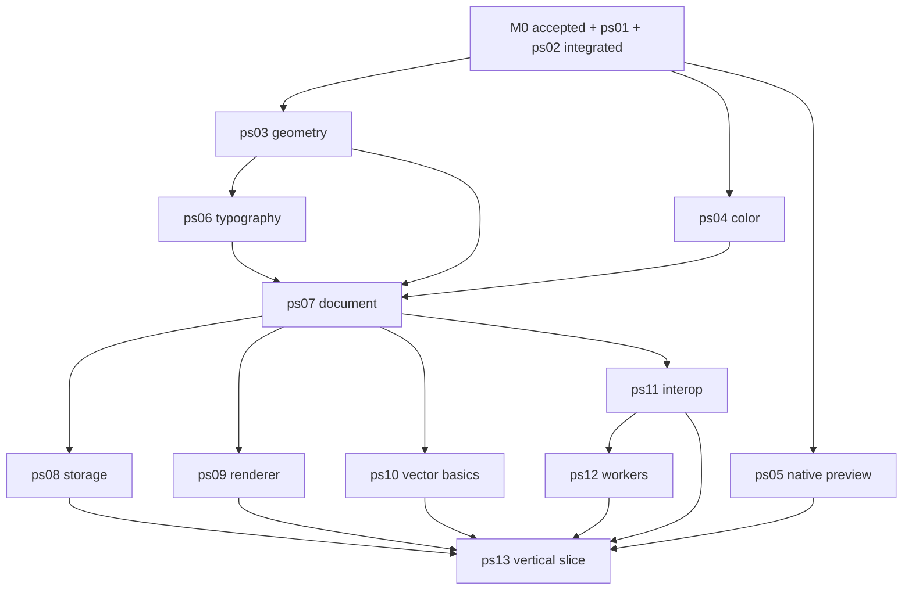

# Kế hoạch M1: editor native dùng được từ đầu đến cuối

Ngày: 2026-10-15. Trạng thái: **đặc tả chờ M0 được nghiệm thu; chưa dispatch implementation M1**. [PS00 hiện tại](../reports/foundation/ps00-acceptance-20261015.md) còn A/B partial, C fail. Tên file/API bên dưới mô tả baseline C++20/Qt/Skia; nếu M0 chọn stack khác, coordinator cập nhật mapping trước khi giao việc.

Nguồn chuẩn: [catalog cha ps03–ps13](post-spike-tasks.json) giữ ID/dependencies/owned paths; [24 checkpoint](m1-task-packages.json) mô tả việc thực hiện bên trong task; [tổ chức code](../development/code-organization.md) quy định trách nhiệm và số dòng. JSON checkpoints là kế hoạch, chưa có scheduler tự gọi agent.

## 1. Kết quả M1 và điều kiện vào

Một app native thực sự làm được: new/import subset → vẽ/sửa shape và chữ tiếng Việt → undo/redo → save native → reopen/recovery → export output đã nhận. Bốn workspace có thể hiện tab, nhưng chỉ Vector có workflow M1; Production/3D chưa có service phải thể hiện capability đúng. M2 tiếp tục node editing nâng cao, raster tools, UX đầy đủ, soak và packaging.

M0 ở đây gồm **ps00 + ps01 + ps02 đã review và tích hợp**, không chỉ ba agent báo xong spike. Coordinator phải kiểm trước dispatch:

| Đầu vào bắt buộc | Điều kiện nhận |
| --- | --- |
| `m0_integrated_sha` | Exact commit chứa code được nhận; reviewer khác người viết, actual exit codes/test counts/artifact hashes và giới hạn rõ |
| Foundation | Các gate bắt buộc A/B/C đều accepted; partial/not_measured/fail vẫn chặn |
| C1–C7 | Version/semantic vectors/oracles và consumer review, đơn vị, axes, revision/epoch/generation, lifetime/errors/limits đã khóa |
| Build | ps02 fresh/incremental build và native checks chạy thật; missing required targets/tests fail; dependencies/license pins và parser host-link scan |
| Quality | Corpus rights/checksums, hardware/memory/latency/durability budgets, format subset và output oracle cụ thể; file-layout checker ps02 chạy thật cùng review trách nhiệm/API |
| Board | Prepared worktrees cũ được đồng bộ an toàn; không lease chồng; localization chưa commit được giữ; mỗi task base có dependencies đã tích hợp |

Không hard-code SHA draft hiện tại vào task M1 tương lai. Khi dispatch, pin SHA M0 mới và từng prerequisite; một task cần nhiều branch phải nhận commit đã tích hợp tất cả, không build bằng local uncommitted code của lane khác.

Nếu Gemini đang làm M0 theo packet cũ, coordinator đối chiếu bổ sung ps01/ps02 trong catalog này trước khi nhận M0, đặc biệt file map/formatter/code-layout checker. Catalog mới không tự mở rộng lease đang chạy: giao task bổ sung có scope hoặc điều chỉnh assignment sau khi task đã dừng theo protocol. Task M0 đã done cần task follow-up rõ ràng, không sửa lịch sử để giả như requirement mới đã qua.

## 2. Phạm vi sản phẩm

| Có trong M1 | Giới hạn |
| --- | --- |
| Page/layer/group cơ bản, paths/shape/text/image references | Giữ stable IDs, units, source curves/fonts/color/assets; chưa cần toàn bộ UI layers chuyên sâu |
| Select, rectangle/ellipse/path cơ bản, move/scale/rotate, fill/stroke/delete, text create/edit | Gesture preview tạm, release một transaction, Escape hủy; pen/node/snap nâng cao thuộc M2 |
| Native save/reopen/recovery | Format/version/durability theo M0; không lấy bytes prototype B làm format mặc định |
| Import được nhận từ C và một output đã kiểm | SVG subset là ứng viên mặc định nếu M0 nhận; CDR/non-PDF AI hoặc effects ngoài scope báo unsupported có provenance |
| Viewport GPU/software, text/image preview | Theo backend/budget M0; preview không đổi nguồn; không tự nhận print proof/PDF-X |
| Worker thật và progress/cancel/error | Host-enforced permissions/quotas; font/asset không tin cậy chỉ qua capability được nhận |

Không lấy mock, PNG screenshot, offscreen submission FPS hay subset protocol để đóng M1. UI form/QSS có thể reload trong dev; sửa C++ vẫn incremental build.

## 3. Đồ thị thực hiện và số agent

Mặc định leader giữ review/integration, tối đa ba implementer. Provider chỉ là metadata; không phụ thuộc một model cố định.

| Lúc ready | Ưu tiên dispatch | Reviewer cần |
| --- | --- | --- |
| M0 xong | ps03 + ps04 + ps05 song song | geometry, color, desktop |
| ps03 đã tích hợp | ps06 ngay; không chờ task UI không liên quan | typography/geometry |
| ps03/04/06 đã tích hợp | ps07 | document/concurrency |
| ps07 đã tích hợp | ps11 trước để mở chuỗi worker; ps08 + ps09 ở hai slot còn lại | interop/license, storage, graphics |
| Một slot trống | ps10; ps12 ngay khi ps11 đã tích hợp | vector, containment |
| Đủ prerequisites ps13 | ps13 duy nhất giữ desktop và E2E scope | reviewer tích hợp độc lập |

Đây là ưu tiên hàng đợi, không barrier cứng theo đợt. Task ready được chạy ngay khi có slot và reviewer. Với hai implementer, giữ nguyên dependencies và ưu tiên chuỗi interop → worker cùng storage/renderer; không giảm gate để tăng concurrency.

## 4. Lease, checkpoint và build integration

Mỗi parent task lấy lease module theo catalog, làm checkpoint trong JSON **nối tiếp dưới cùng owner/worktree**. 24 checkpoint không phải 24 task tự được claim. Không giữ lease parent toàn module rồi cho agent khác claim child path bên trong.

Nếu leader cần hai agent trong cùng module: dừng/release parent theo protocol, chốt APIs trước, tạo các task thật với paths disjoint và task tích hợp module riêng sở hữu CMake/README. Không chia bằng line ranges trong cùng file. Mỗi runtime feature chỉ sửa đúng module; shared contracts/registry/root build/gates thuộc task khác.

Module owner đăng ký local CMake/tests/README trong scope của mình. Root build ps02 dùng cơ chế module registration đã khóa. Nếu cần sửa root hoặc contract, mở task scope riêng rồi mới tiếp tục consumer. Không tạo target rỗng cho raster/production/3D/plugin-sdk vì registry cho phép dependency; chỉ link target thật cần cho M1. Nếu workers thật sự cần plugin-sdk runtime API chưa có, coordinator giao prerequisite riêng trước ps12.

Mỗi checkpoint có commit review được và test oracle thật. Parent chỉ handoff khi tất cả checkpoint đạt. Reviewer kiểm code và rerun từ checkout sạch; leader tích hợp rồi chạy consumer tests trên merged SHA trước đánh parent done.

## 5. File map và việc làm theo task

Quy ước: mọi nhóm có public API nhỏ tại `include/pikdraw/<module>/<feature>/`, implementation `src/<feature>/`, tests `tests/<feature>/`. Tên cụ thể được đối chiếu C1–C7 từ M0; không tạo file rỗng cho đủ sơ đồ. Trần thông thường: header 300, implementation/test 500 dòng không rỗng; chi tiết trong policy.

### ps03-geometry

- `m1-03a-primitives`: tách `point.hpp`, `transform.hpp`, `bounds.hpp`, source path/curve và validation. Khóa mm/binary64, composition/reflection/range/error semantics; giữ path source khác approximation.
- `m1-03b-operations`: `src/flattening/`, `src/operations/boolean.cpp`, `offset.cpp`; chỉ subset M0 đã nhận. Tách approximation/quantization/algorithm budgets và topology diagnostics.
- Nghiệm thu: 20 m/xa gốc/fine detail, inverse/nonuniform/reflection, degenerate/nonfinite, holes/near-contact trong supported subset; unsupported có error. Consumer C1 và microbench đúng corpus; oracle không sinh từ engine đang kiểm.

### ps04-color

- `m1-04a-source-color`: `values/`, `profiles/` giữ source RGB/CMYK/spot/tint/ICC/overprint, profile identity và provenance.
- `m1-04b-preview-color`: `preview/` tách transform/cache/profile diagnostics; không gộp mọi màu vào một `color.cpp`.
- Nghiệm thu: copy/source preservation, swatches/profiles pin, invalid/missing profile có trạng thái, profile change invalidation. Preview RGBA không thay source hoặc bị nhận làm print proof.

### ps05-native-preview

- `m1-05a-shell`: `src/shell/`, `src/actions/`, `src/presenters/`, `ui/panels/`, `themes/`; `main.cpp` chỉ bootstrap. Menu/dock/workspace/status/forms chạy Qt thật, presenters mock ghi nhãn dev.
- `m1-05b-ui-reload`: `src/development/ui_reload_controller.cpp`, form validation/factory allowlist/state restore; source `.ui` chia panel, QSS chia tokens/base/components.
- Nghiệm thu: 1366×768/1080p, DPI 100/150/200%, focus/keyboard và text Việt dài; 50 reload không tích lũy widgets/handlers, form lỗi rollback, drag/IME reload policy rõ. Không recreate viewport/document khi đổi panel.

### ps06-typography

- `m1-06a-shaping`: `fonts/`, `shaping/`; font identity/resolver/backend được M0 chọn, chỉ system/font fixture tin cậy trong host.
- `m1-06b-layout`: `layout/`, `editing/`, `outlines/`; map Unicode/grapheme/cluster/caret, line layout và glyph outlines dẫn xuất. Không normalize âm thầm source text.
- Nghiệm thu: Việt NFC/NFD/combining marks, clusters/line breaks/missing font diagnostics và oracle pin font. Font nhúng chưa có worker capability hợp lệ giữ source và báo unsupported.

### ps07-document

- `m1-07a-model-writer`: `model/`, `commands/` với page/layer/group/path/text/image reference, IDs và transaction writer; command failure atomic từ checkpoint đầu.
- `m1-07b-snapshots-history`: `snapshots/`, `index/`, `history/`; immutable root/index cùng revision, structural sharing, history budgets/cleanup.
- `m1-07c-async-lifetime`: `async/` tách proposal validation, job generation và epoch; camera/selection thuộc view state, không tăng document revision.
- Nghiệm thu: 10.000 commands replay theo oracle, undo/redo tăng revision và giữ metadata/hierarchy, từ chối dangling IDs/group cycles, alias không mutate snapshot, stale sau edit/delete/undo/redo/cancel/replacement/close-reopen đều bị từ chối; memory/commit/cleanup theo budget M0.

### ps08-storage

- `m1-08a-native-format`: `storage/codec/`, `storage/migration/`; reader/writer/manifest/assets/checksums/limits riêng. Giữ opaque fields hoặc từ chối save có lý do khi không bảo toàn được.
- `m1-08b-save-recovery`: `storage/save/`, `storage/recovery/`; injected I/O executor, save snapshot r, dirty r+1, autosave/checkpoint/recovery document riêng.
- Nghiệm thu: native round-trip đủ source/IDs/assets; corrupted/unknown version/path traversal/count limits; fault serialize/write/flush/replace/checkpoint và disk-full/access-denied. Policy atomic replace/power loss đúng bằng chứng.

### ps09-renderer

- `m1-09a-scene-backend`: `scene/`, `precision/`, `backends/`; facade nhận immutable snapshot, local-float sau transform/subtract double, owner resources rõ.
- `m1-09b-cache-recovery`: `culling/`, `cache/`, `recovery/`, `metrics/`; chunk large paths, invalidation stroke/effect/clip, bounded caches và source-backed rebuild.
- Nghiệm thu: mixed corpus A, zoom-to-fit/close zoom/new tiles/edits/font/profile/DPI, GPU init failure/recoverable device-loss và software present. Frame/input/raw memory trên từng máy theo M0; không dùng pixel cache để sửa/export nguồn.

### ps10-vector-basics

- `m1-10a-selection-shapes`: `selection/`, `tools/shapes/`, `commands/`; model-space hit-test, rectangle/ellipse/basic path qua writer, view selection tách source.
- `m1-10b-edit-gestures`: `tools/transform/`, `tools/text/`, `tools/style/`, `interaction/`; move/scale/rotate/text/fill/stroke/delete, transient preview và input-independent API.
- Nghiệm thu: replay create/select/edit/delete; một gesture một undo, Escape/focus loss/invalid numbers không half-commit; Việt IME bridge được ps13 kiểm. Advanced pen/nodes/Boolean UX thuộc M2; async compute của E2E dùng operation subset được M0 nhận.

### ps11-interop-core

- `m1-11a-worker-import`: `capabilities/`, `adapters/<format>/`, `images/`; format subset/versions/limits pin, PDF-compatible AI khác native AI; JPEG/PNG probe/decode trong worker.
- `m1-11b-validation-output`: `validation/`, `reports/`, `writers/<format>/`; bounded host result validator, loss/editability/provenance và output đầu tiên theo M0.
- Nghiệm thu: import → sửa → native save/reopen → export bằng oracle khác implementation; unsupported/missing font/ICC/effects có report; malformed output và write dở dang fail. Target parser/decode chỉ link worker executable, host chỉ link validator/DTO cần thiết. Interop không spawn host và không include workers/desktop.

### ps12-worker-host

- `m1-12a-process-containment`: `launcher/`, `containment/`, `ipc/`; whitelist handles, sandbox identity, process-tree quota, protocol negotiation, stream framing/timeouts.
- `m1-12b-jobs-cancellation`: `jobs/`, `lifecycle/`; bounded queues/jobs/bytes, cancellation/replacement/restart/cleanup; validated DTO về sink do composition root cấp.
- Nghiệm thu: five-canary explicit OS denial có positive controls; actual CPU/memory/time/process-tree limit, malformed/stalled/truncated IPC/crash/hang; handle/process cleanup. Workers không trực tiếp commit document hoặc include UI; document writer recheck revision/epoch/generation khi ps13 route result. Untrusted plugin loading chưa mở trong M1.

### ps13-vertical-slice

- `m1-13a-composition`: `apps/desktop/src/runtime/`, `src/bindings/`; tạo services và bounded executors thật, inject interface vào core. Main window giữ lifecycle; module không đi ngược lên desktop để tìm thread pool.
- `m1-13b-workflows`: `src/workflows/`, `src/presenters/`; new/open/import, tool/text, dirty/save/recovery/output, progress/cancel/loss report/action enablement; tháo mock binding theo feature.
- `m1-13c-acceptance`: `tests/integration/vertical-slice/` chia theo scenario; UI automation + semantic output oracle + hardware traces, không một `test_everything.cpp`.
- Nghiệm thu: toàn bộ matrix mục 7 trên merged SHA; reload giữ document/history/camera/jobs; shutdown đúng owner/lifetime, callbacks muộn không đụng widget/document đã đóng.

## 6. Lát cắt integration và evidence cho leader

Sau mỗi parent: commit → handoff → reviewer rerun → integrate → consumer checks → update board/state theo integrated capability. Bug thuộc module nào quay về task fix module đó; ps13 không copy implementation vào desktop để vượt blocker.

Mỗi handoff phải ghi: parent/checkpoint IDs, base/head và integrated dependencies, contract/fixture revisions, actual changed paths + file map + size/exception report, commands/exit/test counts/skips, toolchain/dependency/machine metadata, artifact paths/hashes, limits và next action. Binary/cache/private data ở storage ngoài Git có checksum; report nhỏ không chứa full chat.

Leader chọn ít nhất một negative case để rerun trực tiếp và đối chiếu test executable hash với source manifest. Hash khác/stale artifact hoặc suite không chạy là thiếu evidence. Handoff có claim tốt không thay được test log, output semantic và review.

Lệnh native chính xác do ps02 bàn giao; mục 8 của [roadmap chung](post-spike-implementation.md) là interface dự kiến. `doctor`/harness tests chỉ chứng minh harness. Không giả tạo một runner in “OK” khi target/test chưa có.

## 7. Matrix đóng M1

Fixture correctness có nguồn/quyền: khổ 20.000 × 1.000 mm, Bézier/shape, “PikDraw — Biển hiệu Ánh Sáng”, font/profile pin, ảnh nhỏ và source metadata. Stress corpus 100.000+ control points và một/few path 100.000+ segments riêng; không dùng demo nhỏ chứng minh performance.

| ID | Thao tác thật | Oracle và điều kiện pass |
| --- | --- | --- |
| M1-E01 | New, units/page/layers, create shapes | mm/bounds/IDs/hierarchy/finite range đúng C1/C2 |
| M1-E02 | Create/edit text Việt, composition/selection | Unicode source/font identity/caret clusters giữ qua edit/undo/save; NFC/NFD fixture |
| M1-E03 | Drag/scale/rotate/style/delete; Escape/focus loss | Preview tạm; commit atomic, một gesture một undo; invalid input không commit |
| M1-E04 | Undo/redo chuỗi mixed objects | Semantic geometry/style/hierarchy/source/assets so oracle; revision đơn điệu |
| M1-E05 | Save r, edit r+1 khi đang save, reopen | File thuộc snapshot r, UI vẫn dirty tại r+1; không mixed revisions |
| M1-E06 | Import subset → edit → native → reopen → output | Units/extents/text/color/provenance và losses đúng feature matrix; oracle độc lập |
| M1-E07 | Unsupported format/effect/font/profile/asset | Report gắn source/object, không silent loss hoặc báo success giả |
| M1-E08 | Real compute job subset, edit/delete/undo/redo/cancel/replace/close trước response | Writer từ chối stale trong mọi schedule; task hook dùng cùng executor/commit path thật |
| M1-E09 | Crash/hang worker, malformed IPC và permission/resource canaries | UI nhận input, không half-commit, five denials + quota/tree cleanup đúng sandbox |
| M1-E10 | Fault native serialize/write/flush/replace/checkpoint | Mở bản cũ/mới hợp lệ theo durability M0; recovery thành bản riêng, không overwrite nguồn |
| M1-E11 | Reload panel 50 lần, form hỏng, DPI/focus đổi | Không rò connections/widgets; giữ document/history/camera/selection/jobs; rollback form lỗi |
| M1-E12 | Full-app replay corpus A trên từng máy tham chiếu, GPU/software/recovery | Present/input p95/p99, memory và source invariants theo baseline; raw từng run, không lấy số empty preview thay |
| M1-E13 | Close/exit khi save/import/compute đang chạy | Không stale callback/UAF/deadlock, committed save đúng policy, cleanup/resource ownership đúng |

M1 chỉ đóng khi matrix bắt buộc pass, reviewer độc lập nhận và reports trỏ exact integrated SHA. Unsupported được nhận chỉ cho feature ngoài subset đã ký; không áp dụng cho gate bắt buộc. Release xưởng, 8 giờ soak, package sạch máy và production output thuộc M2/M3.

## 8. Cách giao việc ngay sau M0

1. Leader xác minh receipt M0, contracts, baseline, actual build commands và rules; ghi next base SHA.
2. Đọc đúng parent entry từ catalog và checkpoint đầu từ JSON; tạo/claim task với owned paths, owner/session duy nhất, worktree từ SHA đủ prerequisites.
3. Agent đọc module AGENTS/README, contract vectors liên quan và policy code; cập nhật file map trước khi sửa, dùng code spike đã nhận.
4. Thực hiện checkpoint nối tiếp, test có oracle/negative case; commit từng bước review được. Không tự mở scope hay đổi expected fixtures.
5. Handoff parent để reviewer/leader nhận. Slot rảnh nhận task ready tiếp theo theo đồ thị; nếu prerequisite fail thì làm remediation đã giao.
6. Sau ps13 accepted, leader mở ps14/ps15/ps16 theo catalog M2; không cần viết lại kế hoạch mới và không tự gọi M1 là production-ready.

Mẫu dispatch prompt (leader điền giá trị thật, không gửi nguyên placeholder):

> Triển khai PARENT_ID theo entry catalog và CHECKPOINT_IDS trong m1-task-packages.json. Base INTEGRATED_SHA, owner SESSION, worktree PATH, owned paths PATHS. Contracts Cx@REV, baseline REV và fixture/oracle MANIFEST đã được nhận. Chỉ sửa scope đã claim. Áp dụng code-organization.md, ghi file map và size report. Chạy COMMANDS thật, lưu source/binary/artifact hashes cùng exit/test count. Handoff commit sạch; không tự đánh milestone pass, không sửa gates/oracles ngoài task.
