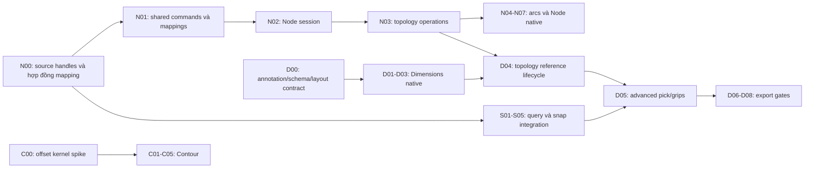

# Kế hoạch điều phối: Node, Contour, OSNAP và Dimensions

Ngày phân tích lại: **17/10/2026**. Trạng thái: **đặc tả đề xuất để triển khai; chưa nghiệm thu bốn tính năng**.
Task tài liệu: `core-tools-dimensions-plan-split-20261017`.

Tài liệu này thay kế hoạch tổng thể trước bằng bốn plan có đầu vào, đầu ra, task, owned paths và gate riêng.
Đọc bảng dưới để chọn plan; mỗi agent phải đọc thêm quy tắc chung tại đây. Không dùng các mốc ngày,
nhãn `done/active` hay lời mô tả năng lực trong bản cũ làm bằng chứng implementation.

| Plan | Chức năng và đầu ra chính | Điểm bắt đầu |
| --- | --- | --- |
| [01 — Node Tool](core-tools-and-dimensions/01-node-tool.md) | Chọn/sửa node, handles, split/break/join/close/reverse, ID mapping và Undo | N00: giải quyết bất nhất handle trong C1 và source |
| [02 — Contour / Offset](core-tools-and-dimensions/02-contour-offset.md) | Offset có ngân sách sai số, contour sống, nhiều bước, tách thành path | C00: kernel spike, topology và quyết định dependency |
| [03 — Advanced OSNAP / Inference](core-tools-and-dimensions/03-advanced-osnap-inference.md) | Candidate hình học thật, truy vấn giới hạn, tracking và khóa hướng | S00: ma trận query và oracle; giữ snap cơ bản hiện có |
| [04 — Technical Dimensions](core-tools-and-dimensions/04-technical-dimensions.md) | Annotation liên kết, styles, grips, native persistence và các gate export riêng | D00: schema/lifecycle/layout contract và inventory consumers |

## 1. Những điểm phải sửa từ bản gốc

| Vấn đề của bản gốc | Phân tích và quyết định của bản sửa |
| --- | --- |
| Gọi toàn bộ nền tảng và nhóm công cụ hiện tại là hoàn chỉnh | Chỉ khẳng định source đã đọc bên dưới; không coi menu/action ID hoặc screenshot là capability |
| Ghi Node Commands `done` trong lịch tương lai | Một số commands tồn tại; thiếu UI và nhiều operations. Mọi task dưới đây bắt đầu ở `planned`, trừ reuse được xác minh lại |
| Offset Bézier được xem là chỉ cần Clipper2 | Clipper2 xử lý polygon/polyline, có lượng tử hóa; cần flatten nguồn với error budget, phân loại winding/holes và kiểm topology |
| Cầu nối 3D buộc mọi tool dùng UCS/4x4 và topology Face/Solid ngay | Hoãn 3D sang task/ADR riêng; bốn plan dùng model 2D hiện tại và không đổi schema 3D trước nhu cầu đã kiểm chứng |
| Tự hàn khe 0.001–0.01 mm để bảo đảm CNC/manifold | Không sửa source theo khoảng cách ngầm. Merge chỉ qua lệnh rõ ràng; dung sai query, render, offset, merge và chế tạo tách riêng |
| Gộp midpoint Bézier, tâm ellipse và bbox center | Tách `t=0.5`, nửa chiều dài, analytic center, quadrant tham số và extrema; không lấy bbox hay render LOD làm hình học nguồn |
| 7 công cụ Dimensions nhưng liệt kê 8; Smart giống driving dimension | Liệt kê đủ 8 entry. Smart là bộ chọn loại annotation; sửa text không điều khiển geometry, chưa có solver |
| DXF DIMENSION mặc nhiên giữ liên kết trên AutoCAD/SolidWorks/MasterCAM | Entity, style, hình ảnh và liên kết là các gate khác nhau. DIMASSOC/handles cần writer và source-app edit/reopen fixture riêng |
| Font web và preset tên ISO/DIN được coi là chuẩn sản xuất | Dùng font thực có resolver; default mang tên PikDraw. Không tuyên bố đạt ISO/DIN/GD&T nếu chưa có tiêu chuẩn và kiểm chứng tương ứng |
| Serial Node → Contour → Snap → Dimension cho mọi phần việc | Bỏ phụ thuộc giả. Kernel/query/schema có thể nghiên cứu độc lập; consumer chỉ nhận dependency đã bàn giao đúng snapshot |
| Mặc định shortcut từ phần mềm khác | F3 hiện mở Snap panel; F10 có Win32 menu handler; A/T có nhãn Text, Ctrl+Shift+D có nhãn Step and Repeat trong menu. Mỗi plan kiểm binding thực trước xử lý |
| 12 DIP và <0.001 mm bị gộp thành cùng một ngưỡng | DIP là bắt/nhả marker; mm/residual là chất lượng nghiệm hình học. Zoom không đổi tọa độ/source accuracy |

## 2. Baseline đã đọc trong source

HEAD: `11512046d23fac08059ecd37382179283b4530a0` **cộng working tree chưa commit**.
Đây là audit source ngày 17/10, không phải kết quả build/test mới. Các agent phải kiểm lại file/hash khi nhận việc.

| Source | Điều thấy trong source | Hệ quả |
| --- | --- | --- |
| [EditablePath](../../core/document/include/pikdraw/document/model/editable_path.hpp) | Stable SubpathId/NodeId/SegmentId; line/quadratic/cubic/analytic elliptic arc; Corner/Cusp/Smooth/Symmetric/AutoSmooth | Tái sử dụng; không xây model node thứ hai |
| [Path commands](../../core/document/include/pikdraw/document/commands/path_commands.hpp) | Move, Split, Delete, Join, Close, Extend; PathTopologyMapping | Tái sử dụng sau test; UI Node đầy đủ chưa được chứng minh |
| [C1](../../contracts/c1-geometry.md) và [path adapter](../../core/document/include/pikdraw/document/model/path_adapter.hpp) | C1 nói handle là vector offset; adapter/validator/Move dùng điểm control tuyệt đối local | N00 là blocker semantic; không đoán representation hoặc migrate file ngầm |
| [Offset](../../core/geometry/src/operations/offset.cpp) | Chỉ exact axis-aligned rectangle, Miter với giới hạn; general path bị từ chối | Chưa có general Contour/Offset |
| [Snap index](../../modules/vector/src/precision/snap/snap_index.cpp) | Point KD trees; capability mặc định Endpoint/SourceNode/LineMidpoint/Grid | Không viết lại snap cơ bản; thêm curve broad phase/narrow phase có đo |
| [Snap stamp/config](../../modules/vector/include/pikdraw/vector/precision/snap/snap_index.hpp) | Epoch/revision/camera/config/capability/tool/query generations; work budget | Dùng lại lifecycle, không giảm strict stale rejection |
| [Object model](../../core/document/include/pikdraw/document/model/object.hpp) | ObjectVariant: Path, Text, Group, Image | Chưa có DimensionObject/ContourFeature persisted trong model này |
| [Production](../../modules/production/README.md) | Module planned; chưa có CMakeLists tại thời điểm audit | Dựng target bằng task có scope nếu cần, không ghi như service đang chạy |
| [Interop matrix](../../modules/interop/src/format_capability_matrix.cpp) | SVG static subset import/export prototype; ASCII DXF `dxf-entities-v1` import-only; PDF/AI/CDR/EPS reject | Mỗi format/version/feature cần adapter và bằng chứng riêng |
| [DXF parser](../../modules/interop/src/adapters/dxf_entity_parser.cpp) | Whitelist LINE, ARC, CIRCLE, LWPOLYLINE | Không có DIMENSION import/export từ whitelist này |
| [Actions](../../apps/desktop/include/pikdraw/desktop/actions/action_id.hpp), [menus](../../apps/desktop/src/shell/native_window_menus.hpp), [native bindings](../../apps/desktop/src/shell/native_window.cpp) | Node ID có nhưng menu disabled; Contour disabled; F3 mở panel; Ctrl+Shift+D có nhãn Step and Repeat | Audit cả action registry, menu và WM_KEY/WM_SYSKEY trước gán phím |

Mốc hash audit (SHA-256, để nhận biết drift; không thay manifest toàn task):

```text
editable_path.hpp c45c919e0f85b0d32135cd32593bb7910dbdb66a17314fb232ebb7664d3f1cbe
path_adapter.hpp a8de1563c450005c9c3bca45bd78383ff489501326833154fdbe29fcbb21badc
path_commands.hpp a96db225b67c7300ee00e910da16436403431337636999d815b29874c4a07dac
offset.cpp 584086bbd628aa4abdca04d52947f89745e5bdf2710df532c9f713e2c2de0d03
snap_index.cpp 9196b09183f6705dcbc486fb46442b72a2c3a402f2aec3aba19411b060f92713
format_capability_matrix.cpp 77feaa4220e4ec9ca2b45c25a5d8cc533603523c76e7e0b208aece34aa5e4e24
```

## 3. Hợp đồng dùng chung và thứ tự giao việc

Đọc [AGENTS](../../AGENTS.md), [START](../START.md), [registry](../../registry/modules.json),
[workflow](../../AGENTS.md), [C1](../../contracts/c1-geometry.md), [C2](../../contracts/c2-document.md),
[C5](../../contracts/c5-storage.md), [C7](../../contracts/c7-actions-ui.md), [C8](../../contracts/c8-import-fidelity.md),
[C9](../../contracts/c9-appearance-effects.md), [UI](../design/ui-ux-standard.md),
[workspace](../architecture/workspace-layout.md), [interop guidance](../architecture/vector-resource-interoperability.md)
và [acceptance](../quality/feature-acceptance.md). C8 là spec Proposed; không coi provenance pipeline đầy đủ đã hiện thực.

- Chỉ source gốc; không worktree/branch mới; không commit/reset/stash hoặc sửa local edits của task khác.
- Bảng task trong bốn plan là **catalog đề xuất**, chưa được create/claim và không phải lệnh dispatch agent.
  Việc viết plan không tự cấp quyền chạy bốn agent song song. Nếu được phép sau này, chỉ chạy các owned paths rời nhau.
- Trước sửa: đọc AGENTS, module README và diff; triển khai trực tiếp, không task/claim/lease/context packet.
- Single writer, immutable snapshot, một gesture/Apply = một transaction; preview không ghi document.
  Undo/redo tăng revision đơn điệu; cancel/no-op không tạo revision/history. Async luôn kiểm strict stamp trước publish và commit.
- Hình học local mm/binary64; góc world +X, CCW và +Y up theo C1. Camera/DPI không sửa source.
  Kiểm adapter thực tế nếu source đã lệch contract; không sửa trục toàn repo trong một feature task.
- Document/geometry không phụ thuộc ngược desktop, production hoặc interop. Renderer đọc schema document;
  interop dùng API trung lập, không gọi Win32 paint. Thay dependency graph/schema phải có task, ADR và consumer review.
- Shared payload đề xuất: `TopologyChangeMap` bao gồm IDs và mapping khoảng tham số khi segment split/reverse/merge;
  `SourceReference` gồm object/subpath/element ID + semantic selector + parameter/branch, không dùng index mảng;
  evaluation cache gắn revision/hash/algorithm version, không thành authority. N00/N01 chốt mapping với D00 trước khi mở associative editing.
- Node làm thay source. Contour là geometry dẫn xuất có tham số. OSNAP chỉ trả candidate/hint.
  Dimension là annotation đọc source; không tạo constraint hay ngược lại sửa source qua text.



N00 không cấm nghiên cứu kernel/query/schema trước khi semantic gate đạt. Contour không cần đợi Node UI hoặc toàn bộ OSNAP;
Dimensions tuyến tính có thể dùng điểm rõ ràng và snap cơ bản trước advanced snaps. D04 cần mapping đã qua test, không cần Contour.

### Quyền sở hữu các điểm dùng chung

| Nhóm path | Quy tắc |
| --- | --- |
| `core/document/.../editable_path.hpp`, `path_commands.hpp`, `command.cpp`, topology mapping | N00/N01 rồi consumer D00/D04 review; một người sửa tại một thời điểm |
| `core/document/.../object.hpp`, snapshots/validation/clone/storage, C2/C5 | C02 và D00/D01 tuần tự; kiểm version mới nhất, không cùng tự chọn v5 |
| `core/geometry/.../curve*`, C1 | N/S/C dùng read-only; mutation qua task shared riêng, không tranh file |
| `apps/desktop/.../native_window*`, action registry, menu, localization, SVG registry | Tích hợp N05, C04, S04, D03/D05 tuần tự; controller mới riêng không thay quyền sửa shared shell |
| CMakeLists/registry/contracts/project-state | Sửa tuần tự; consumer nêu source/target cần thêm trong kết quả |
| New feature implementation/test files | Chia theo domain khi được giao nhiều agent; không sửa chồng file |

Các tính năng Boolean tổng quát, Fillet/Chamfer, driving solver, 3D, CAM/G-code và auto-stitch tự động nằm ngoài đợt này.

### Lời giao việc để dùng lại

Mỗi agent nhận **một task con đang sẵn sàng**, không claim toàn bộ bốn plan. Đặt harness ID có prefix
`core-node-nXX-YYYYMMDD`, `core-contour-cXX-YYYYMMDD`, `core-snap-sXX-YYYYMMDD` hoặc `core-dim-dXX-YYYYMMDD`
để không trùng catalog D11/D15/D16/D20 cũ. Task create phải lặp `--path` cho từng file/new feature directory cần sửa;
các dòng wildcard/shorthand trong bảng phải mở thành owned paths cụ thể trước claim.

| Người nhận | Chỉ dẫn thực thi |
| --- | --- |
| Agent Node | Đọc plan 01 và master; bắt đầu N00, bàn giao representation/semantic vectors rồi mới N01. Không sửa snap/contour/schema annotation trong phạm vi Node |
| Agent Contour | Đọc plan 02 và master; bắt đầu C00, bàn giao kernel/license/error/topology decision. Không enable UI live contour trước C01/C02 gates |
| Agent Snap | Đọc plan 03 và master; bắt đầu S00/S01, giữ basic snap và F3 panel. Không bypass numeric locks hoặc nhận nghiệm chưa đủ residual/bound/stamp |
| Agent Dimensions | Đọc plan 04 và master; bắt đầu D00, chốt source refs/layout/schema và consumers. Nhận native và export bằng từng mốc; không chờ PDF/CAD app để nghiên cứu native |

Output mỗi task: actual changed paths, semantic/API delta, acceptance cases thực chạy, exact commands/results,
snapshot/hash, limitation và task tiếp theo. Nếu dependency chưa đạt hoặc file đang được sửa, làm phần độc lập trong scope
và ghi blocker cụ thể; không tự sửa file của owner khác. Chỉ coordinator tích hợp shared paths và cập nhật trạng thái.

## 4. Interop: ranh giới chung cho cả bốn plan

Mỗi input có adapter riêng theo format/version/representation, normalize vào model trung lập rồi mới dùng chung edit/query/render.
Không chuyển mọi định dạng qua SVG/PDF để tuyên bố tương thích. File/network input là untrusted; worker/proposal vẫn qua C6/C8.
Các plan không thêm downloader. Nguồn online chỉ qua broker do người dùng khởi phát, read-only/hash/quota/license;
parser không tự fetch linked assets. Không sao chép fixture riêng tư hoặc icon thương hiệu vào repo.

| Format/version/representation | Xem/render và edit hiện tại | Metadata và native save | Export/production |
| --- | --- | --- | --- |
| SVG static 1.0/1.1 subset | Prototype chỉ các feature đã map; filter/unknown feature không tự đạt | IDs nội bộ sau normalize; coverage/provenance cần kiểm từng fixture, C8 chưa hoàn tất | SVG subset; không giữ live Node modes/Contour/Dimension semantics theo tên; production chưa được nhận từ parser pass |
| ASCII DXF `dxf-entities-v1`, LINE/ARC/CIRCLE/LWPOLYLINE 2D | Import-only prototype; không suy ra DIMENSION/BLOCK/3D/spline | Giữ unit/layer/source mapping trong profile được kiểm; native round-trip là gate riêng | Chưa DXF export; plan 04 có gói writer riêng, không tự nâng capability |
| PDF, AI authoring, AI PDF-compatible, CDR mọi version, EPS | Chưa có adapter hiện tại; reject. Mỗi representation là một hàng riêng khi triển khai | Không có claim metadata/editability/round-trip | Không PDF/AI/CDR/EPS output trong đợt native; không áp dụng cho authoring thuần native |

Ma trận cụ thể theo từng chức năng nằm ở plan tương ứng. Render giống, sửa được, giữ nguồn, save native,
export về format và đạt sản xuất là sáu kết quả cần ghi riêng; không dùng một ô pass chung.

## 5. Cách kiểm và bàn giao

- Mỗi plan đã có ca Given/When/Then/Verify theo rủi ro. Agent hiện thực test trong suite sở hữu,
  bổ sung consumer/native UI khi sửa luồng tương tác; không thêm bộ test lớn mặc định.
- Native build/test qua `tooling/native/build.ps1`, canonical app `build/win-dev/apps/desktop/pikdraw.exe`.
  New test targets trong plan phải đăng ký CMake trước; kiểm test name hiện tại vì executable và CTest name có thể khác.
- Tách CPU query/compute/offscreen khỏi present/FPS/input-to-visible. Các ngân sách trong plan là mục tiêu đề xuất cần đo,
  không phải kết quả hay chuẩn của Adobe/Corel/Autodesk. Không suy CNC từ offset/preview; cần profile và vật liệu/máy riêng.
- Source/exe hash, cấu hình, command, số test thực chạy, fixture/oracle, giới hạn và thao tác native chưa chạy đều phải báo trực tiếp.
  Giữ regression có ích; dọn output/log/fixture thử một lần do chính task tạo.
- Không đổi `project-state` thành implemented khi chỉ có plan. Khi tích hợp xong, cập nhật snapshot
  capability đúng gate và giữ các limitations; tối đa 8.000 byte, không nối lịch sử.

~~~powershell
./tooling/native/build.ps1
# Chọn -Test -TestTarget và -TestRegex đúng module vừa sửa theo docs/development/native-build.md.
~~~

## 6. Tài liệu chính thức đã tra ngày 17/10/2026

Các nguồn mô tả hành vi sản phẩm/format; không xác nhận PikDraw đạt cùng capability. Quyết định riêng,
range/default/quota của PikDraw được đánh dấu trong từng plan. Không chép nguyên tài liệu nhà cung cấp.

- Node: [CorelDRAW 2026 Node types](https://help.coreldraw.com/CorelDRAW/540111192/Documentation-Mac/CorelDRAW-en/CorelDRAW-Node-types.html), [Adobe Illustrator Convert anchor points](https://helpx.adobe.com/uk/illustrator/desktop/draw-shapes-and-paths/modify-paths/convert-anchor-points-on-a-path.html).
- Contour: [CorelDRAW 2026 Contour objects](https://help.coreldraw.com/CorelDRAW/540111192/Documentation-Windows/CorelDRAW-en/CorelDRAW-Contour-objects.html), [AutoCAD 2026 OFFSET](https://help.autodesk.com/cloudhelp/2026/ENU/AutoCAD-Core/files/GUID-C0E4246D-C420-42BD-A6FC-8B1852EFD005.htm), [Clipper2 InflatePaths](https://www.angusj.com/clipper2/Docs/Units/Clipper/Functions/InflatePaths.htm).
- Snap: [Autodesk Object Snaps](https://help.autodesk.com/cloudhelp/ENU/AutoCAD-Web-Help/files/Drafting-and-Creating/AutoCAD_Web_Help_Drafting_and_Creating_Osnap_html.html), [SketchUp inference/locking](https://help.sketchup.com/en/sketchup/introducing-drawing-basics-and-concepts).
- Dimension: [Adobe Dimension objects](https://helpx.adobe.com/illustrator/desktop/measure-and-align/plot-and-measure/about-dimension-objects.html), [AutoCAD 2026 associativity](https://help.autodesk.com/cloudhelp/2026/ENU/AutoCAD-Core/files/GUID-8B7E8C96-C30D-409E-881E-7942871E80DA.htm), [AutoCAD 2026 primary units](https://help.autodesk.com/cloudhelp/2026/ENU/AutoCAD-Core/files/GUID-2D1177AB-3130-4522-A631-AA28493529DC.htm), [DXF dimension codes 2026](https://help.autodesk.com/cloudhelp/2026/ENU/AutoCAD-DXF/files/GUID-EDD54EAC-A339-4EBA-AEA6-EC8066505E2B.htm), [DXF DIMASSOC 2020](https://help.autodesk.com/cloudhelp/2020/ENU/AutoCAD-DXF/files/GUID-C0B96256-A911-4B4D-85E6-EB4AF2C91E27.htm).
