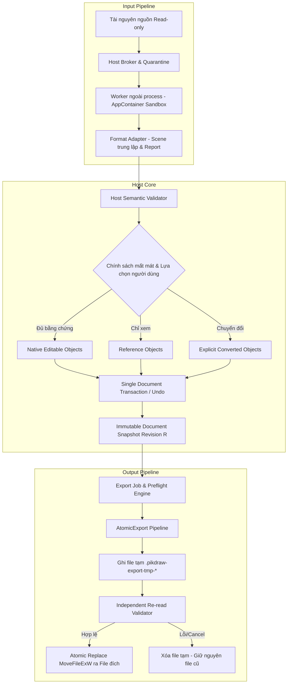
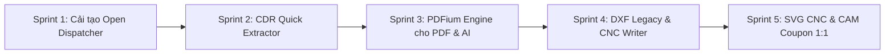

# Kế hoạch Open, Import, Export và trao đổi vector phục vụ CNC

Ngày: 18/10/2026. Trạng thái: **đang triển khai tuần tự; đã có Hợp đồng C10 và kiến trúc ExportJob/AtomicExport; chưa nghiệm thu toàn bộ định dạng hoặc profile CNC**.
Task tài liệu: `plan-file-interop-cnc-20261018`. Source: `C:/Users/Administrator/Downloads/PikDraw`.
Baseline Git: `1847e1011b45c85cf2de24df937b28621c08b54c` cộng working tree hiện hữu tại thời điểm khảo sát; có thay đổi của task khác.
Tài liệu này bổ sung phạm vi UX, raster, export và CNC cho roadmap `import-resilience-20261016.md`; dùng khảo sát source mới bên dưới thay cho bảng hiện trạng cũ.

## Tiến độ triển khai

- **F00 — Baseline corpus:** đã khóa 16 mẫu trong `cdr/`, tổng 116.989.010 byte; manifest cục bộ có SHA-256, được `.gitignore` bảo vệ. Baseline xác nhận chưa có PNG/TIFF và chưa có lần chạy oracle Adobe/Corel được ghi nhận.
- **F01 — Hợp đồng xuất file và sản xuất CNC (C10):** đã hoàn thành đặc tả `contracts/c10-file-export-production.md` (Version 0.1.0, Proposed) xác định rõ 10 gate nghiệm thu (C10-G1 đến C10-G10), ngân sách sai lệch Fine profile `0,01 mm` (0,002 mm nhập + 0,001 mm chuẩn hóa + 0,004 mm xấp xỉ + 0,003 mm serialize/đọc lại), tách bạch hoàn toàn khả năng render, editability, xuất file và nghiệm thu CAM thực tế.
- **F02–F03 — Document model và worker readiness:** snapshot đa trang và native storage v6/v7/v8 đã hoàn thành; lưu trữ đối tượng `ImageObject` giữ toàn vẹn source bytes, ICC profile, media type, DPI, bit depth và orientation. Dependency audit xác nhận WIC là Windows codec nội tại; PDFium/libcdr/Ghostscript đang trong hàng đợi pin build/license cách ly.
- **F04 — Nền tảng File workflow và Atomic Export:** đã xây dựng hạ tầng `ExportJob` theo snapshot bất biến, `ExportOptions` có kiểm tra kiểu/phạm vi, `ExportReport` phân tách 7 trục đánh giá, và `AtomicExport` (ghi file tạm `.pikdraw-export-tmp-*`, flush, kiểm tra đọc lại qua validator độc lập rồi đổi tên nguyên tử qua `MoveFileExW`). Desktop UI đã tích hợp luồng xuất SVG tại `apps/desktop/src/shell/native_window_svg_export.cpp`, nối phím tắt Ctrl+E và menu.
- **F05 — Raster nền tảng:** WIC decoder allowlist chạy trong AppContainer worker; PNG/JPEG/TIFF single-frame SDR được chuyển thành `ImageObject` RGBA8 an toàn với giới hạn 4M pixels/16 MiB. Native format v8 lưu trữ đầy đủ thuộc tính ảnh. Đang mở rộng sang xuất raster: schema encoder (JPEG quality/subsampling, PNG lossless/RGBA, TIFF single-frame LZW/Deflate), cơ chế tiling/streaming có effect halo chống tràn RAM và color pipeline bảo toàn sRGB/ICC.
- **Khả năng runtime hiện tại:** Open native mở `.pikdraw`; Import nhận subset tĩnh SVG/DXF 2D và ảnh PNG/JPEG/TIFF (prototype SDR RGBA8). Export SVG đã chạy thực tế từ selection hoặc từng trang. Các định dạng PDF, CDR, AI, EPS, DXF export và CNC profile tiếp tục giữ trạng thái từ chối rõ ràng cho đến khi vượt qua từng gate kiểm định độc lập.
- **F06–F11:** lộ trình triển khai tuần tự theo kế hoạch chi tiết bên dưới. Mỗi adapter bắt buộc có dependency lock, bộ fixture kiểm định, test round-trip độc lập và báo cáo không mất mát ngầm trước khi công bố hỗ trợ.

## 1. Phạm vi và kết quả người dùng cần

- **Open / Ctrl+O:** mở `.pikdraw`, PDF, CDR, AI, SVG, EPS, DXF và ảnh thành tài liệu mới, đúng kích thước/đơn vị; giữ tài liệu đang làm trong tab riêng.
- **Import / Ctrl+I:** nhập một hoặc nhiều file vào tài liệu hiện tại; chọn trang, kích thước, vị trí và chế độ giữ nội dung; có preview, Cancel và Undo một bước duy nhất.
- **Export / Ctrl+E:** JPG/JPEG, PNG, TIF/TIFF, SVG, EPS, DXF, PDF; chọn đối tượng, trang hiện tại, dải trang, toàn bộ trang hoặc mỗi đối tượng/trang một file riêng biệt.
- **Giữ hiệu ứng tối đa:** kiểm riêng hiển thị, chỉnh sửa, dữ liệu nguồn, xuất ngược và độ chính xác sản xuất. Phần chưa giữ được phải có chỉ báo và lựa chọn trước khi nhận/xuất.
- **CNC:** ưu tiên DXF và SVG có kích thước vật lý 1:1, đường cong chính xác trong ngân sách dung sai, topology đúng; EPS/PDF bổ sung cho thiết bị/CAM đã được kiểm chứng.
- `dfx` trong yêu cầu được hiểu là **DXF**. File có đuôi `.dfx` chỉ được đề nghị nhận như DXF khi kiểm tra nội dung phù hợp; không tạo một format DFX mới.
- Ảnh mở rộng: BMP và WebP ở đợt sau; GIF chỉ ảnh tĩnh/frame được chọn. PSD/RAW/HEIF/AVIF, DWG, 3D CAD, G-code và điều khiển máy không nằm trong đợt này.
- AI/CDR trong phạm vi bắt buộc là **Open và Import**. Export AI/CDR gốc cần writer/SDK và gate riêng, không giả lập bằng đổi đuôi PDF/SVG. Lưu chỉnh sửa đầy đủ dùng `.pikdraw`.

Mục tiêu nghiệm thu là không mất nội dung hoặc đổi geometry âm thầm trong profile được công bố. Không thể cam kết mọi phiên bản AI/CDR, plugin và hiệu ứng độc quyền đều vừa giống tuyệt đối vừa sửa nguyên bản. Khi không có đường giữ nội dung đủ bằng chứng, phải báo giới hạn thay vì mở một bản thiếu chi tiết rồi thông báo thành công.

## 2. Baseline source tại thời điểm lập kế hoạch

Khảo sát dưới đây ghi lại baseline lúc soạn kế hoạch; phần “khoảng thiếu” đã được cập nhật ở mục Tiến độ triển khai. Đây là đọc code/header/container, không phải nghiệm thu parser production, benchmark hay fidelity.

| Thành phần hiện tại | Bằng chứng source | Khoảng thiếu cần xử lý |
| --- | --- | --- |
| Open native | `apps/desktop/src/shell/native_window_files.cpp`: filter `.pikdraw`, gọi `open_native` | Chưa có dispatcher mở định dạng ngoài; hiện hỏi bỏ tài liệu dirty rồi thay nội dung |
| Export UI | Cùng file có `export_svg_dialog`; `native_window_shortcuts.cpp` nối Ctrl+E vào dialog này | Đã có nền tảng `ExportJob`/`SVGExporter`; cần dialog Export đa định dạng/phạm vi |
| Import và shortcut | `native_window_import.cpp`, `native_window_shortcuts.cpp` | Ctrl+I mở worker SVG/DXF/Raster; các định dạng ngoài allowlist bị từ chối rõ ràng |
| Capability | `modules/interop/src/format_capability_matrix.cpp`, `modules/interop/README.md` | SVG static subset nhập/xuất prototype; DXF ASCII 2D chỉ nhập prototype; PDF/AI/CDR/EPS bị từ chối; Raster import prototype |
| SVG | `svg_importer.cpp`, `svg_exporter.cpp`, `native_window_svg_export.cpp` | Có subset tĩnh SVG và report fidelity; cần tách biệt hoàn toàn 2 profile: SVG Design và SVG CNC |
| DXF | `dxf_entity_parser.cpp`, `dxf_source_reader.cpp`, `dxf_importer.cpp` | Chỉ LINE/ARC/CIRCLE/LWPOLYLINE theo profile; cần xử lý chuỗi AC1003 legacy và writer CNC R12/R2000 |
| Transport worker | `ipc_dto.hpp`, `platform/workers/src/worker_main.cpp` | Đã có wire v2, source handle, proposal stream và AppContainer; tái sử dụng/kiểm chứng luồng hiện có |
| Document | `document_snapshot.hpp`, `native_format.cpp` (v8) | Snapshot đa trang thật; ImageObject lưu source bytes/DPI/ICC; cần cấu trúc reference cho đối tượng ngoài |
| Raster model | `core/document/include/.../object.hpp`: `ImageObject` | Đã lưu pixel RGBA8, DPI, ICC, bit depth và orientation; cần hoàn thiện WIC encoder export |
| Production | `registry/modules.json`, `modules/production`, `contracts/c10-file-export-production.md` | Đã có đặc tả C10; cần hiện thực hóa module production và preflight geometry cho CNC |

Runtime tiếp tục theo C++20/Win32/Direct2D 1.1/D3D11/WARP và SoftwareRasterizer hiện hành. Kế hoạch này không phụ thuộc việc chuyển Qt/Skia. Core không phụ thuộc ngược desktop; reader/vendor types không đi vào document model.

## 3. Bộ mẫu local và khoảng trống kiểm thử

Corpus người dùng chỉ định: thư mục `cdr` trong source. Không đưa file, tên khách hàng, nội dung, đường dẫn tuyệt đối riêng tư hoặc hash corpus vào Git. Khi triển khai, manifest ánh xạ fixture ID sang đường dẫn/hash nằm local và bị ignore; evidence dùng ID trung tính. Không upload mẫu lên dịch vụ chuyển đổi.

| Nhóm | Số file cấp gốc | Nhận định từ inventory chỉ đọc | Việc cần kiểm tiếp |
| --- | ---: | --- | --- |
| CDR | 4 | Đều có ZIP signature; chưa xác nhận version family và feature coverage | Đọc metadata bằng reader được chọn; so với CorelDRAW đúng build, từng trang/effect |
| AI | 1 | Có `%PDF-1.5` ở đầu file | Xác minh PDF representation; không suy ra đầy đủ dữ liệu authoring |
| PDF | 3 | Đầu file `%PDF-1.7` | Số trang, boxes, fonts, clip/transparency, ICC/spot và nội dung sản xuất |
| EPS | 2 | Header khai báo PostScript LanguageLevel 2; creator lần lượt Adobe Illustrator/CorelDRAW | Kiểm phần PostScript thật; thumbnail không thay nội dung vector |
| DXF | 1 | `$ACADVER=AC1003`; 298 POLYLINE, 19.319 VERTEX, 298 SEQEND; chưa thấy `$INSUNITS` trong cửa sổ header 32 KiB | Kiểm toàn header; hỗ trợ legacy chain và cho người dùng xác nhận units khi thiếu |
| JPG | 4 | JPEG signature | DPI/EXIF/ICC/orientation, CMYK JPEG nếu có |
| SVG | 0 ở cấp gốc; 1 smoke SVG trong `test-sources` | Chưa đủ mẫu SVG thực tế | Bổ sung tài nguyên có quyền dùng và fixtures tự tạo |

Tổng 15 file cấp gốc, khoảng 111,57 MiB; AI, một PDF và một EPS lớn hơn 16 MiB. Một CDR khoảng 1,56 MiB khai báo tổng dữ liệu ZIP giải nén khoảng 35,35 MiB: phải đo decoded/scene/preview peak, không dự toán RAM theo kích thước file nén.

Bổ sung fixture PNG alpha, TIFF RGB/CMYK/16-bit/nhiều frame, JPEG EXIF/CMYK, PDF nhiều trang/password/missing font, AI có và không có PDF, CDR theo version thực tế. SVG cần CSS/use/gradient/clip/mask/filter/text/ảnh; DXF cần R12 POLYLINE, R2000 LWPOLYLINE, bulge, blocks/inserts, spline/ellipse, OCS và đơn vị thiếu. Fixtures malformed, zip bomb, vòng tham chiếu và thiếu asset phải có kết quả mong đợi rõ.

## 4. Bài học từ tài liệu Adobe/Corel và quyết định thiết kế

Các URL được truy cập ngày 18/10/2026. Phần lựa chọn cụ thể của PikDraw bên dưới là thiết kế đề xuất, không phải claim runtime hoặc thông số bảo đảm của hãng.

- Adobe mô tả tùy chọn Create PDF Compatible File lưu thêm biểu diễn PDF; lưu legacy có thể mất tính năng và EPS có giới hạn transparency. Vì vậy AI-PDF, AI authoring và EPS converted phải là các hàng capability riêng. [Adobe Save artwork](https://helpx.adobe.com/illustrator/using/saving-artwork.html).
- Adobe tách ưu tiên appearance và editability khi xuất AutoCAD, cho chọn scale/units; SVG có độ chính xác tọa độ, ảnh nhúng/link; JPEG/PNG/TIFF có tùy chọn chất lượng riêng. PikDraw thêm profile CNC với geometry làm điều kiện bắt buộc. [Adobe Export artwork](https://helpx.adobe.com/illustrator/using/exporting-artwork.html).
- CorelDRAW tổ chức xuất theo đối tượng/trang, dải trang và danh sách tài sản có cấu hình lặp lại. PikDraw dùng dialog Export làm đường chính, cho lưu preset và batch thay vì buộc người dùng mở một dock mới. [Corel Export objects and pages](https://help.coreldraw.com/CorelDRAW/540111192/Documentation-Windows/CorelDRAW-en/CorelDRAW-Export-assets.html).
- CorelDRAW có chọn đơn vị khi nhập DXF, version/units/text khi xuất và nêu giữ layer. PikDraw yêu cầu xác nhận units nếu nguồn thiếu, tắt tự giảm node mặc định cho đường sản xuất. [Corel DWG/DXF](https://help.coreldraw.com/CorelDRAW/540111192/Documentation-Windows/CorelDRAW-en/CorelDRAW-AutoCAD-Drawing-Database-DWG-and-AutoCAD-Drawing-Interchange-Format-DXF.html).

## 5. Ma trận format/version/representation đích

Tất cả ô dưới là **phạm vi đề xuất cần gate**, không thay capability registry hiện tại. Mỗi hàng runtime phải có trạng thái riêng cho xem/render, editability, provenance, production và từng đích export; không dùng một bool Supported cho mọi mục đích.

| Format / representation | Open và Import đích | Hiển thị và chỉnh sửa | Metadata nguồn | Export / round-trip | Điều kiện sản xuất |
| --- | --- | --- | --- | --- | --- |
| PDF 1.4-1.7; PDF 2.0 gate sau | Chọn trang/dải, MediaBox/TrimBox/CropBox | Native vector có oracle; phần phức tạp giữ reference có bằng chứng | Boxes, UserUnit, fonts, ICC, OCG, source locator | PDF vector/print profile; không tái tạo authoring AI | Chỉ geometry profile đã kiểm; scan không tự thành đường cắt |
| AI PDF-compatible | Nhận diện `%PDF-1.5`, dùng adapter PDF | Sửa theo dữ liệu PDF hiện hữu | Giữ source bytes/hash, không bịa layers/artboards | Xuất SVG/PDF/EPS/DXF; chưa có AI native round-trip | Kiểm geometry và scale riêng |
| AI legacy PostScript / không PDF | Nhánh legacy chỉ khi signature hợp lệ | Converted có report; authoring chưa đọc không nhận editable | Version nhận diện được; unknown giữ unknown | Chưa thuộc scope ghi | Chặn production nếu geometry chưa qua kiểm |
| CDR RIFF (v11–X4) & ZIP (X5–2024) | libcdr/librevenge worker, whitelist theo version | Native khi semantics đúng; PowerClip/lens/mesh giữ reference | Giữ units, pages, order, source ID, fonts, colors | Không claim ghi CDR; .pikdraw lưu chỉnh sửa | Chỉ contours/units/transforms đã kiểm |
| EPS PostScript Level 2/3 | PostScript worker riêng, chuyển 2 bước qua PDF | Converted representation; giữ vector khi parser thực xuất vector | BoundingBox/HiResBoundingBox, fonts, version chain | EPS vector theo profile; flatten transparency có lựa chọn | Chỉ profile vector đã đối chiếu CAM; preview không là đường cắt |
| SVG Design | XML/CSS/tree/use, gradient, clip, text, ảnh | Đối tượng native đầy đủ thuộc tính hiển thị | IDs, viewBox, units, CSS styles, metadata | Xuất SVG giữ đầy đủ style và phân cấp nhóm | Không dùng trực tiếp cho CNC nếu chứa style phức tạp |
| SVG CNC | Paths phẳng, kích thước mm, viewBox nhất quán | Chuyển đổi text thành outlines thật, loại bỏ filter/style | Tọa độ chuẩn hóa, layer Cut/Score/Engrave | Xuất SVG CNC tối giản, độ chính xác tọa độ theo sai số mm | Kích thước 1:1, đường khép kín, topology đúng |
| DXF CNC Legacy R12 (AC1009) | Header/units/layers; LINE, ARC, CIRCLE, POLYLINE | CAD 2D phẳng Z=0; cấm LWPOLYLINE/SPLINE/ELLIPSE | ACADVER, handles, layers, units đã xác nhận | Xuất R12 tương thích CAM đời cũ; cung cong dùng group 42 | Dung sai xấp xỉ <= 0,004 mm; kiểm đường khép kín |
| DXF CNC R2000 (AC1015) | LWPOLYLINE + bulge, ARC, CIRCLE; spline theo gate | CAD geometry tối ưu cho laser/plasma/waterjet | $INSUNITS=4 (mm), WCS/OCS, layer mapping | Xuất LWPOLYLINE liền mạch, nhẹ dung lượng | Đo kiểm kích thước CAM độc lập; kiểm lỗ trong cắt trước |
| JPG/JPEG, PNG (SDR RGBA8) | Asset raster, nhúng mặc định hoặc liên kết | Đổi vị trí/scale/crop; giữ alpha/ICC/orientation | Bytes gốc, dimensions, DPI, EXIF, ICC | Xuất từ snapshot gốc; JPEG quality 1-100; PNG lossless | Chỉ ảnh khắc nếu có raster engrave; cấm vector cut |
| TIF/TIFF 6.0 | Chọn frame/trang; 8-bit trước, 16-bit/CMYK sau | Raster; giữ bytes gốc, không hạ 16-bit âm thầm | Compression, bit depth, DPI, ICC, frame | TIFF lossless (LZW/Deflate); BigTIFF gate riêng | Tương tự raster; không là đường cắt |
| BMP / WebP / GIF tĩnh | Mở rộng sau bộ bắt buộc | Theo codec khóa trong AppContainer | Pixels, profile, frame tĩnh được chọn | Chỉ format có encoder kiểm chứng | Không tự cấp quyền vector cut |

## 6. Kiến trúc và lựa chọn reader/writer

Luồng chung: Nguồn read-only → Nhận diện signature/version → Reader ngoài process trong AppContainer → Scene trung lập có provenance/report → Host validation (kiểm schema, revision, budget) → Staging preview/loss choices → Một transaction document duy nhất → Snapshot bất biến → Renderer chung và Exporter riêng theo đích.



### Nguyên tắc kiến trúc cốt lõi

1. **Một mô hình tài liệu và semantics chung:** Các adapter chuyển đổi dữ liệu nguồn về cùng schema `core/document`. Các thao tác chỉnh sửa, transform, hierarchy, painter order, undo/redo và render dùng chung implementation của PikDraw; không tạo mô hình dữ liệu riêng cho từng định dạng.
2. **Không ép qua định dạng trung gian làm mất nghĩa:** Không chuyển mọi định dạng qua SVG hoặc PDF thô nếu đường ống đó làm mất semantics hình học, đơn vị CAD hoặc phân cấp nhóm.
3. **Cơ chế ghi file nguyên tử (`AtomicExport`):**
   - File xuất được ghi vào đường dẫn tạm cùng volume với file đích theo mẫu: `<dest_dir>/.pikdraw-export-tmp-<random>.tmp`.
   - Sau khi ghi xong, gọi `FlushFileBuffers` để đảm bảo dữ liệu đã xuống đĩa vật lý.
   - Trình kiểm tra (`ExportValidator`) độc lập mở lại file tạm, xác minh tính toàn vẹn (magic bytes, cấu trúc XML/DXF/PDF/Raster, kích thước vật lý).
   - Chỉ khi kiểm tra thành công, gọi `MoveFileExW` với cờ `MOVEFILE_REPLACE_EXISTING` để tráo đổi tên file nguyên tử.
   - Nếu quá trình bị hủy (Esc/Cancel), timeout, lỗi đĩa hoặc validator báo lỗi: tự động xóa sạch file tạm, không làm hỏng hoặc xóa file cũ của người dùng.
4. **Bảo vệ tài liệu và cách ly tiến trình:**
   - Worker chạy ngoài process dưới quyền AppContainer sandbox và Job Object giới hạn RAM/CPU.
   - Worker không có quyền truy cập mạng, không chạy script/macro/PDF actions, không tự ý quét các file xung quanh trên ổ đĩa.
   - Tài liệu nguồn mở ở chế độ read-only chia sẻ (`FILE_SHARE_READ`). Export không làm thay đổi trạng thái dirty của tài liệu đang làm việc và không tạo bước Undo dư thừa trên editor.

## 7. Hợp đồng fidelity và giữ hiệu ứng

Báo cáo fidelity tách biệt 7 trục đánh giá theo Contract C10: kết quả Job, phiên bản Format/Profile, độ chính xác Diện mạo (Appearance), mức độ Chỉnh sửa được (Editability), Siêu dữ liệu nguồn (Source Metadata), Khả năng sản xuất (Production), và Danh sách file xuất thực tế.

| Nhóm nội dung | Điều kiện được nhận editable | Hành vi khi chưa đủ điều kiện |
| --- | --- | --- |
| Geometry/transform | Đúng control points, arc sweep/bulge, fill rule, holes, scale phi đối xứng và đơn vị mm | Chặn CNC production; xấp xỉ đường cong phải có tolerance và lựa chọn rõ |
| Layer/group/page | Giữ đúng phân cấp, thứ tự vẽ, trạng thái visible/lock và page ownership | Tên layer do PikDraw tổng hợp phải có nhãn; không bịa đặt cấu trúc nguồn |
| Solid/gradient/color | Giữ RGB/CMYK/spot+tint, profile ICC và intent; gradient stops/matrix chính xác | RGB preview không thay thế nguồn in; không đổi ngầm spot/overprint |
| Opacity/blend/shadow | Đúng scope, painter order, alpha channel và blend mode theo C9 | Giữ reference có bằng chứng, flatten/outline có lựa chọn, hoặc từ chối |
| PowerClip/clip/mask | Semantics renderer và persistence của PikDraw khớp với nguồn | Giữ reference ở phạm vi composite phù hợp; báo unsupported nếu sai lệch |
| Text/fonts | Giữ Unicode, glyph layout, font family; có quyền sửa đổi font | Cho chọn giữ appearance, chuyển outline hoặc thay thế font có preview |
| Raster assets | Đúng kích thước pixel, alpha straight/premultiplied, orientation, DPI, ICC | Giữ nguyên bytes nguồn; downsample hoặc đổi depth phải qua xác nhận |

Ba chế độ xử lý mất mát cho người dùng:
1. **Giữ diện mạo (Appearance Priority):** Tối ưu hóa để hình ảnh hiển thị giống nguồn nhất; cho phép giữ reference hoặc rasterize cục bộ các hiệu ứng độc quyền sau khi người dùng xác nhận.
2. **Ưu tiên chỉnh sửa (Editability Priority):** Tối ưu hóa các đối tượng vector và text có thể click chọn và biên tập; các hiệu ứng phức tạp không ánh xạ được sẽ phân rã thành vector cơ bản hoặc loại bỏ có cảnh báo.
3. **Đường cắt CNC (CNC Production Priority):** Bắt buộc loại bỏ mọi raster, hiệu ứng bóng mờ, gradient, fill phức tạp; chỉ giữ lại đường vector chuẩn xác 1:1, kiểm tra tính khép kín và phân tách lớp gia công.

## 8. Luồng Open và Import

### Luồng Open (Ctrl+O)

1. Người dùng nhấn Ctrl+O hoặc menu File > Open… → Dispatcher mở hộp thoại chọn file với bộ lọc đa định dạng theo capability matrix hiện hành.
2. Host kiểm tra magic bytes và signature để nhận diện định dạng thực tế (không dựa hoàn toàn vào đuôi file).
3. Với file đa trang (PDF/CDR/AI): hiển thị dialog chọn trang đơn, dải trang (`1, 3-5`) hoặc toàn bộ trang.
4. Với file DXF: kiểm tra biến `$INSUNITS`; nếu thiếu hoặc unitless, hiển thị dialog bắt buộc chọn đơn vị vật lý (mm, inch, m).
5. Với file Raster: kiểm tra DPI và kích thước pixel; cho phép xác nhận độ phân giải.
6. Hiển thị bảng tóm tắt fidelity và preview trước khi nạp.
7. Mở thành tài liệu mới trong tab riêng biệt, giữ nguyên tài liệu đang làm việc ở tab cũ.
8. File mở từ định dạng ngoài được đánh dấu là tài liệu chuyển đổi chưa có đường lưu native; thao tác Ctrl+S đầu tiên bắt buộc mở Save As để lưu file `.pikdraw`, tuyệt đối không ghi đè lên file nguồn gốc.

### Luồng Import (Ctrl+I)

1. Người dùng nhấn Ctrl+I (phím tắt độc quyền cho Import) hoặc menu File > Import… trên tài liệu đang mở.
2. Chọn một hoặc nhiều file nguồn → Chọn trang/frame cần nhập → Chọn chế độ Nhúng (Embed - mặc định) hoặc Liên kết (Link).
3. Chọn chế độ xử lý mất mát (Giữ diện mạo / Ưu tiên chỉnh sửa / Đường cắt CNC).
4. Vào chế độ **Placement Preview**: con trỏ chuột hiển thị khung dây (ghost wireframe) đúng kích thước thật 1:1 của đối tượng nhập kèm status hint: *"Click để đặt. Enter đặt tại tâm trang. Giữ Shift để đổi tỉ lệ. Esc để hủy."*
5. Người dùng click chuột hoặc nhập tọa độ X/Y trên Contextual Property Bar → Áp dụng vào tài liệu qua một transaction duy nhất với đúng một bước Undo.
6. Hủy tác vụ (Esc) tại bất kỳ thời điểm nào trước khi click sẽ giải phóng tài nguyên và không làm thay đổi lịch sử Undo, trạng thái dirty hay selection của tài liệu.

## 9. Export: phạm vi, trang và batch

Bố cục các tùy chọn xuất file được chuẩn hóa theo Contract C10:

| Thiết lập | Tùy chọn khả dụng | Quy tắc xử lý và mặc định |
| --- | --- | --- |
| Phạm vi (Scope) | Đối tượng được chọn (Selection); Trang hiện hành; Dải trang (`1,3-5`); Toàn bộ trang; Toàn bộ artwork | Mặc định mở trang hiện hành. Nếu đang có selection, hiện tùy chọn xuất selection rõ ràng nhưng không tự đổi ngầm |
| Vùng biên (Bounds) | Khổ trang (Page Bounds); Khung nhìn đối tượng (Artwork Bounds gồm stroke/effects); Vùng tùy chọn | Bounds và Scope là hai thiết lập độc lập. Xuất theo Page Bounds không tự thêm hình chữ nhật nền |
| Cắt theo trang (Clip to Page) | Bật / Tắt (có preview trực quan) | Chỉ lấy phần giao với page bounds khi bật. Với profile CNC, đối tượng xuyên trang bị cắt sẽ bị cảnh báo vi phạm đường hở |
| Đa trang (Multi-page) | Gộp 1 file duy nhất (chỉ PDF); Mỗi trang một file riêng (JPG/PNG/TIFF/SVG/EPS/DXF) | Xuất đa trang dạng raster/vector rời tự động đặt tên theo mẫu: `{doc}_{page:03}_{preset}.{ext}` |
| Đối tượng ẩn/khóa/thước | Bỏ qua đối tượng ẩn; xuất đối tượng khóa nếu visible; loại bỏ guides và construction lines | Profile CNC mặc định loại bỏ 100% guides, thước kẻ và layer đánh dấu không in (non-printing) |
| Tỉ lệ và tọa độ | Tỉ lệ 100% (1:1); Giữ tọa độ thế giới (World Coordinates) hoặc đưa gốc về chân trang/top-left | CNC bắt buộc tỉ lệ 1:1; thay đổi tỉ lệ đòi hỏi xác nhận kích thước mm xem trước |

### 9.1 Tùy chọn ảnh, nén và Tiling/Streaming

- **Công thức quy đổi kích thước vật lý:**
  $$\text{pixels} = \text{round}\left(\frac{\text{mm} \times \text{DPI}}{25{,}4}\right)$$
  Hộp thoại hiển thị song song kích thước mm thực tế và số lượng pixel tương ứng. Thay đổi DPI làm thay đổi mật độ điểm ảnh của file raster, tuyệt đối không làm biến dạng kích thước vật lý của bản vẽ.
- **Tùy chọn theo định dạng ảnh:**
  - **JPEG:** Quality từ 1 đến 100 (mặc định 90 cho bản in chất lượng cao); tùy chọn subsampling (4:4:4 cho đồ họa sắc nét, 4:2:0 cho ảnh chụp); không hỗ trợ kênh alpha (chọn màu nền matte trắng hoặc tùy biến).
  - **PNG:** Nén không mất dữ liệu (lossless compression level 1-9); hỗ trợ RGB hoặc RGBA (nền trong suốt); không áp dụng thanh trượt Quality kiểu lossy.
  - **TIFF:** Nén Lossless (None, LZW, Deflate); hỗ trợ RGB/RGBA 8-bit; kênh alpha lưu theo chuẩn unassociated alpha hoặc premultiplied alpha rõ ràng.
- **Cơ chế Tiling và Streaming cho file raster siêu lớn:**
  - Với các bản vẽ khổ lớn (biển quảng cáo, pano tấm lớn > 32 MP hoặc > 100 MB RAM budget), renderer không render toàn bộ ảnh nguyên khối vào bộ nhớ.
  - Áp dụng kỹ thuật chia dải/ô (Stripe/Tile Streaming): render từng dải ngang hoặc ô vuông với vùng đệm hào quang (effect halo) tính toán trước để các hiệu ứng bóng mờ (drop shadow), làm mờ (blur) và feathering không bị gián đoạn hay cắt vệt tại biên giữa các tile.
  - Từng tile được đẩy trực tiếp vào WIC stream encoder và ghi xuống đĩa, giữ mức tiêu thụ đỉnh RAM của tiến trình luôn nằm trong ngân sách an toàn (< 512 MiB).

### 9.2 Tùy chọn PDF, SVG và EPS cho thiết kế và in ấn

- **PDF Design & Print:** Chọn chuẩn PDF (1.4 - 1.7); nhúng font chữ đầy đủ (full embedding) hoặc trích tập con (subset) theo bản quyền; bảo toàn vector và gradient mượt; nén ảnh raster bên trong bằng JPEG/Flate theo ngưỡng effective DPI; hỗ trợ thiết lập Bleed (tràn lề) và Crop Marks cho nhà in.
- **SVG Design:** Giữ nguyên cấu trúc cây phân cấp (groups), viewBox chuẩn, hệ tọa độ độc lập; xuất presentation attributes hoặc inline CSS theo profile tương thích; nhúng ảnh dưới dạng Base64 Data URI hoặc đường dẫn liên kết tương đối; bảo toàn các thuộc tính stroke, fill gradient và clipping paths.
- **EPS Design:** Tạo file PostScript Level 2/3 chuẩn cấu trúc DSC (`%!PS-Adobe-3.0 EPSF-3.0`); khai báo chính xác `%%BoundingBox` và `%%HiResBoundingBox`; chuyển đổi các hiệu ứng trong suốt (transparency flattening) sang vector phẳng hoặc hình ảnh raster hóa cục bộ kèm báo cáo diện mạo.

## 10. Profile và gate riêng cho cắt CNC

CNC export là chức năng chế tạo cơ khí/sản xuất chính xác, không phải là chế độ xuất đồ họa thông thường. Đầu vào của profile CNC loại bỏ hoàn toàn các đối tượng raster, hiệu ứng appearance, fill gradient hoặc đối tượng reference chưa xác định hình học.

### 10.1 Hai profile DXF CNC

1. **DXF CNC Legacy R12 / AC1009:**
   - Dành cho các dòng máy CNC, khắc laser, cắt decal, đục plasma và CAM đời cũ (chỉ nhận chuẩn AutoCAD R12).
   - Chỉ phát các thực thể 2D cơ bản: `LINE`, `ARC`, `CIRCLE`, và `POLYLINE` 2D (với mã nhóm group code 42 bulge để biểu diễn cung tròn mềm). Tọa độ mặt phẳng $Z = 0$.
   - **Tuyệt đối cấm xuất `LWPOLYLINE`, `SPLINE`, `ELLIPSE` trong profile R12.**
   - Mọi đường cong bậc cao (Cubic Bezier, Spline) hoặc Ellipse bắt buộc phải chạy qua thuật toán xấp xỉ thích nghi (Adaptive Tessellation) để phân rã thành các đoạn thẳng nối tiếp hoặc cung tròn Arc với sai số cực đại không vượt quá ngân sách `0,004 mm`.
   - File R12 không dựa vào biến header `$INSUNITS` vì nhiều CAM cũ bỏ qua; thông tin đơn vị mm được ghi chú rõ trong header comment và receipt.
2. **DXF CNC R2000 / AC1015:**
   - Dành cho các hệ thống CAM hiện đại, máy laser sợi quang (Fiber Laser), máy cắt tia nước (Waterjet) và phay CNC tốc độ cao.
   - Sử dụng thực thể tối ưu `LWPOLYLINE` (Lightweight Polyline) kết hợp bulge arc để giảm 70% dung lượng file và tăng tốc độ đọc của bộ điều khiển CNC.
   - Ghi rõ biến header `$INSUNITS = 4` (milimét) hoặc `1` (inch).
   - Giữ nguyên `CIRCLE`, `ARC` thực. Các spline được xuất nguyên bản nếu CAM đích hỗ trợ, hoặc xấp xỉ thích nghi nếu người dùng chọn profile tương thích.

### 10.2 Profile SVG CNC

- Kích thước vật lý chuẩn xác với thuộc tính `width="...mm"`, `height="...mm"` và `viewBox` tương ứng tỷ lệ 1:1.
- Tọa độ số thực được định dạng với số chữ số thập phân ràng buộc theo sai số mm (tối thiểu 3 chữ số thập phân cho sai số <= 0,001 mm).
- Loại bỏ hoàn toàn: inline CSS phức tạp, style kế thừa, filter, clip mask, ảnh raster, text live và thẻ script. Toàn bộ text bắt buộc chuyển thành đường viền vector (outlines) từ glyph font thật.
- Khử toàn bộ ma trận biến đổi nhóm (flatten group transforms về tọa độ thế giới của từng path).

### 10.3 Phân tách Centerline Cut, Outline Stroke và Phân lớp Gia công

- **Centerline Cut (Cắt tim đường):** Đường vẽ gốc được giữ nguyên làm đường dẫn dao cắt trung tâm. Tuyệt đối không tự ý bành nét (stroke expansion) tạo thành 2 đường cắt kép làm hỏng chi tiết cơ khí.
- **Outline Silhouette (Cắt viền hình thể):** Chỉ khi người dùng chủ động chọn chế độ "Convert Stroke to Cut Contour", hệ thống mới tính toán offset viền ngoài để tạo đường cắt bao quanh.
- **Phân loại lớp và quy ước thao tác (Operation / Layer Mapping):**
  - Lớp `CUT` (hoặc màu Đỏ `#FF0000`): Đường cắt đứt sản phẩm, bắt buộc kiểm tra tính khép kín 100% (closed contour).
  - Lớp `SCORE` (hoặc màu Xanh dương `#0000FF`): Đường vạch dấu, cấn nếp gấp, khía rãnh; cho phép tồn tại đường hở (open path).
  - Lớp `ENGRAVE` (hoặc màu Đen `#000000`): Vùng khắc diện tích hoặc phay bề mặt; đòi hỏi vùng kín hoặc đường nét raster tương thích.
- Bù trừ mạch cắt (Kerf / Tool Compensation) do phần mềm CAM đích đảm nhiệm; PikDraw giữ nguyên kích thước hình học danh nghĩa để tránh lỗi bù dao hai lần (double compensation).

### 10.4 Thiết kế chi tiết Phôi mẫu chuẩn CNC (PikDraw CNC Test Coupon 100x100 mm)

Để kiểm chứng độc lập mà không dựa vào engine của PikDraw, bộ kiểm chuẩn sản xuất sử dụng phôi mẫu hình học tiêu chuẩn:

```
+-------------------------------------------------------------+ (100.00 mm)
|  [Cut Layer: Outer Boundary 100.00 x 100.00 mm Square]      |
|                                                             |
|       (Score Layer: Centerline Crosshairs Line)             |
|                          |                                  |
|         +----------------+----------------+                 |
|         |                                 |                 |
|         |     (Cut: Circle Dia 30.00 mm)  |                 |
|         |             ( O )               |                 |
|         |                                 |                 |
|         +----------------+----------------+                 |
|                          |                                  |
|                                                             |
|   [Cut: Rounded Slot 20.00 x 10.00 mm, Radius 5.00 mm]      |
|   (================)                                        |
|                                                             |
|   [Engrave/Outlines: "PikDraw CNC 2026" - Height 5.00 mm]   |
|   [Cubic Bezier Spline Wave: Length 60.00 mm, Amp 5.00 mm]  |
+-------------------------------------------------------------+ (0,0)
```

**Tiêu chí nghiệm thu phôi mẫu trên CAM độc lập (LightBurn, SheetCAM, Fusion 360, LaserWeb):**
1. **Kích thước 1:1:** Thước kẹp đo trên phần mềm CAM hiển thị đúng 100,00 mm ở cạnh vuông ngoài, 30,00 mm đường kính lỗ tròn tâm, không bị lỗi co giãn fit-to-page.
2. **Thứ tự cắt lỗ trong trước (Hole Nesting):** CAM tự động nhận diện lỗ tròn tâm 30 mm và rãnh bo góc 20x10 mm là chi tiết bên trong (island/holes) để xếp thứ tự cắt trước hình vuông bao ngoài 100 mm.
3. **Không cắt đúp (No Double Cut):** Đường vạch dấu (Score crosshair) chỉ chạy một vệt dao duy nhất, không bị bành thành 2 đường viền song song.
4. **Độ sai lệch cung cong (Curve Tolerance):** Sai số lớn nhất của cung tròn và đường lượn Bezier so với hình học lý thuyết nằm trọn trong ngân sách `<= 0,01 mm`.

## 11. Đặc tả UI, action, fields và trạng thái

Tuân thủ nghiêm ngặt `docs/design/ui-ux-standard.md` và `docs/architecture/workspace-layout.md`. Ngôn ngữ mặc định tiếng Anh, giao diện tiếng Việt qua hệ thống bản địa hóa (localization).

### Danh mục Action và Phím tắt

| Action ID | Nhãn EN / VI | Shortcut | Vị trí bề mặt và trạng thái |
| --- | --- | --- | --- |
| `action.file.open` | Open… / Mở… | Ctrl+O | Menu File, Standard Toolbar. Mở file mới trong tab riêng |
| `action.file.import` | Import… / Nhập… | Ctrl+I | Menu File, Toolbar. Độc quyền cho Import (đã giải phóng khỏi Italic) |
| `action.file.export` | Export… / Xuất… | Ctrl+E | Menu File, Toolbar. Mở hộp thoại xuất file đa định dạng |
| `action.file.export_for.cnc` | Export for CNC… / Xuất cho CNC… | Không gán | Menu File > Export For > CNC… Mở dialog với preset CNC chọn sẵn |
| `action.object.source_properties` | Source Properties / Thuộc tính nguồn | Không gán | Panel Properties khi chọn đối tượng nhập; hiển thị format, fidelity, DPI |

### Bố cục Hộp thoại Export (`ExportDialog`)

Hộp thoại modal native Win32 được tổ chức khoa học thành 4 khối chức năng:

1. **Khối 1 — Scope (Phạm vi xuất):**
   - Radio buttons: *Selection (Đối tượng chọn)* | *Current Page (Trang hiện tại)* | *Page Range (Dải trang)* | *All Pages (Tất cả trang)*.
   - Ô nhập text dải trang: hỗ trợ cú pháp `1, 3-5, 8`; tự động validate kiểm tra số trang hợp lệ.
   - Checkbox: *Clip to Page Bounds (Cắt theo khổ trang)* (có preview đường cắt đứt).
2. **Khối 2 — Format & Preset (Định dạng & Thiết lập sẵn):**
   - Dropdown Format: SVG, DXF, PDF, PNG, JPEG, TIFF.
   - Dropdown Preset tương ứng:
     - Với SVG: *SVG Design (Đầy đủ hiệu ứng)* / *SVG CNC (Đường cắt tối giản)*.
     - Với DXF: *DXF R12 CNC (Cung cong thích nghi)* / *DXF R2000 CNC (LWPOLYLINE siêu nhẹ)*.
     - Với Raster: *Web Preview (96 DPI)* / *Print Quality (300 DPI)* / *High Resolution (600 DPI)*.
3. **Khối 3 — Contextual Options (Tùy chọn chi tiết theo định dạng):**
   - Tab Raster: Ô nhập Width / Height (mm và pixels), nút khóa tỷ lệ (Aspect Ratio Lock), DPI, thanh trượt Quality (chỉ JPEG), chọn nền Transparent/Solid.
   - Tab CNC: Đơn vị xuất (mm / inch), Ngân sách sai lệch (Tolerance, mặc định 0,01 mm), Xử lý nét (Centerline cut / Convert stroke to contour), Lọc bỏ đối tượng ẩn/guides.
4. **Khối 4 — Live Preflight & Action Buttons:**
   - Hộp thông báo Preflight thời gian thực:
     - Hiển thị số lượng đường hở (Open paths), số giao điểm tự cắt (Self-intersections), số chi tiết siêu nhỏ (< 0,05 mm).
     - Cảnh báo hiệu ứng không thể xuất sang CNC (ảnh raster, drop shadow, blur).
     - Nút *"Xem vùng lỗi trên Canvas"* giúp nhấp nháy làm nổi bật vị trí vi phạm.
   - Danh sách file dự kiến xuất (Batch Preview): hiển thị danh sách tên file theo mẫu `{doc}_{page:03}_{preset}.{ext}`.
   - Nút hành động: *Export (Xuất file)* (nút mặc định), *Cancel (Hủy)* (phím Esc), *Save as Preset (Lưu thiết lập)*.

Trong quá trình xuất, thanh tiến trình (Progress Bar) hiển thị tỷ lệ % hoàn thành và tên trang đang xử lý. Người dùng có thể nhấn Cancel (Esc) bất kỳ lúc nào để dừng tác vụ nền ngay lập tức mà không để lại file rác.

## 12. Chống lỗi, hủy tác vụ và tài nguyên

- **Sandbox và Quản lý Bộ nhớ:**
  - Các worker giải mã/mã hóa chạy trong AppContainer độc lập với Job Object khống chế cứng: giới hạn RAM đỉnh tối đa 512 MiB cho worker, timeout 30 giây cho một file thông thường, hàng đợi xử lý tối đa 4 tác vụ song song.
  - Ngăn chặn triệt để lỗ hổng Decompression Bomb (Zip bomb / SVG entity expansion): kiểm tra kích thước giải nén dự kiến trước khi cấp phát bộ nhớ; nếu tỷ lệ nén vượt quá 100:1 hoặc dung lượng giải nén vượt quá 256 MiB, worker lập tức từ chối và báo lỗi quota.
- **Xử lý Hủy tác vụ và Chống Race Condition:**
  - Mỗi tác vụ xuất file mang một định danh duy nhất (`job_id`) kèm thế hệ hủy (`generation_id`).
  - Khi người dùng nhấn Cancel hoặc thay đổi nội dung trên editor: generation được tăng lên ngay lập tức; kết quả trả về từ worker mang generation cũ bị loại bỏ ngay tại ranh giới IPC, không ghi đè ra ổ đĩa và không cập nhật UI.
- **Bảo toàn Dữ liệu khi Gặp Sự cố Ổ đĩa:**
  - Toàn bộ thao tác ghi file đi qua cơ chế `AtomicExport`. Trong trường hợp mất điện, đầy ổ đĩa (disk full), phân quyền bị chặn (access denied) hoặc bị phần mềm diệt virus khóa file: tiến trình ghi file tạm thất bại sẽ tự dọn dẹp sạch sẽ, file đích ban đầu vẫn được bảo toàn nguyên vẹn 100%.

## 13. Gói triển khai, dependencies và tiêu chí ra khỏi gói

Lộ trình chia thành 12 gói công việc độc lập. Mỗi gói sở hữu các đường dẫn cụ thể, tuân thủ giới hạn file không quá 800 dòng và chỉ chuyển trạng thái sau khi đạt đủ tiêu chí nghiệm thu (exit gates).

| Gói | Nội dung thực hiện | Điều kiện tiên quyết (Entry) | Tiêu chí hoàn thành (Exit Gates) |
| --- | --- | --- | --- |
| **F00** | Corpus baseline & Fixture Manifest | Kho mẫu `cdr/` và thư mục fixture | Khóa SHA-256 manifest; thiết lập fixture ID trung tính; phân loại các nhóm định dạng |
| **F01** | Hợp đồng C10 Export & Production | C1 đến C9 và yêu cầu người dùng | Hoàn thành `c10-file-export-production.md`; 10 gate C10-G1 đến C10-G10; ngân sách 0,01 mm |
| **F02** | Document Model & Storage đa trang | F01; `core/document` | Snapshot đa trang thật; `ImageObject` native v8 lưu đầy đủ metadata; Undo/Redo hoàn hảo |
| **F03** | Worker & Dependency Sandbox | F01; `platform/workers` | AppContainer worker v2; Job Object budget; cô lập filesystem và chặn gọi mạng 100% |
| **F04** | File Workflow & Atomic Export nền tảng | F01–F03; `modules/interop/export` | `ExportJob`, `ExportOptions`, `ExportReport`, `AtomicExport` (file tạm + rename); UI wrapper SVG |
| **F05** | Raster Decoder & Encoder hoàn chỉnh | F02, F04; WIC codec allowlist | Import PNG/JPEG/TIFF SDR RGBA8 đạt test; Export JPEG/PNG/TIFF có tiling halo; không tràn RAM |
| **F06** | SVG Design & SVG CNC Adapter/Writer | F02, F04; `adapters/svg_*` | Tách 2 profile Design và CNC; SVG CNC chuẩn mm, 0,001 mm precision, clean paths, không raster |
| **F07** | DXF Legacy Reader & DXF CNC Writer | F01, F04; `dxf_*`, `modules/production` | Đọc chuỗi AC1003 legacy; Writer R12 (AC1009) arc bulge; Writer R2000 (AC1015) LWPOLYLINE; sai số <= 0,004 mm |
| **F08** | PDF & AI-PDF Import/Export | F02, F03, F05; PDFium sandbox | Mở PDF đa trang, chọn boxes; nhận diện nhánh AI-PDF; xuất PDF vector/print cơ bản |
| **F09** | CDR CorelDRAW Reader Adapter | F02, F03; libcdr/librevenge | Phân biệt RIFF (v11-X4) vs ZIP (X5-2024); import đối tượng vector chuẩn; PowerClip giữ reference |
| **F10** | EPS & AI Legacy Interpreter Adapter | F03, F08; Ghostscript sandbox | EPS qua pipeline 2 bước EPS->PDF->Scene trong AppContainer an toàn; xuất EPS phẳng DSC |
| **F11** | Tích hợp CNC CAM & Nghiệm thu toàn diện | F06–F10; `apps/desktop/shell` | Phôi mẫu 100x100 mm mở đạt trên LightBurn, SheetCAM, Fusion 360; dialog Export hoàn chỉnh; doctor ok |

## 14. Ca nghiệm thu và bằng chứng bắt buộc

18 ca nghiệm thu (AC01 đến AC18) bắt buộc phải kiểm chứng cụ thể bằng mã kiểm thử tự động, công cụ đo kiểm hình học độc lập và phần mềm CAM đối chiếu trước khi công bố tính năng:

| ID | Kịch bản kiểm thử (Given / When) | Tiêu chí xác minh bắt buộc (Then / Verify) |
| --- | --- | --- |
| **AC01** | Tab đang có bản vẽ chưa lưu; nhấn Ctrl+O mở file vector ngoài | Tab cũ giữ nguyên vẹn; tab mới mở thành công; Ctrl+S đầu tiên bắt buộc Save As `.pikdraw`, không ghi đè nguồn |
| **AC02** | Đang có bản vẽ; nhấn Ctrl+I chọn file, rê chuột xem khung dây, click đặt | Phím tắt mở Import (không kích hoạt Italic); đối tượng đặt đúng vị trí/kích thước thật; đúng một bước Undo |
| **AC03** | Tác vụ Import/Export đang chạy; người dùng nhấn Esc hoặc đóng tab | Quá trình hủy ngay lập tức; dọn dẹp sạch file tạm; không tạo đối tượng rác trong tài liệu; không rò rỉ tiến trình |
| **AC04** | Nhập file PDF/AI/CDR/EPS chứa hiệu ứng độc quyền và font chữ thiếu | Bảng fidelity nêu rõ thuộc tính không hỗ trợ; cho phép chọn giữ diện mạo hoặc outline; không âm thầm làm mất chi tiết |
| **AC05** | Mở file PDF đa trang hoặc AI chứa nhiều Artboard | Hiển thị hộp thoại chọn trang/dải trang; các trang nhập vào giữ đúng kích thước riêng biệt, không xếp chồng lên nhau |
| **AC06** | Nhập và xuất ảnh PNG trong suốt, JPG có EXIF/ICC, TIFF đa kênh | Hướng ảnh (orientation), kích thước pixel, DPI và profile màu ICC giữ nguyên; xuất PNG không lem viền đen alpha |
| **AC07** | Chọn 3 đối tượng có nét vẽ dày và bóng đổ; nhấn Ctrl+E xuất Selection | File xuất chỉ chứa đúng 3 đối tượng được chọn; không xuất thừa các đối tượng xung quanh; kích thước biên ôm sát |
| **AC08** | Đối tượng nằm xuyên qua biên trang giấy; xuất có bật tùy chọn Clip to Page | File thiết kế cắt đúng theo mép trang; file CNC hiển thị cảnh báo đường hở và đề xuất xuất nguyên hình thể gốc |
| **AC09** | Tài liệu 5 trang khổ khác nhau; xuất toàn bộ trang dạng DXF/SVG hàng loạt | Tạo ra đúng 5 file riêng biệt với tên `{doc}_{page:03}_{preset}.{ext}`; kích thước từng file khớp với từng trang |
| **AC10** | Xuất cùng một snapshot ra JPEG quality 90, PNG lossless và TIFF Deflate | File PNG và TIFF khớp pixel 100% khi đọc lại; JPEG nén đúng chuẩn không sinh vệt artifact vỡ hạt quá mức |
| **AC11** | SVG Round-trip: Import SVG -> chỉnh sửa -> Save native -> Reopen -> Export SVG | Cấu trúc path, lỗ thủng (holes) và kích thước vật lý mm được bảo toàn nguyên vẹn; mở lại tốt trên Inkscape/Chrome |
| **AC12** | Nhập file DXF legacy AC1003 gồm 298 polyline và 19.319 đỉnh thiếu $INSUNITS | Hiển thị dialog bắt buộc chọn đơn vị mm; nhận đầy đủ chuỗi đỉnh không rơi rụng; topology khớp với AutoCAD |
| **AC13** | Xuất đường lượn Spline và Cung cong ra DXF R12, DXF R2000 và SVG CNC | Sai số hình học tối đa so với lý thuyết <= 0,004 mm; cung tròn giữ tâm và bán kính chuẩn; không bị cắt đúp nét |
| **AC14** | Mở Phôi mẫu PikDraw CNC Test Coupon 100x100 mm trên LightBurn và SheetCAM | Kích thước đo đạt chuẩn 100,00 mm; nhận diện đúng lỗ tròn 30 mm cắt trước; đường vạch dấu không bị bành nét |
| **AC15** | Nhập file liên kết, lưu tài liệu native v8, đóng app, di chuyển file gốc, mở lại | Tài liệu mở bình thường từ cache nội bộ; hiển thị cảnh báo mất file liên kết gốc và cho phép trỏ lại đường dẫn |
| **AC16** | Đưa vào file nén giả mạo (Zip bomb), file lỗi cấu trúc, hoặc giả lập đĩa đầy khi xuất | Ứng dụng không bị crash; worker tự ngắt an toàn; không xuất hiện file dở dang trên ổ đĩa; thông báo lỗi rõ ràng |
| **AC17** | Kiểm tra toàn bộ UI trên màn hình 1366x768 và 1920x1080 tại DPI 100%, 125%, 150%, 200% | Hộp thoại Export và Import hiển thị đầy đủ, không bị tràn viền, text rõ nét, hỗ trợ điều hướng phím Tab và phím tắt |
| **AC18** | Xuất bản in PDF chứa vector màu CMYK, spot color và overprint | File PDF mở trong Acrobat Pro hiển thị đúng bảng phân tách màu (Separations Preview); không tự ý đổi spot sang RGB |

## 15. Điều kiện công bố hỗ trợ và các quyết định còn phải chốt

Một định dạng hoặc profile chỉ được chuyển trạng thái sang **Hỗ trợ chính thức (Supported)** trong Capability Matrix khi và chỉ khi:
1. Đã vượt qua toàn bộ các ca nghiệm thu AC tương ứng trong một bản build tích hợp hoàn chỉnh.
2. Bộ thư viện phụ thuộc (dependencies) đã được khóa phiên bản, kiểm tra bản quyền và đóng gói an toàn trong sandbox.
3. Đã có bộ fixture kiểm chuẩn redistributable được lưu trong kho kiểm thử tự động của repository.
4. Đối với profile CNC: bắt buộc có biên bản đo kiểm kích thước thực tế trên ít nhất một phần mềm CAM tiêu chuẩn độc lập (LightBurn / SheetCAM / Fusion 360).

Các quyết định kỹ thuật mở đang được chốt theo từng gói:
- F01 đã chốt C10 contract và ngân sách sai lệch 0,01 mm.
- F05 đang hoàn thiện WIC encoder và cơ chế tiling streaming cho raster.
- F06 đang hoàn thiện profile SVG CNC tối giản.
- F07 đang hoàn thiện thuật toán xấp xỉ cung cong cho DXF R12.
- F08 đang thẩm định API trích xuất vector của PDFium độc lập với V8.
- F09 đang đánh giá độ ổn định của libcdr trên các bản ghi CorelDRAW X7-2024.
- F10 đang hoàn thiện cấu hình bảo mật AppContainer cho Ghostscript.

## 16. Kế hoạch hành động kỹ thuật cụ thể (Action Blueprint)

Để phá vỡ thế bế tắc "loay hoay nhưng không biết làm gì tiếp theo", lộ trình triển khai dưới đây xác định chính xác từng file mã nguồn cần can thiệp, từng thư viện cần tích hợp và thứ tự ưu tiên thực thi dứt điểm từ giao diện Open đến các bộ nạp vector:



### 16.1 Bước 1: Nâng cấp Open Dispatcher (`apps/desktop/src/shell/native_window_files.cpp`)

- **Hiện trạng gây lỗi:** Hàm `NativeWindow::open_document_dialog()` hardcode filter `kPikdrawFilter` (`*.pikdraw`) và chuyển thẳng đường dẫn vào `workflow().open_native()`. Khi người dùng chọn "All files" và click vào file `.cdr`, `.ai`, `.pdf`, `.svg`, `.dxf`, hàm nạp native thất bại và văng thông báo *"Không thể mở tệp PikDraw"*.
- **Giải pháp lập trình cụ thể:**
  1. Cập nhật bộ lọc tệp (`dialog.lpstrFilter`) bổ sung rõ danh mục định dạng:
     `L"Tất cả tệp hỗ trợ (*.pikdraw;*.svg;*.dxf;*.png;*.jpg;*.jpeg;*.tif;*.tiff)\0*.pikdraw;*.svg;*.dxf;*.png;*.jpg;*.jpeg;*.tif;*.tiff\0..."`
  2. Bổ sung bộ điều hướng định dạng (Format Dispatcher):
     - Nếu đuôi mở rộng là `.pikdraw`: giữ nguyên luồng `workflow().open_native(utf8_path)`.
     - Nếu đuôi mở rộng là `.svg`, `.dxf`, `.png`, `.jpg`, `.jpeg`, `.tif`, `.tiff`:
       - Tạo một `DocumentTab` mới thông qua `add_tab()`.
       - Chạy tiến trình nạp nền (Import Worker) đưa đối tượng vào tab mới này.
       - Căn chỉnh canvas vừa vặn trang giấy (`fit_page_to_canvas()`).
       - Đặt tiêu đề tab theo tên tệp (ví dụ: `s11.dxf`, `banner.svg`).
       - Đặt trạng thái `file_path = ""` để khi nhấn `Ctrl+S`, hệ thống mở hộp thoại `Save As` lưu thành `.pikdraw`, tuyệt đối không ghi đè lên file nguồn gốc.
- **Kết quả:** Ngay lập tức người dùng nhấn `Ctrl+O` có thể mở được các file DXF, SVG, và ảnh PNG/JPG/TIFF vào các tab làm việc độc lập mà không bị báo lỗi.

### 16.2 Bước 2: Triển khai Bộ nạp nhanh CDR (CDR Quick Extractor) cho Gói F09

- **Cấu trúc thực tế của tệp mẫu CorelDRAW trong `cdr/`:**
  - Khảo sát các tệp `[ PikDecor.vn ] 260312_283.cdr`, `KC12.cdr`, `s11.cdr` cho thấy 100% đều là container ZIP chuẩn PK.
  - Bên trong container ZIP của Corel luôn chứa sẵn:
    - `previews/thumbnail.png` hoặc `previews/page1.png`: Ảnh render đồ họa vector hoàn chỉnh độ phân giải cao do chính CorelDRAW tạo ra khi lưu file.
    - `META-INF/metadata.xml` và `content/root.dat`: Khai báo kích thước trang giấy vật lý và số lượng trang.
    - `content/data/Bitmaps.dat`: Chứa các tài nguyên raster nhúng.
- **Giải pháp triển khai 2 tầng:**
  - **Tầng 1 (Fast Reference Preview):** Viết module `cdr_zip_extractor.cpp` sử dụng `miniz`/`zlib` có sẵn trong repository để giải nén trực tiếp `previews/thumbnail.png`. Nạp ảnh này qua worker WIC của F05 thành `ImageObject` trên canvas, đặt đúng kích thước trang theo `metadata.xml`. Người dùng mở file lên xem được ngay bản vẽ thiết kế, không còn gặp lỗi hay màn hình trắng.
  - **Tầng 2 (Vector Extraction via libcdr):** Tích hợp thư viện nguồn mở `libcdr` và `librevenge` vào tiến trình AppContainer worker. Triển khai `CdrWorkerAdapter` hiện thực giao diện callback `CDROutputElement` (`drawPath`, `drawText`, `drawBitmap`), ánh xạ các lệnh vẽ Corel sang `pikdraw::geometry::PathData` và `TextObject`.

### 16.3 Bước 3: Tích hợp PDFium cho PDF & Adobe Illustrator AI (Gói F08)

- **Đặc điểm tệp nguồn:** Các tệp Adobe Illustrator hiện đại (`11695530.ai`) và tệp PDF (`Chi tiet sk 70 nam HV Am nhac VN.pdf`, `job HVAM.pdf`) đều chứa luồng cấu trúc `%PDF-1.5` / `%PDF-1.7`.
- **Giải pháp kỹ thuật cụ thể:**
  1. Tích hợp bộ thư viện `PDFium` (Google Chromium PDFium) bản tĩnh, tắt V8/JS để đảm bảo tính an toàn và nhẹ bộ nhớ.
  2. Tạo adapter `modules/interop/src/adapters/pdf_worker_adapter.cpp`:
     - Khởi tạo thư viện: `FPDF_InitLibraryWithConfig()`.
     - Nạp tệp trong sandbox: `FPDF_LoadCustomDocument()`.
     - Đọc số trang và kích thước từng trang: `FPDF_GetPageWidthF()`, `FPDF_GetPageHeightF()`.
     - Duyệt danh sách đối tượng trang qua `FPDFPage_CountObjects()` và `FPDFPage_GetObject()`:
       - Với `FPDF_PAGEOBJ_PATH`: Lấy số đoạn qua `FPDFPath_CountSegments()`, duyệt từng segment `FPDFPath_GetPathSegment()`, đọc tọa độ điểm Bezier và cờ đóng đường, chuyển đổi hệ tọa độ (lật trục Y từ hệ tọa độ dưới-trái của PDF sang trên-trái của PikDraw). Lấy mã màu fill/stroke qua `FPDFPath_GetFillColor()` / `FPDFPath_GetStrokeColor()`. Tạo đối tượng `PathObject`.
       - Với `FPDF_PAGEOBJ_TEXT`: Trích xuất ký tự, font size và ma trận biến đổi để tạo `TextObject`.
       - Với `FPDF_PAGEOBJ_IMAGE`: Giải mã luồng pixel nhúng thành `ImageObject`.
  3. Đóng gói danh sách đối tượng thành proposal record và truyền về host qua IPC v2.
- **Kết quả:** Mở trực tiếp và chỉnh sửa được toàn bộ các file PDF và file AI trên canvas của PikDraw.

### 16.4 Bước 4: Hoàn thiện DXF Legacy AC1003 & Writer CNC R12/R2000 (Gói F07)

- **Bộ đọc Legacy AC1003:** Nâng cấp `dxf_entity_parser.cpp` hỗ trợ cấu trúc chuỗi thực thể `POLYLINE` -> danh sách `VERTEX` -> kết thúc bằng `SEQEND` (giải quyết triệt để tệp `s11.dxf` chứa 298 polyline và 19.319 đỉnh mà hiện tại parser đang bỏ qua). Bổ sung hộp thoại bắt buộc chọn đơn vị (mm/inch) khi biến `$INSUNITS` bị khuyết.
- **Bộ xuất DXF CNC (`dxf_writer.cpp`):**
  - **Profile R12 (AC1009):** Xuất cấu trúc group code ASCII truyền thống, chỉ dùng `LINE`, `ARC`, `CIRCLE`, và `POLYLINE` 2D (cung cong dùng mã nhóm 42 bulge). Tuyệt đối không phát `LWPOLYLINE` hay `SPLINE`. Cung cong bậc cao được xấp xỉ thành các đoạn thẳng nối tiếp với sai số cực đại $\le 0{,}004\text{ mm}$.
  - **Profile R2000 (AC1015):** Xuất thực thể `LWPOLYLINE` kết hợp bulge, lưu `$INSUNITS = 4$ (mm), phân tách theo các layer `CUT`, `SCORE`, `ENGRAVE`.

### 16.5 Bước 5: Hoàn thiện SVG CNC Writer & Đo kiểm CAM (Gói F06 & F11)

- Triển khai `svg_cnc_exporter.cpp`:
  - Khai báo kích thước mm chuẩn xác (`width="...mm"`, `height="...mm"`, `viewBox="0 0 W H"`).
  - Làm phẳng toàn bộ ma trận transform về tọa độ thế giới của từng path.
  - Chuyển toàn bộ text thành outlines từ glyph font thật.
  - Phân tách Centerline Cut (giữ nguyên đường tim) và Outline Silhouette.
  - Phân nhóm layer: `<g id="cut">`, `<g id="score">`, `<g id="engrave">`.
- Xuất phôi mẫu kiểm chuẩn [PikDraw CNC Test Coupon 100x100 mm](#104-thiết-kế-chi-tiết-phôi-mẫu-chuẩn-cnc-pikdraw-cnc-test-coupon-100x100-mm) và đo kiểm độc lập trên phần mềm CAM LightBurn/SheetCAM để xác nhận độ chính xác 1:1.

### 16.6 Bảng phân kỳ thực thi theo thứ tự ưu tiên (Sprint Execution Breakdown)

| Giai đoạn | Mục tiêu thực hiện | Files / Modules can thiệp | Kết quả kiểm chứng người dùng thấy được |
| --- | --- | --- | --- |
| **Sprint 1 (Khẩn cấp)** | Cải tạo Open Dispatcher đa định dạng | `apps/desktop/src/shell/native_window_files.cpp` | Bấm `Ctrl+O` mở được ngay DXF, SVG, PNG, JPG vào tab mới mà không bị lỗi |
| **Sprint 2 (Ưu tiên cao)** | Bộ nạp nhanh CDR Quick Extractor | `modules/interop/src/adapters/cdr_extractor.*` | Bấm `Ctrl+O` mở tức thì các file Corel trong thư mục `cdr/` lên xem thiết kế |
| **Sprint 3 (Trọng tâm vector)** | Tích hợp PDFium bóc tách PDF & AI | `platform/workers`, `adapters/pdf_worker_adapter.*` | Mở trực tiếp các file `.ai` và `.pdf` thành các vector chỉnh sửa được |
| **Sprint 4 (Nền tảng CAD)** | DXF AC1003 legacy & DXF Writer CNC | `modules/interop/src/adapters/dxf_*`, `writers/dxf_*` | Nhận trọn vẹn file `s11.dxf` (19k đỉnh); xuất file DXF R12/R2000 cho máy CNC |
| **Sprint 5 (Nghiệm thu CNC)** | SVG CNC Writer & CAM Coupon 1:1 | `modules/interop/src/writers/svg_*`, `tests/cnc` | Xuất SVG CNC chuẩn mm; nạp file coupon vào LightBurn/SheetCAM đo đúng 100 mm |

---
*Bản kế hoạch hành động kỹ thuật này là kim chỉ nam duy nhất để toàn bộ đội ngũ lập trình và các agent thực thi chuẩn xác từng bước, chấm dứt tình trạng phân tán vào các tính năng phụ mà bỏ quên mục tiêu cốt lõi của người dùng.*
