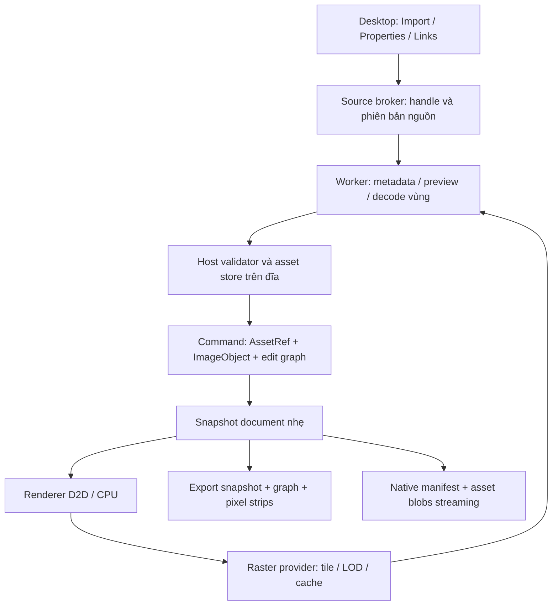

# 02 — Asset, lưu trữ, decode và sửa ảnh

Trạng thái: hợp đồng đích phải được triển khai/kiểm chứng. [Mục lục](../raster-import-large-assets-20261021.md).

## 1. Thành phần và dependency



- `core/document`: AssetId/AssetRevisionId, descriptor nguồn, ImageObject/graph dữ liệu, command và storage schema; giao diện read-only để renderer yêu cầu tile. Không parser, worker process, GPU handle hoặc UI type trong model.
- `modules/raster`: cache/scheduler, tile evaluator, graph algorithms, request planning, interface `IRasterTaskExecutor`. Dependencies giữ `document`, `color`; dùng kiểu geometry thông qua dependency khai báo nếu cần, không kéo `apps/desktop`.
- `modules/interop`: adapter codec và wire serialization; normalize metadata/nguồn. Không thành chủ sở hữu document/Undo. Vendor codecs chỉ được chạy qua worker trong đường sản phẩm.
- `platform/workers`: lifecycle, capability handles, job accounting, codec/effect jobs và host validation. Khi worker chạy evaluator raster, thêm dependency `raster` vào registry/CMake; raster không phụ thuộc ngược workers.
- `core/rendering`: chỉ phụ thuộc interface/model từ core, nhận provider bằng injection; không gọi `modules/raster` trực tiếp, không biết source file path/codec.
- `apps/desktop`: composition root tạo store/provider và adapter executor dùng workers; thêm dependency raster. UI/presenters phát command, không decode.
- Cập nhật registry và `cmake/PikDrawModules.cmake`/CMake target theo DAG thật; code trong core không include modules/apps. Tránh tạo global asset singleton không kiểm soát vòng đời.

## 2. Model authoritative và bản cache

Các tên sau là đề xuất API; agent có thể chỉnh tên phù hợp repository nhưng phải giữ ngữ nghĩa.

```text
RasterAssetId              stable identity, không dùng path làm ID
RasterAssetRevisionId      immutable version token, dùng trước khi có SHA đầy đủ
RasterSourceDescriptor     storage mode, locator/capability, byte_length:u64,
                           format/representation, frame locator, source dimensions,
                           sample layout/depth, DPI/unit, orientation, ICC identity,
                           provenance, integrity state, optional content digest
ImagePlacement             ObjectId, AssetId+Revision, frame, bounds_mm, affine,
                           clip, RasterEditGraph reference; không chứa full pixels
RasterEditGraph            schema, stable node IDs/type IDs/order/parameters/inputs
RasterTileKey              AssetRevision + frame + graph hash + LOD + tile x/y
                           + sample layout + working/output profile/intent/version
```

Tách ba loại:

1. **Nguồn:** bytes encoded bất biến, hoặc linked version đang được pin/được chấp nhận. Tài liệu embedded phải tự chứa bytes khi save hoàn tất.
2. **Dữ liệu sửa authoritative:** graph tham số, masks/paint tile deltas và schema. Paint tile mới là dữ liệu cần lưu, không được coi là cache rồi xóa.
3. **Derived cache:** thumbnails, mips, decoded/evaluated tiles, GPU textures. Xóa sạch chúng vẫn mở lại, sửa và xuất đúng từ 1+2.

`ImageObject::width_px/height_px` hiện có là source dimension trong nghĩa tương thích; không thay thành kích thước preview mà không đổi schema. Kích thước nguồn, frame và output/crop dimension phải có field rõ. Dùng arithmetic kiểm overflow 64 bit cho source offsets, sample counts, pixel rectangles và disk lengths. Per-message buffer vẫn có thể U32 nếu mỗi chunk nhỏ; **không cần tăng mọi trường IPC lên U64**, chỉ thay trường ngữ nghĩa tổng thể đang chặn file lớn.

Placement duplicates dùng chung asset version và decoded caches; graph độc lập mặc định. Sửa một placement không sửa các placement khác trừ lệnh rõ `Edit shared source`. Graph/pixel data immutable/COW; Undo giữ refs phiên bản, không snapshot toàn bitmap.

## 3. Source broker và import sớm

### 3.1 Mở nguồn

- Host mở file người dùng chọn, xác nhận regular file/signature, tạo source capability nonce và identity (file ID/volume, size, version metadata). Worker nhận đúng read-only handle, không tự mở path/URL trong file.
- Bảo đảm một decode job thấy **một version bất biến**: handle không share write/delete trong giai đoạn pin, hoặc managed snapshot immutable. Không chỉ dựa mtime/size; không dùng read-only file mapping để giả rằng file đang bị sửa là immutable.
- Giữ chế độ `SourceSnapshot::Create` hiện có cho đường cần snapshot ngay. Thêm fast-source lease từ handle đã pin để đọc metadata/preview trước khi copy/hash toàn file; release lease đúng lúc, không khóa file nguồn suốt đời tài liệu.
- Host broker có read/seek 64 bit. Custom `IStream` dùng cursor riêng cho từng clone, ReadAt có đồng bộ/overlapped I/O hợp lệ; `DuplicateHandle` không tự tạo file position độc lập. Kiểm seek âm, `offset+length`, EOF và partial reads.
- Buffer copy/hash gợi ý 1–4 MiB, có cancellation/progress. Không `vector(file_size)`, `InitializeFromMemory` hay map toàn file thành resident buffer để vượt quota trên giấy.
- Kiểm chính sách cache I/O của file staging: code hiện dùng `FILE_ATTRIBUTE_TEMPORARY`. Đo OS file-cache/dirty pages riêng với private commit trước khi chọn flags cho blob GiB; không khẳng định mọi RAM hệ thống tăng là leak. Không bật unbuffered I/O tùy tiện nếu chưa xử lý alignment, partial I/O và throughput.

### 3.2 Integrity và hai chế độ

**Linked:** đặt đối tượng từ descriptor + preview đã decode từ handle pin. Không chờ hash toàn nguồn trước first-visible. AssetRevision token hợp lệ trong phiên không phụ thuộc SHA; SHA có thể tính nền. Path tương đối được ưu tiên khi lưu, file identity/fingerprint và optional digest lưu cùng. Khi nguồn thay đổi: trạng thái Modified, giữ phiên bản đã chấp nhận nếu còn cache/source pin; Update tạo version mới bằng command. Không âm thầm biến graph sang một nguồn khác.

**Embedded (mặc định):** cùng fast metadata/preview, source copy+hash tiếp tục nền vào managed store. Chỉ commit placement sau metadata hợp lệ, source capability pin và một preview thật được validator chấp nhận; bytes authoritative tạm thời do lease giữ. State `Staging` phải rõ; người dùng có thể transform/crop trong lúc copy. Đây là một ImageObject hợp lệ có nguồn được giữ, không phải một mảng pixel đang nửa commit.

Save/Save As/Recovery phải chờ hoặc hoàn tất streaming nguồn để tạo checkpoint tự chứa; có progress/cancel. Nếu người dùng hủy Save, bản đã lưu trước đó không bị thay và document vẫn dirty. Không ghi native có “embedded” trỏ vào temp sẽ xóa khi app đóng. Undo import bỏ placement; hủy staging nếu không còn refs từ document/history/save/job, Redo còn source version hoặc làm staging lại từ backing hợp lệ. Khi copy thất bại/disk full: giữ edit/session source khi còn được pin, báo chưa lưu độc lập; không báo Saved.

Hash pending chỉ dùng provisional cache key không chia sẻ theo nội dung. **Chỉ content-dedup/cross-file reuse sau SHA đã hoàn tất trên đúng source version**. Khi đổi sang content digest, chuyển alias atomically, không tạo Undo giả hoặc thay asset pixels. C6/C8 phải bổ sung quy tắc integrity này; không bỏ `VerifySource` rồi coi là tương đương. Với manifest managed đã có digest, worker có thể verify đúng chunks/ranges có hash do host cấp thay vì full scan trước mỗi tile; phải có cơ chế ràng buộc chunk manifest vào toàn blob.

Metadata/preview thành công chưa xác nhận mọi byte codec. Lỗi decode phát hiện muộn phải đánh dấu asset/frame lỗi và chặn output bị thiếu; không tự xóa đối tượng cùng các edit người dùng làm sau import. Trước commit ban đầu, lỗi/hủy không để lại đối tượng; sau commit, thay trạng thái qua luồng có kiểm soát và Undo gốc vẫn dùng được.

## 4. Codec theo định dạng, không một parser chung

Giao diện worker: `Probe(source)`, `DecodePreview(source, frame, target)`, `DecodeRegion(source, frame, source_rect, level, layout)`, `BuildDiskCache(source, ...)`. Từng adapter trả capabilities: random/scanline access, native scale, sample layouts, frame enumeration, scratch estimate và giới hạn format thực tế.

| Adapter đích | Thuật toán và fallback |
| --- | --- |
| JPEG | WIC stream + query `IWICBitmapSourceTransform` để native shrink/ROI khi hỗ trợ; làm spike baseline/progressive/CMYK. Baseline scanline/native DCT shrink trước full-res cache. Khi codec không giữ được memory bound, dùng libjpeg-turbo scanline được pin trong worker |
| Progressive JPEG | Đo coefficient buffers độc lập với output size. Triển khai/qualify disk-backed virtual coefficient arrays hoặc decoder backend có backing store thật; memory option chỉ trả lỗi không phải spill. Nếu cần custom libjpeg memory-manager/backend, pin patch/build/license và test access windows. Không bật claim large-progressive trước gate này |
| PNG | WIC stream dùng cho profile đã đo; đường lớn dùng libpng row/pass reader + disk tile builder. Non-interlaced quét một lần; Adam7 cập nhật tiles theo pass trên đĩa, không giữ canvas full-frame. Không cố đọc ROI trực tiếp từ arbitrary DEFLATE offset |
| TIFF 6.0/BigTIFF | Ưu tiên libtiff với client I/O trên capability, tile/strip API. Nhận signature 42 và 43, LE/BE riêng. Không dùng WIC làm bằng chứng BigTIFF hỗ trợ. Các compression/layout theo ma trận fixture, không gọi reader full-image RGBA |
| BMP | WIC stream hoặc reader theo hàng; top-down/bottom-up được normalize mà không đảo toàn buffer |

Với strip quá lớn, ảnh cực rộng, progressive/interlaced và metadata directory khổng lồ: kiểm cả buffer nội bộ và số lần decode. Dùng disk backing/windowed index khi cần; trả diagnostic codec/variant cụ thể khi chưa có backend hỗ trợ, không gắn lỗi “file quá lớn” chỉ theo byte count. P0 phải giải quyết feasibility của các trường hợp khó trước khi hứa universal support.

Pin dependency phiên bản/hash/license, ABI MinGW/MSVC của toolchain thực tế và codec plugins được nạp. Không tự dùng mọi WIC codec bên thứ ba. Cân nhắc libvips như backend thay thế sau spike có số liệu; nó không tự bảo đảm decoder nội bộ bounded và không phải dependency bắt buộc của plan. Chọn một implementation có bằng chứng, tránh giữ nhiều backend chưa được kiểm.

## 5. Tile store, pyramid, cache và render

- Khởi điểm tile 512×512; cho phép 256 ở chế độ ít RAM. RGBA8 tile 512 là 1 MiB; float RGBA cùng tile là 4 MiB, chưa có halo. Tile edge nhỏ hơn tile chuẩn có valid rect rõ.
- Pyramid factor 2, xây incremental và/lazy, ưu tiên preview/coarse levels rồi vùng nhìn thấy. Không bắt xây mọi mip/toàn ảnh trước first-visible. Pyramid đầy đủ cần thêm dung lượng đĩa; estimate từ sample layout + cache compression, không giả luôn bằng 1/3 dung lượng **encoded nguồn**.
- JPEG/PNG sequential: decode một lượt thành tiled disk cache khi cần full-res; không restart decode từ đầu cho từng viewport tile. Chống nhiều request trùng bằng single-flight. Cache key dựa asset version/graph, không document revision tổng.
- TIFF tiled/overview: đọc đúng tiles cần nếu codec/layout cho phép. IFD/strile index và metadata phân trang, không đọc list hàng triệu entries vào RAM chỉ để mở frame đầu.
- Renderer tính visible ROI và LOD từ transform source→device, chọn tile phủ viewport/crop + filter support. Ưu tiên visible, sau đó lân cận; cancel prefetch khi pan/zoom. Culling tile áp dụng trong object painter order, không làm mất clip/opacity.
- D2D upload tile theo ngân sách, query device maximum bitmap size; texture không được rộng bằng toàn ảnh. GPU cache keyed bằng tile content/profile, device generation; device loss chỉ hủy GPU resources, giữ disk source/edits. Giữ viewport staging/readback hiện tại; đổi swap chain không thuộc điều kiện để làm import này.
- CPU fallback sample cùng tile provider và cùng pixel semantics. Không block UI chờ decode; dùng preview/LOD trước, đánh dấu quality pending. Export không chấp nhận missing tile.
- Tọa độ lớn: tính origin/transform ở double rồi trừ tile/camera origin trước float GPU; sampling/clip/filter edges có overlap/halo và oracle seam. Pixel center/edge conventions phải thống nhất CPU/D2D/export.

## 6. Memory accounting và scheduler

Ngân sách là cache/work budget, **không phải dung lượng file được phép mở**. Công thức cần đạt:

```text
peak tăng thêm ≈ metadata window + compressed I/O buffers
                + active decode/effect scratch + CPU tile cache
                + IPC in-flight buffers + viewport buffers + GPU tile cache
```

Không có thành phần bắt buộc tỷ lệ trực tiếp với tổng source bytes hoặc tổng pixels toàn ảnh. Directory/cache indexes rất lớn cũng phải có paging; những codec bắt buộc row/coefficient storage phải được tính riêng và dùng đĩa khi cần.

Thiết lập ban đầu để đo/tune: CPU derived cache tối đa 256 MiB, GPU image tile cache 256 MiB, một decode job nặng; tối đa 2–4 tile payload in-flight tùy scratch. Các giá trị là default cache có thể hạ, không admission limit theo file. Reservation lấy trước allocation, release theo RAII; cả decoder nội bộ, conversion, halo, IPC và encoder được tính, không chỉ cache cuối.

Đo available commit/physical, app pressure và VRAM. Thiếu budget: evict unpinned LRU → bỏ prefetch/hạ concurrency → hạ LOD/nhỏ tile → spill/pause. Duy trì một đường metadata/preview nhỏ nếu đủ nguồn lực; không bắt có 768 MiB trống mới được chọn file. Job Object cap có thể giữ như containment/admission của **job**, tính theo backend/session + baseline DLL, không hằng 640 MiB cho mọi ảnh. OOM/worker exit phải có retry nhỏ hơn có giới hạn và thông báo giữ document; không retry vô tận hoặc toàn ảnh trên UI.

Ở ngưỡng RAM vật lý 95%, import giữ nguyên job hợp lệ và chờ headroom đủ; chỉ hết allowance cộng dồn 5 phút mới timeout do áp lực RAM. Pressure monitoring không được tắt mù bằng thread-local bypass. Những worker vector dùng chung import waiter 95%/5 phút.

## 7. Sửa ảnh không phá hủy và điểm mở rộng

Graph raster là phần mở rộng C9 có schema riêng; C9 basic authored hiện chỉ Path/Text, không thể gắn Image vào đó chỉ bằng label UI.

- Node: stable instance ID/type ID/schema version/enabled/order/typed params/input refs; DAG không cycle, finite values và bounds propagation. Đổi tham số sửa node hiện có; không nhân node khi reselect.
- Crop lưu ROI trong source basis và quan hệ normalized để xử lý relink. Crop gesture cập nhật source ROI + local bounds trong một command, giữ pixel density của placement theo phép ánh xạ; Undo khôi phục toàn hình, không cắt bytes nguồn. Clip có sẵn giữ độc lập với crop.
- Flip/rotate placement ưu tiên affine hiện có, không rewrite encoded pixels. Chốt thứ tự source EXIF → source-space edits/crop → placement affine → object compositing; không áp EXIF lần hai sau reopen.
- Exposure v1: EV hữu hạn [-10,+10], `rgb_linear_out = rgb_linear_in * 2^EV`, alpha giữ nguyên; nguồn được đưa vào working linear RGB qua color contract. Không clamp HDR trong authoritative intermediate; preview/output clamp/tone mapping theo profile được khai báo. Thay intent/profile làm đổi cache key, không đổi source ICC.
- Source 16-bit không đi qua RGBA8 trước edit/export 16-bit. Preview RGBA8/BGRA8 là conversion có nhãn. CMYK/float/n-channel chỉ bật operation/export sau fixture/ICC oracle đúng; giữ source không đủ để claim giữ mọi channel semantics.
- Point operation không cần halo; blur/sharpen cần halo theo support nguồn, tái dùng C9 semantics đã định nghĩa nơi phù hợp. Histogram/global adjustment là streaming reduction pass; không tải cả ảnh. Preview có thể provisional, final graph parameters chỉ commit sau kết quả hợp lệ.
- Mask/brush tương lai lưu sparse COW tile deltas có version và source coordinate basis. Plug-in/AI nhận tile/ROI capabilities, output validated new node/version; không sửa source file tại chỗ. Global algorithms phải khai báo pass/scratch/spill strategy trước khi được đăng ký.
- Relink giữ bounds mm, placement ID, graph và thứ tự. Mặc định crop theo normalized ROI; mask/pixel edit phụ thuộc kích thước nguồn phải kiểm compatible và cho lựa chọn rõ nếu cần reproject. Không tự bỏ crop/mask/effect để thay ảnh.

## 8. IPC và tính đúng của kết quả async

Đề xuất feature negotiated `raster-tiled-assets-v1` với record/job types: SourceMetadata, FramePage, Preview/TileRequest, TileDescriptor/TileChunk, CacheBuildProgress, Cancel, Release. Tên và bit feature được chốt sau kiểm ID trống, không tái dùng record ID CDR đang có.

`V2ImportBegin.source_bytes` hiện đã U64. Giữ giới hạn kích thước mỗi message; thêm U64 cho tổng offset/length trong blob/tile store cần thiết. Không dùng `ImportRasterImageChunkRecord.total_bytes/byte_offset` U32 như một frame toàn ảnh mới. Large blobs đi qua broker-authorized file handle hoặc bounded chunk window + ack/backpressure; không gom response vector sau khi đã chia wire chunks.

Validator kiểm nonce/source version, frame/ROI/LOD, dimensions/sample layout, stride, checked lengths/offsets, format/profile IDs, checksum, completion và giới hạn work được cấp. Không tin worker trả đường dẫn cache, source hash hoặc descriptor rồi cấp quyền mở tùy ý. Thêm canary filesystem/network/child-handle regression nếu grant cache capabilities thay đổi.

Document mutation: base revision/epoch/job generation phải hợp lệ theo writer hiện tại. Cache completion không phải document edit; có thể reuse qua một transform edit nếu source version/graph không đổi, nhưng chỉ present khi object hiện tại còn trỏ đúng key và viewport request generation còn hợp lệ. Close/relink/graph edit hủy adoption kết quả cũ; không để một revision check quá thô làm mọi pan/transform mất cache và decode lại.

## 9. Native storage, save và recovery >4 GiB

- Tạo version container mới **lấy version còn trống lúc triển khai** (audit hiện v18), có header/index lengths/offsets U64, chunk checksums và source digest. Không sửa nghĩa U32 header v18 tại chỗ, không giả v19 luôn còn trống.
- Manifest lưu descriptor/graph/placement nhỏ; asset blobs stream từ disk vào container một lần theo content identity. Readers mở manifest/index trước, đọc blob ranges khi cần. Không `serialize()->vector` hoặc đọc toàn native vào vector cho container mới.
- Embedded save tự chứa nguyên bytes và graph/authoritative deltas; cache optional, có thể bỏ. Linked save chỉ giữ locator/version/metadata + preview optional; `Package` copy assets theo stream và viết locator tương đối, không tự đổi Linked thành Embedded nếu không được chọn.
- Snapshot save R pin toàn bộ asset revisions được dùng; writer tiếp tục R+1. Atomic save temp→flush→replace; chỉ mark saved R nếu R vẫn phù hợp với policy hiện có, không xóa dirty R+1. Disk-full/cancel/crash không phá file trước đó.
- Legacy reader tiếp tục các version đã hỗ trợ; thêm streaming legacy migration cho asset lớn để tránh đọc toàn native rồi mới đổi model. Preserve geometry/units/paint/profile IDs/path specs v18. Source/pixels legacy được đưa vào disk store, không chỉ lấy preview và bỏ bytes nguồn. Old reader phải reject version mới rõ; không hứa downgrade không mất dữ liệu.
- GC theo reachability: open docs, Undo/Redo, in-flight requests, save snapshots và recovery manifests. Chỉ cache derived được evict; source/graph/deltas còn được tham chiếu không bị dọn. Recovery dùng managed blobs durable, không chỉ giữ temp path/handle sống ở process trước.
- Export pin cùng snapshot/asset graph. Encoder kéo strips/tiles ở output resolution và profile, streaming ra file tạm rồi atomic replace. Đường JPEG có loss/size limits thực theo format; BigTIFF/TIFF output chọn đúng container. Lỗi format cụ thể không biến thành trần import. Các writer mới chỉ vào capability khi gate hoàn tất.
